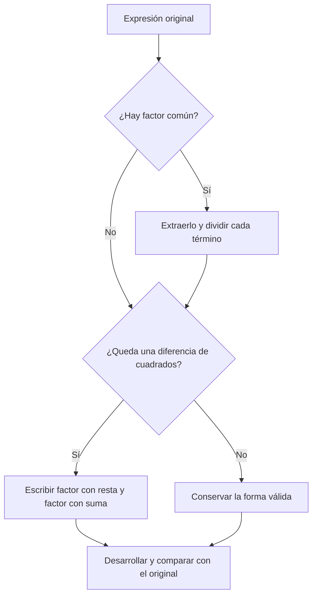
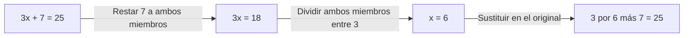
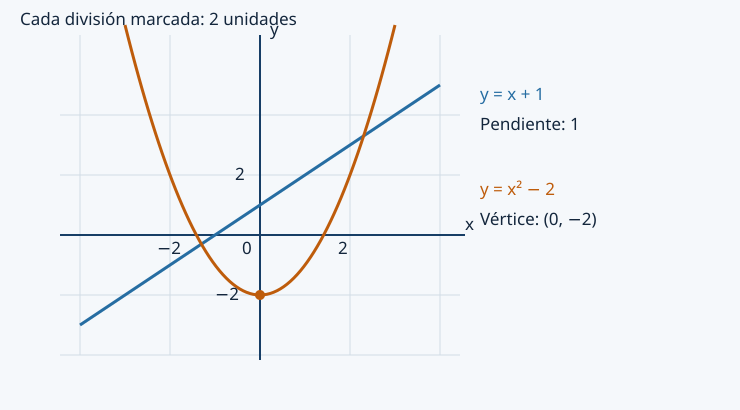
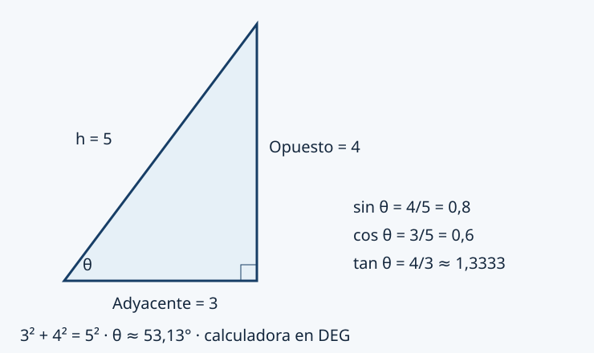

# MIPD-001 — Matemáticas para ingeniería industrial y diseño de producto

## Guía de estudio

Este curso está dirigido a una persona adulta con formación técnica que retoma matemáticas después de más de diez años y se prepara para ingeniería industrial y diseño de producto. Los ejemplos se sitúan en talleres, producción, medidas, materiales, presupuestos y empaques. Son situaciones didácticas con datos definidos, no especificaciones para fabricar productos reales.

**Duración:** 22 semanas, 154 bloques diarios y 3.920 minutos (65 horas y 20 minutos). El tiempo incluye explicación, práctica, diagnóstico, comprobaciones, evaluación y corrección. El curso nivela fundamentos; su terminación no acredita dominio de todas las matemáticas de bachillerato ni sustituye las asignaturas universitarias. No se ha recibido el programa de primer semestre de una universidad concreta.

**Modalidad de diseño:** autoestudio con posibilidad de revisión semanal. Esta es una suposición de trabajo porque aún no se indicó si habrá profesor. Las soluciones comentadas permiten estudiar de manera autónoma; si hay acompañamiento, la conversación de devolución se hace dentro del tiempo de corrección. Una conversación adicional de 10–15 minutos como la sugerida en el Excel sería tiempo extra opcional y no forma parte de las 65 horas y 20 minutos.

### Cómo elegir una ruta

- **Básica, recomendada para el perfil descrito:** trabaja el ejemplo resuelto, completa el ejercicio con ayuda y resuelve la práctica esencial. Vuelve a los preconceptos si un paso no tiene sentido.
- **Intermedia:** intenta primero el ejercicio esencial sin leer su solución. Si lo resuelves y explicas, utiliza la parte de lectura del bloque para la aplicación a producción o diseño.
- **Avanzada:** sustituye ejercicios rutinarios ya dominados por el desafío de análisis o aplicación del mismo subtema. No agrega minutos ni adelanta temas que dependen de bases todavía débiles. En este curso, avanzada significa mayor autonomía dentro de la nivelación, no formación matemática de especialización.

Las tres rutas comparten el calendario y el presupuesto; cambian la ayuda y los ejercicios elegidos. No hay obligación de completar todos los ejercicios de todas las rutas. Un cambio de ruta se decide con evidencia del trabajo, no por los años transcurridos desde el colegio.

### Organización de los bloques

Cada semana tiene tres subtemas, distribuidos en seis días, y una evaluación el séptimo día. Los archivos de preconceptos y comprobación son parte de esos bloques, no clases adicionales. Consulta el cronograma para la actividad concreta de cada día.

| Minutos del bloque | Recordar sin mirar | Explicación y ejemplo | Práctica | Comprobación y corrección |
|---:|---:|---:|---:|---:|
| 15 | 2 | 4 | 7 | 2 |
| 20 | 3 | 5 | 9 | 3 |
| 25 | 3 | 6 | 12 | 4 |
| 30 | 4 | 7 | 14 | 5 |
| 35 | 4 | 8 | 17 | 6 |
| 40 | 5 | 9 | 20 | 6 |

En los dos primeros días el diagnóstico ocupa diez minutos de cada bloque y reemplaza parte de la explicación y práctica habitual. El bloque semanal de evaluación usa aproximadamente dos tercios para responder y un tercio para corregir. Los proyectos y repasos se realizan en los bloques asignados. Los tiempos son presupuestos de diseño y requieren ajuste después de observar las primeras semanas; no se ha realizado todavía un pilotaje con la estudiante.

### Qué hacer durante una clase

1. Anota la fecha, el subtema y el tiempo disponible. Resuelve el recuerdo inicial sin apuntes.
2. Lee el objetivo y los preconceptos. Estudia el ejemplo indicando qué operación se hace y por qué.
3. Resuelve en papel la práctica correspondiente a tu ruta. Escribe unidades y comprueba el orden de magnitud.
4. Responde la comprobación sin copiar el ejemplo. Abre el solucionario después de responder.
5. Registra un error concreto y la corrección. Al terminar el bloque, detente y conserva lo pendiente para sustituir práctica posterior.

Para repasar, recupera un ejercicio antiguo al día siguiente, la semana siguiente y en el repaso de bloque. Estas recuperaciones reemplazan ejercicios del bloque corriente; no suman tarea obligatoria. Usa calculadora después de plantear la operación, excepto cuando la actividad indique cálculo manual. En trigonometría comprueba el modo DEG; los ángulos de las primeras actividades se expresan en grados.

### Evaluación y avance

La evaluación semanal separa cuatro aspectos: interpretación, procedimiento, cálculo y significado de la respuesta. Conserva el intento inicial. El resultado corregido sirve para aprender, pero no reemplaza el registro del primer intento.

Como regla inicial del curso, avanza si obtienes al menos 80 % del puntaje y resuelves las habilidades prerrequisito sin ayuda sustancial. Si falta una habilidad, sustituye parte de la práctica siguiente por el refuerzo indicado y vuelve a comprobarla con otro ejercicio. El umbral es una decisión pedagógica de este diseño, no una norma universitaria.

Si el refuerzo no cabe, usa primero las semanas 18, 19 y la ruta alternativa de 20 y 21. Si las dificultades siguen, amplía la duración y registra esa decisión; el calendario de 22 semanas no garantiza el dominio a una fecha fija. Los contenidos opcionales de límites y derivadas se trabajan cuando álgebra, funciones y pendientes estén consolidados.

### Días de fatiga

El Excel permite una sesión mínima para sostener el hábito. En esta ruta de matemáticas, una sesión abreviada puede consistir en recuperar un procedimiento y resolver un ejercicio. Registra los minutos realmente realizados y el contenido pendiente. Cuenta como continuidad del hábito, pero no demuestra que se completó la clase ni mantiene automáticamente el total de horas. Evita duplicar la carga al día siguiente; reubica el refuerzo dentro de la ruta o extiende el calendario si hace falta.

### Material necesario

Cuaderno, lápiz, regla, calculadora básica o científica y navegador para las simulaciones locales. No necesitas programar. En cada simulación, predice primero el resultado, cambia un parámetro y escribe qué se mantuvo y qué cambió. Los enlaces HTML se abren desde la carpeta del curso; el PDF contiene la explicación y las imágenes estáticas, mientras que la interacción requiere el navegador.

### Registro de progreso

Usa una fila por día en el siguiente formato: fecha; semana/subtema; minutos previstos; minutos realizados; ejercicio resuelto sin ayuda; error detectado; corrección; próximo refuerzo. Cada domingo revisa el aprendizaje y la carga por separado. Más tiempo de estudio no implica necesariamente más dominio.

## Módulo 0: diagnóstico integrado

> **Fuente interna:** diagnóstico añadido por diseño; tiempo integrado en RUTA_ING_realista.xlsx, Plan progresivo!I2:I3 y Progresión!E2. Las preguntas no están localizadas explícitamente en el Excel.

**Objetivo:** identificar el punto de partida con cuatro tareas cortas y registrar el tipo de ayuda necesario. Es un sondeo de operaciones y lectura matemática; no constituye un diagnóstico exhaustivo de todos los temas de bachillerato.

**Tiempo:** 20 minutos incluidos en la semana 1, diez minutos el día 1 y diez el día 2. En cada bloque, usa seis minutos para responder y cuatro para corregir; los cinco minutos restantes del día se destinan a equivalencias de fracciones. No añadas estas actividades antes del calendario.

Trabaja en papel sin consultar soluciones. Si un procedimiento no aparece, anota hasta dónde llegaste. Indica si respondiste sin ayuda, con una pista o mirando un ejemplo. No hay nota de aprobación ni penalización por no recordar.

### Día 1: operaciones y signos

**D1.** Una cuenta de material registra un saldo de −3 unidades y luego una entrada de 8. ¿Cuál es el saldo final? Escribe la operación y explica el signo.

**D2.** Calcula 2 + 3 × 4. Una persona obtuvo 20. Explica qué orden de operaciones pudo haber usado y cuál es el correcto.

### Día 2: fracciones y lectura de una tabla

**D3.** Para una pieza se cortan 1/2 m y después 1/4 m de cinta. ¿Cuánto se cortó en total? Dibuja la cantidad o escribe fracciones equivalentes para explicar el resultado.

**D4.** Un taller registra esta relación entre piezas y costo de material:

| Piezas | Costo en pesos |
|---:|---:|
| 1 | 3.000 |
| 2 | 6.000 |
| 3 | 9.000 |

Si la relación se mantiene, ¿cuánto cuestan cuatro piezas? Explica el patrón y su unidad.

### Cómo usar el resultado

Registra para cada tarea: procedimiento, resultado, explicación y ayuda. Si D1 o D2 muestran dificultades, sustituye parte de la práctica de semana 1 por suma de enteros y orden de operaciones. Si D3 falla, comienza con el dibujo y la equivalencia antes de sumar. Si D4 falla, lee encabezados, unidades y cambios entre filas antes de calcular.

Las tareas no permiten determinar aún dominio de ecuaciones, geometría o funciones. Las comprobaciones de las semanas correspondientes ampliarán el diagnóstico. Una respuesta acertada con ayuda orienta el refuerzo, pero no demuestra autonomía.

Fuente de calendario y tiempo: material/RUTA_ING_realista.xlsx, Plan progresivo!I2:I3 y Progresión!E2. El diagnóstico es una incorporación didáctica al temario, no una prueba contenida en el Excel.

## Soluciones del diagnóstico

Abre esta sección después de responder cada bloque. La corrección forma parte de los diez minutos asignados al diagnóstico ese día.

### D1: saldo con signo

−3 + 8 = 5 unidades. Tres de las ocho unidades compensan el saldo negativo; quedan cinco positivas. Si escribiste −11, revisa la representación en una recta: empezar en −3 y avanzar ocho posiciones termina en 5. Un signo negativo no se conserva automáticamente después de sumar.

### D2: orden de operaciones

Primero 3 × 4 = 12 y después 2 + 12 = 14. El resultado 20 corresponde a operar de izquierda a derecha como si hubiera paréntesis: (2 + 3) × 4. Los paréntesis no estaban en la expresión original. Multiplicación y división preceden a suma y resta; operaciones del mismo nivel se realizan de izquierda a derecha.

### D3: suma de medidas

1/2 = 2/4. Por tanto 1/2 + 1/4 = 2/4 + 1/4 = 3/4 m. Ambas fracciones describen partes de un metro. El denominador se mantiene porque la unidad de conteo es un cuarto. Sumar numeradores y denominadores para obtener 2/6 no representa la longitud total.

### D4: patrón de costo

Cada pieza añade 3.000 pesos. Cuatro piezas cuestan 4 × 3.000 = 12.000 pesos, bajo la condición explícita de que la relación se mantiene. La unidad de la tasa es pesos por pieza. La tabla no prueba por sí sola que todos los lotes de un taller real mantengan ese costo.

### Decisión de ruta

Usa la ruta básica si alguna tarea exige un ejemplo completo. Si todas se resuelven y explican sin ayuda, prueba la ruta intermedia en la primera semana, conservando las comprobaciones. Elige desafíos avanzados únicamente después de resolver la práctica esencial. El resultado de cuatro tareas no autoriza saltar automáticamente álgebra o geometría.

## Glosario de nivelación

Este glosario es material de consulta dentro de los bloques de recuperación. Lee la entrada que necesites; no agrega una sesión previa obligatoria. Las prioridades indican dependencia pedagógica en este curso, no una puntuación de la persona.

| Concepto | Definición y ejemplo | Por qué se necesita | Prioridad |
|---|---|---|---:|
| Unidad | Referencia de una medida: metro, segundo, peso. 2 m no es lo mismo que 2 cm. | Interpretar medidas y conversiones | 10 |
| Entero con signo | Número para cantidad o posición respecto de un origen: −3, 0, 5. | Operar diferencias y coordenadas | 10 |
| Orden de operaciones | Paréntesis, potencias/raíces, multiplicación/división, suma/resta; mismo nivel de izquierda a derecha. | Leer expresiones sin cambiar su significado | 10 |
| Fracción | a/b representa a partes de tamaño 1/b, con b distinto de 0. | Medidas parciales y proporciones | 10 |
| Equivalencia | Dos expresiones con igual valor: 1/2 = 2/4. | Sumar fracciones y transformar ecuaciones | 10 |
| Razón | Cociente de dos cantidades: 6 piezas/2 horas = 3 piezas/hora. | Proporciones, pendientes y trigonometría | 9 |
| Variable | Símbolo que representa una cantidad: n, número de piezas. | Expresar modelos y resolver problemas | 9 |
| Igualdad | Relación entre expresiones con igual valor. En 2x=8, x=4. | Comprobar y despejar ecuaciones | 10 |
| Área y volumen | Área mide superficie en unidades cuadradas; volumen, espacio en unidades cúbicas. | Estimar material y capacidad de empaques | 9 |
| Función | Regla que asigna una salida a cada entrada de su dominio. C(n)=5n. | Relacionar fórmulas, tablas y gráficas | 9 |

La secuencia de dependencia es: números y unidades → operaciones y equivalencias → proporciones y variables → ecuaciones → funciones y geometría analítica. La trigonometría utiliza además triángulos rectángulos y Pitágoras.

Ejemplo de conexión: medir 3/4 m de cinta exige identificar la unidad metro, comprender la fracción y representar tres cuartos. Calcular el costo de cinco piezas exige identificar n=5, sustituirlo en una regla y expresar el resultado en pesos. Esta progresión se retoma en las clases, con ayuda que disminuye gradualmente.

## Semana 1: Fracciones: suma y resta

**Presupuesto semanal:** 105 minutos; siete bloques de 15 minutos, evaluación y corrección incluidas.

**Fuente del tema y tiempo:** material/RUTA_ING_realista.xlsx, Plan progresivo!D2:D8, I2:I8; Progresión!E2. El desarrollo matemático y las aplicaciones son elaboración didáctica; véase Referencias.

### Subtema 1.1.1: Equivalencias, simplificación y diagnóstico

#### Preconceptos 1.1.1

Lectura de apoyo dentro de la preparación de la microclase; no es otra sesión. Recupera estos conceptos en el orden indicado antes de equivalencias, simplificación y diagnóstico.

#### 1. Unidad

Cantidad completa de referencia; una fracción depende de esa unidad. Importancia: 10/10. Esta base permite comprobar el procedimiento sin depender de memorizar una regla aislada.

**Pregunta:** ¿Una mitad de 2 m mide igual que una mitad de 1 m?

**Respuesta:** No: miden 1 m y 0,5 m.

#### 2. Divisor

Entero que divide a otro sin dejar resto; permite simplificar. Importancia: 10/10. Esta base permite comprobar el procedimiento sin depender de memorizar una regla aislada.

**Pregunta:** ¿3 divide a 12?

**Respuesta:** Sí,12÷3=4.

#### 3. Partes iguales

Porciones del mismo tamaño dentro de la unidad; hacen comparable el conteo. Importancia: 9/10. Esta base permite comprobar el procedimiento sin depender de memorizar una regla aislada.

**Pregunta:** ¿Dos trozos desiguales forman automáticamente medios?

**Respuesta:** No; una mitad exige dos partes iguales.

#### Puente al ejemplo

Simplifiquemos 12/18. Si una pregunta previa cuesta, usa su respuesta como pista y vuelve al ejemplo del subtema. El objetivo es reparar esa base mientras resuelves; no añadir tareas al calendario.

#### 1.1.1: Equivalencias, simplificación y diagnóstico

> **Fuente interna:** RUTA_ING_realista.xlsx, Plan progresivo!D2:D8 y Progresión!E2, para tema y tiempo. El desarrollo matemático no está localizado explícitamente en el Excel: es elaboración didáctica respaldada en [Referencias](REFERENCIAS.md).

Tiempo: 30 min en días 1 y 2;20 min pertenecen al diagnóstico transversal y 10 min a fracciones. Ruta básica predeterminada.

#### Comprensión intuitiva

Una fracción permite indicar parte de una unidad: 3/4 de una lámina significa tres de cuatro partes iguales. El dibujo solo sirve si las partes tienen el mismo tamaño. Si subdividimos cada cuarto en dos partes, aparecen ocho partes y quedan ocupadas seis: 3/4 y 6/8 representan exactamente la misma cantidad. Cambia la manera de contar, pero no cambia el material disponible.

#### Regla y significado

En a/b, a es el numerador y cuenta partes; b es el denominador y describe en cuántas partes iguales se dividió la unidad. b no puede ser cero. Multiplicar numerador y denominador por un mismo número distinto de cero conserva el valor. Simplificar es dividir ambos por un factor común hasta que no compartan otro divisor entero mayor que uno.

#### Ejemplo resuelto paso a paso

Simplifiquemos 12/18.
1. Buscamos un divisor común: 6 divide a 12 y a 18.
2. Dividimos arriba y abajo: (12÷6)/(18÷6)=2/3.
3. Comprobamos multiplicando ambos términos por 6: 2/3=12/18.
4. Interpretamos: doce de dieciocho partes ocupan dos tercios de la misma unidad.
No se necesita dibujar dieciocho partes: reconocer equivalencia reduce el cálculo.

#### Error que conviene detectar

Cambiar solo el numerador altera la cantidad: 12/18 no es 2/18. Se divide arriba y abajo por el mismo número. Tampoco se comparan porciones de unidades de distinto tamaño sin aclararlo.

#### Microclases y práctica

Día 1:10 min de diagnóstico transversal y 5 min para leer la intuición y reconocer equivalencias. Día 2:10 min de diagnóstico transversal y 5 min para simplificar el ejemplo, resolver el ejercicio guiado y responder la comprobación. El resto del banco es alternativa; no se hace todo en estos 10 minutos.

La ruta básica utiliza la pista del ejercicio 1. La intermedia resuelve el 2 sin consultar y comprueba el procedimiento. La avanzada sustituye el 2 por el 3 y justifica la decisión; no acumula ejercicios. El banco y sus soluciones están en [ejercicios](modulos/modulo_1/tema_1.1_subtema_1.1.1_ejercicios.md). La [comprobación](modulos/modulo_1/tema_1.1_subtema_1.1.1_evaluacion.md) se realiza al final del segundo día.

#### Verificación visual

Consulta el [modelo de fracciones](media/fracciones.svg) o la [simulación](simulaciones/fracciones.html) durante el bloque de práctica. Predice antes: ¿3/4 y 6/8 ocupan lo mismo? Luego representa ambas; deben coincidir. Explica qué cambia al subdividir. Esta actividad sustituye el ejercicio guiado cuando se utiliza; no añade tiempo.

#### Cierre activo

Pregunta sin apuntes: ¿Es 4/6 equivalente a 2/3? Explica con una operación. Conserva una línea con el resultado y otra con la razón del paso clave; después contrasta con la solución de la comprobación.

Fuente del temario y tiempo: RUTA_ING_realista.xlsx, Plan progresivo!D2:D8; Progresión!E2. El Excel fija secuencia y carga, no demuestra las reglas matemáticas. Desarrollo didáctico original; [referencias](REFERENCIAS.md).

#### Ejercicios 1.1.1: Equivalencias, simplificación y diagnóstico

Banco para elegir dentro del bloque de práctica de las microclases. Ejercicio 1 guiado el primer día; ejercicio 2 independiente el segundo. Ejercicio 3 avanzado sustituye el 2. En 1.1.1 solo 10 min quedan para fracciones: hacer 1 y comprobación;2/3 son alternativas si el diagnóstico demuestra dominio. Trabaja con cuaderno; consulta las soluciones después de intentar.

#### Ejercicio 1: guiado

Escribe 2/3 con denominador 12. Pista: 3×4=12.

#### Ejercicio 2: independiente

Simplifica 15/20 sin calculadora.

#### Ejercicio 3: aplicación avanzada

Una plantilla A usa 6/8 de lámina y B usa 9/12. ¿Consumen igual material si las láminas son iguales?

#### Soluciones

#### Solución 1

Multiplica ambos términos por 4: 2/3=8/12. La subdivisión cambia el número de partes, no el valor.

#### Solución 2

El factor común es 5: 15/20=3/4. Como 3 y 4 no comparten divisor mayor que 1, ya está simplificada.

#### Solución 3

A:6/8=3/4; B:9/12=3/4. Sí consumen lo mismo. La igualdad de unidades es necesaria para comparar.

#### Cómo revisar

Se logra el ejercicio si el procedimiento respeta la regla del subtema y la respuesta coincide o es una expresión equivalente. Si tu resultado difiere, revisa este error específico: Cambiar solo el numerador altera la cantidad: 12/18 no es 2/18. Se divide arriba y abajo por el mismo número. Tampoco se comparan porciones de unidades de distinto tamaño sin aclararlo. Rehaz el ejercicio 1 en el siguiente bloque de práctica sustituyendo el desafío; no prolongues la sesión.

#### Comprobación 1.1.1

Realizar dentro de los últimos 2 minutos del segundo día; incluye corrección. No consultar apuntes antes de responder.

#### Pregunta

¿Es 4/6 equivalente a 2/3? Explica con una operación.

#### Solución y criterio

Sí: dividir numerador y denominador de 4/6 por 2 da 2/3.

2 puntos:1 por resultado correcto y 1 por explicación del paso clave. Si falla el resultado pero la idea es correcta, ubica el error aritmético antes de repetir. Si falla la idea, recupera la sección Regla y significado y repite el ejercicio guiado en el siguiente bloque, en lugar de una aplicación nueva.

#### Refuerzo concreto

Cambiar solo el numerador altera la cantidad: 12/18 no es 2/18. Se divide arriba y abajo por el mismo número. Tampoco se comparan porciones de unidades de distinto tamaño sin aclararlo. Reproduce la comprobación con el dibujo o la operación descrita en su respuesta. La revisión sustituye práctica y no suma tiempo.

### Subtema 1.1.2: Suma y resta con denominador común

#### Preconceptos 1.1.2

Lectura de apoyo dentro de la preparación de la microclase; no es otra sesión. Recupera estos conceptos en el orden indicado antes de suma y resta con denominador común.

#### 1. Unidad

Cantidad completa de referencia; una fracción depende de esa unidad. Importancia: 10/10. Esta base permite comprobar el procedimiento sin depender de memorizar una regla aislada.

**Pregunta:** ¿Una mitad de 2 m mide igual que una mitad de 1 m?

**Respuesta:** No: miden 1 m y 0,5 m.

#### 2. Divisor

Entero que divide a otro sin dejar resto; permite simplificar. Importancia: 10/10. Esta base permite comprobar el procedimiento sin depender de memorizar una regla aislada.

**Pregunta:** ¿3 divide a 12?

**Respuesta:** Sí,12÷3=4.

#### 3. Partes iguales

Porciones del mismo tamaño dentro de la unidad; hacen comparable el conteo. Importancia: 9/10. Esta base permite comprobar el procedimiento sin depender de memorizar una regla aislada.

**Pregunta:** ¿Dos trozos desiguales forman automáticamente medios?

**Respuesta:** No; una mitad exige dos partes iguales.

#### Puente al ejemplo

Una tira requiere 3/8 m para una pieza y 2/8 m para otra. Si una pregunta previa cuesta, usa su respuesta como pista y vuelve al ejemplo del subtema. El objetivo es reparar esa base mientras resuelves; no añadir tareas al calendario.

#### 1.1.2: Suma y resta con denominador común

> **Fuente interna:** RUTA_ING_realista.xlsx, Plan progresivo!D2:D8 y Progresión!E2, para tema y tiempo. El desarrollo matemático no está localizado explícitamente en el Excel: es elaboración didáctica respaldada en [Referencias](REFERENCIAS.md).

Tiempo: 30 min en días 3 y 4. Ruta básica predeterminada.

#### Comprensión intuitiva

Sumar fracciones con el mismo denominador se parece a reunir piezas de una misma medida. Tres octavos y dos octavos son cinco octavos, del mismo modo que tres centímetros y dos centímetros son cinco centímetros. Al restar quitamos piezas de ese mismo tamaño. El denominador nombra la medida de cada pieza: no necesita cambiar al contar más o menos piezas.

#### Regla y significado

Para b distinto de cero: a/b+c/b=(a+c)/b y a/b−c/b=(a−c)/b. Primero se operan los numeradores, después se simplifica. Una fracción puede ser mayor que uno: 9/8 indica una unidad completa y otro octavo. Las cantidades negativas indican un déficit o una diferencia orientada; el signo pertenece al valor completo de la fracción.

#### Ejemplo resuelto paso a paso

Una tira requiere 3/8 m para una pieza y 2/8 m para otra.
1. Ambas medidas están en octavos de metro: son compatibles.
2. Sumamos numeradores: (3+2)/8=5/8 m.
3. De una tira de 7/8 m restamos lo usado: 7/8−5/8=(7−5)/8=2/8 m.
4. Simplificamos: 2/8=1/4 m.
5. Verificamos: 5/8+1/4=5/8+2/8=7/8 m.

#### Error que conviene detectar

3/8+2/8 no es 5/16: doblar el denominador cambia el tamaño de la parte. Otro error consiste en restar sin atender al orden: 2/7−5/7=−3/7, no 3/7.

#### Microclases y práctica

Día 3: 3 min para intuición y regla; 7 min para reproducir el ejemplo y realizar el ejercicio guiado; 5 min para explicar por qué cada paso conserva el significado y corregir. Día 4: 3 min para recuperar la regla sin mirar; 7 min para el ejercicio independiente, o la aplicación avanzada en su lugar; 5 min para comprobación y corrección. Total diario: 15 min, con lectura, soluciones y evaluación incluidas.

La ruta básica utiliza la pista del ejercicio 1. La intermedia resuelve el 2 sin consultar y comprueba el procedimiento. La avanzada sustituye el 2 por el 3 y justifica la decisión; no acumula ejercicios. El banco y sus soluciones están en [ejercicios](modulos/modulo_1/tema_1.1_subtema_1.1.2_ejercicios.md). La [comprobación](modulos/modulo_1/tema_1.1_subtema_1.1.2_evaluacion.md) se realiza al final del segundo día.

#### Verificación visual

Consulta el [modelo de fracciones](media/fracciones.svg) o la [simulación](simulaciones/fracciones.html) durante el bloque de práctica. Predice antes: ¿3/4 y 6/8 ocupan lo mismo? Luego representa ambas; deben coincidir. Explica qué cambia al subdividir. Esta actividad sustituye el ejercicio guiado cuando se utiliza; no añade tiempo.

#### Cierre activo

Pregunta sin apuntes: Corrige: 2/5+1/5=3/10. Conserva una línea con el resultado y otra con la razón del paso clave; después contrasta con la solución de la comprobación.

Fuente del temario y tiempo: RUTA_ING_realista.xlsx, Plan progresivo!D2:D8; Progresión!E2. El Excel fija secuencia y carga, no demuestra las reglas matemáticas. Desarrollo didáctico original; [referencias](REFERENCIAS.md).

#### Ejercicios 1.1.2: Suma y resta con denominador común

Banco para elegir dentro del bloque de práctica de las microclases. Ejercicio 1 guiado el primer día; ejercicio 2 independiente el segundo. Ejercicio 3 avanzado sustituye el 2.  Trabaja con cuaderno; consulta las soluciones después de intentar.

#### Ejercicio 1: guiado

Calcula 4/9+2/9. Pista: conserva novenos.

#### Ejercicio 2: independiente

Calcula 3/10−7/10.

#### Ejercicio 3: aplicación avanzada

Una barra de 11/12 m se corta en dos tramos de 3/12 m y 5/12 m. ¿Qué longitud queda?

#### Soluciones

#### Solución 1

(4+2)/9=6/9=2/3. El resultado simplificado representa los mismos seis novenos.

#### Solución 2

(3−7)/10=−4/10=−2/5. El minuendo es menor y la diferencia es negativa.

#### Solución 3

11/12−3/12−5/12=3/12=1/4 m. Comprobación:3/12+5/12+3/12=11/12.

#### Cómo revisar

Se logra el ejercicio si el procedimiento respeta la regla del subtema y la respuesta coincide o es una expresión equivalente. Si tu resultado difiere, revisa este error específico: 3/8+2/8 no es 5/16: doblar el denominador cambia el tamaño de la parte. Otro error consiste en restar sin atender al orden: 2/7−5/7=−3/7, no 3/7. Rehaz el ejercicio 1 en el siguiente bloque de práctica sustituyendo el desafío; no prolongues la sesión.

#### Comprobación 1.1.2

Realizar dentro de los últimos 5 minutos del segundo día; incluye corrección. No consultar apuntes antes de responder.

#### Pregunta

Corrige: 2/5+1/5=3/10.

#### Solución y criterio

La unidad de cada parte es un quinto: se suman numeradores y se conserva 5. El resultado es 3/5.

2 puntos:1 por resultado correcto y 1 por explicación del paso clave. Si falla el resultado pero la idea es correcta, ubica el error aritmético antes de repetir. Si falla la idea, recupera la sección Regla y significado y repite el ejercicio guiado en el siguiente bloque, en lugar de una aplicación nueva.

#### Refuerzo concreto

3/8+2/8 no es 5/16: doblar el denominador cambia el tamaño de la parte. Otro error consiste en restar sin atender al orden: 2/7−5/7=−3/7, no 3/7. Reproduce la comprobación con el dibujo o la operación descrita en su respuesta. La revisión sustituye práctica y no suma tiempo.

### Subtema 1.1.3: Denominadores distintos y medidas fraccionarias

#### Preconceptos 1.1.3

Lectura de apoyo dentro de la preparación de la microclase; no es otra sesión. Recupera estos conceptos en el orden indicado antes de denominadores distintos y medidas fraccionarias.

#### 1. Unidad

Cantidad completa de referencia; una fracción depende de esa unidad. Importancia: 10/10. Esta base permite comprobar el procedimiento sin depender de memorizar una regla aislada.

**Pregunta:** ¿Una mitad de 2 m mide igual que una mitad de 1 m?

**Respuesta:** No: miden 1 m y 0,5 m.

#### 2. Divisor

Entero que divide a otro sin dejar resto; permite simplificar. Importancia: 10/10. Esta base permite comprobar el procedimiento sin depender de memorizar una regla aislada.

**Pregunta:** ¿3 divide a 12?

**Respuesta:** Sí,12÷3=4.

#### 3. Partes iguales

Porciones del mismo tamaño dentro de la unidad; hacen comparable el conteo. Importancia: 9/10. Esta base permite comprobar el procedimiento sin depender de memorizar una regla aislada.

**Pregunta:** ¿Dos trozos desiguales forman automáticamente medios?

**Respuesta:** No; una mitad exige dos partes iguales.

#### Puente al ejemplo

Calculemos 3/4−1/6 m. Si una pregunta previa cuesta, usa su respuesta como pista y vuelve al ejemplo del subtema. El objetivo es reparar esa base mientras resuelves; no añadir tareas al calendario.

#### 1.1.3: Denominadores distintos y medidas fraccionarias

> **Fuente interna:** RUTA_ING_realista.xlsx, Plan progresivo!D2:D8 y Progresión!E2, para tema y tiempo. El desarrollo matemático no está localizado explícitamente en el Excel: es elaboración didáctica respaldada en [Referencias](REFERENCIAS.md).

Tiempo: 30 min en días 5 y 6. Ruta básica predeterminada.

#### Comprensión intuitiva

Un cuarto y un sexto son partes de diferente tamaño. No podemos contarlas como si fueran la misma pieza. Se subdivide la unidad hasta conseguir una medida común: cada cuarto contiene tres doceavos y cada sexto contiene dos doceavos. Así podemos reunir o quitar partes iguales sin perder la cantidad original. Esta traducción es útil cuando una medida de taller llega expresada en fracciones diferentes.

#### Regla y significado

Para sumar a/b y c/d se elige un denominador común, preferiblemente el mínimo común múltiplo de b y d. Se convierten ambas fracciones usando factores que afectan por igual a numerador y denominador. Entonces se suman o restan los numeradores. También sirve (ad+bc)/(bd); no siempre produce la fracción más pequeña y hay que simplificar al final.

#### Ejemplo resuelto paso a paso

Calculemos 3/4−1/6 m.
1. Los múltiplos de 4 son 4,8,12; los de 6 son 6,12. Elegimos 12.
2. 3/4=(3×3)/(4×3)=9/12.
3. 1/6=(1×2)/(6×2)=2/12.
4. Restamos:9/12−2/12=7/12 m.
5. Comprobamos el orden: el resultado es positivo y menor que 3/4 m. Al sumar 1/6 a 7/12 se recupera 3/4.

#### Error que conviene detectar

No se suma 1/2+1/3 como 2/5: eso cambia la medida de las partes. Cuando el denominador cambia, también cambia el numerador por el mismo factor; 1/3 convertido a sextos es 2/6, no 1/6.

#### Microclases y práctica

Día 5: 3 min para intuición y regla; 7 min para reproducir el ejemplo y realizar el ejercicio guiado; 5 min para explicar por qué cada paso conserva el significado y corregir. Día 6: 3 min para recuperar la regla sin mirar; 7 min para el ejercicio independiente, o la aplicación avanzada en su lugar; 5 min para comprobación y corrección. Total diario: 15 min, con lectura, soluciones y evaluación incluidas.

La ruta básica utiliza la pista del ejercicio 1. La intermedia resuelve el 2 sin consultar y comprueba el procedimiento. La avanzada sustituye el 2 por el 3 y justifica la decisión; no acumula ejercicios. El banco y sus soluciones están en [ejercicios](modulos/modulo_1/tema_1.1_subtema_1.1.3_ejercicios.md). La [comprobación](modulos/modulo_1/tema_1.1_subtema_1.1.3_evaluacion.md) se realiza al final del segundo día.

#### Verificación visual

Consulta el [modelo de fracciones](media/fracciones.svg) o la [simulación](simulaciones/fracciones.html) durante el bloque de práctica. Predice antes: ¿3/4 y 6/8 ocupan lo mismo? Luego representa ambas; deben coincidir. Explica qué cambia al subdividir. Esta actividad sustituye el ejercicio guiado cuando se utiliza; no añade tiempo.

#### Cierre activo

Pregunta sin apuntes: Calcula 1/3+1/6 y explica por qué el denominador es 6. Conserva una línea con el resultado y otra con la razón del paso clave; después contrasta con la solución de la comprobación.

Fuente del temario y tiempo: RUTA_ING_realista.xlsx, Plan progresivo!D2:D8; Progresión!E2. El Excel fija secuencia y carga, no demuestra las reglas matemáticas. Desarrollo didáctico original; [referencias](REFERENCIAS.md).

#### Ejercicios 1.1.3: Denominadores distintos y medidas fraccionarias

Banco para elegir dentro del bloque de práctica de las microclases. Ejercicio 1 guiado el primer día; ejercicio 2 independiente el segundo. Ejercicio 3 avanzado sustituye el 2.  Trabaja con cuaderno; consulta las soluciones después de intentar.

#### Ejercicio 1: guiado

Calcula 1/2+1/4. Pista: expresa medios en cuartos.

#### Ejercicio 2: independiente

Calcula 5/6−1/4.

#### Ejercicio 3: aplicación avanzada

Una pieza usa 2/3 m y otra 3/8 m. ¿Basta una barra de 1 m?

#### Soluciones

#### Solución 1

1/2=2/4; entonces 2/4+1/4=3/4.

#### Solución 2

Denominador 12:10/12−3/12=7/12. No tiene otro factor común.

#### Solución 3

Denominador 24:16/24+9/24=25/24 m. No basta; falta 1/24 m. No redondear antes de decidir.

#### Cómo revisar

Se logra el ejercicio si el procedimiento respeta la regla del subtema y la respuesta coincide o es una expresión equivalente. Si tu resultado difiere, revisa este error específico: No se suma 1/2+1/3 como 2/5: eso cambia la medida de las partes. Cuando el denominador cambia, también cambia el numerador por el mismo factor; 1/3 convertido a sextos es 2/6, no 1/6. Rehaz el ejercicio 1 en el siguiente bloque de práctica sustituyendo el desafío; no prolongues la sesión.

#### Comprobación 1.1.3

Realizar dentro de los últimos 5 minutos del segundo día; incluye corrección. No consultar apuntes antes de responder.

#### Pregunta

Calcula 1/3+1/6 y explica por qué el denominador es 6.

#### Solución y criterio

1/3 equivale a 2/6; 2/6+1/6=3/6=1/2. Sextos son una medida común para ambas cantidades.

2 puntos:1 por resultado correcto y 1 por explicación del paso clave. Si falla el resultado pero la idea es correcta, ubica el error aritmético antes de repetir. Si falla la idea, recupera la sección Regla y significado y repite el ejercicio guiado en el siguiente bloque, en lugar de una aplicación nueva.

#### Refuerzo concreto

No se suma 1/2+1/3 como 2/5: eso cambia la medida de las partes. Cuando el denominador cambia, también cambia el numerador por el mismo factor; 1/3 convertido a sextos es 2/6, no 1/6. Reproduce la comprobación con el dibujo o la operación descrita en su respuesta. La revisión sustituye práctica y no suma tiempo.

### Evaluación semanal 1

#### Evaluación del módulo 1: Fracciones: suma y resta

Domingo: 15 min totales, 10 min para resolver sin apuntes y 5 min para corregir y explicar. No se añade conversación obligatoria. Calculadora solo para comprobar después.

#### Pregunta 1 (2 puntos)

Simplifica 18/24 y escribe una fracción equivalente con denominador 8. Muestra al menos una operación o justificación.

#### Pregunta 2 (3 puntos)

Calcula 7/10−3/10. Muestra al menos una operación o justificación.

#### Pregunta 3 (3 puntos)

Suma 1/3 m y 1/4 m y determina cuánto falta para 1 m. Muestra al menos una operación o justificación.

#### Pregunta 4 (2 puntos)

Corrige 2/5+1/5=3/10. Muestra al menos una operación o justificación.

#### Rúbrica y avance

Total 10 puntos. En pregunta 1:1 resultado y 1 procedimiento; en 2/3:2 resultados parciales y 1 explicación/comprobación; en 4:1 resultado y 1 razón. En problemas con unidades, el resultado parcial exige unidad apropiada. Umbral 8/10 (80%) y explicación verificable. Marcar cada error como cálculo, concepto o interpretación. Si no se alcanza, sustituir un desafío de la semana siguiente por el ejercicio guiado correspondiente y registrar la reparación.

### Solucionario semanal 1

#### Soluciones de evaluación del módulo 1

Abrir tras los 10 min de resolución; usar los 5 min restantes para comparar y explicar un error.

#### Respuesta 1

18/24=3/4=6/8, dividir por 6 y luego multiplicar por 2.

Referencia: 1.1.1. Si obtuviste otra respuesta, comprueba el significado de los signos, factores y unidades antes de repetir el cálculo.

#### Respuesta 2

4/10=2/5. Conservamos décimos y simplificamos.

Referencia: 1.1.2. Si obtuviste otra respuesta, comprueba el significado de los signos, factores y unidades antes de repetir el cálculo.

#### Respuesta 3

4/12+3/12=7/12 m. Falta 5/12 m.

Referencia: 1.1.3. Si obtuviste otra respuesta, comprueba el significado de los signos, factores y unidades antes de repetir el cálculo.

#### Respuesta 4

Da 3/5; las partes siguen siendo quintos.

Referencia: 1.1.3 y recuperación de bases previas. Si obtuviste otra respuesta, comprueba el significado de los signos, factores y unidades antes de repetir el cálculo.

#### Registro de aprendizaje

Anota la puntuación sobre 10, el primer paso incorrecto y su corrección. Una respuesta correcta sin procedimiento no demuestra por sí sola que puedes repetir la solución. Una explicación y una comprobación permiten reconocer qué habilidad está consolidada.

## Semana 2: Fracciones: multiplicación y división

**Presupuesto semanal:** 105 minutos; siete bloques de 15 minutos, evaluación y corrección incluidas.

**Fuente del tema y tiempo:** material/RUTA_ING_realista.xlsx, Plan progresivo!D9:D15, I9:I15; Progresión!E3. El desarrollo matemático y las aplicaciones son elaboración didáctica; véase Referencias.

### Subtema 2.1.1: Multiplicar fracciones y simplificar productos

#### Preconceptos 2.1.1

Lectura de apoyo dentro de la preparación de la microclase; no es otra sesión. Recupera estos conceptos en el orden indicado antes de multiplicar fracciones y simplificar productos.

#### 1. Producto

Resultado de multiplicar; puede representar suma repetida o escala. Importancia: 10/10. Esta base permite comprobar el procedimiento sin depender de memorizar una regla aislada.

**Pregunta:** ¿Cuánto es 3×4?

**Respuesta:** 12.

#### 2. Inverso multiplicativo

Número que multiplicado por otro da 1. Importancia: 10/10. Esta base permite comprobar el procedimiento sin depender de memorizar una regla aislada.

**Pregunta:** ¿Cuál es el inverso de 2/3?

**Respuesta:** 3/2.

#### 3. Unidad de medida

Referencia de longitud, área o cantidad que se conserva al interpretar. Importancia: 9/10. Esta base permite comprobar el procedimiento sin depender de memorizar una regla aislada.

**Pregunta:** ¿6 m÷2 m tiene unidad de longitud?

**Respuesta:** No: da 3, un conteo de segmentos.

#### Puente al ejemplo

Tomamos 2/3 de 3/4 m. Si una pregunta previa cuesta, usa su respuesta como pista y vuelve al ejemplo del subtema. El objetivo es reparar esa base mientras resuelves; no añadir tareas al calendario.

#### 2.1.1: Multiplicar fracciones y simplificar productos

> **Fuente interna:** RUTA_ING_realista.xlsx, Plan progresivo!D9:D15 y Progresión!E3, para tema y tiempo. El desarrollo matemático no está localizado explícitamente en el Excel: es elaboración didáctica respaldada en [Referencias](REFERENCIAS.md).

Tiempo: 30 min en días 1 y 2. Ruta básica predeterminada.

#### Comprensión intuitiva

Tomar una fracción de otra cantidad es reducir o ampliar esa cantidad por un factor. Si una lámina disponible mide 3/4 de unidad y usamos dos tercios de ella, primero tenemos tres cuartos y luego escogemos dos de cada tres partes. El resultado es menor que lo disponible porque el factor 2/3 es positivo y menor que uno. Esa predicción ayuda a detectar un producto mal calculado.

#### Regla y significado

Para b y d distintos de cero, (a/b)(c/d)=ac/bd. Los factores comunes pueden simplificarse antes del producto: dividir un factor del numerador y otro del denominador por el mismo número conserva el cociente total. La simplificación actúa sobre factores multiplicativos completos, no sobre términos separados por suma. Un entero n puede escribirse n/1.

#### Ejemplo resuelto paso a paso

Tomamos 2/3 de 3/4 m.
1. Traducimos “de” como multiplicación: (2/3)×(3/4).
2. Cancelamos el factor 3 de arriba y de abajo:2×1/(1×4).
3. Obtenemos 2/4=1/2 m.
4. Sin simplificar antes habría salido 6/12, equivalente a 1/2.
5. Comprobamos la magnitud:1/2 es menor que 3/4, como debía ocurrir al tomar solo dos tercios.

#### Error que conviene detectar

Multiplicar no siempre aumenta: al multiplicar por una fracción positiva menor que uno disminuye la cantidad. Tampoco se multiplican cruzados; los numeradores van arriba y los denominadores abajo.

#### Microclases y práctica

Día 1: 3 min para intuición y regla; 7 min para reproducir el ejemplo y realizar el ejercicio guiado; 5 min para explicar por qué cada paso conserva el significado y corregir. Día 2: 3 min para recuperar la regla sin mirar; 7 min para el ejercicio independiente, o la aplicación avanzada en su lugar; 5 min para comprobación y corrección. Total diario: 15 min, con lectura, soluciones y evaluación incluidas.

La ruta básica utiliza la pista del ejercicio 1. La intermedia resuelve el 2 sin consultar y comprueba el procedimiento. La avanzada sustituye el 2 por el 3 y justifica la decisión; no acumula ejercicios. El banco y sus soluciones están en [ejercicios](modulos/modulo_2/tema_2.1_subtema_2.1.1_ejercicios.md). La [comprobación](modulos/modulo_2/tema_2.1_subtema_2.1.1_evaluacion.md) se realiza al final del segundo día.

#### Verificación visual

Consulta el [modelo de fracciones](media/fracciones.svg) o la [simulación](simulaciones/fracciones.html) durante el bloque de práctica. Predice antes: ¿3/4 y 6/8 ocupan lo mismo? Luego representa ambas; deben coincidir. Explica qué cambia al subdividir. Esta actividad sustituye el ejercicio guiado cuando se utiliza; no añade tiempo.

#### Cierre activo

Pregunta sin apuntes: Sin calcular exactamente, ¿(5/6)×(1/2) es mayor o menor que 5/6? Conserva una línea con el resultado y otra con la razón del paso clave; después contrasta con la solución de la comprobación.

Fuente del temario y tiempo: RUTA_ING_realista.xlsx, Plan progresivo!D9:D15; Progresión!E3. El Excel fija secuencia y carga, no demuestra las reglas matemáticas. Desarrollo didáctico original; [referencias](REFERENCIAS.md).

#### Ejercicios 2.1.1: Multiplicar fracciones y simplificar productos

Banco para elegir dentro del bloque de práctica de las microclases. Ejercicio 1 guiado el primer día; ejercicio 2 independiente el segundo. Ejercicio 3 avanzado sustituye el 2.  Trabaja con cuaderno; consulta las soluciones después de intentar.

#### Ejercicio 1: guiado

Calcula (3/5)×(10/9). Pista: simplifica 10 con 5.

#### Ejercicio 2: independiente

Calcula (−2/7)×(3/4).

#### Ejercicio 3: aplicación avanzada

Se aprovechan 4/5 de una lámina de 15/8 m². ¿Qué área útil queda?

#### Soluciones

#### Solución 1

3×2/9=6/9=2/3. También 30/45=2/3.

#### Solución 2

Producto de signos negativo;6/28 con signo menos da−3/14.

#### Solución 3

(4/5)×(15/8)=3/2 m²=1,5 m². Simplificar 4 con 8 y 15 con 5. El factor 4/5 reduce 15/8.

#### Cómo revisar

Se logra el ejercicio si el procedimiento respeta la regla del subtema y la respuesta coincide o es una expresión equivalente. Si tu resultado difiere, revisa este error específico: Multiplicar no siempre aumenta: al multiplicar por una fracción positiva menor que uno disminuye la cantidad. Tampoco se multiplican cruzados; los numeradores van arriba y los denominadores abajo. Rehaz el ejercicio 1 en el siguiente bloque de práctica sustituyendo el desafío; no prolongues la sesión.

#### Comprobación 2.1.1

Realizar dentro de los últimos 5 minutos del segundo día; incluye corrección. No consultar apuntes antes de responder.

#### Pregunta

Sin calcular exactamente, ¿(5/6)×(1/2) es mayor o menor que 5/6?

#### Solución y criterio

Menor, porque tomar la mitad reduce una cantidad positiva. El valor exacto es 5/12.

2 puntos:1 por resultado correcto y 1 por explicación del paso clave. Si falla el resultado pero la idea es correcta, ubica el error aritmético antes de repetir. Si falla la idea, recupera la sección Regla y significado y repite el ejercicio guiado en el siguiente bloque, en lugar de una aplicación nueva.

#### Refuerzo concreto

Multiplicar no siempre aumenta: al multiplicar por una fracción positiva menor que uno disminuye la cantidad. Tampoco se multiplican cruzados; los numeradores van arriba y los denominadores abajo. Reproduce la comprobación con el dibujo o la operación descrita en su respuesta. La revisión sustituye práctica y no suma tiempo.

### Subtema 2.1.2: Dividir fracciones y comprobar con el producto

#### Preconceptos 2.1.2

Lectura de apoyo dentro de la preparación de la microclase; no es otra sesión. Recupera estos conceptos en el orden indicado antes de dividir fracciones y comprobar con el producto.

#### 1. Producto

Resultado de multiplicar; puede representar suma repetida o escala. Importancia: 10/10. Esta base permite comprobar el procedimiento sin depender de memorizar una regla aislada.

**Pregunta:** ¿Cuánto es 3×4?

**Respuesta:** 12.

#### 2. Inverso multiplicativo

Número que multiplicado por otro da 1. Importancia: 10/10. Esta base permite comprobar el procedimiento sin depender de memorizar una regla aislada.

**Pregunta:** ¿Cuál es el inverso de 2/3?

**Respuesta:** 3/2.

#### 3. Unidad de medida

Referencia de longitud, área o cantidad que se conserva al interpretar. Importancia: 9/10. Esta base permite comprobar el procedimiento sin depender de memorizar una regla aislada.

**Pregunta:** ¿6 m÷2 m tiene unidad de longitud?

**Respuesta:** No: da 3, un conteo de segmentos.

#### Puente al ejemplo

Tenemos 3/2 m y cortamos tramos de 1/4 m. Si una pregunta previa cuesta, usa su respuesta como pista y vuelve al ejemplo del subtema. El objetivo es reparar esa base mientras resuelves; no añadir tareas al calendario.

#### 2.1.2: Dividir fracciones y comprobar con el producto

> **Fuente interna:** RUTA_ING_realista.xlsx, Plan progresivo!D9:D15 y Progresión!E3, para tema y tiempo. El desarrollo matemático no está localizado explícitamente en el Excel: es elaboración didáctica respaldada en [Referencias](REFERENCIAS.md).

Tiempo: 30 min en días 3 y 4. Ruta básica predeterminada.

#### Comprensión intuitiva

Dividir también puede preguntar cuántas veces cabe una medida dentro de otra. ¿Cuántos tramos de 1/4 m caben en 3/2 m? Cada metro contiene cuatro tramos, por lo que un metro y medio contiene seis. El cociente expresa número de tramos, no metros. Una división por un número menor que uno puede dar un resultado mayor que el dividendo: se están contando piezas pequeñas.

#### Regla y significado

Para divisor c/d distinto de cero, (a/b)÷(c/d)=(a/b)×(d/c). Se conserva el dividendo y se invierte únicamente el divisor. El inverso multiplicativo de c/d es d/c porque su producto es 1. Comprobar una división consiste en multiplicar cociente por divisor y recuperar el dividendo. Dividir por cero nunca está definido.

#### Ejemplo resuelto paso a paso

Tenemos 3/2 m y cortamos tramos de 1/4 m.
1. Escribimos(3/2)÷(1/4).
2. El inverso de 1/4 es 4.
3. Multiplicamos(3/2)×(4/1)=12/2=6.
4. Las unidades se cancelan: metros divididos por metros producen un conteo sin unidad de longitud.
5. Verificamos:6 tramos×1/4 m por tramo=6/4 m=3/2 m. En este ejemplo no hay sobrante.

#### Error que conviene detectar

Invertir ambas fracciones cambia el problema. (2/3)÷(1/6) conserva 2/3 y multiplica por 6: da 4. Si se invierte también 2/3 aparece 9, un valor que no supera la comprobación.

#### Microclases y práctica

Día 3: 3 min para intuición y regla; 7 min para reproducir el ejemplo y realizar el ejercicio guiado; 5 min para explicar por qué cada paso conserva el significado y corregir. Día 4: 3 min para recuperar la regla sin mirar; 7 min para el ejercicio independiente, o la aplicación avanzada en su lugar; 5 min para comprobación y corrección. Total diario: 15 min, con lectura, soluciones y evaluación incluidas.

La ruta básica utiliza la pista del ejercicio 1. La intermedia resuelve el 2 sin consultar y comprueba el procedimiento. La avanzada sustituye el 2 por el 3 y justifica la decisión; no acumula ejercicios. El banco y sus soluciones están en [ejercicios](modulos/modulo_2/tema_2.1_subtema_2.1.2_ejercicios.md). La [comprobación](modulos/modulo_2/tema_2.1_subtema_2.1.2_evaluacion.md) se realiza al final del segundo día.

#### Verificación visual

Consulta el [modelo de fracciones](media/fracciones.svg) o la [simulación](simulaciones/fracciones.html) durante el bloque de práctica. Predice antes: ¿3/4 y 6/8 ocupan lo mismo? Luego representa ambas; deben coincidir. Explica qué cambia al subdividir. Esta actividad sustituye el ejercicio guiado cuando se utiliza; no añade tiempo.

#### Cierre activo

Pregunta sin apuntes: ¿Por qué al dividir por 2/5 se multiplica por 5/2? Conserva una línea con el resultado y otra con la razón del paso clave; después contrasta con la solución de la comprobación.

Fuente del temario y tiempo: RUTA_ING_realista.xlsx, Plan progresivo!D9:D15; Progresión!E3. El Excel fija secuencia y carga, no demuestra las reglas matemáticas. Desarrollo didáctico original; [referencias](REFERENCIAS.md).

#### Ejercicios 2.1.2: Dividir fracciones y comprobar con el producto

Banco para elegir dentro del bloque de práctica de las microclases. Ejercicio 1 guiado el primer día; ejercicio 2 independiente el segundo. Ejercicio 3 avanzado sustituye el 2.  Trabaja con cuaderno; consulta las soluciones después de intentar.

#### Ejercicio 1: guiado

Calcula(4/5)÷(2/3). Pista: usa 3/2.

#### Ejercicio 2: independiente

Calcula(−3/8)÷(9/4).

#### Ejercicio 3: aplicación avanzada

Una barra mide 7/4 m. Se requieren piezas de 1/3 m. ¿Cuántas piezas completas salen y qué sobra?

#### Soluciones

#### Solución 1

(4/5)×(3/2)=12/10=6/5. Comprobación:(6/5)×(2/3)=4/5.

#### Solución 2

(−3/8)×(4/9)=−12/72=−1/6.

#### Solución 3

(7/4)÷(1/3)=21/4=5,25. Salen 5 piezas completas; usado 5/3 m. Sobra 7/4−5/3=1/12 m. El cociente fraccionario no es un conteo de piezas completas.

#### Cómo revisar

Se logra el ejercicio si el procedimiento respeta la regla del subtema y la respuesta coincide o es una expresión equivalente. Si tu resultado difiere, revisa este error específico: Invertir ambas fracciones cambia el problema. (2/3)÷(1/6) conserva 2/3 y multiplica por 6: da 4. Si se invierte también 2/3 aparece 9, un valor que no supera la comprobación. Rehaz el ejercicio 1 en el siguiente bloque de práctica sustituyendo el desafío; no prolongues la sesión.

#### Comprobación 2.1.2

Realizar dentro de los últimos 5 minutos del segundo día; incluye corrección. No consultar apuntes antes de responder.

#### Pregunta

¿Por qué al dividir por 2/5 se multiplica por 5/2?

#### Solución y criterio

Porque(2/5)×(5/2)=1: multiplicar por el inverso deshace el divisor.

2 puntos:1 por resultado correcto y 1 por explicación del paso clave. Si falla el resultado pero la idea es correcta, ubica el error aritmético antes de repetir. Si falla la idea, recupera la sección Regla y significado y repite el ejercicio guiado en el siguiente bloque, en lugar de una aplicación nueva.

#### Refuerzo concreto

Invertir ambas fracciones cambia el problema. (2/3)÷(1/6) conserva 2/3 y multiplica por 6: da 4. Si se invierte también 2/3 aparece 9, un valor que no supera la comprobación. Reproduce la comprobación con el dibujo o la operación descrita en su respuesta. La revisión sustituye práctica y no suma tiempo.

### Subtema 2.1.3: Cantidades de material y reparto en lotes

#### Preconceptos 2.1.3

Lectura de apoyo dentro de la preparación de la microclase; no es otra sesión. Recupera estos conceptos en el orden indicado antes de cantidades de material y reparto en lotes.

#### 1. Producto

Resultado de multiplicar; puede representar suma repetida o escala. Importancia: 10/10. Esta base permite comprobar el procedimiento sin depender de memorizar una regla aislada.

**Pregunta:** ¿Cuánto es 3×4?

**Respuesta:** 12.

#### 2. Inverso multiplicativo

Número que multiplicado por otro da 1. Importancia: 10/10. Esta base permite comprobar el procedimiento sin depender de memorizar una regla aislada.

**Pregunta:** ¿Cuál es el inverso de 2/3?

**Respuesta:** 3/2.

#### 3. Unidad de medida

Referencia de longitud, área o cantidad que se conserva al interpretar. Importancia: 9/10. Esta base permite comprobar el procedimiento sin depender de memorizar una regla aislada.

**Pregunta:** ¿6 m÷2 m tiene unidad de longitud?

**Respuesta:** No: da 3, un conteo de segmentos.

#### Puente al ejemplo

Disponemos de 5/2 m; cada pieza consume 3/8 m. Si una pregunta previa cuesta, usa su respuesta como pista y vuelve al ejemplo del subtema. El objetivo es reparar esa base mientras resuelves; no añadir tareas al calendario.

#### 2.1.3: Cantidades de material y reparto en lotes

> **Fuente interna:** RUTA_ING_realista.xlsx, Plan progresivo!D9:D15 y Progresión!E3, para tema y tiempo. El desarrollo matemático no está localizado explícitamente en el Excel: es elaboración didáctica respaldada en [Referencias](REFERENCIAS.md).

Tiempo: 30 min en días 5 y 6. Ruta básica predeterminada.

#### Comprensión intuitiva

Un problema de material mezcla dos preguntas diferentes: cuánto usa cada unidad y cuántas unidades se pueden fabricar. Para calcular el consumo de varias piezas multiplicamos; para contar piezas desde una cantidad disponible dividimos. Antes de operar, escribir “metros por pieza” evita confundir ambos pasos. El número de unidades completas es entero: una fracción del cociente indica capacidad sobrante, no una pieza terminada.

#### Regla y significado

Si hay L metros y cada pieza consume c metros, la capacidad exacta es L/c; el número de piezas completas es el entero inferior cuando L y c son positivos. Para n piezas, el consumo es nc y el sobrante es L−nc. El modelo supone cortes sin pérdida; si se da ancho de corte, debe sumarse al consumo según la situación.

#### Ejemplo resuelto paso a paso

Disponemos de 5/2 m; cada pieza consume 3/8 m.
1. Capacidad:(5/2)÷(3/8)=(5/2)×(8/3)=20/3.
2. 20/3=6+2/3: se completan 6 piezas, no 7.
3. Consumo:6×3/8=18/8=9/4 m.
4. Sobrante:5/2−9/4=10/4−9/4=1/4 m.
5. El sobrante 1/4 m es menor que 3/8 m; por eso no alcanza para una séptima pieza.

#### Error que conviene detectar

Redondear 6,67 a 7 permite prometer material inexistente. Para fabricar piezas completas se toma 6 y se calcula la longitud sobrante. No debe confundirse el sobrante de metros con la fracción de capacidad.

#### Microclases y práctica

Día 5: 3 min para intuición y regla; 7 min para reproducir el ejemplo y realizar el ejercicio guiado; 5 min para explicar por qué cada paso conserva el significado y corregir. Día 6: 3 min para recuperar la regla sin mirar; 7 min para el ejercicio independiente, o la aplicación avanzada en su lugar; 5 min para comprobación y corrección. Total diario: 15 min, con lectura, soluciones y evaluación incluidas.

La ruta básica utiliza la pista del ejercicio 1. La intermedia resuelve el 2 sin consultar y comprueba el procedimiento. La avanzada sustituye el 2 por el 3 y justifica la decisión; no acumula ejercicios. El banco y sus soluciones están en [ejercicios](modulos/modulo_2/tema_2.1_subtema_2.1.3_ejercicios.md). La [comprobación](modulos/modulo_2/tema_2.1_subtema_2.1.3_evaluacion.md) se realiza al final del segundo día.

#### Verificación visual

Consulta el [modelo de fracciones](media/fracciones.svg) o la [simulación](simulaciones/fracciones.html) durante el bloque de práctica. Predice antes: ¿3/4 y 6/8 ocupan lo mismo? Luego representa ambas; deben coincidir. Explica qué cambia al subdividir. Esta actividad sustituye el ejercicio guiado cuando se utiliza; no añade tiempo.

#### Cierre activo

Pregunta sin apuntes: Dos piezas consumen 3/8 m cada una. ¿Basta una tira de 2/3 m? Conserva una línea con el resultado y otra con la razón del paso clave; después contrasta con la solución de la comprobación.

Fuente del temario y tiempo: RUTA_ING_realista.xlsx, Plan progresivo!D9:D15; Progresión!E3. El Excel fija secuencia y carga, no demuestra las reglas matemáticas. Desarrollo didáctico original; [referencias](REFERENCIAS.md).

#### Ejercicios 2.1.3: Cantidades de material y reparto en lotes

Banco para elegir dentro del bloque de práctica de las microclases. Ejercicio 1 guiado el primer día; ejercicio 2 independiente el segundo. Ejercicio 3 avanzado sustituye el 2.  Trabaja con cuaderno; consulta las soluciones después de intentar.

#### Ejercicio 1: guiado

Cuatro piezas usan 2/5 m cada una. ¿Cuál es el consumo?

#### Ejercicio 2: independiente

Con 3 m y piezas de 2/3 m, calcula piezas completas y sobrante.

#### Ejercicio 3: aplicación avanzada

Un lote usa 3/4 de 4/3 m². Otro lote usa 2/3 de 3/2 m². Compara el consumo.

#### Soluciones

#### Solución 1

4×2/5=8/5 m. Suma repetida y producto dan lo mismo.

#### Solución 2

3÷(2/3)=9/2=4,5:4 piezas; consumo 8/3 m; sobra 3−8/3=1/3 m.

#### Solución 3

Primero:(3/4)×(4/3)=1 m². Segundo:(2/3)×(3/2)=1 m². Consumen igual aunque factores sean diferentes.

#### Cómo revisar

Se logra el ejercicio si el procedimiento respeta la regla del subtema y la respuesta coincide o es una expresión equivalente. Si tu resultado difiere, revisa este error específico: Redondear 6,67 a 7 permite prometer material inexistente. Para fabricar piezas completas se toma 6 y se calcula la longitud sobrante. No debe confundirse el sobrante de metros con la fracción de capacidad. Rehaz el ejercicio 1 en el siguiente bloque de práctica sustituyendo el desafío; no prolongues la sesión.

#### Comprobación 2.1.3

Realizar dentro de los últimos 5 minutos del segundo día; incluye corrección. No consultar apuntes antes de responder.

#### Pregunta

Dos piezas consumen 3/8 m cada una. ¿Basta una tira de 2/3 m?

#### Solución y criterio

No:2×3/8=3/4 m y 3/4>2/3. Faltan 3/4−2/3=1/12 m.

2 puntos:1 por resultado correcto y 1 por explicación del paso clave. Si falla el resultado pero la idea es correcta, ubica el error aritmético antes de repetir. Si falla la idea, recupera la sección Regla y significado y repite el ejercicio guiado en el siguiente bloque, en lugar de una aplicación nueva.

#### Refuerzo concreto

Redondear 6,67 a 7 permite prometer material inexistente. Para fabricar piezas completas se toma 6 y se calcula la longitud sobrante. No debe confundirse el sobrante de metros con la fracción de capacidad. Reproduce la comprobación con el dibujo o la operación descrita en su respuesta. La revisión sustituye práctica y no suma tiempo.

### Evaluación semanal 2

#### Evaluación del módulo 2: Fracciones: multiplicación y división

Domingo: 15 min totales, 10 min para resolver sin apuntes y 5 min para corregir y explicar. No se añade conversación obligatoria. Calculadora solo para comprobar después.

#### Pregunta 1 (2 puntos)

Calcula(3/4)×(2/5). Muestra al menos una operación o justificación.

#### Pregunta 2 (3 puntos)

Calcula(5/6)÷(1/3) y comprueba. Muestra al menos una operación o justificación.

#### Pregunta 3 (3 puntos)

Con 2 m de barra y piezas de 3/5 m, calcula piezas completas y sobrante. Muestra al menos una operación o justificación.

#### Pregunta 4 (2 puntos)

Calcula 1/2+1/6. Muestra al menos una operación o justificación.

#### Rúbrica y avance

Total 10 puntos. En pregunta 1:1 resultado y 1 procedimiento; en 2/3:2 resultados parciales y 1 explicación/comprobación; en 4:1 resultado y 1 razón. En problemas con unidades, el resultado parcial exige unidad apropiada. Umbral 8/10 (80%) y explicación verificable. Marcar cada error como cálculo, concepto o interpretación. Si no se alcanza, sustituir un desafío de la semana siguiente por el ejercicio guiado correspondiente y registrar la reparación.

### Solucionario semanal 2

#### Soluciones de evaluación del módulo 2

Abrir tras los 10 min de resolución; usar los 5 min restantes para comparar y explicar un error.

#### Respuesta 1

6/20=3/10; se multiplican numeradores y denominadores.

Referencia: 2.1.1. Si obtuviste otra respuesta, comprueba el significado de los signos, factores y unidades antes de repetir el cálculo.

#### Respuesta 2

(5/6)×3=5/2. Comprobación:(5/2)×(1/3)=5/6.

Referencia: 2.1.2. Si obtuviste otra respuesta, comprueba el significado de los signos, factores y unidades antes de repetir el cálculo.

#### Respuesta 3

2÷(3/5)=10/3;3 piezas. Consumo 9/5 m; sobrante 1/5 m.

Referencia: 2.1.3. Si obtuviste otra respuesta, comprueba el significado de los signos, factores y unidades antes de repetir el cálculo.

#### Respuesta 4

3/6+1/6=4/6=2/3; recupera denominador común.

Referencia: 2.1.3 y recuperación de bases previas. Si obtuviste otra respuesta, comprueba el significado de los signos, factores y unidades antes de repetir el cálculo.

#### Registro de aprendizaje

Anota la puntuación sobre 10, el primer paso incorrecto y su corrección. Una respuesta correcta sin procedimiento no demuestra por sí sola que puedes repetir la solución. Una explicación y una comprobación permiten reconocer qué habilidad está consolidada.

## Semana 3: Decimales y conversión entre fracciones y decimales

**Presupuesto semanal:** 105 minutos; siete bloques de 15 minutos, evaluación y corrección incluidas.

**Fuente del tema y tiempo:** material/RUTA_ING_realista.xlsx, Plan progresivo!D16:D22, I16:I22; Progresión!E4. El desarrollo matemático y las aplicaciones son elaboración didáctica; véase Referencias.

### Subtema 3.1.1: Valor posicional y conversión de representaciones

#### Preconceptos 3.1.1

Lectura de apoyo dentro de la preparación de la microclase; no es otra sesión. Recupera estos conceptos en el orden indicado antes de valor posicional y conversión de representaciones.

#### 1. Sistema decimal

Cada posición vale diez veces la situada a su derecha. Importancia: 10/10. Esta base permite comprobar el procedimiento sin depender de memorizar una regla aislada.

**Pregunta:** ¿0,7 contiene cuántas décimas?

**Respuesta:** 7 décimas.

#### 2. Fracción equivalente

Otra escritura que conserva el mismo valor. Importancia: 10/10. Esta base permite comprobar el procedimiento sin depender de memorizar una regla aislada.

**Pregunta:** ¿25/100 es 1/4?

**Respuesta:** Sí, dividiendo ambos términos por 25.

#### 3. Factor de conversión

Razón entre dos unidades que representa la misma medida. Importancia: 9/10. Esta base permite comprobar el procedimiento sin depender de memorizar una regla aislada.

**Pregunta:** ¿1 m tiene cuántos cm?

**Respuesta:** 100 cm.

#### Puente al ejemplo

Convirtamos 0,375 m. Si una pregunta previa cuesta, usa su respuesta como pista y vuelve al ejemplo del subtema. El objetivo es reparar esa base mientras resuelves; no añadir tareas al calendario.

#### 3.1.1: Valor posicional y conversión de representaciones

> **Fuente interna:** RUTA_ING_realista.xlsx, Plan progresivo!D16:D22 y Progresión!E4, para tema y tiempo. El desarrollo matemático no está localizado explícitamente en el Excel: es elaboración didáctica respaldada en [Referencias](REFERENCIAS.md).

Tiempo: 30 min en días 1 y 2. Ruta básica predeterminada.

#### Comprensión intuitiva

Un decimal escribe las partes de una unidad usando grupos de diez. En 1,25 hay una unidad, dos décimas y cinco centésimas. Una centésima es diez veces menor que una décima; por eso la posición cambia el valor del dígito. En un plano,0,25 m y 1/4 m pueden señalar la misma longitud. Elegimos la escritura que facilite el cálculo y conservamos la unidad.

#### Regla y significado

La coma separa la parte entera de las décimas, centésimas y siguientes posiciones. Un decimal finito se convierte en fracción colocando el entero sin coma sobre 10,100,1000 según las cifras decimales, y simplificando. Para convertir a/b en decimal se divide a entre b. Algunos cocientes terminan y otros repiten cifras; un decimal redondeado no siempre es una igualdad exacta.

#### Ejemplo resuelto paso a paso

Convirtamos 0,375 m.
1. Hay tres cifras después de la coma: son 375 milésimas.
2. Escribimos 375/1000 m.
3. Dividimos numerador y denominador por 125:3/8 m.
4. Volvemos a comprobar:3÷8=0,375.
5. En contraste,1/3=0,333… no termina. Escribir 1/3≈0,33 indica aproximación, mientras que 3/8=0,375 es exacto.

#### Error que conviene detectar

0,05 y 0,5 no tienen el mismo valor: el primero es cinco centésimas y el segundo cinco décimas. Al convertir 0,05, el denominador es 100, no 10.

#### Microclases y práctica

Día 1: 3 min para intuición y regla; 7 min para reproducir el ejemplo y realizar el ejercicio guiado; 5 min para explicar por qué cada paso conserva el significado y corregir. Día 2: 3 min para recuperar la regla sin mirar; 7 min para el ejercicio independiente, o la aplicación avanzada en su lugar; 5 min para comprobación y corrección. Total diario: 15 min, con lectura, soluciones y evaluación incluidas.

La ruta básica utiliza la pista del ejercicio 1. La intermedia resuelve el 2 sin consultar y comprueba el procedimiento. La avanzada sustituye el 2 por el 3 y justifica la decisión; no acumula ejercicios. El banco y sus soluciones están en [ejercicios](modulos/modulo_3/tema_3.1_subtema_3.1.1_ejercicios.md). La [comprobación](modulos/modulo_3/tema_3.1_subtema_3.1.1_evaluacion.md) se realiza al final del segundo día.

#### Cierre activo

Pregunta sin apuntes: ¿0,20 y 0,2 son iguales? Justifica. Conserva una línea con el resultado y otra con la razón del paso clave; después contrasta con la solución de la comprobación.

Fuente del temario y tiempo: RUTA_ING_realista.xlsx, Plan progresivo!D16:D22; Progresión!E4. El Excel fija secuencia y carga, no demuestra las reglas matemáticas. Desarrollo didáctico original; [referencias](REFERENCIAS.md).

#### Ejercicios 3.1.1: Valor posicional y conversión de representaciones

Banco para elegir dentro del bloque de práctica de las microclases. Ejercicio 1 guiado el primer día; ejercicio 2 independiente el segundo. Ejercicio 3 avanzado sustituye el 2.  Trabaja con cuaderno; consulta las soluciones después de intentar.

#### Ejercicio 1: guiado

Convierte 0,6 en fracción simplificada.

#### Ejercicio 2: independiente

Convierte 7/8 a decimal.

#### Ejercicio 3: aplicación avanzada

Una medida es 0,125 m. Expresa en fracción y en centímetros.

#### Soluciones

#### Solución 1

0,6=6/10=3/5. Una cifra decimal pide denominador 10.

#### Solución 2

7÷8=0,875. Es exacto y ocupa tres cifras decimales.

#### Solución 3

0,125=125/1000=1/8 m. Multiplicar metros por 100 da 12,5 cm.

#### Cómo revisar

Se logra el ejercicio si el procedimiento respeta la regla del subtema y la respuesta coincide o es una expresión equivalente. Si tu resultado difiere, revisa este error específico: 0,05 y 0,5 no tienen el mismo valor: el primero es cinco centésimas y el segundo cinco décimas. Al convertir 0,05, el denominador es 100, no 10. Rehaz el ejercicio 1 en el siguiente bloque de práctica sustituyendo el desafío; no prolongues la sesión.

#### Comprobación 3.1.1

Realizar dentro de los últimos 5 minutos del segundo día; incluye corrección. No consultar apuntes antes de responder.

#### Pregunta

¿0,20 y 0,2 son iguales? Justifica.

#### Solución y criterio

Sí:20/100=2/10=1/5. El cero final no altera el valor.

2 puntos:1 por resultado correcto y 1 por explicación del paso clave. Si falla el resultado pero la idea es correcta, ubica el error aritmético antes de repetir. Si falla la idea, recupera la sección Regla y significado y repite el ejercicio guiado en el siguiente bloque, en lugar de una aplicación nueva.

#### Refuerzo concreto

0,05 y 0,5 no tienen el mismo valor: el primero es cinco centésimas y el segundo cinco décimas. Al convertir 0,05, el denominador es 100, no 10. Reproduce la comprobación con el dibujo o la operación descrita en su respuesta. La revisión sustituye práctica y no suma tiempo.

### Subtema 3.1.2: Operaciones con decimales y redondeo

#### Preconceptos 3.1.2

Lectura de apoyo dentro de la preparación de la microclase; no es otra sesión. Recupera estos conceptos en el orden indicado antes de operaciones con decimales y redondeo.

#### 1. Sistema decimal

Cada posición vale diez veces la situada a su derecha. Importancia: 10/10. Esta base permite comprobar el procedimiento sin depender de memorizar una regla aislada.

**Pregunta:** ¿0,7 contiene cuántas décimas?

**Respuesta:** 7 décimas.

#### 2. Fracción equivalente

Otra escritura que conserva el mismo valor. Importancia: 10/10. Esta base permite comprobar el procedimiento sin depender de memorizar una regla aislada.

**Pregunta:** ¿25/100 es 1/4?

**Respuesta:** Sí, dividiendo ambos términos por 25.

#### 3. Factor de conversión

Razón entre dos unidades que representa la misma medida. Importancia: 9/10. Esta base permite comprobar el procedimiento sin depender de memorizar una regla aislada.

**Pregunta:** ¿1 m tiene cuántos cm?

**Respuesta:** 100 cm.

#### Puente al ejemplo

Una pieza de 1,25 m se añade a otra de 0,8 m. Si una pregunta previa cuesta, usa su respuesta como pista y vuelve al ejemplo del subtema. El objetivo es reparar esa base mientras resuelves; no añadir tareas al calendario.

#### 3.1.2: Operaciones con decimales y redondeo

> **Fuente interna:** RUTA_ING_realista.xlsx, Plan progresivo!D16:D22 y Progresión!E4, para tema y tiempo. El desarrollo matemático no está localizado explícitamente en el Excel: es elaboración didáctica respaldada en [Referencias](REFERENCIAS.md).

Tiempo: 30 min en días 3 y 4. Ruta básica predeterminada.

#### Comprensión intuitiva

Al sumar medidas decimales necesitamos juntar décimas con décimas y centésimas con centésimas. La alineación de la coma hace visible esta regla. Multiplicar decimales requiere ubicar la escala del producto; dividir requiere conservar el cociente al trasladar la coma en ambos números. Un cálculo aproximado inicial permite ver si el resultado tiene sentido antes de confiar en sus cifras.

#### Regla y significado

Suma y resta: alinear comas y completar con ceros. Multiplicación: operar enteros y colocar tantas cifras decimales como tienen ambos factores en total. División: multiplicar dividendo y divisor por la misma potencia de 10 hasta que el divisor sea entero. Redondear a centésimas depende de la tercera cifra decimal: si es 5 o mayor, aumentar una centésima.

#### Ejemplo resuelto paso a paso

Una pieza de 1,25 m se añade a otra de 0,8 m.
1. Escribimos 0,8 como 0,80.
2. Sumamos 1,25+0,80=2,05 m.
3. Para cinco piezas de 0,24 m:24×5=120 y dos cifras decimales producen 1,20 m.
4. Si el costo es 2,345 por unidad, redondeado a centésimas es 2,35.
5. Guardar 2,345 durante el cálculo evita acumular errores por redondear cada paso.

#### Error que conviene detectar

Alinear por el último dígito en vez de por la coma mezcla unidades y décimas. Otro error:0,2×0,3=0,6. El producto correcto es 0,06 porque se toman dos décimas de tres décimas.

#### Microclases y práctica

Día 3: 3 min para intuición y regla; 7 min para reproducir el ejemplo y realizar el ejercicio guiado; 5 min para explicar por qué cada paso conserva el significado y corregir. Día 4: 3 min para recuperar la regla sin mirar; 7 min para el ejercicio independiente, o la aplicación avanzada en su lugar; 5 min para comprobación y corrección. Total diario: 15 min, con lectura, soluciones y evaluación incluidas.

La ruta básica utiliza la pista del ejercicio 1. La intermedia resuelve el 2 sin consultar y comprueba el procedimiento. La avanzada sustituye el 2 por el 3 y justifica la decisión; no acumula ejercicios. El banco y sus soluciones están en [ejercicios](modulos/modulo_3/tema_3.1_subtema_3.1.2_ejercicios.md). La [comprobación](modulos/modulo_3/tema_3.1_subtema_3.1.2_evaluacion.md) se realiza al final del segundo día.

#### Cierre activo

Pregunta sin apuntes: Redondea 4,286 a centésimas. Conserva una línea con el resultado y otra con la razón del paso clave; después contrasta con la solución de la comprobación.

Fuente del temario y tiempo: RUTA_ING_realista.xlsx, Plan progresivo!D16:D22; Progresión!E4. El Excel fija secuencia y carga, no demuestra las reglas matemáticas. Desarrollo didáctico original; [referencias](REFERENCIAS.md).

#### Ejercicios 3.1.2: Operaciones con decimales y redondeo

Banco para elegir dentro del bloque de práctica de las microclases. Ejercicio 1 guiado el primer día; ejercicio 2 independiente el segundo. Ejercicio 3 avanzado sustituye el 2.  Trabaja con cuaderno; consulta las soluciones después de intentar.

#### Ejercicio 1: guiado

Calcula 2,7+0,35. Pista: escribe 2,70.

#### Ejercicio 2: independiente

Calcula 1,8÷0,6.

#### Ejercicio 3: aplicación avanzada

Ocho piezas consumen 0,375 m cada una. Calcula consumo y redondea a décimas.

#### Soluciones

#### Solución 1

2,70+0,35=3,05.

#### Solución 2

Multiplicar ambos por 10 conserva el cociente:18÷6=3.

#### Solución 3

8×0,375=3,000 m:3,0 m. No redondear 0,375 a 0,4 antes, pues daría 3,2 m.

#### Cómo revisar

Se logra el ejercicio si el procedimiento respeta la regla del subtema y la respuesta coincide o es una expresión equivalente. Si tu resultado difiere, revisa este error específico: Alinear por el último dígito en vez de por la coma mezcla unidades y décimas. Otro error:0,2×0,3=0,6. El producto correcto es 0,06 porque se toman dos décimas de tres décimas. Rehaz el ejercicio 1 en el siguiente bloque de práctica sustituyendo el desafío; no prolongues la sesión.

#### Comprobación 3.1.2

Realizar dentro de los últimos 5 minutos del segundo día; incluye corrección. No consultar apuntes antes de responder.

#### Pregunta

Redondea 4,286 a centésimas.

#### Solución y criterio

La tercera cifra es 6;4,286≈4,29.

2 puntos:1 por resultado correcto y 1 por explicación del paso clave. Si falla el resultado pero la idea es correcta, ubica el error aritmético antes de repetir. Si falla la idea, recupera la sección Regla y significado y repite el ejercicio guiado en el siguiente bloque, en lugar de una aplicación nueva.

#### Refuerzo concreto

Alinear por el último dígito en vez de por la coma mezcla unidades y décimas. Otro error:0,2×0,3=0,6. El producto correcto es 0,06 porque se toman dos décimas de tres décimas. Reproduce la comprobación con el dibujo o la operación descrita en su respuesta. La revisión sustituye práctica y no suma tiempo.

### Subtema 3.1.3: Mediciones, unidades y tolerancias

#### Preconceptos 3.1.3

Lectura de apoyo dentro de la preparación de la microclase; no es otra sesión. Recupera estos conceptos en el orden indicado antes de mediciones, unidades y tolerancias.

#### 1. Sistema decimal

Cada posición vale diez veces la situada a su derecha. Importancia: 10/10. Esta base permite comprobar el procedimiento sin depender de memorizar una regla aislada.

**Pregunta:** ¿0,7 contiene cuántas décimas?

**Respuesta:** 7 décimas.

#### 2. Fracción equivalente

Otra escritura que conserva el mismo valor. Importancia: 10/10. Esta base permite comprobar el procedimiento sin depender de memorizar una regla aislada.

**Pregunta:** ¿25/100 es 1/4?

**Respuesta:** Sí, dividiendo ambos términos por 25.

#### 3. Factor de conversión

Razón entre dos unidades que representa la misma medida. Importancia: 9/10. Esta base permite comprobar el procedimiento sin depender de memorizar una regla aislada.

**Pregunta:** ¿1 m tiene cuántos cm?

**Respuesta:** 100 cm.

#### Puente al ejemplo

Se exige 0,05 m±0,0002 m. Si una pregunta previa cuesta, usa su respuesta como pista y vuelve al ejemplo del subtema. El objetivo es reparar esa base mientras resuelves; no añadir tareas al calendario.

#### 3.1.3: Mediciones, unidades y tolerancias

> **Fuente interna:** RUTA_ING_realista.xlsx, Plan progresivo!D16:D22 y Progresión!E4, para tema y tiempo. El desarrollo matemático no está localizado explícitamente en el Excel: es elaboración didáctica respaldada en [Referencias](REFERENCIAS.md).

Tiempo: 30 min en días 5 y 6. Ruta básica predeterminada.

#### Comprensión intuitiva

Una tolerancia describe cuánto se permite alejar una medida de un valor objetivo. Si una pieza debe medir 50 mm con tolerancia±0,2 mm, una pieza de 50,15 mm puede aceptarse y una de 50,3 mm no. No basta comparar los números escritos: primero deben expresar la misma unidad. Convertir metros, centímetros y milímetros es una operación de escala, no un cambio de tamaño físico.

#### Regla y significado

1 m=100 cm=1000 mm y 1 cm=10 mm. Para longitudes, cada factor se aplica una vez; las unidades de área requieren factores al cuadrado, que se retomarán después. Una tolerancia nominal x±t admite valores desde x−t hasta x+t, incluidos los extremos si así se define. Una medición debe compararse antes del redondeo cuando redondear pueda cambiar la aceptación.

#### Ejemplo resuelto paso a paso

Se exige 0,05 m±0,0002 m.
1. Convertimos el objetivo:0,05×1000=50 mm.
2. Convertimos la tolerancia:0,0002×1000=0,2 mm.
3. Intervalo aceptable:49,8 a 50,2 mm.
4. Una medición de 5,015 cm equivale a 50,15 mm: está dentro.
5. Una de 50,24 mm está fuera; redondearla a 50,2 antes de comparar ocultaría el exceso.

#### Error que conviene detectar

50 mm±0,2 no debe compararse con una medición en centímetros sin convertir. Tampoco una lectura redondeada garantiza una tolerancia más pequeña que la precisión del instrumento.

#### Microclases y práctica

Día 5: 3 min para intuición y regla; 7 min para reproducir el ejemplo y realizar el ejercicio guiado; 5 min para explicar por qué cada paso conserva el significado y corregir. Día 6: 3 min para recuperar la regla sin mirar; 7 min para el ejercicio independiente, o la aplicación avanzada en su lugar; 5 min para comprobación y corrección. Total diario: 15 min, con lectura, soluciones y evaluación incluidas.

La ruta básica utiliza la pista del ejercicio 1. La intermedia resuelve el 2 sin consultar y comprueba el procedimiento. La avanzada sustituye el 2 por el 3 y justifica la decisión; no acumula ejercicios. El banco y sus soluciones están en [ejercicios](modulos/modulo_3/tema_3.1_subtema_3.1.3_ejercicios.md). La [comprobación](modulos/modulo_3/tema_3.1_subtema_3.1.3_evaluacion.md) se realiza al final del segundo día.

#### Cierre activo

Pregunta sin apuntes: ¿Cuántos milímetros son 0,004 m? Conserva una línea con el resultado y otra con la razón del paso clave; después contrasta con la solución de la comprobación.

Fuente del temario y tiempo: RUTA_ING_realista.xlsx, Plan progresivo!D16:D22; Progresión!E4. El Excel fija secuencia y carga, no demuestra las reglas matemáticas. Desarrollo didáctico original; [referencias](REFERENCIAS.md).

#### Ejercicios 3.1.3: Mediciones, unidades y tolerancias

Banco para elegir dentro del bloque de práctica de las microclases. Ejercicio 1 guiado el primer día; ejercicio 2 independiente el segundo. Ejercicio 3 avanzado sustituye el 2.  Trabaja con cuaderno; consulta las soluciones después de intentar.

#### Ejercicio 1: guiado

Convierte 2,35 m a centímetros.

#### Ejercicio 2: independiente

Una pieza exige 30,0±0,1 mm. ¿29,88 mm es aceptable?

#### Ejercicio 3: aplicación avanzada

Dos proveedores ofrecen piezas de 0,0252 m y 2,49 cm. Objetivo 25,0±0,2 mm. ¿Cuáles cumplen?

#### Soluciones

#### Solución 1

2,35×100=235 cm. El número crece porque el centímetro es una unidad menor.

#### Solución 2

Intervalo 29,9 a 30,1 mm.29,88 queda por debajo: no aceptable.

#### Solución 3

Primera:25,2 mm, extremo incluido, cumple. Segunda:24,9 mm, cumple. Compare datos originales, no solo cifras redondeadas.

#### Cómo revisar

Se logra el ejercicio si el procedimiento respeta la regla del subtema y la respuesta coincide o es una expresión equivalente. Si tu resultado difiere, revisa este error específico: 50 mm±0,2 no debe compararse con una medición en centímetros sin convertir. Tampoco una lectura redondeada garantiza una tolerancia más pequeña que la precisión del instrumento. Rehaz el ejercicio 1 en el siguiente bloque de práctica sustituyendo el desafío; no prolongues la sesión.

#### Comprobación 3.1.3

Realizar dentro de los últimos 5 minutos del segundo día; incluye corrección. No consultar apuntes antes de responder.

#### Pregunta

¿Cuántos milímetros son 0,004 m?

#### Solución y criterio

0,004×1000=4 mm.

2 puntos:1 por resultado correcto y 1 por explicación del paso clave. Si falla el resultado pero la idea es correcta, ubica el error aritmético antes de repetir. Si falla la idea, recupera la sección Regla y significado y repite el ejercicio guiado en el siguiente bloque, en lugar de una aplicación nueva.

#### Refuerzo concreto

50 mm±0,2 no debe compararse con una medición en centímetros sin convertir. Tampoco una lectura redondeada garantiza una tolerancia más pequeña que la precisión del instrumento. Reproduce la comprobación con el dibujo o la operación descrita en su respuesta. La revisión sustituye práctica y no suma tiempo.

### Evaluación semanal 3

#### Evaluación del módulo 3: Decimales y conversión entre fracciones y decimales

Domingo: 15 min totales, 10 min para resolver sin apuntes y 5 min para corregir y explicar. No se añade conversación obligatoria. Calculadora solo para comprobar después.

#### Pregunta 1 (2 puntos)

Convierte 0,75 a fracción simplificada. Muestra al menos una operación o justificación.

#### Pregunta 2 (3 puntos)

Calcula 0,8×0,25 y redondea 2,346 a centésimas. Muestra al menos una operación o justificación.

#### Pregunta 3 (3 puntos)

Se exige 20,0±0,2 mm. ¿Una pieza de 2,03 cm cumple? Muestra al menos una operación o justificación.

#### Pregunta 4 (2 puntos)

Convierte 1/4 m a centímetros. Muestra al menos una operación o justificación.

#### Rúbrica y avance

Total 10 puntos. En pregunta 1:1 resultado y 1 procedimiento; en 2/3:2 resultados parciales y 1 explicación/comprobación; en 4:1 resultado y 1 razón. En problemas con unidades, el resultado parcial exige unidad apropiada. Umbral 8/10 (80%) y explicación verificable. Marcar cada error como cálculo, concepto o interpretación. Si no se alcanza, sustituir un desafío de la semana siguiente por el ejercicio guiado correspondiente y registrar la reparación.

### Solucionario semanal 3

#### Soluciones de evaluación del módulo 3

Abrir tras los 10 min de resolución; usar los 5 min restantes para comparar y explicar un error.

#### Respuesta 1

75/100=3/4.

Referencia: 3.1.1. Si obtuviste otra respuesta, comprueba el significado de los signos, factores y unidades antes de repetir el cálculo.

#### Respuesta 2

0,20=0,2;2,346≈2,35.

Referencia: 3.1.2. Si obtuviste otra respuesta, comprueba el significado de los signos, factores y unidades antes de repetir el cálculo.

#### Respuesta 3

2,03 cm=20,3 mm; intervalo 19,8 a 20,2. No cumple.

Referencia: 3.1.3. Si obtuviste otra respuesta, comprueba el significado de los signos, factores y unidades antes de repetir el cálculo.

#### Respuesta 4

1/4 m=0,25 m=25 cm.

Referencia: 3.1.3 y recuperación de bases previas. Si obtuviste otra respuesta, comprueba el significado de los signos, factores y unidades antes de repetir el cálculo.

#### Registro de aprendizaje

Anota la puntuación sobre 10, el primer paso incorrecto y su corrección. Una respuesta correcta sin procedimiento no demuestra por sí sola que puedes repetir la solución. Una explicación y una comprobación permiten reconocer qué habilidad está consolidada.

## Semana 4: Potenciación y radicación

**Presupuesto semanal:** 105 minutos; siete bloques de 15 minutos, evaluación y corrección incluidas.

**Fuente del tema y tiempo:** material/RUTA_ING_realista.xlsx, Plan progresivo!D23:D29, I23:I29; Progresión!E5. El desarrollo matemático y las aplicaciones son elaboración didáctica; véase Referencias.

### Subtema 4.1.1: Potencias, signos y orden de operaciones

#### Preconceptos 4.1.1

Lectura de apoyo dentro de la preparación de la microclase; no es otra sesión. Recupera estos conceptos en el orden indicado antes de potencias, signos y orden de operaciones.

#### 1. Multiplicación repetida

Producto con varios factores iguales. Importancia: 10/10. Esta base permite comprobar el procedimiento sin depender de memorizar una regla aislada.

**Pregunta:** ¿2×2×2 cuánto da?

**Respuesta:** 8.

#### 2. Signos

Dos negativos multiplicados producen positivo. Importancia: 10/10. Esta base permite comprobar el procedimiento sin depender de memorizar una regla aislada.

**Pregunta:** ¿(−3)×(−3) cuánto da?

**Respuesta:** 9.

#### 3. Área

Medida de superficie; en rectángulos se multiplican dos longitudes. Importancia: 9/10. Esta base permite comprobar el procedimiento sin depender de memorizar una regla aislada.

**Pregunta:** ¿Un cuadrado de 2 cm por lado qué área tiene?

**Respuesta:** 4 cm².

#### Puente al ejemplo

Calculemos 2+3×2³. Si una pregunta previa cuesta, usa su respuesta como pista y vuelve al ejemplo del subtema. El objetivo es reparar esa base mientras resuelves; no añadir tareas al calendario.

#### 4.1.1: Potencias, signos y orden de operaciones

> **Fuente interna:** RUTA_ING_realista.xlsx, Plan progresivo!D23:D29 y Progresión!E5, para tema y tiempo. El desarrollo matemático no está localizado explícitamente en el Excel: es elaboración didáctica respaldada en [Referencias](REFERENCIAS.md).

Tiempo: 30 min en días 1 y 2. Ruta básica predeterminada.

#### Comprensión intuitiva

Una potencia abrevia una multiplicación repetida. En 3⁴ el 3 se repite cuatro veces:3×3×3×3. No significa 3×4. El exponente indica cuántos factores iguales se usan y no cuántas veces se suma. Esta distinción importa para áreas, volúmenes y crecimiento. Los paréntesis señalan qué expresión completa se eleva: la posición de un signo negativo cambia el resultado.

#### Regla y significado

aⁿ es el producto de n factores a para n entero positivo. Para a≠0, a⁰=1. Con la misma base, aᵐaⁿ=aᵐ⁺ⁿ y aᵐ/aⁿ=aᵐ⁻ⁿ cuando a≠0. Las potencias se calculan antes de productos y sumas. En−3² el signo se aplica después del cuadrado; en(−3)² el signo pertenece a la base.

#### Ejemplo resuelto paso a paso

Calculemos 2+3×2³.
1. Primero la potencia:2³=2×2×2=8.
2. Luego el producto:3×8=24.
3. Finalmente la suma:2+24=26.
4. Para comparar signos:−3²=−9 mientras(−3)²=9.
5. Una comprobación rápida es escribir los factores completos;(−3)×(−3)=9 porque el producto de dos negativos es positivo.

#### Error que conviene detectar

3⁴ no es 12: hay que multiplicar 3 por sí mismo cuatro veces y da 81. Tampoco se suman exponentes en 2³+2²:8+4=12; la regla de sumar exponentes se usa en productos de igual base.

#### Microclases y práctica

Día 1: 3 min para intuición y regla; 7 min para reproducir el ejemplo y realizar el ejercicio guiado; 5 min para explicar por qué cada paso conserva el significado y corregir. Día 2: 3 min para recuperar la regla sin mirar; 7 min para el ejercicio independiente, o la aplicación avanzada en su lugar; 5 min para comprobación y corrección. Total diario: 15 min, con lectura, soluciones y evaluación incluidas.

La ruta básica utiliza la pista del ejercicio 1. La intermedia resuelve el 2 sin consultar y comprueba el procedimiento. La avanzada sustituye el 2 por el 3 y justifica la decisión; no acumula ejercicios. El banco y sus soluciones están en [ejercicios](modulos/modulo_4/tema_4.1_subtema_4.1.1_ejercicios.md). La [comprobación](modulos/modulo_4/tema_4.1_subtema_4.1.1_evaluacion.md) se realiza al final del segundo día.

#### Cierre activo

Pregunta sin apuntes: ¿−4² y(−4)² dan lo mismo? Conserva una línea con el resultado y otra con la razón del paso clave; después contrasta con la solución de la comprobación.

Fuente del temario y tiempo: RUTA_ING_realista.xlsx, Plan progresivo!D23:D29; Progresión!E5. El Excel fija secuencia y carga, no demuestra las reglas matemáticas. Desarrollo didáctico original; [referencias](REFERENCIAS.md).

#### Ejercicios 4.1.1: Potencias, signos y orden de operaciones

Banco para elegir dentro del bloque de práctica de las microclases. Ejercicio 1 guiado el primer día; ejercicio 2 independiente el segundo. Ejercicio 3 avanzado sustituye el 2.  Trabaja con cuaderno; consulta las soluciones después de intentar.

#### Ejercicio 1: guiado

Calcula 4² y 4³.

#### Ejercicio 2: independiente

Calcula 5−2×(−2)².

#### Ejercicio 3: aplicación avanzada

Simplifica 2³×2⁴ y calcula.

#### Soluciones

#### Solución 1

4²=4×4=16;4³=4×4×4=64.

#### Solución 2

(−2)²=4;2×4=8;5−8=−3.

#### Solución 3

Misma base:2⁷=128. También 8×16=128 comprueba.

#### Cómo revisar

Se logra el ejercicio si el procedimiento respeta la regla del subtema y la respuesta coincide o es una expresión equivalente. Si tu resultado difiere, revisa este error específico: 3⁴ no es 12: hay que multiplicar 3 por sí mismo cuatro veces y da 81. Tampoco se suman exponentes en 2³+2²:8+4=12; la regla de sumar exponentes se usa en productos de igual base. Rehaz el ejercicio 1 en el siguiente bloque de práctica sustituyendo el desafío; no prolongues la sesión.

#### Comprobación 4.1.1

Realizar dentro de los últimos 5 minutos del segundo día; incluye corrección. No consultar apuntes antes de responder.

#### Pregunta

¿−4² y(−4)² dan lo mismo?

#### Solución y criterio

No:−4²=−16;(−4)²=16.

2 puntos:1 por resultado correcto y 1 por explicación del paso clave. Si falla el resultado pero la idea es correcta, ubica el error aritmético antes de repetir. Si falla la idea, recupera la sección Regla y significado y repite el ejercicio guiado en el siguiente bloque, en lugar de una aplicación nueva.

#### Refuerzo concreto

3⁴ no es 12: hay que multiplicar 3 por sí mismo cuatro veces y da 81. Tampoco se suman exponentes en 2³+2²:8+4=12; la regla de sumar exponentes se usa en productos de igual base. Reproduce la comprobación con el dibujo o la operación descrita en su respuesta. La revisión sustituye práctica y no suma tiempo.

### Subtema 4.1.2: Raíces cuadradas y relación con potencias

#### Preconceptos 4.1.2

Lectura de apoyo dentro de la preparación de la microclase; no es otra sesión. Recupera estos conceptos en el orden indicado antes de raíces cuadradas y relación con potencias.

#### 1. Multiplicación repetida

Producto con varios factores iguales. Importancia: 10/10. Esta base permite comprobar el procedimiento sin depender de memorizar una regla aislada.

**Pregunta:** ¿2×2×2 cuánto da?

**Respuesta:** 8.

#### 2. Signos

Dos negativos multiplicados producen positivo. Importancia: 10/10. Esta base permite comprobar el procedimiento sin depender de memorizar una regla aislada.

**Pregunta:** ¿(−3)×(−3) cuánto da?

**Respuesta:** 9.

#### 3. Área

Medida de superficie; en rectángulos se multiplican dos longitudes. Importancia: 9/10. Esta base permite comprobar el procedimiento sin depender de memorizar una regla aislada.

**Pregunta:** ¿Un cuadrado de 2 cm por lado qué área tiene?

**Respuesta:** 4 cm².

#### Puente al ejemplo

Estimemos√20. Si una pregunta previa cuesta, usa su respuesta como pista y vuelve al ejemplo del subtema. El objetivo es reparar esa base mientras resuelves; no añadir tareas al calendario.

#### 4.1.2: Raíces cuadradas y relación con potencias

> **Fuente interna:** RUTA_ING_realista.xlsx, Plan progresivo!D23:D29 y Progresión!E5, para tema y tiempo. El desarrollo matemático no está localizado explícitamente en el Excel: es elaboración didáctica respaldada en [Referencias](REFERENCIAS.md).

Tiempo: 30 min en días 3 y 4. Ruta básica predeterminada.

#### Comprensión intuitiva

La raíz cuadrada pregunta qué longitud produce una cierta área cuadrada. Si un cuadrado tiene área 49 unidades cuadradas, su lado positivo es 7 porque 7×7=49. La raíz y el cuadrado son operaciones relacionadas. Un área entre dos cuadrados conocidos permite estimar un lado aunque no sea entero. La respuesta debe distinguir un valor exacto de una aproximación decimal.

#### Regla y significado

Para a≥0,√a es el número no negativo cuyo cuadrado es a. Así√49=7, aunque tanto 7 como−7 tienen cuadrado 49. La ecuación x²=49 tiene dos soluciones reales; el símbolo√ elige una. Si b es real,√(b²)=|b|. Para a, b≥0,√(ab)=√a√b; no existe una regla equivalente para sumar raíces.

#### Ejemplo resuelto paso a paso

Estimemos√20.
1. Sabemos 4²=16 y 5²=25.
2. Como 16<20<25, tenemos 4<√20<5.
3. Para afinar:4,4²=19,36 y 4,5²=20,25. La raíz queda entre 4,4 y 4,5.
4. Con calculadora√20≈4,4721.
5. Redondeada a centésimas:4,47. Elevar 4,47 al cuadrado da 19,9809, cercano a 20 pero no idéntico.

#### Error que conviene detectar

√(9+16) es 5, mientras√9+√16 es 7: la raíz no se reparte sobre la suma. Escribir√25=±5 confunde la raíz principal con las soluciones de x²=25.

#### Microclases y práctica

Día 3: 3 min para intuición y regla; 7 min para reproducir el ejemplo y realizar el ejercicio guiado; 5 min para explicar por qué cada paso conserva el significado y corregir. Día 4: 3 min para recuperar la regla sin mirar; 7 min para el ejercicio independiente, o la aplicación avanzada en su lugar; 5 min para comprobación y corrección. Total diario: 15 min, con lectura, soluciones y evaluación incluidas.

La ruta básica utiliza la pista del ejercicio 1. La intermedia resuelve el 2 sin consultar y comprueba el procedimiento. La avanzada sustituye el 2 por el 3 y justifica la decisión; no acumula ejercicios. El banco y sus soluciones están en [ejercicios](modulos/modulo_4/tema_4.1_subtema_4.1.2_ejercicios.md). La [comprobación](modulos/modulo_4/tema_4.1_subtema_4.1.2_evaluacion.md) se realiza al final del segundo día.

#### Cierre activo

Pregunta sin apuntes: ¿√((−5)²) vale −5 o 5? Conserva una línea con el resultado y otra con la razón del paso clave; después contrasta con la solución de la comprobación.

Fuente del temario y tiempo: RUTA_ING_realista.xlsx, Plan progresivo!D23:D29; Progresión!E5. El Excel fija secuencia y carga, no demuestra las reglas matemáticas. Desarrollo didáctico original; [referencias](REFERENCIAS.md).

#### Ejercicios 4.1.2: Raíces cuadradas y relación con potencias

Banco para elegir dentro del bloque de práctica de las microclases. Ejercicio 1 guiado el primer día; ejercicio 2 independiente el segundo. Ejercicio 3 avanzado sustituye el 2.  Trabaja con cuaderno; consulta las soluciones después de intentar.

#### Ejercicio 1: guiado

Calcula√81 y comprueba.

#### Ejercicio 2: independiente

Acota√50 entre dos enteros consecutivos.

#### Ejercicio 3: aplicación avanzada

Una baldosa cuadrada tiene área 0,36 m². ¿Cuánto mide su lado?

#### Soluciones

#### Solución 1

√81=9 porque 9²=81 y 9 es no negativo.

#### Solución 2

7²=49 y 8²=64; por tanto 7<√50<8.

#### Solución 3

√0,36=0,6 m. Comprobación 0,6×0,6=0,36 m².

#### Cómo revisar

Se logra el ejercicio si el procedimiento respeta la regla del subtema y la respuesta coincide o es una expresión equivalente. Si tu resultado difiere, revisa este error específico: √(9+16) es 5, mientras√9+√16 es 7: la raíz no se reparte sobre la suma. Escribir√25=±5 confunde la raíz principal con las soluciones de x²=25. Rehaz el ejercicio 1 en el siguiente bloque de práctica sustituyendo el desafío; no prolongues la sesión.

#### Comprobación 4.1.2

Realizar dentro de los últimos 5 minutos del segundo día; incluye corrección. No consultar apuntes antes de responder.

#### Pregunta

¿√((−5)²) vale −5 o 5?

#### Solución y criterio

√((−5)²)=√25=5. La raíz cuadrada principal no es negativa.

2 puntos:1 por resultado correcto y 1 por explicación del paso clave. Si falla el resultado pero la idea es correcta, ubica el error aritmético antes de repetir. Si falla la idea, recupera la sección Regla y significado y repite el ejercicio guiado en el siguiente bloque, en lugar de una aplicación nueva.

#### Refuerzo concreto

√(9+16) es 5, mientras√9+√16 es 7: la raíz no se reparte sobre la suma. Escribir√25=±5 confunde la raíz principal con las soluciones de x²=25. Reproduce la comprobación con el dibujo o la operación descrita en su respuesta. La revisión sustituye práctica y no suma tiempo.

### Subtema 4.1.3: Áreas, cuadrados y estimación de raíces

#### Preconceptos 4.1.3

Lectura de apoyo dentro de la preparación de la microclase; no es otra sesión. Recupera estos conceptos en el orden indicado antes de áreas, cuadrados y estimación de raíces.

#### 1. Multiplicación repetida

Producto con varios factores iguales. Importancia: 10/10. Esta base permite comprobar el procedimiento sin depender de memorizar una regla aislada.

**Pregunta:** ¿2×2×2 cuánto da?

**Respuesta:** 8.

#### 2. Signos

Dos negativos multiplicados producen positivo. Importancia: 10/10. Esta base permite comprobar el procedimiento sin depender de memorizar una regla aislada.

**Pregunta:** ¿(−3)×(−3) cuánto da?

**Respuesta:** 9.

#### 3. Área

Medida de superficie; en rectángulos se multiplican dos longitudes. Importancia: 9/10. Esta base permite comprobar el procedimiento sin depender de memorizar una regla aislada.

**Pregunta:** ¿Un cuadrado de 2 cm por lado qué área tiene?

**Respuesta:** 4 cm².

#### Puente al ejemplo

Una pieza cuadrada mide 0,3 m por lado. Si una pregunta previa cuesta, usa su respuesta como pista y vuelve al ejemplo del subtema. El objetivo es reparar esa base mientras resuelves; no añadir tareas al calendario.

#### 4.1.3: Áreas, cuadrados y estimación de raíces

> **Fuente interna:** RUTA_ING_realista.xlsx, Plan progresivo!D23:D29 y Progresión!E5, para tema y tiempo. El desarrollo matemático no está localizado explícitamente en el Excel: es elaboración didáctica respaldada en [Referencias](REFERENCIAS.md).

Tiempo: 30 min en días 5 y 6. Ruta básica predeterminada.

#### Comprensión intuitiva

El área de una pieza cuadrada y su longitud no cambian a la misma velocidad. Doblar el lado de un cuadrado multiplica el área por cuatro: aparecen dos copias en cada dirección. Una estimación antes del cálculo evita tratar metros cuadrados como si fueran metros. Si conocemos el área y buscamos un lado, la raíz cuadrada recupera una medida de longitud.

#### Regla y significado

Para un cuadrado de lado l, A=l² y l=√A cuando l≥0. Si el lado se multiplica por k>0, el área se multiplica por k². Para convertir áreas, se eleva al cuadrado el factor de longitud:1 m²=(100 cm)²=10000 cm². El exponente afecta también a la unidad, no solo al número.

#### Ejemplo resuelto paso a paso

Una pieza cuadrada mide 0,3 m por lado.
1. Área:0,3²=0,09 m².
2. Convertimos:0,09×10000=900 cm².
3. Comprobamos por longitud:0,3 m=30 cm;30²=900 cm².
4. Si se duplica el lado a 0,6 m, el área es 0,36 m².
5.0,36/0,09=4: duplicar cada dirección produjo cuatro veces el área original.

#### Error que conviene detectar

1 m² no equivale a 100 cm². El factor 100 debe aplicarse en ambas direcciones y produce 10000. Otro error: doblar un lado y afirmar que el área solo se duplica cuando también se dobló el otro.

#### Microclases y práctica

Día 5: 3 min para intuición y regla; 7 min para reproducir el ejemplo y realizar el ejercicio guiado; 5 min para explicar por qué cada paso conserva el significado y corregir. Día 6: 3 min para recuperar la regla sin mirar; 7 min para el ejercicio independiente, o la aplicación avanzada en su lugar; 5 min para comprobación y corrección. Total diario: 15 min, con lectura, soluciones y evaluación incluidas.

La ruta básica utiliza la pista del ejercicio 1. La intermedia resuelve el 2 sin consultar y comprueba el procedimiento. La avanzada sustituye el 2 por el 3 y justifica la decisión; no acumula ejercicios. El banco y sus soluciones están en [ejercicios](modulos/modulo_4/tema_4.1_subtema_4.1.3_ejercicios.md). La [comprobación](modulos/modulo_4/tema_4.1_subtema_4.1.3_evaluacion.md) se realiza al final del segundo día.

#### Cierre activo

Pregunta sin apuntes: Convierte 0,02 m² a cm². Conserva una línea con el resultado y otra con la razón del paso clave; después contrasta con la solución de la comprobación.

Fuente del temario y tiempo: RUTA_ING_realista.xlsx, Plan progresivo!D23:D29; Progresión!E5. El Excel fija secuencia y carga, no demuestra las reglas matemáticas. Desarrollo didáctico original; [referencias](REFERENCIAS.md).

#### Ejercicios 4.1.3: Áreas, cuadrados y estimación de raíces

Banco para elegir dentro del bloque de práctica de las microclases. Ejercicio 1 guiado el primer día; ejercicio 2 independiente el segundo. Ejercicio 3 avanzado sustituye el 2.  Trabaja con cuaderno; consulta las soluciones después de intentar.

#### Ejercicio 1: guiado

Calcula el área de un cuadrado de 8 cm de lado.

#### Ejercicio 2: independiente

Un cuadrado tiene área 144 cm². Calcula lado y perímetro.

#### Ejercicio 3: aplicación avanzada

Un diseño reduce el lado de 10 cm a 5 cm. ¿Qué fracción de área conserva?

#### Soluciones

#### Solución 1

A=8²=64 cm². La unidad también está al cuadrado.

#### Solución 2

Lado√144=12 cm; perímetro 4×12=48 cm. Área y perímetro usan unidades distintas.

#### Solución 3

Áreas 100 y 25 cm²; conserva 25/100=1/4. Reducir el lado a la mitad reduce el área a un cuarto.

#### Cómo revisar

Se logra el ejercicio si el procedimiento respeta la regla del subtema y la respuesta coincide o es una expresión equivalente. Si tu resultado difiere, revisa este error específico: 1 m² no equivale a 100 cm². El factor 100 debe aplicarse en ambas direcciones y produce 10000. Otro error: doblar un lado y afirmar que el área solo se duplica cuando también se dobló el otro. Rehaz el ejercicio 1 en el siguiente bloque de práctica sustituyendo el desafío; no prolongues la sesión.

#### Comprobación 4.1.3

Realizar dentro de los últimos 5 minutos del segundo día; incluye corrección. No consultar apuntes antes de responder.

#### Pregunta

Convierte 0,02 m² a cm².

#### Solución y criterio

0,02×10000=200 cm².

2 puntos:1 por resultado correcto y 1 por explicación del paso clave. Si falla el resultado pero la idea es correcta, ubica el error aritmético antes de repetir. Si falla la idea, recupera la sección Regla y significado y repite el ejercicio guiado en el siguiente bloque, en lugar de una aplicación nueva.

#### Refuerzo concreto

1 m² no equivale a 100 cm². El factor 100 debe aplicarse en ambas direcciones y produce 10000. Otro error: doblar un lado y afirmar que el área solo se duplica cuando también se dobló el otro. Reproduce la comprobación con el dibujo o la operación descrita en su respuesta. La revisión sustituye práctica y no suma tiempo.

### Evaluación semanal 4

#### Evaluación del módulo 4: Potenciación y radicación

Domingo: 15 min totales, 10 min para resolver sin apuntes y 5 min para corregir y explicar. No se añade conversación obligatoria. Calculadora solo para comprobar después.

#### Pregunta 1 (2 puntos)

Calcula 3+2×3². Muestra al menos una operación o justificación.

#### Pregunta 2 (3 puntos)

Calcula√64 y acota√30 entre enteros consecutivos. Muestra al menos una operación o justificación.

#### Pregunta 3 (3 puntos)

Un cuadrado mide 0,2 m por lado. Calcula área en m² y cm². Muestra al menos una operación o justificación.

#### Pregunta 4 (2 puntos)

Si el lado se triplica, ¿qué factor multiplica el área? Muestra al menos una operación o justificación.

#### Rúbrica y avance

Total 10 puntos. En pregunta 1:1 resultado y 1 procedimiento; en 2/3:2 resultados parciales y 1 explicación/comprobación; en 4:1 resultado y 1 razón. En problemas con unidades, el resultado parcial exige unidad apropiada. Umbral 8/10 (80%) y explicación verificable. Marcar cada error como cálculo, concepto o interpretación. Si no se alcanza, sustituir un desafío de la semana siguiente por el ejercicio guiado correspondiente y registrar la reparación.

### Solucionario semanal 4

#### Soluciones de evaluación del módulo 4

Abrir tras los 10 min de resolución; usar los 5 min restantes para comparar y explicar un error.

#### Respuesta 1

3²=9;2×9=18;3+18=21.

Referencia: 4.1.1. Si obtuviste otra respuesta, comprueba el significado de los signos, factores y unidades antes de repetir el cálculo.

#### Respuesta 2

√64=8;25<30<36 implica 5<√30<6.

Referencia: 4.1.2. Si obtuviste otra respuesta, comprueba el significado de los signos, factores y unidades antes de repetir el cálculo.

#### Respuesta 3

0,2²=0,04 m²=400 cm².

Referencia: 4.1.3. Si obtuviste otra respuesta, comprueba el significado de los signos, factores y unidades antes de repetir el cálculo.

#### Respuesta 4

3²=9. El área depende de las dos dimensiones.

Referencia: 4.1.3 y recuperación de bases previas. Si obtuviste otra respuesta, comprueba el significado de los signos, factores y unidades antes de repetir el cálculo.

#### Registro de aprendizaje

Anota la puntuación sobre 10, el primer paso incorrecto y su corrección. Una respuesta correcta sin procedimiento no demuestra por sí sola que puedes repetir la solución. Una explicación y una comprobación permiten reconocer qué habilidad está consolidada.

## Semana 5: Notación científica y proporciones

**Presupuesto semanal:** 105 minutos; siete bloques de 15 minutos, evaluación y corrección incluidas.

**Fuente del tema y tiempo:** material/RUTA_ING_realista.xlsx, Plan progresivo!D30:D36, I30:I36; Progresión!E6. El desarrollo matemático y las aplicaciones son elaboración didáctica; véase Referencias.

### Subtema 5.1.1: Escritura y lectura en notación científica

#### Preconceptos 5.1.1

Lectura de apoyo dentro de la preparación de la microclase; no es otra sesión. Recupera estos conceptos en el orden indicado antes de escritura y lectura en notación científica.

#### 1. Potencia de diez

Escala de 10 repetida; un exponente negativo indica su inverso. Importancia: 10/10. Esta base permite comprobar el procedimiento sin depender de memorizar una regla aislada.

**Pregunta:** ¿Cuánto es 10³?

**Respuesta:** 1000.

#### 2. Razón

Cociente ordenado que compara cantidades. Importancia: 10/10. Esta base permite comprobar el procedimiento sin depender de memorizar una regla aislada.

**Pregunta:** ¿2:5 equivale a 5:2?

**Respuesta:** No:2/5 difiere de 5/2.

#### 3. Unidades compatibles

La misma referencia de medida para comparar magnitudes. Importancia: 9/10. Esta base permite comprobar el procedimiento sin depender de memorizar una regla aislada.

**Pregunta:** ¿2 m y 200 cm son iguales?

**Respuesta:** Sí.

#### Puente al ejemplo

Escribamos 0,00045 m. Si una pregunta previa cuesta, usa su respuesta como pista y vuelve al ejemplo del subtema. El objetivo es reparar esa base mientras resuelves; no añadir tareas al calendario.

#### 5.1.1: Escritura y lectura en notación científica

> **Fuente interna:** RUTA_ING_realista.xlsx, Plan progresivo!D30:D36 y Progresión!E6, para tema y tiempo. El desarrollo matemático no está localizado explícitamente en el Excel: es elaboración didáctica respaldada en [Referencias](REFERENCIAS.md).

Tiempo: 30 min en días 1 y 2. Ruta básica predeterminada.

#### Comprensión intuitiva

Una cifra muy grande o pequeña resulta difícil de leer cuando acumula ceros. La notación científica separa una parte significativa y una escala de diez. Una película de 0,00045 m puede describirse como 4,5×10⁻⁴ m. El exponente negativo indica una escala pequeña; no significa que el espesor sea negativo. La longitud sigue siendo positiva.

#### Regla y significado

La escritura normalizada es a×10ⁿ, con 1≤|a|<10 y n entero. Para positivos a también es positivo. 10⁻ⁿ=1/10ⁿ. Desplazar la coma cambia la escala y debe compensarse para conservar el valor. En productos de potencias de diez se suman exponentes; los coeficientes se multiplican. Si el coeficiente resultante queda fuera del intervalo, normalizar de nuevo.

#### Ejemplo resuelto paso a paso

Escribamos 0,00045 m.
1. Movemos la coma cuatro posiciones a la derecha:4,5.
2. Compensamos con 10⁻⁴:4,5×10⁻⁴ m.
3. Comprobamos:4,5/10000=0,00045.
4. Para 45000, la escritura es 4,5×10⁴: ahora multiplicamos por 10000.
5. Para(2×10³)(3×10⁻²), coeficientes 2×3=6 y exponentes 3−2=1, por tanto 6×10¹=60.

#### Error que conviene detectar

45×10³ representa 45000, pero no está normalizada:45 no está entre 1 y 10. Escribir 4,5×10⁴ para 0,00045 invierte la escala y produce una magnitud enorme.

#### Microclases y práctica

Día 1: 3 min para intuición y regla; 7 min para reproducir el ejemplo y realizar el ejercicio guiado; 5 min para explicar por qué cada paso conserva el significado y corregir. Día 2: 3 min para recuperar la regla sin mirar; 7 min para el ejercicio independiente, o la aplicación avanzada en su lugar; 5 min para comprobación y corrección. Total diario: 15 min, con lectura, soluciones y evaluación incluidas.

La ruta básica utiliza la pista del ejercicio 1. La intermedia resuelve el 2 sin consultar y comprueba el procedimiento. La avanzada sustituye el 2 por el 3 y justifica la decisión; no acumula ejercicios. El banco y sus soluciones están en [ejercicios](modulos/modulo_5/tema_5.1_subtema_5.1.1_ejercicios.md). La [comprobación](modulos/modulo_5/tema_5.1_subtema_5.1.1_evaluacion.md) se realiza al final del segundo día.

#### Cierre activo

Pregunta sin apuntes: Escribe 0,0072 en notación normalizada. Conserva una línea con el resultado y otra con la razón del paso clave; después contrasta con la solución de la comprobación.

Fuente del temario y tiempo: RUTA_ING_realista.xlsx, Plan progresivo!D30:D36; Progresión!E6. El Excel fija secuencia y carga, no demuestra las reglas matemáticas. Desarrollo didáctico original; [referencias](REFERENCIAS.md).

#### Ejercicios 5.1.1: Escritura y lectura en notación científica

Banco para elegir dentro del bloque de práctica de las microclases. Ejercicio 1 guiado el primer día; ejercicio 2 independiente el segundo. Ejercicio 3 avanzado sustituye el 2.  Trabaja con cuaderno; consulta las soluciones después de intentar.

#### Ejercicio 1: guiado

Escribe 680000 en notación científica.

#### Ejercicio 2: independiente

Convierte 3,2×10⁻³ a decimal.

#### Ejercicio 3: aplicación avanzada

Una película de 2×10⁻⁴ m cubre 3×10² m². Calcula volumen.

#### Soluciones

#### Solución 1

6,8×10⁵, mover coma cinco posiciones y compensar por 100000.

#### Solución 2

3,2/1000=0,0032.

#### Solución 3

(2×3)×10⁻⁴⁺²=6×10⁻² m³=0,06 m³. Área×espesor produce unidad cúbica.

#### Cómo revisar

Se logra el ejercicio si el procedimiento respeta la regla del subtema y la respuesta coincide o es una expresión equivalente. Si tu resultado difiere, revisa este error específico: 45×10³ representa 45000, pero no está normalizada:45 no está entre 1 y 10. Escribir 4,5×10⁴ para 0,00045 invierte la escala y produce una magnitud enorme. Rehaz el ejercicio 1 en el siguiente bloque de práctica sustituyendo el desafío; no prolongues la sesión.

#### Comprobación 5.1.1

Realizar dentro de los últimos 5 minutos del segundo día; incluye corrección. No consultar apuntes antes de responder.

#### Pregunta

Escribe 0,0072 en notación normalizada.

#### Solución y criterio

7,2×10⁻³; dividir 7,2 por 1000 recupera 0,0072.

2 puntos:1 por resultado correcto y 1 por explicación del paso clave. Si falla el resultado pero la idea es correcta, ubica el error aritmético antes de repetir. Si falla la idea, recupera la sección Regla y significado y repite el ejercicio guiado en el siguiente bloque, en lugar de una aplicación nueva.

#### Refuerzo concreto

45×10³ representa 45000, pero no está normalizada:45 no está entre 1 y 10. Escribir 4,5×10⁴ para 0,00045 invierte la escala y produce una magnitud enorme. Reproduce la comprobación con el dibujo o la operación descrita en su respuesta. La revisión sustituye práctica y no suma tiempo.

### Subtema 5.1.2: Razones y proporciones equivalentes

#### Preconceptos 5.1.2

Lectura de apoyo dentro de la preparación de la microclase; no es otra sesión. Recupera estos conceptos en el orden indicado antes de razones y proporciones equivalentes.

#### 1. Potencia de diez

Escala de 10 repetida; un exponente negativo indica su inverso. Importancia: 10/10. Esta base permite comprobar el procedimiento sin depender de memorizar una regla aislada.

**Pregunta:** ¿Cuánto es 10³?

**Respuesta:** 1000.

#### 2. Razón

Cociente ordenado que compara cantidades. Importancia: 10/10. Esta base permite comprobar el procedimiento sin depender de memorizar una regla aislada.

**Pregunta:** ¿2:5 equivale a 5:2?

**Respuesta:** No:2/5 difiere de 5/2.

#### 3. Unidades compatibles

La misma referencia de medida para comparar magnitudes. Importancia: 9/10. Esta base permite comprobar el procedimiento sin depender de memorizar una regla aislada.

**Pregunta:** ¿2 m y 200 cm son iguales?

**Respuesta:** Sí.

#### Puente al ejemplo

Pigmento: resina=2:5. Disponemos de 15 kg de resina. Si una pregunta previa cuesta, usa su respuesta como pista y vuelve al ejemplo del subtema. El objetivo es reparar esa base mientras resuelves; no añadir tareas al calendario.

#### 5.1.2: Razones y proporciones equivalentes

> **Fuente interna:** RUTA_ING_realista.xlsx, Plan progresivo!D30:D36 y Progresión!E6, para tema y tiempo. El desarrollo matemático no está localizado explícitamente en el Excel: es elaboración didáctica respaldada en [Referencias](REFERENCIAS.md).

Tiempo: 30 min en días 3 y 4. Ruta básica predeterminada.

#### Comprensión intuitiva

Una razón compara dos cantidades mediante división. Si una mezcla usa dos partes de pigmento por cinco de resina, mantener el color exige preservar 2:5 aunque cambie el lote. El total es siete partes, no cinco. Una proporción afirma que dos razones son iguales. Es útil distinguir la comparación entre componentes de la comparación de uno de ellos con todo el lote.

#### Regla y significado

La razón a: b se escribe a/b si b≠0. Una proporción a/b=c/d, con b y d distintos de cero, cumple ad=bc. Se puede encontrar un valor multiplicando ambos términos por un factor común. Antes de comparar, alinear unidades y orden: pigmento/resina no significa resina/pigmento. Los productos cruzados comprueban igualdad, pero su interpretación depende de las cantidades definidas.

#### Ejemplo resuelto paso a paso

Pigmento: resina=2:5. Disponemos de 15 kg de resina.
1. Factor de ampliación:15/5=3.
2. Pigmento:2×3=6 kg.
3. Total:6+15=21 kg.
4. Comprobación:6/15=2/5.
5. La fracción de pigmento del total es 6/21=2/7. No es 2/5: esa razón compara pigmento con resina, que es una cantidad distinta del total.

#### Error que conviene detectar

Usar 2/5 del total como pigmento cambia la receta 2:5. Escribe qué representa numerador y denominador. Mantener la misma razón requiere multiplicar ambas cantidades por el mismo factor.

#### Microclases y práctica

Día 3: 3 min para intuición y regla; 7 min para reproducir el ejemplo y realizar el ejercicio guiado; 5 min para explicar por qué cada paso conserva el significado y corregir. Día 4: 3 min para recuperar la regla sin mirar; 7 min para el ejercicio independiente, o la aplicación avanzada en su lugar; 5 min para comprobación y corrección. Total diario: 15 min, con lectura, soluciones y evaluación incluidas.

La ruta básica utiliza la pista del ejercicio 1. La intermedia resuelve el 2 sin consultar y comprueba el procedimiento. La avanzada sustituye el 2 por el 3 y justifica la decisión; no acumula ejercicios. El banco y sus soluciones están en [ejercicios](modulos/modulo_5/tema_5.1_subtema_5.1.2_ejercicios.md). La [comprobación](modulos/modulo_5/tema_5.1_subtema_5.1.2_evaluacion.md) se realiza al final del segundo día.

#### Cierre activo

Pregunta sin apuntes: Razón 3:2, total 25 kg. ¿Cuánto corresponde al primer componente? Conserva una línea con el resultado y otra con la razón del paso clave; después contrasta con la solución de la comprobación.

Fuente del temario y tiempo: RUTA_ING_realista.xlsx, Plan progresivo!D30:D36; Progresión!E6. El Excel fija secuencia y carga, no demuestra las reglas matemáticas. Desarrollo didáctico original; [referencias](REFERENCIAS.md).

#### Ejercicios 5.1.2: Razones y proporciones equivalentes

Banco para elegir dentro del bloque de práctica de las microclases. Ejercicio 1 guiado el primer día; ejercicio 2 independiente el segundo. Ejercicio 3 avanzado sustituye el 2.  Trabaja con cuaderno; consulta las soluciones después de intentar.

#### Ejercicio 1: guiado

Completa 3/4=x/12. Pista:4×3=12.

#### Ejercicio 2: independiente

¿4/6 y 10/15 forman proporción?

#### Ejercicio 3: aplicación avanzada

MezclaA pigmento: resina=1:4; B=2:6. ¿Cuál tiene mayor fracción de pigmento del total?

#### Soluciones

#### Solución 1

x=9;3×3=9 y 9/12=3/4.

#### Solución 2

Sí:4×15=6×10=60; ambas razones equivalen a 2/3.

#### Solución 3

A:1/5; B:2/8=1/4. B tiene mayor fracción.

#### Cómo revisar

Se logra el ejercicio si el procedimiento respeta la regla del subtema y la respuesta coincide o es una expresión equivalente. Si tu resultado difiere, revisa este error específico: Usar 2/5 del total como pigmento cambia la receta 2:5. Escribe qué representa numerador y denominador. Mantener la misma razón requiere multiplicar ambas cantidades por el mismo factor. Rehaz el ejercicio 1 en el siguiente bloque de práctica sustituyendo el desafío; no prolongues la sesión.

#### Comprobación 5.1.2

Realizar dentro de los últimos 5 minutos del segundo día; incluye corrección. No consultar apuntes antes de responder.

#### Pregunta

Razón 3:2, total 25 kg. ¿Cuánto corresponde al primer componente?

#### Solución y criterio

Cinco partes; cada parte 25/5=5 kg. Primero 3×5=15 kg.

2 puntos:1 por resultado correcto y 1 por explicación del paso clave. Si falla el resultado pero la idea es correcta, ubica el error aritmético antes de repetir. Si falla la idea, recupera la sección Regla y significado y repite el ejercicio guiado en el siguiente bloque, en lugar de una aplicación nueva.

#### Refuerzo concreto

Usar 2/5 del total como pigmento cambia la receta 2:5. Escribe qué representa numerador y denominador. Mantener la misma razón requiere multiplicar ambas cantidades por el mismo factor. Reproduce la comprobación con el dibujo o la operación descrita en su respuesta. La revisión sustituye práctica y no suma tiempo.

### Subtema 5.1.3: Conversión de unidades y escalas de diseño

#### Preconceptos 5.1.3

Lectura de apoyo dentro de la preparación de la microclase; no es otra sesión. Recupera estos conceptos en el orden indicado antes de conversión de unidades y escalas de diseño.

#### 1. Potencia de diez

Escala de 10 repetida; un exponente negativo indica su inverso. Importancia: 10/10. Esta base permite comprobar el procedimiento sin depender de memorizar una regla aislada.

**Pregunta:** ¿Cuánto es 10³?

**Respuesta:** 1000.

#### 2. Razón

Cociente ordenado que compara cantidades. Importancia: 10/10. Esta base permite comprobar el procedimiento sin depender de memorizar una regla aislada.

**Pregunta:** ¿2:5 equivale a 5:2?

**Respuesta:** No:2/5 difiere de 5/2.

#### 3. Unidades compatibles

La misma referencia de medida para comparar magnitudes. Importancia: 9/10. Esta base permite comprobar el procedimiento sin depender de memorizar una regla aislada.

**Pregunta:** ¿2 m y 200 cm son iguales?

**Respuesta:** Sí.

#### Puente al ejemplo

La base de un plano 1:20 mide 6×4 cm. Si una pregunta previa cuesta, usa su respuesta como pista y vuelve al ejemplo del subtema. El objetivo es reparar esa base mientras resuelves; no añadir tareas al calendario.

#### 5.1.3: Conversión de unidades y escalas de diseño

> **Fuente interna:** RUTA_ING_realista.xlsx, Plan progresivo!D30:D36 y Progresión!E6, para tema y tiempo. El desarrollo matemático no está localizado explícitamente en el Excel: es elaboración didáctica respaldada en [Referencias](REFERENCIAS.md).

Tiempo: 30 min en días 5 y 6. Ruta básica predeterminada.

#### Comprensión intuitiva

Un plano a escala conserva la forma pero cambia todas las longitudes por el mismo factor. En 1:20, un centímetro dibujado corresponde a veinte centímetros reales. Comparar requiere la misma unidad: centímetros del plano no se dividen directamente entre metros reales. Si se mide superficie, hay dos direcciones y el factor debe aplicarse dos veces; una escala de longitud no es una escala de área.

#### Regla y significado

Escala=longitud dibujada/longitud real, con unidades iguales. Para 1: k, longitud real=k×longitud dibujada. 1 m=100 cm y 1 cm=10 mm. El área real se obtiene multiplicando área dibujada por k². Primero convertir unidades y después aplicar razón de longitudes o superficies. El factor al cuadrado también interviene al convertir unidades de área.

#### Ejemplo resuelto paso a paso

La base de un plano 1:20 mide 6×4 cm.
1. Largo real:6×20=120 cm=1,2 m.
2. Ancho real:4×20=80 cm=0,8 m.
3. Área real:1,2×0,8=0,96 m².
4. Área dibujada:6×4=24 cm².
5. Comprobación por escala de área:24×20²=9600 cm²=0,96 m². Ambas rutas coinciden al respetar los factores.

#### Error que conviene detectar

Multiplicar área por 20 en vez de 400 subestima superficie. Mezclar centímetros y metros dentro de la razón agrega un error de factor 100. Anotar unidades en cada paso previene ambos.

#### Microclases y práctica

Día 5: 3 min para intuición y regla; 7 min para reproducir el ejemplo y realizar el ejercicio guiado; 5 min para explicar por qué cada paso conserva el significado y corregir. Día 6: 3 min para recuperar la regla sin mirar; 7 min para el ejercicio independiente, o la aplicación avanzada en su lugar; 5 min para comprobación y corrección. Total diario: 15 min, con lectura, soluciones y evaluación incluidas.

La ruta básica utiliza la pista del ejercicio 1. La intermedia resuelve el 2 sin consultar y comprueba el procedimiento. La avanzada sustituye el 2 por el 3 y justifica la decisión; no acumula ejercicios. El banco y sus soluciones están en [ejercicios](modulos/modulo_5/tema_5.1_subtema_5.1.3_ejercicios.md). La [comprobación](modulos/modulo_5/tema_5.1_subtema_5.1.3_evaluacion.md) se realiza al final del segundo día.

#### Cierre activo

Pregunta sin apuntes: En 1:25,¿2 cm dibujados representan 50 cm reales? Conserva una línea con el resultado y otra con la razón del paso clave; después contrasta con la solución de la comprobación.

Fuente del temario y tiempo: RUTA_ING_realista.xlsx, Plan progresivo!D30:D36; Progresión!E6. El Excel fija secuencia y carga, no demuestra las reglas matemáticas. Desarrollo didáctico original; [referencias](REFERENCIAS.md).

#### Ejercicios 5.1.3: Conversión de unidades y escalas de diseño

Banco para elegir dentro del bloque de práctica de las microclases. Ejercicio 1 guiado el primer día; ejercicio 2 independiente el segundo. Ejercicio 3 avanzado sustituye el 2.  Trabaja con cuaderno; consulta las soluciones después de intentar.

#### Ejercicio 1: guiado

Plano 1:10 muestra 8 cm. Calcula longitud real en metros.

#### Ejercicio 2: independiente

Pieza real 2 m. ¿Cuánto dibujar en cm para 1:50?

#### Ejercicio 3: aplicación avanzada

En 1:5, un rectángulo dibujado mide 3×2 cm. Calcula área real.

#### Soluciones

#### Solución 1

8×10=80 cm=0,8 m.

#### Solución 2

200 cm/50=4 cm.

#### Solución 3

Lados 15 y 10 cm, área 150 cm². También 6×25=150.

#### Cómo revisar

Se logra el ejercicio si el procedimiento respeta la regla del subtema y la respuesta coincide o es una expresión equivalente. Si tu resultado difiere, revisa este error específico: Multiplicar área por 20 en vez de 400 subestima superficie. Mezclar centímetros y metros dentro de la razón agrega un error de factor 100. Anotar unidades en cada paso previene ambos. Rehaz el ejercicio 1 en el siguiente bloque de práctica sustituyendo el desafío; no prolongues la sesión.

#### Comprobación 5.1.3

Realizar dentro de los últimos 5 minutos del segundo día; incluye corrección. No consultar apuntes antes de responder.

#### Pregunta

En 1:25,¿2 cm dibujados representan 50 cm reales?

#### Solución y criterio

Sí:2×25=50 cm; ambas longitudes se expresan en cm.

2 puntos:1 por resultado correcto y 1 por explicación del paso clave. Si falla el resultado pero la idea es correcta, ubica el error aritmético antes de repetir. Si falla la idea, recupera la sección Regla y significado y repite el ejercicio guiado en el siguiente bloque, en lugar de una aplicación nueva.

#### Refuerzo concreto

Multiplicar área por 20 en vez de 400 subestima superficie. Mezclar centímetros y metros dentro de la razón agrega un error de factor 100. Anotar unidades en cada paso previene ambos. Reproduce la comprobación con el dibujo o la operación descrita en su respuesta. La revisión sustituye práctica y no suma tiempo.

### Evaluación semanal 5

#### Evaluación del módulo 5: Notación científica y proporciones

Domingo: 15 min totales, 10 min para resolver sin apuntes y 5 min para corregir y explicar. No se añade conversación obligatoria. Calculadora solo para comprobar después.

#### Pregunta 1 (2 puntos)

Escribe 0,00081 en notación científica. Muestra al menos una operación o justificación.

#### Pregunta 2 (3 puntos)

RazónA: B=3:4. SiB=12 kg, calculaA y total. Muestra al menos una operación o justificación.

#### Pregunta 3 (3 puntos)

Longitud dibujada 5 cm en 1:30. Calcula longitud real en metros. Muestra al menos una operación o justificación.

#### Pregunta 4 (2 puntos)

Convierte 0,36 m² a cm². Muestra al menos una operación o justificación.

#### Rúbrica y avance

Total 10 puntos. En pregunta 1:1 resultado y 1 procedimiento; en 2/3:2 resultados parciales y 1 explicación/comprobación; en 4:1 resultado y 1 razón. En problemas con unidades, el resultado parcial exige unidad apropiada. Umbral 8/10 (80%) y explicación verificable. Marcar cada error como cálculo, concepto o interpretación. Si no se alcanza, sustituir un desafío de la semana siguiente por el ejercicio guiado correspondiente y registrar la reparación.

### Solucionario semanal 5

#### Soluciones de evaluación del módulo 5

Abrir tras los 10 min de resolución; usar los 5 min restantes para comparar y explicar un error.

#### Respuesta 1

8,1×10⁻⁴. Dividir 8,1 por 10000 recupera 0,00081.

Referencia: 5.1.1. Si obtuviste otra respuesta, comprueba el significado de los signos, factores y unidades antes de repetir el cálculo.

#### Respuesta 2

Factor 12/4=3. A=9 kg; total 21 kg.

Referencia: 5.1.2. Si obtuviste otra respuesta, comprueba el significado de los signos, factores y unidades antes de repetir el cálculo.

#### Respuesta 3

5×30=150 cm=1,5 m.

Referencia: 5.1.3. Si obtuviste otra respuesta, comprueba el significado de los signos, factores y unidades antes de repetir el cálculo.

#### Respuesta 4

0,36×10000=3600 cm²; factor cuadrático.

Referencia: 5.1.3 y recuperación de bases previas. Si obtuviste otra respuesta, comprueba el significado de los signos, factores y unidades antes de repetir el cálculo.

#### Registro de aprendizaje

Anota la puntuación sobre 10, el primer paso incorrecto y su corrección. Una respuesta correcta sin procedimiento no demuestra por sí sola que puedes repetir la solución. Una explicación y una comprobación permiten reconocer qué habilidad está consolidada.

## Semana 6: Regla de tres y porcentajes

**Presupuesto semanal:** 105 minutos; siete bloques de 15 minutos, evaluación y corrección incluidas.

**Fuente del tema y tiempo:** material/RUTA_ING_realista.xlsx, Plan progresivo!D37:D43, I37:I43; Progresión!E7. El desarrollo matemático y las aplicaciones son elaboración didáctica; véase Referencias.

### Subtema 6.1.1: Proporcionalidad directa e inversa

#### Preconceptos 6.1.1

Lectura de apoyo dentro de la preparación de la microclase; no es otra sesión. Recupera estos conceptos en el orden indicado antes de proporcionalidad directa e inversa.

#### 1. Base porcentual

Cantidad tomada como total para calcular una parte. Importancia: 10/10. Esta base permite comprobar el procedimiento sin depender de memorizar una regla aislada.

**Pregunta:** ¿20% de 50 qué base utiliza?

**Respuesta:** 50; la parte vale 10.

#### 2. Factor decimal

Porcentaje dividido por cien para multiplicar. Importancia: 10/10. Esta base permite comprobar el procedimiento sin depender de memorizar una regla aislada.

**Pregunta:** ¿75% escrito como decimal?

**Respuesta:** 0,75.

#### 3. Cociente

Resultado de dividir; compara parte con total. Importancia: 9/10. Esta base permite comprobar el procedimiento sin depender de memorizar una regla aislada.

**Pregunta:** ¿36/40 cuánto es?

**Respuesta:** 0,9.

#### Puente al ejemplo

Cinco piezas requieren 2 m sin desperdicio. Si una pregunta previa cuesta, usa su respuesta como pista y vuelve al ejemplo del subtema. El objetivo es reparar esa base mientras resuelves; no añadir tareas al calendario.

#### 6.1.1: Proporcionalidad directa e inversa

> **Fuente interna:** RUTA_ING_realista.xlsx, Plan progresivo!D37:D43 y Progresión!E7, para tema y tiempo. El desarrollo matemático no está localizado explícitamente en el Excel: es elaboración didáctica respaldada en [Referencias](REFERENCIAS.md).

Tiempo: 30 min en días 1 y 2. Ruta básica predeterminada.

#### Comprensión intuitiva

Si cada pieza usa el mismo material, duplicar las piezas duplica el consumo: proporción directa. En cambio, un trabajo fijo repartido entre más máquinas igualmente rápidas requiere menos tiempo ideal: proporción inversa. Antes de una regla de tres, predice el sentido del cambio. Tener tres datos no garantiza proporcionalidad: un costo fijo de preparación rompe la relación directa entre piezas y costo total.

#### Regla y significado

Directa: y=kx, con cociente y/x constante para x≠0. Inversa: y=k/x, con producto xy constante. El modelo supone que las demás condiciones no cambian. Para máquinas: igual productividad, trabajo divisible y ausencia de tiempos adicionales. Usar la tasa constante o el producto constante evita memorizar dónde colocar los números sin comprender qué se mantiene.

#### Ejemplo resuelto paso a paso

Cinco piezas requieren 2 m sin desperdicio.
1. Tasa:2/5=0,4 m por pieza.
2. Para 12 piezas:12×0,4=4,8 m.
3. Comprobación:5×0,4=2.
4. Otro problema: dos máquinas tardan 6 h en un trabajo fijo; producto 2×6=12 máquina-hora.
5. Tres máquinas idénticas tardan 12/3=4 h bajo los supuestos. El resultado disminuye como predijimos.

#### Error que conviene detectar

Una proporción directa entre máquinas y tiempo daría 9 h para tres máquinas, contrario al modelo. Un costo con preparación tampoco aumenta proporcionalmente con el número de piezas.

#### Microclases y práctica

Día 1: 3 min para intuición y regla; 7 min para reproducir el ejemplo y realizar el ejercicio guiado; 5 min para explicar por qué cada paso conserva el significado y corregir. Día 2: 3 min para recuperar la regla sin mirar; 7 min para el ejercicio independiente, o la aplicación avanzada en su lugar; 5 min para comprobación y corrección. Total diario: 15 min, con lectura, soluciones y evaluación incluidas.

La ruta básica utiliza la pista del ejercicio 1. La intermedia resuelve el 2 sin consultar y comprueba el procedimiento. La avanzada sustituye el 2 por el 3 y justifica la decisión; no acumula ejercicios. El banco y sus soluciones están en [ejercicios](modulos/modulo_6/tema_6.1_subtema_6.1.1_ejercicios.md). La [comprobación](modulos/modulo_6/tema_6.1_subtema_6.1.1_evaluacion.md) se realiza al final del segundo día.

#### Cierre activo

Pregunta sin apuntes: Con el doble de máquinas idénticas,¿qué sucede con el tiempo ideal del mismo trabajo? Conserva una línea con el resultado y otra con la razón del paso clave; después contrasta con la solución de la comprobación.

Fuente del temario y tiempo: RUTA_ING_realista.xlsx, Plan progresivo!D37:D43; Progresión!E7. El Excel fija secuencia y carga, no demuestra las reglas matemáticas. Desarrollo didáctico original; [referencias](REFERENCIAS.md).

#### Ejercicios 6.1.1: Proporcionalidad directa e inversa

Banco para elegir dentro del bloque de práctica de las microclases. Ejercicio 1 guiado el primer día; ejercicio 2 independiente el segundo. Ejercicio 3 avanzado sustituye el 2.  Trabaja con cuaderno; consulta las soluciones después de intentar.

#### Ejercicio 1: guiado

Tres piezas usan 0,9 kg. ¿Cuánto usan 7?

#### Ejercicio 2: independiente

Cuatro trabajadores tardan 6 h. ¿Cuánto tardan 8 idénticos en el modelo ideal?

#### Ejercicio 3: aplicación avanzada

Costo 50 de preparación más 2 por pieza. Compara 10 y 20 piezas. ¿Es directamente proporcional?

#### Soluciones

#### Solución 1

Tasa 0,3 kg/pieza;7×0,3=2,1 kg.

#### Solución 2

Producto 24 trabajador-hora;24/8=3 h.

#### Solución 3

C(10)=70; C(20)=90.90 no es el doble de 70, por el costo fijo.

#### Cómo revisar

Se logra el ejercicio si el procedimiento respeta la regla del subtema y la respuesta coincide o es una expresión equivalente. Si tu resultado difiere, revisa este error específico: Una proporción directa entre máquinas y tiempo daría 9 h para tres máquinas, contrario al modelo. Un costo con preparación tampoco aumenta proporcionalmente con el número de piezas. Rehaz el ejercicio 1 en el siguiente bloque de práctica sustituyendo el desafío; no prolongues la sesión.

#### Comprobación 6.1.1

Realizar dentro de los últimos 5 minutos del segundo día; incluye corrección. No consultar apuntes antes de responder.

#### Pregunta

Con el doble de máquinas idénticas,¿qué sucede con el tiempo ideal del mismo trabajo?

#### Solución y criterio

Se reduce a la mitad; el producto máquina×tiempo permanece constante.

2 puntos:1 por resultado correcto y 1 por explicación del paso clave. Si falla el resultado pero la idea es correcta, ubica el error aritmético antes de repetir. Si falla la idea, recupera la sección Regla y significado y repite el ejercicio guiado en el siguiente bloque, en lugar de una aplicación nueva.

#### Refuerzo concreto

Una proporción directa entre máquinas y tiempo daría 9 h para tres máquinas, contrario al modelo. Un costo con preparación tampoco aumenta proporcionalmente con el número de piezas. Reproduce la comprobación con el dibujo o la operación descrita en su respuesta. La revisión sustituye práctica y no suma tiempo.

### Subtema 6.1.2: Porcentaje de una cantidad y variación

#### Preconceptos 6.1.2

Lectura de apoyo dentro de la preparación de la microclase; no es otra sesión. Recupera estos conceptos en el orden indicado antes de porcentaje de una cantidad y variación.

#### 1. Base porcentual

Cantidad tomada como total para calcular una parte. Importancia: 10/10. Esta base permite comprobar el procedimiento sin depender de memorizar una regla aislada.

**Pregunta:** ¿20% de 50 qué base utiliza?

**Respuesta:** 50; la parte vale 10.

#### 2. Factor decimal

Porcentaje dividido por cien para multiplicar. Importancia: 10/10. Esta base permite comprobar el procedimiento sin depender de memorizar una regla aislada.

**Pregunta:** ¿75% escrito como decimal?

**Respuesta:** 0,75.

#### 3. Cociente

Resultado de dividir; compara parte con total. Importancia: 9/10. Esta base permite comprobar el procedimiento sin depender de memorizar una regla aislada.

**Pregunta:** ¿36/40 cuánto es?

**Respuesta:** 0,9.

#### Puente al ejemplo

Una herramienta vale 80 con 15% de descuento. Si una pregunta previa cuesta, usa su respuesta como pista y vuelve al ejemplo del subtema. El objetivo es reparar esa base mientras resuelves; no añadir tareas al calendario.

#### 6.1.2: Porcentaje de una cantidad y variación

> **Fuente interna:** RUTA_ING_realista.xlsx, Plan progresivo!D37:D43 y Progresión!E7, para tema y tiempo. El desarrollo matemático no está localizado explícitamente en el Excel: es elaboración didáctica respaldada en [Referencias](REFERENCIAS.md).

Tiempo: 30 min en días 3 y 4. Ruta básica predeterminada.

#### Comprensión intuitiva

Un porcentaje compara una parte con cien partes del total:15%=15/100=0,15. Un descuento actúa sobre una base:15% de 80 no equivale a 15% de 100. Cuando se aplican dos cambios consecutivos, la segunda base ya cambió. Por eso un aumento y una disminución del mismo porcentaje no siempre se cancelan. Nombrar la base es tan necesario como hacer bien el producto.

#### Regla y significado

Parte=(p/100)×base. Porcentaje=100×parte/base, con base no nula. Aumento de p%: final=base×(1+p/100). Disminución: final=base×(1−p/100). Variación relativa=100×(final−inicial)/inicial, para inicial no nulo. Las bases pueden ser precio inicial, precio rebajado o material de entrada; no son intercambiables. Una disminución se indica con variación negativa.

#### Ejemplo resuelto paso a paso

Una herramienta vale 80 con 15% de descuento.
1. Descuento:0,15×80=12.
2. Final:80−12=68.
3. Equivalente:80×0,85=68.
4. Si después aumenta 15%,68×1,15=78,2.
5. No vuelve a 80: el aumento usó 68 como base. Variación neta:(78,2−80)/80×100=−2,25%. Dos cambios iguales en porcentaje actuaron sobre cantidades distintas.

#### Error que conviene detectar

Restar 15 por un descuento 15% supone que el porcentaje es una cantidad fija. Sumar−15%+15%=0 omite que las bases sucesivas difieren. Para comprobar, calcular ambos cambios en orden.

#### Microclases y práctica

Día 3: 3 min para intuición y regla; 7 min para reproducir el ejemplo y realizar el ejercicio guiado; 5 min para explicar por qué cada paso conserva el significado y corregir. Día 4: 3 min para recuperar la regla sin mirar; 7 min para el ejercicio independiente, o la aplicación avanzada en su lugar; 5 min para comprobación y corrección. Total diario: 15 min, con lectura, soluciones y evaluación incluidas.

La ruta básica utiliza la pista del ejercicio 1. La intermedia resuelve el 2 sin consultar y comprueba el procedimiento. La avanzada sustituye el 2 por el 3 y justifica la decisión; no acumula ejercicios. El banco y sus soluciones están en [ejercicios](modulos/modulo_6/tema_6.1_subtema_6.1.2_ejercicios.md). La [comprobación](modulos/modulo_6/tema_6.1_subtema_6.1.2_evaluacion.md) se realiza al final del segundo día.

#### Cierre activo

Pregunta sin apuntes: Una pieza cuesta 50 y sube 8%. ¿Nuevo precio? Conserva una línea con el resultado y otra con la razón del paso clave; después contrasta con la solución de la comprobación.

Fuente del temario y tiempo: RUTA_ING_realista.xlsx, Plan progresivo!D37:D43; Progresión!E7. El Excel fija secuencia y carga, no demuestra las reglas matemáticas. Desarrollo didáctico original; [referencias](REFERENCIAS.md).

#### Ejercicios 6.1.2: Porcentaje de una cantidad y variación

Banco para elegir dentro del bloque de práctica de las microclases. Ejercicio 1 guiado el primer día; ejercicio 2 independiente el segundo. Ejercicio 3 avanzado sustituye el 2.  Trabaja con cuaderno; consulta las soluciones después de intentar.

#### Ejercicio 1: guiado

Calcula 20% de 150.

#### Ejercicio 2: independiente

Un costo sube de 200 a 230. ¿Qué porcentaje aumentó?

#### Ejercicio 3: aplicación avanzada

Compara 20% y luego 10% de descuento sobre 100, frente a 30% directo.

#### Soluciones

#### Solución 1

0,2×150=30.

#### Solución 2

(230−200)/200×100=15%. La base es 200.

#### Solución 3

Sucesivos:100×0,8×0,9=72. Directo:70. Los sucesivos equivalen a 28%, no 30%.

#### Cómo revisar

Se logra el ejercicio si el procedimiento respeta la regla del subtema y la respuesta coincide o es una expresión equivalente. Si tu resultado difiere, revisa este error específico: Restar 15 por un descuento 15% supone que el porcentaje es una cantidad fija. Sumar−15%+15%=0 omite que las bases sucesivas difieren. Para comprobar, calcular ambos cambios en orden. Rehaz el ejercicio 1 en el siguiente bloque de práctica sustituyendo el desafío; no prolongues la sesión.

#### Comprobación 6.1.2

Realizar dentro de los últimos 5 minutos del segundo día; incluye corrección. No consultar apuntes antes de responder.

#### Pregunta

Una pieza cuesta 50 y sube 8%. ¿Nuevo precio?

#### Solución y criterio

50×1,08=54; el aumento es 4.

2 puntos:1 por resultado correcto y 1 por explicación del paso clave. Si falla el resultado pero la idea es correcta, ubica el error aritmético antes de repetir. Si falla la idea, recupera la sección Regla y significado y repite el ejercicio guiado en el siguiente bloque, en lugar de una aplicación nueva.

#### Refuerzo concreto

Restar 15 por un descuento 15% supone que el porcentaje es una cantidad fija. Sumar−15%+15%=0 omite que las bases sucesivas difieren. Para comprobar, calcular ambos cambios en orden. Reproduce la comprobación con el dibujo o la operación descrita en su respuesta. La revisión sustituye práctica y no suma tiempo.

### Subtema 6.1.3: Rendimiento, descuento y desperdicio

#### Preconceptos 6.1.3

Lectura de apoyo dentro de la preparación de la microclase; no es otra sesión. Recupera estos conceptos en el orden indicado antes de rendimiento, descuento y desperdicio.

#### 1. Base porcentual

Cantidad tomada como total para calcular una parte. Importancia: 10/10. Esta base permite comprobar el procedimiento sin depender de memorizar una regla aislada.

**Pregunta:** ¿20% de 50 qué base utiliza?

**Respuesta:** 50; la parte vale 10.

#### 2. Factor decimal

Porcentaje dividido por cien para multiplicar. Importancia: 10/10. Esta base permite comprobar el procedimiento sin depender de memorizar una regla aislada.

**Pregunta:** ¿75% escrito como decimal?

**Respuesta:** 0,75.

#### 3. Cociente

Resultado de dividir; compara parte con total. Importancia: 9/10. Esta base permite comprobar el procedimiento sin depender de memorizar una regla aislada.

**Pregunta:** ¿36/40 cuánto es?

**Respuesta:** 0,9.

#### Puente al ejemplo

Objetivo 45 kg útiles, rendimiento 90%. Si una pregunta previa cuesta, usa su respuesta como pista y vuelve al ejemplo del subtema. El objetivo es reparar esa base mientras resuelves; no añadir tareas al calendario.

#### 6.1.3: Rendimiento, descuento y desperdicio

> **Fuente interna:** RUTA_ING_realista.xlsx, Plan progresivo!D37:D43 y Progresión!E7, para tema y tiempo. El desarrollo matemático no está localizado explícitamente en el Excel: es elaboración didáctica respaldada en [Referencias](REFERENCIAS.md).

Tiempo: 30 min en días 5 y 6. Ruta básica predeterminada.

#### Comprensión intuitiva

El rendimiento compara material útil con material de entrada. Si de 100 kg se aprovechan 92, el rendimiento es 92%. Para obtener una cantidad útil objetivo debemos invertir la relación: sumar el porcentaje de pérdida al objetivo usa una base equivocada. El desperdicio porcentual se calcula sobre lo que entra. Cuando no hay otras salidas, útil y desperdiciado completan el total de entrada.

#### Regla y significado

r=útil/entrada. Útil=r×entrada; entrada=útil/r, para r>0. Fracción desperdiciada=1−r si el balance solo contempla material útil y pérdida. Dos etapas consecutivas tienen rendimiento r₁r₂ cuando la salida de la primera alimenta la segunda. Convertir porcentajes a factores decimales antes de multiplicar o dividir. Un rendimiento físico en este modelo está entre 0 y 1.

#### Ejemplo resuelto paso a paso

Objetivo 45 kg útiles, rendimiento 90%.
1.90%=0,9.
2. Si la entrada es x,0,9 x=45.
3. Entrada 45/0,9=50 kg.
4. Desperdicio 50−45=5 kg.
5.5/50=10% de la entrada, comprobación. Sumar 10% de 45 daría 49,5 kg y útil 44,55 kg: el lote quedaría corto porque se aplicó el porcentaje a la base equivocada.

#### Error que conviene detectar

La pérdida porcentual usa entrada, no salida útil. Dos pérdidas sucesivas no se suman automáticamente porque la segunda actúa sobre una base menor. Multiplicar los rendimientos conserva la secuencia.

#### Microclases y práctica

Día 5: 3 min para intuición y regla; 7 min para reproducir el ejemplo y realizar el ejercicio guiado; 5 min para explicar por qué cada paso conserva el significado y corregir. Día 6: 3 min para recuperar la regla sin mirar; 7 min para el ejercicio independiente, o la aplicación avanzada en su lugar; 5 min para comprobación y corrección. Total diario: 15 min, con lectura, soluciones y evaluación incluidas.

La ruta básica utiliza la pista del ejercicio 1. La intermedia resuelve el 2 sin consultar y comprueba el procedimiento. La avanzada sustituye el 2 por el 3 y justifica la decisión; no acumula ejercicios. El banco y sus soluciones están en [ejercicios](modulos/modulo_6/tema_6.1_subtema_6.1.3_ejercicios.md). La [comprobación](modulos/modulo_6/tema_6.1_subtema_6.1.3_evaluacion.md) se realiza al final del segundo día.

#### Cierre activo

Pregunta sin apuntes: Entrada 40 kg, útil 36 kg. ¿Rendimiento? Conserva una línea con el resultado y otra con la razón del paso clave; después contrasta con la solución de la comprobación.

Fuente del temario y tiempo: RUTA_ING_realista.xlsx, Plan progresivo!D37:D43; Progresión!E7. El Excel fija secuencia y carga, no demuestra las reglas matemáticas. Desarrollo didáctico original; [referencias](REFERENCIAS.md).

#### Ejercicios 6.1.3: Rendimiento, descuento y desperdicio

Banco para elegir dentro del bloque de práctica de las microclases. Ejercicio 1 guiado el primer día; ejercicio 2 independiente el segundo. Ejercicio 3 avanzado sustituye el 2.  Trabaja con cuaderno; consulta las soluciones después de intentar.

#### Ejercicio 1: guiado

De 80 kg se aprovecha 75%. Calcula útil y desperdicio.

#### Ejercicio 2: independiente

Objetivo 24 kg útiles, rendimiento 80%. Calcula entrada.

#### Ejercicio 3: aplicación avanzada

Etapas 90% y 80% desde 100 kg. ¿Cuánto útil queda?

#### Soluciones

#### Solución 1

Útil 60 kg; desperdicio 20 kg.

#### Solución 2

24/0,8=30 kg; desperdicio 6 kg.

#### Solución 3

Primera 90 kg; segunda 72 kg. Rendimiento conjunto 0,9×0,8=72%.

#### Cómo revisar

Se logra el ejercicio si el procedimiento respeta la regla del subtema y la respuesta coincide o es una expresión equivalente. Si tu resultado difiere, revisa este error específico: La pérdida porcentual usa entrada, no salida útil. Dos pérdidas sucesivas no se suman automáticamente porque la segunda actúa sobre una base menor. Multiplicar los rendimientos conserva la secuencia. Rehaz el ejercicio 1 en el siguiente bloque de práctica sustituyendo el desafío; no prolongues la sesión.

#### Comprobación 6.1.3

Realizar dentro de los últimos 5 minutos del segundo día; incluye corrección. No consultar apuntes antes de responder.

#### Pregunta

Entrada 40 kg, útil 36 kg. ¿Rendimiento?

#### Solución y criterio

36/40=0,9=90%.

2 puntos:1 por resultado correcto y 1 por explicación del paso clave. Si falla el resultado pero la idea es correcta, ubica el error aritmético antes de repetir. Si falla la idea, recupera la sección Regla y significado y repite el ejercicio guiado en el siguiente bloque, en lugar de una aplicación nueva.

#### Refuerzo concreto

La pérdida porcentual usa entrada, no salida útil. Dos pérdidas sucesivas no se suman automáticamente porque la segunda actúa sobre una base menor. Multiplicar los rendimientos conserva la secuencia. Reproduce la comprobación con el dibujo o la operación descrita en su respuesta. La revisión sustituye práctica y no suma tiempo.

### Evaluación semanal 6

#### Evaluación del módulo 6: Regla de tres y porcentajes

Domingo: 15 min totales, 10 min para resolver sin apuntes y 5 min para corregir y explicar. No se añade conversación obligatoria. Calculadora solo para comprobar después.

#### Pregunta 1 (2 puntos)

Calcula 1/2+1/4; después indica cuánto consumen 10 piezas si 4 piezas consumen 1,2 kg. Muestra al menos una operación o justificación.

#### Pregunta 2 (3 puntos)

Un precio 80 aumenta 25%. Calcula aumento y precio final. Muestra al menos una operación o justificación.

#### Pregunta 3 (3 puntos)

Objetivo 36 kg útiles con rendimiento 90%. Calcula entrada y desperdicio. Muestra al menos una operación o justificación.

#### Pregunta 4 (2 puntos)

Cuatro máquinas tardan 6 h. ¿Tiempo ideal con 8 máquinas idénticas? Muestra al menos una operación o justificación.

#### Rúbrica y avance

Total 10 puntos. En pregunta 1:1 punto por la suma de fracciones con denominador común y 1 por tasa/consumo con unidad; en 2/3:2 resultados parciales y 1 explicación/comprobación; en 4:1 resultado y 1 razón. En problemas con unidades, el resultado parcial exige unidad apropiada. Umbral 8/10 (80%) y explicación verificable. Marcar cada error como cálculo, concepto o interpretación. Si no se alcanza, sustituir un desafío de la semana siguiente por el ejercicio guiado correspondiente y registrar la reparación.

### Solucionario semanal 6

#### Soluciones de evaluación del módulo 6

Abrir tras los 10 min de resolución; usar los 5 min restantes para comparar y explicar un error.

#### Respuesta 1

Fracciones:2/4+1/4=3/4. Tasa 1,2/4=0,3 kg/pieza;10 consumen 3 kg.

Referencia: 6.1.1. Si obtuviste otra respuesta, comprueba el significado de los signos, factores y unidades antes de repetir el cálculo.

#### Respuesta 2

Aumento 0,25×80=20; final 100.

Referencia: 6.1.2. Si obtuviste otra respuesta, comprueba el significado de los signos, factores y unidades antes de repetir el cálculo.

#### Respuesta 3

Entrada 36/0,9=40 kg; desperdicio 4 kg.

Referencia: 6.1.3. Si obtuviste otra respuesta, comprueba el significado de los signos, factores y unidades antes de repetir el cálculo.

#### Respuesta 4

3 h; producto 4×6=8×3. Igual trabajo y productividad.

Referencia: 6.1.3 y recuperación de bases previas. Si obtuviste otra respuesta, comprueba el significado de los signos, factores y unidades antes de repetir el cálculo.

#### Registro de aprendizaje

Anota la puntuación sobre 10, el primer paso incorrecto y su corrección. Una respuesta correcta sin procedimiento no demuestra por sí sola que puedes repetir la solución. Una explicación y una comprobación permiten reconocer qué habilidad está consolidada.

## Semana 7: Lenguaje algebraico y expresiones algebraicas

**Presupuesto semanal:** 140 minutos; siete bloques de 20 minutos, evaluación y corrección incluidas.

**Fuente del tema y tiempo:** material/RUTA_ING_realista.xlsx, Plan progresivo!D44:D50, I44:I50; Progresión!E8. El desarrollo matemático y las aplicaciones son elaboración didáctica; véase Referencias.

### Subtema 7.1.1: Variables, signos y traducción verbal

#### Preconceptos 7.1.1

Lectura de apoyo dentro de la preparación de la microclase; no es otra sesión. Recupera estos conceptos en el orden indicado antes de variables, signos y traducción verbal.

#### 1. Variable

Símbolo definido para una cantidad desconocida o cambiante. Importancia: 10/10. Esta base permite comprobar el procedimiento sin depender de memorizar una regla aislada.

**Pregunta:** Si n cuenta piezas,¿qué representa 3 n?

**Respuesta:** Tres veces ese número.

#### 2. Orden de operaciones

Paréntesis y potencias antes de productos y sumas. Importancia: 10/10. Esta base permite comprobar el procedimiento sin depender de memorizar una regla aislada.

**Pregunta:** ¿2+3×4 cuánto vale?

**Respuesta:** 14.

#### 3. Términos semejantes

Comparten variables y exponentes; permiten reunir coeficientes. Importancia: 9/10. Esta base permite comprobar el procedimiento sin depender de memorizar una regla aislada.

**Pregunta:** ¿x yx² son semejantes?

**Respuesta:** No.

#### Puente al ejemplo

Se cobra 20 de preparación y 3 por pieza. Si una pregunta previa cuesta, usa su respuesta como pista y vuelve al ejemplo del subtema. El objetivo es reparar esa base mientras resuelves; no añadir tareas al calendario.

#### 7.1.1: Variables, signos y traducción verbal

> **Fuente interna:** RUTA_ING_realista.xlsx, Plan progresivo!D44:D50 y Progresión!E8, para tema y tiempo. El desarrollo matemático no está localizado explícitamente en el Excel: es elaboración didáctica respaldada en [Referencias](REFERENCIAS.md).

Tiempo: 40 min en días 1 y 2. Ruta básica predeterminada.

#### Comprensión intuitiva

Una variable nombra una cantidad desconocida o que puede cambiar. Si cada pieza cuesta 3 y fabricamos n piezas,3 n expresa su costo variable sin reescribir la relación para cada lote. La letra debe venir con significado y unidad. Una expresión algebraica conserva el vínculo entre cantidades; no afirma por sí sola que haya una igualdad que resolver. Los paréntesis indican qué parte completa se multiplica.

#### Regla y significado

Una expresión combina números, variables y operaciones. Una ecuación afirma una igualdad. En 3 n, el 3 es coeficiente y 3×n se abrevia 3 n. Un término es una parte separada por suma o resta al nivel principal.2(n+3) multiplica toda la suma, mientras 2 n+3 solo duplica n. Definir una variable aclara sus valores admisibles: un conteo de piezas es entero no negativo.

#### Ejemplo resuelto paso a paso

Se cobra 20 de preparación y 3 por pieza.
1. Definimos n=número de piezas.
2. Costo variable:3 n.
3. Costo total: C=20+3 n.
4. Para n=4, C=20+12=32.
5. Compare “doble de una cantidad, más cinco”:2 x+5, y “doble de la suma de cantidad y cinco”:2(x+5). Para x=3 dan 11 y 16 respectivamente. La agrupación conserva el sentido del enunciado.

#### Error que conviene detectar

3+n y 3 n son distintos: uno suma 3 una vez y el otro multiplica n por 3. “Cinco menos una cantidad” es 5−x, no x−5. Leer el orden evita invertir una resta.

#### Microclases y práctica

Día 1: 4 min para intuición y regla; 10 min para reproducir el ejemplo y realizar el ejercicio guiado; 6 min para explicar por qué cada paso conserva el significado y corregir. Día 2: 4 min para recuperar la regla sin mirar; 10 min para el ejercicio independiente, o la aplicación avanzada en su lugar; 6 min para comprobación y corrección. Total diario: 20 min, con lectura, soluciones y evaluación incluidas.

La ruta básica utiliza la pista del ejercicio 1. La intermedia resuelve el 2 sin consultar y comprueba el procedimiento. La avanzada sustituye el 2 por el 3 y justifica la decisión; no acumula ejercicios. El banco y sus soluciones están en [ejercicios](modulos/modulo_7/tema_7.1_subtema_7.1.1_ejercicios.md). La [comprobación](modulos/modulo_7/tema_7.1_subtema_7.1.1_evaluacion.md) se realiza al final del segundo día.

#### Cierre activo

Pregunta sin apuntes: Diferencia entre 2 x+3 y 2(x+3). Conserva una línea con el resultado y otra con la razón del paso clave; después contrasta con la solución de la comprobación.

Fuente del temario y tiempo: RUTA_ING_realista.xlsx, Plan progresivo!D44:D50; Progresión!E8. El Excel fija secuencia y carga, no demuestra las reglas matemáticas. Desarrollo didáctico original; [referencias](REFERENCIAS.md).

#### Ejercicios 7.1.1: Variables, signos y traducción verbal

Banco para elegir dentro del bloque de práctica de las microclases. Ejercicio 1 guiado el primer día; ejercicio 2 independiente el segundo. Ejercicio 3 avanzado sustituye el 2.  Trabaja con cuaderno; consulta las soluciones después de intentar.

#### Ejercicio 1: guiado

Define x=cantidad de tornillos; escribe cuatro veces la cantidad.

#### Ejercicio 2: independiente

Traduce mitad de una longitud, menos 2 cm.

#### Ejercicio 3: aplicación avanzada

Un servicio cobra 12 de inicio y 5 por unidad. Escribe costo y significado.

#### Soluciones

#### Solución 1

4 x, el coeficiente 4 multiplica el conteo.

#### Solución 2

Si l es longitud en cm, l/2−2.

#### Solución 3

C=12+5 n;12 fijo y 5 n variable, n número de unidades.

#### Cómo revisar

Se logra el ejercicio si el procedimiento respeta la regla del subtema y la respuesta coincide o es una expresión equivalente. Si tu resultado difiere, revisa este error específico: 3+n y 3 n son distintos: uno suma 3 una vez y el otro multiplica n por 3. “Cinco menos una cantidad” es 5−x, no x−5. Leer el orden evita invertir una resta. Rehaz el ejercicio 1 en el siguiente bloque de práctica sustituyendo el desafío; no prolongues la sesión.

#### Comprobación 7.1.1

Realizar dentro de los últimos 6 minutos del segundo día; incluye corrección. No consultar apuntes antes de responder.

#### Pregunta

Diferencia entre 2 x+3 y 2(x+3).

#### Solución y criterio

Primera duplica x y suma 3; segunda duplica toda la suma y equivale a 2 x+6.

2 puntos:1 por resultado correcto y 1 por explicación del paso clave. Si falla el resultado pero la idea es correcta, ubica el error aritmético antes de repetir. Si falla la idea, recupera la sección Regla y significado y repite el ejercicio guiado en el siguiente bloque, en lugar de una aplicación nueva.

#### Refuerzo concreto

3+n y 3 n son distintos: uno suma 3 una vez y el otro multiplica n por 3. “Cinco menos una cantidad” es 5−x, no x−5. Leer el orden evita invertir una resta. Reproduce la comprobación con el dibujo o la operación descrita en su respuesta. La revisión sustituye práctica y no suma tiempo.

### Subtema 7.1.2: Evaluación y términos semejantes

#### Preconceptos 7.1.2

Lectura de apoyo dentro de la preparación de la microclase; no es otra sesión. Recupera estos conceptos en el orden indicado antes de evaluación y términos semejantes.

#### 1. Variable

Símbolo definido para una cantidad desconocida o cambiante. Importancia: 10/10. Esta base permite comprobar el procedimiento sin depender de memorizar una regla aislada.

**Pregunta:** Si n cuenta piezas,¿qué representa 3 n?

**Respuesta:** Tres veces ese número.

#### 2. Orden de operaciones

Paréntesis y potencias antes de productos y sumas. Importancia: 10/10. Esta base permite comprobar el procedimiento sin depender de memorizar una regla aislada.

**Pregunta:** ¿2+3×4 cuánto vale?

**Respuesta:** 14.

#### 3. Términos semejantes

Comparten variables y exponentes; permiten reunir coeficientes. Importancia: 9/10. Esta base permite comprobar el procedimiento sin depender de memorizar una regla aislada.

**Pregunta:** ¿x yx² son semejantes?

**Respuesta:** No.

#### Puente al ejemplo

Evaluemos 3 x+2 x−4 para x=−2. Si una pregunta previa cuesta, usa su respuesta como pista y vuelve al ejemplo del subtema. El objetivo es reparar esa base mientras resuelves; no añadir tareas al calendario.

#### 7.1.2: Evaluación y términos semejantes

> **Fuente interna:** RUTA_ING_realista.xlsx, Plan progresivo!D44:D50 y Progresión!E8, para tema y tiempo. El desarrollo matemático no está localizado explícitamente en el Excel: es elaboración didáctica respaldada en [Referencias](REFERENCIAS.md).

Tiempo: 40 min en días 3 y 4. Ruta básica predeterminada.

#### Comprensión intuitiva

Evaluar una expresión es sustituir las letras por valores. Reducir términos semejantes reúne cantidades del mismo tipo: tres longitudes x y otras dos longitudes x forman cinco longitudes x. Una parte lineal y una parte cuadrática no se combinan de esa manera. Escribir los valores negativos entre paréntesis evita que su signo quede fuera de una potencia o de un producto.

#### Regla y significado

Términos semejantes tienen la misma parte literal con iguales exponentes; se suman sus coeficientes.3 x+2 x=5 x, pero 3 x+2 x² no es 5 x³. Para evaluar, sustituir entre paréntesis, calcular potencias, luego productos y sumas/restas. La simplificación y la sustitución deberían dar el mismo resultado sin alterar el significado de los signos. Un término constante no se combina con un término variable.

#### Ejemplo resuelto paso a paso

Evaluemos 3 x+2 x−4 para x=−2.
1. Reducimos 3 x+2 x=5 x.
2. Sustituimos 5(−2)−4.
3. Producto−10−4=−14.
4. Comprobamos sin reducir:3(−2)+2(−2)−4=−6−4−4=−14.
5. Para x² con x=−2, el valor es(−2)²=4. Escribir−2² sin paréntesis daría−4 y no representa la sustitución correcta.

#### Error que conviene detectar

2 x+3 x² no se reduce a 5 x² ni 5 x³: los exponentes son distintos. Cuando la variable negativa está elevada al cuadrado, se eleva toda la cantidad sustituyendo entre paréntesis.

#### Microclases y práctica

Día 3: 4 min para intuición y regla; 10 min para reproducir el ejemplo y realizar el ejercicio guiado; 6 min para explicar por qué cada paso conserva el significado y corregir. Día 4: 4 min para recuperar la regla sin mirar; 10 min para el ejercicio independiente, o la aplicación avanzada en su lugar; 6 min para comprobación y corrección. Total diario: 20 min, con lectura, soluciones y evaluación incluidas.

La ruta básica utiliza la pista del ejercicio 1. La intermedia resuelve el 2 sin consultar y comprueba el procedimiento. La avanzada sustituye el 2 por el 3 y justifica la decisión; no acumula ejercicios. El banco y sus soluciones están en [ejercicios](modulos/modulo_7/tema_7.1_subtema_7.1.2_ejercicios.md). La [comprobación](modulos/modulo_7/tema_7.1_subtema_7.1.2_evaluacion.md) se realiza al final del segundo día.

#### Cierre activo

Pregunta sin apuntes: Reduce 3 y²−y²+2 y. Conserva una línea con el resultado y otra con la razón del paso clave; después contrasta con la solución de la comprobación.

Fuente del temario y tiempo: RUTA_ING_realista.xlsx, Plan progresivo!D44:D50; Progresión!E8. El Excel fija secuencia y carga, no demuestra las reglas matemáticas. Desarrollo didáctico original; [referencias](REFERENCIAS.md).

#### Ejercicios 7.1.2: Evaluación y términos semejantes

Banco para elegir dentro del bloque de práctica de las microclases. Ejercicio 1 guiado el primer día; ejercicio 2 independiente el segundo. Ejercicio 3 avanzado sustituye el 2.  Trabaja con cuaderno; consulta las soluciones después de intentar.

#### Ejercicio 1: guiado

Reduce 4 a+3 a−2 a.

#### Ejercicio 2: independiente

Evalúa 2 x²−3 x para x=−1.

#### Ejercicio 3: aplicación avanzada

Una pieza suma x+x+3+2 x cm. Reduce y evalúa x=4.

#### Soluciones

#### Solución 1

(4+3−2)a=5 a; se conserva la parte literal.

#### Solución 2

2(−1)²−3(−1)=2+3=5.

#### Solución 3

4 x+3; para 4,19 cm.

#### Cómo revisar

Se logra el ejercicio si el procedimiento respeta la regla del subtema y la respuesta coincide o es una expresión equivalente. Si tu resultado difiere, revisa este error específico: 2 x+3 x² no se reduce a 5 x² ni 5 x³: los exponentes son distintos. Cuando la variable negativa está elevada al cuadrado, se eleva toda la cantidad sustituyendo entre paréntesis. Rehaz el ejercicio 1 en el siguiente bloque de práctica sustituyendo el desafío; no prolongues la sesión.

#### Comprobación 7.1.2

Realizar dentro de los últimos 6 minutos del segundo día; incluye corrección. No consultar apuntes antes de responder.

#### Pregunta

Reduce 3 y²−y²+2 y.

#### Solución y criterio

2 y²+2 y. El término 2 y no es semejante a y².

2 puntos:1 por resultado correcto y 1 por explicación del paso clave. Si falla el resultado pero la idea es correcta, ubica el error aritmético antes de repetir. Si falla la idea, recupera la sección Regla y significado y repite el ejercicio guiado en el siguiente bloque, en lugar de una aplicación nueva.

#### Refuerzo concreto

2 x+3 x² no se reduce a 5 x² ni 5 x³: los exponentes son distintos. Cuando la variable negativa está elevada al cuadrado, se eleva toda la cantidad sustituyendo entre paréntesis. Reproduce la comprobación con el dibujo o la operación descrita en su respuesta. La revisión sustituye práctica y no suma tiempo.

### Subtema 7.1.3: Expresiones de costo y consumo

#### Preconceptos 7.1.3

Lectura de apoyo dentro de la preparación de la microclase; no es otra sesión. Recupera estos conceptos en el orden indicado antes de expresiones de costo y consumo.

#### 1. Variable

Símbolo definido para una cantidad desconocida o cambiante. Importancia: 10/10. Esta base permite comprobar el procedimiento sin depender de memorizar una regla aislada.

**Pregunta:** Si n cuenta piezas,¿qué representa 3 n?

**Respuesta:** Tres veces ese número.

#### 2. Orden de operaciones

Paréntesis y potencias antes de productos y sumas. Importancia: 10/10. Esta base permite comprobar el procedimiento sin depender de memorizar una regla aislada.

**Pregunta:** ¿2+3×4 cuánto vale?

**Respuesta:** 14.

#### 3. Términos semejantes

Comparten variables y exponentes; permiten reunir coeficientes. Importancia: 9/10. Esta base permite comprobar el procedimiento sin depender de memorizar una regla aislada.

**Pregunta:** ¿x yx² son semejantes?

**Respuesta:** No.

#### Puente al ejemplo

Preparación 30, costo 4 por pieza, material 0,25 m por pieza. Si una pregunta previa cuesta, usa su respuesta como pista y vuelve al ejemplo del subtema. El objetivo es reparar esa base mientras resuelves; no añadir tareas al calendario.

#### 7.1.3: Expresiones de costo y consumo

> **Fuente interna:** RUTA_ING_realista.xlsx, Plan progresivo!D44:D50 y Progresión!E8, para tema y tiempo. El desarrollo matemático no está localizado explícitamente en el Excel: es elaboración didáctica respaldada en [Referencias](REFERENCIAS.md).

Tiempo: 40 min en días 5 y 6. Ruta básica predeterminada.

#### Comprensión intuitiva

Un modelo algebraico permite comparar lotes sin repetir desde cero cada operación. En taller puede haber preparación fija y costo por pieza. Dos productos con consumos distintos requieren dos variables. Un costo y un material no se suman porque representan magnitudes distintas. También hay que explicitar supuestos: un precio constante por pieza excluye descuentos a menos que el problema los proporcione.

#### Regla y significado

Con preparación F y costo unitario v, el costo del lote es C=F+vn. Para consumo m metros por pieza, M=mn. n es entero no negativo porque cuenta unidades. El costo medio es C/n para n>0; no siempre coincide con v. Este bloque usa expresiones; su interpretación como funciones se desarrollará después. Cada coeficiente debe tener una unidad compatible con la cantidad que multiplica.

#### Ejemplo resuelto paso a paso

Preparación 30, costo 4 por pieza, material 0,25 m por pieza.
1. Definimos n=número de piezas.
2. Costo: C=30+4 n.
3. Material: M=0,25 n metros.
4. Para 12 piezas, C=78 y M=3 m.
5. Costo medio:78/12=6,5 por pieza; no 4, porque la preparación se reparte entre las doce. Mantener dos expresiones separadas evita sumar moneda y metros.

#### Error que conviene detectar

Omitir 30 da 48 en lugar de 78. Sumar 30+4 n+0,25 n mezcla magnitudes. Distingue costo unitario variable, costo total y costo medio antes de interpretar una respuesta.

#### Microclases y práctica

Día 5: 4 min para intuición y regla; 10 min para reproducir el ejemplo y realizar el ejercicio guiado; 6 min para explicar por qué cada paso conserva el significado y corregir. Día 6: 4 min para recuperar la regla sin mirar; 10 min para el ejercicio independiente, o la aplicación avanzada en su lugar; 6 min para comprobación y corrección. Total diario: 20 min, con lectura, soluciones y evaluación incluidas.

La ruta básica utiliza la pista del ejercicio 1. La intermedia resuelve el 2 sin consultar y comprueba el procedimiento. La avanzada sustituye el 2 por el 3 y justifica la decisión; no acumula ejercicios. El banco y sus soluciones están en [ejercicios](modulos/modulo_7/tema_7.1_subtema_7.1.3_ejercicios.md). La [comprobación](modulos/modulo_7/tema_7.1_subtema_7.1.3_evaluacion.md) se realiza al final del segundo día.

#### Cierre activo

Pregunta sin apuntes: ¿Por qué n=−2 no representa un lote? Conserva una línea con el resultado y otra con la razón del paso clave; después contrasta con la solución de la comprobación.

Fuente del temario y tiempo: RUTA_ING_realista.xlsx, Plan progresivo!D44:D50; Progresión!E8. El Excel fija secuencia y carga, no demuestra las reglas matemáticas. Desarrollo didáctico original; [referencias](REFERENCIAS.md).

#### Ejercicios 7.1.3: Expresiones de costo y consumo

Banco para elegir dentro del bloque de práctica de las microclases. Ejercicio 1 guiado el primer día; ejercicio 2 independiente el segundo. Ejercicio 3 avanzado sustituye el 2.  Trabaja con cuaderno; consulta las soluciones después de intentar.

#### Ejercicio 1: guiado

Preparación 10 y 2 por pieza. Expresa costo y evalúa n=5.

#### Ejercicio 2: independiente

A usa 0,2 m yB 0,3 m. Expresa consumo de a unidades deA y b deB.

#### Ejercicio 3: aplicación avanzada

Con preparación 24 y 3 por pieza, compara costo medio para 8 y 24 unidades.

#### Soluciones

#### Solución 1

C=10+2 n; para 5, C=20.

#### Solución 2

M=0,2 a+0,3 b metros.

#### Solución 3

Lote 8: C=48, medio 6. Lote 24: C=96, medio 4. El costo fijo se reparte entre más unidades.

#### Cómo revisar

Se logra el ejercicio si el procedimiento respeta la regla del subtema y la respuesta coincide o es una expresión equivalente. Si tu resultado difiere, revisa este error específico: Omitir 30 da 48 en lugar de 78. Sumar 30+4 n+0,25 n mezcla magnitudes. Distingue costo unitario variable, costo total y costo medio antes de interpretar una respuesta. Rehaz el ejercicio 1 en el siguiente bloque de práctica sustituyendo el desafío; no prolongues la sesión.

#### Comprobación 7.1.3

Realizar dentro de los últimos 6 minutos del segundo día; incluye corrección. No consultar apuntes antes de responder.

#### Pregunta

¿Por qué n=−2 no representa un lote?

#### Solución y criterio

n cuenta unidades; el contexto exige entero no negativo aunque algebraicamente se pueda sustituir−2.

2 puntos:1 por resultado correcto y 1 por explicación del paso clave. Si falla el resultado pero la idea es correcta, ubica el error aritmético antes de repetir. Si falla la idea, recupera la sección Regla y significado y repite el ejercicio guiado en el siguiente bloque, en lugar de una aplicación nueva.

#### Refuerzo concreto

Omitir 30 da 48 en lugar de 78. Sumar 30+4 n+0,25 n mezcla magnitudes. Distingue costo unitario variable, costo total y costo medio antes de interpretar una respuesta. Reproduce la comprobación con el dibujo o la operación descrita en su respuesta. La revisión sustituye práctica y no suma tiempo.

### Evaluación semanal 7

#### Evaluación del módulo 7: Lenguaje algebraico y expresiones algebraicas

Domingo: 20 min totales, 13 min para resolver sin apuntes y 7 min para corregir y explicar. No se añade conversación obligatoria. Calculadora solo para comprobar después.

#### Pregunta 1 (2 puntos)

Traduce tres veces una cantidad menos cinco y evalúa x=4. Muestra al menos una operación o justificación.

#### Pregunta 2 (3 puntos)

Reduce 2 x+5 x−3 y evalúa x=−1. Muestra al menos una operación o justificación.

#### Pregunta 3 (3 puntos)

Preparación 18 y 4 por pieza. Escribe costo y calcula lote de 8. Muestra al menos una operación o justificación.

#### Pregunta 4 (2 puntos)

Calcula 10% de 50 y distingue el valor de 50+10. Muestra al menos una operación o justificación.

#### Rúbrica y avance

Total 10 puntos. En pregunta 1:1 resultado y 1 procedimiento; en 2/3:2 resultados parciales y 1 explicación/comprobación; en 4:1 resultado y 1 razón. En problemas con unidades, el resultado parcial exige unidad apropiada. Umbral 8/10 (80%) y explicación verificable. Marcar cada error como cálculo, concepto o interpretación. Si no se alcanza, sustituir un desafío de la semana siguiente por el ejercicio guiado correspondiente y registrar la reparación.

### Solucionario semanal 7

#### Soluciones de evaluación del módulo 7

Abrir tras los 13 min de resolución; usar los 7 min restantes para comparar y explicar un error.

#### Respuesta 1

3 x−5; para 4:7.

Referencia: 7.1.1. Si obtuviste otra respuesta, comprueba el significado de los signos, factores y unidades antes de repetir el cálculo.

#### Respuesta 2

7 x−3; para−1:−10.

Referencia: 7.1.2. Si obtuviste otra respuesta, comprueba el significado de los signos, factores y unidades antes de repetir el cálculo.

#### Respuesta 3

C=18+4 n; C(8)=50.

Referencia: 7.1.3. Si obtuviste otra respuesta, comprueba el significado de los signos, factores y unidades antes de repetir el cálculo.

#### Respuesta 4

0,1×50=5. En cambio 50+10=60 suma cantidad fija, no porcentaje.

Referencia: 7.1.3 y recuperación de bases previas. Si obtuviste otra respuesta, comprueba el significado de los signos, factores y unidades antes de repetir el cálculo.

#### Registro de aprendizaje

Anota la puntuación sobre 10, el primer paso incorrecto y su corrección. Una respuesta correcta sin procedimiento no demuestra por sí sola que puedes repetir la solución. Una explicación y una comprobación permiten reconocer qué habilidad está consolidada.

## Semana 8: Operaciones con polinomios

**Presupuesto semanal:** 140 minutos; siete bloques de 20 minutos, evaluación y corrección incluidas.

**Fuente del tema y tiempo:** material/RUTA_ING_realista.xlsx, Plan progresivo!D51:D57, I51:I57; Progresión!E9. El desarrollo matemático y las aplicaciones son elaboración didáctica; véase Referencias.

### Subtema 8.1.1: Suma y resta de polinomios

#### Preconceptos 8.1.1

Lectura de apoyo dentro de la preparación de la microclase; no es otra sesión. Recupera estos conceptos en el orden indicado antes de suma y resta de polinomios.

#### 1. Distributiva

Multiplicar una suma requiere multiplicar cada término. Importancia: 10/10. Esta base permite comprobar el procedimiento sin depender de memorizar una regla aislada.

**Pregunta:** ¿2(x+3) desarrollado?

**Respuesta:** 2 x+6.

#### 2. Potencias de misma base

En productos se suman exponentes. Importancia: 10/10. Esta base permite comprobar el procedimiento sin depender de memorizar una regla aislada.

**Pregunta:** ¿x×x cuánto es?

**Respuesta:** x².

#### 3. Sustitución

Reemplazar la letra por un valor conservando las operaciones. Importancia: 9/10. Esta base permite comprobar el procedimiento sin depender de memorizar una regla aislada.

**Pregunta:** ¿x² para x=−2?

**Respuesta:** (−2)²=4.

#### Puente al ejemplo

P=2 x²+3 x−1, Q=x²−2 x+4. Si una pregunta previa cuesta, usa su respuesta como pista y vuelve al ejemplo del subtema. El objetivo es reparar esa base mientras resuelves; no añadir tareas al calendario.

#### 8.1.1: Suma y resta de polinomios

> **Fuente interna:** RUTA_ING_realista.xlsx, Plan progresivo!D51:D57 y Progresión!E9, para tema y tiempo. El desarrollo matemático no está localizado explícitamente en el Excel: es elaboración didáctica respaldada en [Referencias](REFERENCIAS.md).

Tiempo: 40 min en días 1 y 2. Ruta básica predeterminada.

#### Comprensión intuitiva

Un polinomio reúne términos como 2 x²,3 x y una constante. Sumar polinomios junta términos del mismo tipo; restarlos exige quitar cada término del segundo. Un signo menos delante del paréntesis cambia todos sus signos. Ordenar por exponentes hace visible qué cantidades son comparables y evita unir una parte cuadrática a una lineal. Un término que no aparece puede entenderse con coeficiente cero.

#### Regla y significado

Un polinomio en x es suma finita de coeficientes por potencias con exponentes enteros no negativos. Su grado es el mayor exponente con coeficiente no nulo. Agrupar términos de igual exponente para sumar. Restar Q equivale a sumar−Q: cada término de Q cambia de signo. Sumar coeficientes no cambia exponentes:2 x²+3 x²=5 x².

#### Ejemplo resuelto paso a paso

P=2 x²+3 x−1, Q=x²−2 x+4.
1. P+Q=(2+1)x²+(3−2)x+(−1+4)=3 x²+x+3.
2. P−Q=2 x²+3 x−1−x²+2 x−4.
3. Agrupamos: x²+5 x−5.
4. Para x=1, P=4 y Q=3.
5. Diferencia 1; expresión reducida 1+5−5=1. Una sustitución detecta fallos, pero no demuestra por sí sola igualdad para todos los valores.

#### Error que conviene detectar

Restar x²−2 x+4 no equivale a escribir−x²−2 x+4. Deben cambiar los tres signos:−x²+2 x−4. Los exponentes no se suman al reunir términos semejantes.

#### Microclases y práctica

Día 1: 4 min para intuición y regla; 10 min para reproducir el ejemplo y realizar el ejercicio guiado; 6 min para explicar por qué cada paso conserva el significado y corregir. Día 2: 4 min para recuperar la regla sin mirar; 10 min para el ejercicio independiente, o la aplicación avanzada en su lugar; 6 min para comprobación y corrección. Total diario: 20 min, con lectura, soluciones y evaluación incluidas.

La ruta básica utiliza la pista del ejercicio 1. La intermedia resuelve el 2 sin consultar y comprueba el procedimiento. La avanzada sustituye el 2 por el 3 y justifica la decisión; no acumula ejercicios. El banco y sus soluciones están en [ejercicios](modulos/modulo_8/tema_8.1_subtema_8.1.1_ejercicios.md). La [comprobación](modulos/modulo_8/tema_8.1_subtema_8.1.1_evaluacion.md) se realiza al final del segundo día.

#### Cierre activo

Pregunta sin apuntes: Reduce(2 x²+3 x)−(x²−x). Conserva una línea con el resultado y otra con la razón del paso clave; después contrasta con la solución de la comprobación.

Fuente del temario y tiempo: RUTA_ING_realista.xlsx, Plan progresivo!D51:D57; Progresión!E9. El Excel fija secuencia y carga, no demuestra las reglas matemáticas. Desarrollo didáctico original; [referencias](REFERENCIAS.md).

#### Ejercicios 8.1.1: Suma y resta de polinomios

Banco para elegir dentro del bloque de práctica de las microclases. Ejercicio 1 guiado el primer día; ejercicio 2 independiente el segundo. Ejercicio 3 avanzado sustituye el 2.  Trabaja con cuaderno; consulta las soluciones después de intentar.

#### Ejercicio 1: guiado

Suma(3 x+2)+(2 x−5).

#### Ejercicio 2: independiente

Resta(4 x²−x+6)−(x²+2 x−1).

#### Ejercicio 3: aplicación avanzada

A=2 x²+5 x+10, B=x²+7 x+8. Calcula A−B y evalúa x=2.

#### Soluciones

#### Solución 1

5 x−3; coeficientes 3+2 y constantes 2−5.

#### Solución 2

3 x²−3 x+7, cambiando todos los signos del segundo.

#### Solución 3

A−B=x²−2 x+2; para 2:2. Directo A=28 yB=26, diferencia 2.

#### Cómo revisar

Se logra el ejercicio si el procedimiento respeta la regla del subtema y la respuesta coincide o es una expresión equivalente. Si tu resultado difiere, revisa este error específico: Restar x²−2 x+4 no equivale a escribir−x²−2 x+4. Deben cambiar los tres signos:−x²+2 x−4. Los exponentes no se suman al reunir términos semejantes. Rehaz el ejercicio 1 en el siguiente bloque de práctica sustituyendo el desafío; no prolongues la sesión.

#### Comprobación 8.1.1

Realizar dentro de los últimos 6 minutos del segundo día; incluye corrección. No consultar apuntes antes de responder.

#### Pregunta

Reduce(2 x²+3 x)−(x²−x).

#### Solución y criterio

x²+4 x; al quitar el paréntesis,−(−x)=+x.

2 puntos:1 por resultado correcto y 1 por explicación del paso clave. Si falla el resultado pero la idea es correcta, ubica el error aritmético antes de repetir. Si falla la idea, recupera la sección Regla y significado y repite el ejercicio guiado en el siguiente bloque, en lugar de una aplicación nueva.

#### Refuerzo concreto

Restar x²−2 x+4 no equivale a escribir−x²−2 x+4. Deben cambiar los tres signos:−x²+2 x−4. Los exponentes no se suman al reunir términos semejantes. Reproduce la comprobación con el dibujo o la operación descrita en su respuesta. La revisión sustituye práctica y no suma tiempo.

### Subtema 8.1.2: Producto, distributiva y productos notables

#### Preconceptos 8.1.2

Lectura de apoyo dentro de la preparación de la microclase; no es otra sesión. Recupera estos conceptos en el orden indicado antes de producto, distributiva y productos notables.

#### 1. Distributiva

Multiplicar una suma requiere multiplicar cada término. Importancia: 10/10. Esta base permite comprobar el procedimiento sin depender de memorizar una regla aislada.

**Pregunta:** ¿2(x+3) desarrollado?

**Respuesta:** 2 x+6.

#### 2. Potencias de misma base

En productos se suman exponentes. Importancia: 10/10. Esta base permite comprobar el procedimiento sin depender de memorizar una regla aislada.

**Pregunta:** ¿x×x cuánto es?

**Respuesta:** x².

#### 3. Sustitución

Reemplazar la letra por un valor conservando las operaciones. Importancia: 9/10. Esta base permite comprobar el procedimiento sin depender de memorizar una regla aislada.

**Pregunta:** ¿x² para x=−2?

**Respuesta:** (−2)²=4.

#### Puente al ejemplo

Desarrollamos(x+3)(x+2). Si una pregunta previa cuesta, usa su respuesta como pista y vuelve al ejemplo del subtema. El objetivo es reparar esa base mientras resuelves; no añadir tareas al calendario.

#### 8.1.2: Producto, distributiva y productos notables

> **Fuente interna:** RUTA_ING_realista.xlsx, Plan progresivo!D51:D57 y Progresión!E9, para tema y tiempo. El desarrollo matemático no está localizado explícitamente en el Excel: es elaboración didáctica respaldada en [Referencias](REFERENCIAS.md).

Tiempo: 40 min en días 3 y 4. Ruta básica predeterminada.

#### Comprensión intuitiva

La distributiva reparte una multiplicación entre todos los términos de una suma. Dos filas de x+3 elementos contienen 2 x+6. Si ambos factores son sumas, cada término del primero multiplica cada término del segundo. Un rectángulo dividido en cuatro regiones muestra los cuatro productos: ninguna región se omite. Esa organización evita memorizar un producto notable sin comprender de dónde proviene.

#### Regla y significado

a(b+c)=ab+ac. Para binomios:(a+b)(c+d)=ac+ad+bc+bd. Al multiplicar potencias iguales, se suman exponentes. Productos notables:(a+b)²=a²+2 ab+b²;(a−b)²=a²−2 ab+b²;(a+b)(a−b)=a²−b². Todos resultan de distributiva. El término 2 ab aparece porque hay dos productos iguales, ab yba; no es un ajuste añadido a la fórmula.

#### Ejemplo resuelto paso a paso

Desarrollamos(x+3)(x+2).
1. x multiplica ambos términos: x²+2 x.
2.3 multiplica ambos:3 x+6.
3. Sumamos: x²+2 x+3 x+6=x²+5 x+6.
4. Para(x+3)² quedan dos productos 3 x: x²+6 x+9.
5. Para x=2, el primer producto es 5×4=20 y su desarrollo 4+10+6=20. La comparación numérica confirma este caso.

#### Error que conviene detectar

(x+3)² no es x²+9: faltan dos productos 3 x. Multiplicar solo primer y último término también omite dos regiones. Anota los cuatro productos antes de reducir.

#### Microclases y práctica

Día 3: 4 min para intuición y regla; 10 min para reproducir el ejemplo y realizar el ejercicio guiado; 6 min para explicar por qué cada paso conserva el significado y corregir. Día 4: 4 min para recuperar la regla sin mirar; 10 min para el ejercicio independiente, o la aplicación avanzada en su lugar; 6 min para comprobación y corrección. Total diario: 20 min, con lectura, soluciones y evaluación incluidas.

La ruta básica utiliza la pista del ejercicio 1. La intermedia resuelve el 2 sin consultar y comprueba el procedimiento. La avanzada sustituye el 2 por el 3 y justifica la decisión; no acumula ejercicios. El banco y sus soluciones están en [ejercicios](modulos/modulo_8/tema_8.1_subtema_8.1.2_ejercicios.md). La [comprobación](modulos/modulo_8/tema_8.1_subtema_8.1.2_evaluacion.md) se realiza al final del segundo día.

#### Cierre activo

Pregunta sin apuntes: Desarrolla(x−3)². Conserva una línea con el resultado y otra con la razón del paso clave; después contrasta con la solución de la comprobación.

Fuente del temario y tiempo: RUTA_ING_realista.xlsx, Plan progresivo!D51:D57; Progresión!E9. El Excel fija secuencia y carga, no demuestra las reglas matemáticas. Desarrollo didáctico original; [referencias](REFERENCIAS.md).

#### Ejercicios 8.1.2: Producto, distributiva y productos notables

Banco para elegir dentro del bloque de práctica de las microclases. Ejercicio 1 guiado el primer día; ejercicio 2 independiente el segundo. Ejercicio 3 avanzado sustituye el 2.  Trabaja con cuaderno; consulta las soluciones después de intentar.

#### Ejercicio 1: guiado

Desarrolla 3(x+4). Pista:3 multiplica cada término.

#### Ejercicio 2: independiente

Desarrolla(x−2)(x+5).

#### Ejercicio 3: aplicación avanzada

Compara(x+4)² con(x+4)(x−4) desarrollando.

#### Soluciones

#### Solución 1

3 x+12.

#### Solución 2

x²+5 x−2 x−10=x²+3 x−10.

#### Solución 3

Primero: x²+8 x+16. Segundo: x²−16; los términos lineales se cancelan. No son equivalentes.

#### Cómo revisar

Se logra el ejercicio si el procedimiento respeta la regla del subtema y la respuesta coincide o es una expresión equivalente. Si tu resultado difiere, revisa este error específico: (x+3)² no es x²+9: faltan dos productos 3 x. Multiplicar solo primer y último término también omite dos regiones. Anota los cuatro productos antes de reducir. Rehaz el ejercicio 1 en el siguiente bloque de práctica sustituyendo el desafío; no prolongues la sesión.

#### Comprobación 8.1.2

Realizar dentro de los últimos 6 minutos del segundo día; incluye corrección. No consultar apuntes antes de responder.

#### Pregunta

Desarrolla(x−3)².

#### Solución y criterio

x²−6 x+9; doble producto negativo y constante positiva.

2 puntos:1 por resultado correcto y 1 por explicación del paso clave. Si falla el resultado pero la idea es correcta, ubica el error aritmético antes de repetir. Si falla la idea, recupera la sección Regla y significado y repite el ejercicio guiado en el siguiente bloque, en lugar de una aplicación nueva.

#### Refuerzo concreto

(x+3)² no es x²+9: faltan dos productos 3 x. Multiplicar solo primer y último término también omite dos regiones. Anota los cuatro productos antes de reducir. Reproduce la comprobación con el dibujo o la operación descrita en su respuesta. La revisión sustituye práctica y no suma tiempo.

### Subtema 8.1.3: Área algebraica y comprobación numérica

#### Preconceptos 8.1.3

Lectura de apoyo dentro de la preparación de la microclase; no es otra sesión. Recupera estos conceptos en el orden indicado antes de área algebraica y comprobación numérica.

#### 1. Distributiva

Multiplicar una suma requiere multiplicar cada término. Importancia: 10/10. Esta base permite comprobar el procedimiento sin depender de memorizar una regla aislada.

**Pregunta:** ¿2(x+3) desarrollado?

**Respuesta:** 2 x+6.

#### 2. Potencias de misma base

En productos se suman exponentes. Importancia: 10/10. Esta base permite comprobar el procedimiento sin depender de memorizar una regla aislada.

**Pregunta:** ¿x×x cuánto es?

**Respuesta:** x².

#### 3. Sustitución

Reemplazar la letra por un valor conservando las operaciones. Importancia: 9/10. Esta base permite comprobar el procedimiento sin depender de memorizar una regla aislada.

**Pregunta:** ¿x² para x=−2?

**Respuesta:** (−2)²=4.

#### Puente al ejemplo

Panel de(x+2) cm por(x+5) cm, x como valor numérico en centímetros. Si una pregunta previa cuesta, usa su respuesta como pista y vuelve al ejemplo del subtema. El objetivo es reparar esa base mientras resuelves; no añadir tareas al calendario.

#### 8.1.3: Área algebraica y comprobación numérica

> **Fuente interna:** RUTA_ING_realista.xlsx, Plan progresivo!D51:D57 y Progresión!E9, para tema y tiempo. El desarrollo matemático no está localizado explícitamente en el Excel: es elaboración didáctica respaldada en [Referencias](REFERENCIAS.md).

Tiempo: 40 min en días 5 y 6. Ruta básica predeterminada.

#### Comprensión intuitiva

El área rectangular multiplica largo por ancho. Si las longitudes dependen de una variable, la superficie se describe mediante un polinomio. La forma de producto conserva visibles las dimensiones; la forma desarrollada muestra sus contribuciones. Ambas representan la misma superficie por distributiva. El contexto exige longitudes positivas, aunque el polinomio pueda evaluarse con cualquier número real. Comprobar con un caso ayuda a detectar fallos de expansión.

#### Regla y significado

Si largo=x+a y ancho=x+b, en una unidad común, A=(x+a)(x+b)=x²+(a+b)x+ab. La unidad de superficie está al cuadrado. Se puede sustituir un valor en el producto y en el desarrollo para comprobar ese caso. La identidad general se justifica mediante distributiva, no por una sola coincidencia numérica. No confundir área con perímetro, que suma longitudes.

#### Ejemplo resuelto paso a paso

Panel de(x+2) cm por(x+5) cm, x como valor numérico en centímetros.
1. A=(x+2)(x+5) cm².
2. Distribuimos: x²+5 x+2 x+10.
3. Reducimos: x²+7 x+10 cm².
4. Para x=3, lados 5 y 8 cm:40 cm².
5. Desarrollo:9+21+10=40. Para dimensión física requerimos x+2>0 y x+5>0; un lado negativo no representa este panel.

#### Error que conviene detectar

Sumar largo y ancho no calcula área. Omitir cm² confunde longitud y superficie. Un valor de x que produce lado negativo debe descartarse como dimensión física del diseño.

#### Microclases y práctica

Día 5: 4 min para intuición y regla; 10 min para reproducir el ejemplo y realizar el ejercicio guiado; 6 min para explicar por qué cada paso conserva el significado y corregir. Día 6: 4 min para recuperar la regla sin mirar; 10 min para el ejercicio independiente, o la aplicación avanzada en su lugar; 6 min para comprobación y corrección. Total diario: 20 min, con lectura, soluciones y evaluación incluidas.

La ruta básica utiliza la pista del ejercicio 1. La intermedia resuelve el 2 sin consultar y comprueba el procedimiento. La avanzada sustituye el 2 por el 3 y justifica la decisión; no acumula ejercicios. El banco y sus soluciones están en [ejercicios](modulos/modulo_8/tema_8.1_subtema_8.1.3_ejercicios.md). La [comprobación](modulos/modulo_8/tema_8.1_subtema_8.1.3_evaluacion.md) se realiza al final del segundo día.

#### Cierre activo

Pregunta sin apuntes: Área de(x+1)(x+3) para x=2. Conserva una línea con el resultado y otra con la razón del paso clave; después contrasta con la solución de la comprobación.

Fuente del temario y tiempo: RUTA_ING_realista.xlsx, Plan progresivo!D51:D57; Progresión!E9. El Excel fija secuencia y carga, no demuestra las reglas matemáticas. Desarrollo didáctico original; [referencias](REFERENCIAS.md).

#### Ejercicios 8.1.3: Área algebraica y comprobación numérica

Banco para elegir dentro del bloque de práctica de las microclases. Ejercicio 1 guiado el primer día; ejercicio 2 independiente el segundo. Ejercicio 3 avanzado sustituye el 2.  Trabaja con cuaderno; consulta las soluciones después de intentar.

#### Ejercicio 1: guiado

Rectángulo de x cm por(x+4) cm. Desarrolla área.

#### Ejercicio 2: independiente

Evalúa x²+6 x+8 en x=2 y comprueba lados(x+2),(x+4).

#### Ejercicio 3: aplicación avanzada

Compara paneles(x+1)(x+6) y(x+2)(x+4); resta áreas y evalúa x=3.

#### Soluciones

#### Solución 1

A=x(x+4)=x²+4 x cm².

#### Solución 2

4+12+8=24 cm²; lados 4×6 también 24.

#### Solución 3

Primero x²+7 x+6, segundo x²+6 x+8. Diferencia x−2; en 3,1 cm². Directo 4×9−5×7=1.

#### Cómo revisar

Se logra el ejercicio si el procedimiento respeta la regla del subtema y la respuesta coincide o es una expresión equivalente. Si tu resultado difiere, revisa este error específico: Sumar largo y ancho no calcula área. Omitir cm² confunde longitud y superficie. Un valor de x que produce lado negativo debe descartarse como dimensión física del diseño. Rehaz el ejercicio 1 en el siguiente bloque de práctica sustituyendo el desafío; no prolongues la sesión.

#### Comprobación 8.1.3

Realizar dentro de los últimos 6 minutos del segundo día; incluye corrección. No consultar apuntes antes de responder.

#### Pregunta

Área de(x+1)(x+3) para x=2.

#### Solución y criterio

Lados 3×5=15; desarrollo x²+4 x+3 da 4+8+3=15.

2 puntos:1 por resultado correcto y 1 por explicación del paso clave. Si falla el resultado pero la idea es correcta, ubica el error aritmético antes de repetir. Si falla la idea, recupera la sección Regla y significado y repite el ejercicio guiado en el siguiente bloque, en lugar de una aplicación nueva.

#### Refuerzo concreto

Sumar largo y ancho no calcula área. Omitir cm² confunde longitud y superficie. Un valor de x que produce lado negativo debe descartarse como dimensión física del diseño. Reproduce la comprobación con el dibujo o la operación descrita en su respuesta. La revisión sustituye práctica y no suma tiempo.

### Evaluación semanal 8

#### Evaluación del módulo 8: Operaciones con polinomios

Domingo: 20 min totales, 13 min para resolver sin apuntes y 7 min para corregir y explicar. No se añade conversación obligatoria. Calculadora solo para comprobar después.

#### Pregunta 1 (2 puntos)

Resta(3 x²+2 x−1)−(x²−x+2). Muestra al menos una operación o justificación.

#### Pregunta 2 (3 puntos)

Desarrolla(x+2)². Muestra al menos una operación o justificación.

#### Pregunta 3 (3 puntos)

Panel(x+1) cm por(x+4) cm: desarrolla área y evalúa x=2. Muestra al menos una operación o justificación.

#### Pregunta 4 (2 puntos)

Evalúa 2 x²−x para x=−1. Muestra al menos una operación o justificación.

#### Rúbrica y avance

Total 10 puntos. En pregunta 1:1 resultado y 1 procedimiento; en 2/3:2 resultados parciales y 1 explicación/comprobación; en 4:1 resultado y 1 razón. En problemas con unidades, el resultado parcial exige unidad apropiada. Umbral 8/10 (80%) y explicación verificable. Marcar cada error como cálculo, concepto o interpretación. Si no se alcanza, sustituir un desafío de la semana siguiente por el ejercicio guiado correspondiente y registrar la reparación.

### Solucionario semanal 8

#### Soluciones de evaluación del módulo 8

Abrir tras los 13 min de resolución; usar los 7 min restantes para comparar y explicar un error.

#### Respuesta 1

2 x²+3 x−3; cada signo del segundo polinomio cambia.

Referencia: 8.1.1. Si obtuviste otra respuesta, comprueba el significado de los signos, factores y unidades antes de repetir el cálculo.

#### Respuesta 2

x²+4 x+4; dos productos 2 x.

Referencia: 8.1.2. Si obtuviste otra respuesta, comprueba el significado de los signos, factores y unidades antes de repetir el cálculo.

#### Respuesta 3

x²+5 x+4; para 2:18 cm². Lados 3×6 comprueban 18.

Referencia: 8.1.3. Si obtuviste otra respuesta, comprueba el significado de los signos, factores y unidades antes de repetir el cálculo.

#### Respuesta 4

2(−1)²−(−1)=3; conservar los signos usando paréntesis.

Referencia: 8.1.3 y recuperación de bases previas. Si obtuviste otra respuesta, comprueba el significado de los signos, factores y unidades antes de repetir el cálculo.

#### Registro de aprendizaje

Anota la puntuación sobre 10, el primer paso incorrecto y su corrección. Una respuesta correcta sin procedimiento no demuestra por sí sola que puedes repetir la solución. Una explicación y una comprobación permiten reconocer qué habilidad está consolidada.

## Semana 9: Factorización I (factor común, diferencia de cuadrados)

**Presupuesto semanal:** 140 minutos; siete bloques de 20 minutos, evaluación y corrección incluidas.

**Fuente del tema y tiempo:** material/RUTA_ING_realista.xlsx, Plan progresivo!D58:D64, I58:I64; Progresión!E10. El desarrollo matemático y las aplicaciones son elaboración didáctica; véase Referencias.

### Subtema 9.1.1: Extraer factor común numérico y literal

#### Puente de entrada: Extraer factor común numérico y literal

Usa solo los 2 minutos de recuerdo asignados: responde una minipregunta sin mirar y lee su definición si hace falta. El orden va de herramientas básicas a su uso en el subtema.

#### 1. Divisor

**Definición:** Número que divide otro sin dejar residuo.

**Puente:** necesitas esta herramienta para interpretar y comprobar el procedimiento de extraer factor común numérico y literal. **Importancia:** 10/10.

**Minipregunta y respuesta:** ¿6 divide 18? Sí: 18/6=3.

#### 2. Potencia literal

**Definición:** x² significa x·x.

**Puente:** necesitas esta herramienta para interpretar y comprobar el procedimiento de extraer factor común numérico y literal. **Importancia:** 9/10.

**Minipregunta y respuesta:** ¿x²/x para x≠0? x.

#### 3. Distributiva

**Definición:** Multiplicar un paréntesis exige multiplicar cada término.

**Puente:** necesitas esta herramienta para interpretar y comprobar el procedimiento de extraer factor común numérico y literal. **Importancia:** 9/10.

**Minipregunta y respuesta:** ¿3(a+2)? 3a+6.

Si no puedes explicar una respuesta, dedica el tramo de recuperación del día B a ese concepto antes de elegir una ruta de ejercicios.

**Fuente del temario y tiempo:** RUTA_ING_realista.xlsx, Plan progresivo!D58:D64; Progresión!E10. El Excel define la secuencia y los minutos; las explicaciones matemáticas se apoyan en [Referencias](REFERENCIAS.md).

#### Extraer factor común numérico y literal

> **Fuente interna:** RUTA_ING_realista.xlsx, Plan progresivo!D58:D64 y Progresión!E10, para tema y tiempo. El desarrollo matemático no está localizado explícitamente en el Excel: es elaboración didáctica respaldada en [Referencias](REFERENCIAS.md).

**Subtema 9.1.1 · semana 9 · días 1 y 2 · 20 minutos cada día.**

**Objetivo:** Factorizar por factor común y diferencia de cuadrados. En esta clase, practica específicamente extraer factor común numérico y literal.

#### Intuición y conexión

Factorizar es escribir una suma como un producto equivalente. Imagina dos pedidos que contienen paquetes del mismo tamaño: puedes contar todos los artículos por separado o contar cuántos paquetes tienes. La cantidad no cambia. Al extraer un factor común haces esa reorganización con números y letras. No estás resolviendo una ecuación porque todavía no existe una igualdad que determine una incógnita.

#### Definición y procedimiento

En ab+ac=a(b+c), a es el factor común. Busca el mayor divisor positivo compartido por los coeficientes; para cada letra compartida conserva el menor exponente. Divide cada término original entre ese factor y escribe los resultados dentro del paréntesis. Una letra que no aparece en todos los términos no puede incluirse en el factor común.

#### Ejemplo resuelto paso a paso

Factoriza 12x²+18x. Los coeficientes 12 y 18 comparten 6; x² y x comparten x. Extrae 6x. Divide: 12x²/(6x)=2x y 18x/(6x)=3. Resultado: 6x(2x+3). Comprueba multiplicando: 6x·2x+6x·3=12x²+18x. Si x=2, la expresión inicial vale 48+36=84 y la factorizada vale 12·7=84. La verificación numérica ayuda a detectar errores, aunque la distributiva justifica la equivalencia para todo x.

#### Aplicación en producción o diseño

Una pieza tiene dos zonas cuya área total, en cm², es 12x²+18x, con x medido como un valor numérico positivo en centímetros. La forma factorizada permite reconocer una longitud común 6x y otra longitud 2x+3. Puedes calcular el área con una sola multiplicación cuando ya conoces ambas dimensiones.

#### Error frecuente y reparación

Extraer 6x y dejar 2x+18 es incorrecto: también debes dividir el segundo término. No dividas entre x para afirmar que x nunca puede valer cero; la identidad factorizada sigue siendo válida cuando x=0.

#### Dos microclases

- **Día A (20 min):** 2 min para responder una minipregunta de preconceptos; 6 min de lectura y reconstrucción del ejemplo sin copiarlo; 8 min para un ejercicio de la ruta elegida; 4 min para comparar con la solución y explicar un paso en voz alta.
- **Día B (20 min):** 2 min de recuerdo sin consultar; 4 min para recuperar el paso que falló; 10 min de práctica independiente en la misma ruta o una superior si ya dominas la anterior; 4 min de comprobación y registro de un error corregido. La comprobación usa el archivo de evaluación del subtema.

Trabaja una ruta por sesión. Si un ejercicio queda pendiente, continúa en el siguiente bloque de práctica; no añadas minutos fuera del plan. Conserva tus pasos para distinguir un error de cálculo de un modelo mal planteado.

**Fuente del temario y tiempo:** RUTA_ING_realista.xlsx, Plan progresivo!D58:D64; Progresión!E10. El Excel define la secuencia y los minutos; las explicaciones matemáticas se apoyan en [Referencias](REFERENCIAS.md).

#### Práctica: Extraer factor común numérico y literal

**Objetivo:** aplicar y justificar el procedimiento del subtema 9.1.1.

**Rutas alternativas:** elige solo una por sesión. Básica recupera el procedimiento; intermedia integra pasos; avanzada transfiere o analiza. No son tres tareas obligatorias acumuladas. Usa 8 minutos en el día A o 10 en el B; reserva la corrección prevista en la microclase. Papel y lápiz son suficientes.

#### Ruta básica

**Problema:** Factoriza 8x+12.

Escribe la relación o regla usada, desarrolla los pasos y comprueba el resultado antes de mirar.

**Solución razonada:** El máximo divisor común es 4: 4(2x+3). Desarrollar devuelve 8x+12.

**Criterio de dominio:** procedimiento válido y resultado interpretado; una respuesta sin pasos no muestra todavía dónde corregir.

#### Ruta intermedia

**Problema:** Factoriza 15a²b+10ab².

Escribe la relación o regla usada, desarrolla los pasos y comprueba el resultado antes de mirar.

**Solución razonada:** Coeficientes: factor 5; letras: ab. Resultado 5ab(3a+2b).

**Criterio de dominio:** procedimiento válido y resultado interpretado; una respuesta sin pasos no muestra todavía dónde corregir.

#### Ruta avanzada

**Problema:** Un área es 14t²+21t. Factoriza y calcula para t=3.

Escribe la relación o regla usada, desarrolla los pasos y comprueba el resultado antes de mirar.

**Solución razonada:** 7t(2t+3). Para t=3: 21·9=189; coincide con 126+63.

**Criterio de dominio:** procedimiento válido y resultado interpretado; una respuesta sin pasos no muestra todavía dónde corregir.

#### Retroalimentación

Si el resultado difiere, compara primero la regla elegida, después los signos y por último el cálculo. Reconstruye únicamente el paso incorrecto y verifica otra vez. Cambia de ruta cuando puedas explicar por qué cada transformación conserva la relación.

**Fuente del temario y tiempo:** RUTA_ING_realista.xlsx, Plan progresivo!D58:D64; Progresión!E10. El Excel define la secuencia y los minutos; las explicaciones matemáticas se apoyan en [Referencias](REFERENCIAS.md).

#### Comprobación: Extraer factor común numérico y literal

Dentro de los últimos 4 minutos del día B: 2 minutos para resolver, 2 para revisar y explicar. Mantén la solución cubierta hasta terminar.

**Pregunta:** Factoriza 20y²−30y y comprueba.

**Solución y explicación:** 10y(2y−3); 10y·2y−10y·3=20y²−30y.

**Refuerzo si falla:** Si dejaste −30 dentro, vuelve a dividir ambos términos entre 10y. Retoma el ejemplo del contenido y reconstruye el paso señalado en la siguiente sesión prevista, sustituyendo práctica; no sumes tiempo extra.

**Criterio:** 1 punto por procedimiento válido y 1 por resultado con interpretación o comprobación. Dos puntos permiten avanzar; un punto identifica una reparación concreta; cero indica volver al preconcepto antes de repetir. Esta comprobación formativa no sustituye la prueba dominical.

**Fuente del temario y tiempo:** RUTA_ING_realista.xlsx, Plan progresivo!D58:D64; Progresión!E10. El Excel define la secuencia y los minutos; las explicaciones matemáticas se apoyan en [Referencias](REFERENCIAS.md).

### Subtema 9.1.2: Diferencia de cuadrados

#### Puente de entrada: Diferencia de cuadrados

Usa solo los 2 minutos de recuerdo asignados: responde una minipregunta sin mirar y lee su definición si hace falta. El orden va de herramientas básicas a su uso en el subtema.

#### 1. Cuadrado

**Definición:** Producto de un número por sí mismo.

**Puente:** necesitas esta herramienta para interpretar y comprobar el procedimiento de diferencia de cuadrados. **Importancia:** 10/10.

**Minipregunta y respuesta:** ¿Qué número positivo al cuadrado da 49? 7.

#### 2. Signos de productos

**Definición:** Dos signos negativos dan producto positivo.

**Puente:** necesitas esta herramienta para interpretar y comprobar el procedimiento de diferencia de cuadrados. **Importancia:** 9/10.

**Minipregunta y respuesta:** ¿(−3)(−2)? 6.

#### 3. Términos opuestos

**Definición:** Una cantidad y su negativa se cancelan.

**Puente:** necesitas esta herramienta para interpretar y comprobar el procedimiento de diferencia de cuadrados. **Importancia:** 9/10.

**Minipregunta y respuesta:** ¿7x−7x? 0.

Si no puedes explicar una respuesta, dedica el tramo de recuperación del día B a ese concepto antes de elegir una ruta de ejercicios.

**Fuente del temario y tiempo:** RUTA_ING_realista.xlsx, Plan progresivo!D58:D64; Progresión!E10. El Excel define la secuencia y los minutos; las explicaciones matemáticas se apoyan en [Referencias](REFERENCIAS.md).

#### Diferencia de cuadrados

> **Fuente interna:** RUTA_ING_realista.xlsx, Plan progresivo!D58:D64 y Progresión!E10, para tema y tiempo. El desarrollo matemático no está localizado explícitamente en el Excel: es elaboración didáctica respaldada en [Referencias](REFERENCIAS.md).

**Subtema 9.1.2 · semana 9 · días 3 y 4 · 20 minutos cada día.**

**Objetivo:** Factorizar por factor común y diferencia de cuadrados. En esta clase, practica específicamente diferencia de cuadrados.

#### Intuición y conexión

Un cuadrado grande menos un cuadrado pequeño puede reorganizarse como un rectángulo. Esta imagen da sentido a una identidad que acorta cálculos y ayuda a reconocer dimensiones. Los dos términos deben ser cuadrados y estar separados por una resta. El nombre diferencia de cuadrados describe exactamente esa condición, no cualquier expresión que tenga exponentes.

#### Definición y procedimiento

a²−b²=(a−b)(a+b). Al desarrollar, a²+ab−ab−b² deja a²−b² porque los términos cruzados se cancelan. Para usarla identifica primero las bases a y b: en 9x²−25 las bases son 3x y 5. Si hay un factor común conviene extraerlo antes. Una suma a²+b² no utiliza esta identidad con factores reales de la misma forma.

#### Ejemplo resuelto paso a paso

Factoriza 9x²−25. Reconoce 9x²=(3x)² y 25=5². Escribe (3x−5)(3x+5). Comprueba: 9x²+15x−15x−25=9x²−25. Para x=4, el original es 144−25=119; los factores son 7 y 17, cuyo producto es 119. También puedes calcular 49²−1² como 48·50=2400 sin elevar por separado.

#### Aplicación en producción o diseño

Una placa cuadrada tiene lado 3x cm y un recorte cuadrado de lado 5 cm. El área restante es (3x−5)(3x+5) cm². Para que el recorte quepa físicamente se exige 3x≥5. La identidad algebraica vale para cualquier x real, pero esa condición describe el objeto que estás diseñando.

#### Error frecuente y reparación

Escribir (3x−5)² produce 9x²−30x+25, que es otra expresión. Conserva un factor con resta y otro con suma. Tampoco confundas √(9x²) con 9x: al reconocer un cuadrado, busca una base que al multiplicarse por sí misma reconstruya el término.

#### Dos microclases

- **Día A (20 min):** 2 min para responder una minipregunta de preconceptos; 6 min de lectura y reconstrucción del ejemplo sin copiarlo; 8 min para un ejercicio de la ruta elegida; 4 min para comparar con la solución y explicar un paso en voz alta.
- **Día B (20 min):** 2 min de recuerdo sin consultar; 4 min para recuperar el paso que falló; 10 min de práctica independiente en la misma ruta o una superior si ya dominas la anterior; 4 min de comprobación y registro de un error corregido. La comprobación usa el archivo de evaluación del subtema.

Trabaja una ruta por sesión. Si un ejercicio queda pendiente, continúa en el siguiente bloque de práctica; no añadas minutos fuera del plan. Conserva tus pasos para distinguir un error de cálculo de un modelo mal planteado.

**Fuente del temario y tiempo:** RUTA_ING_realista.xlsx, Plan progresivo!D58:D64; Progresión!E10. El Excel define la secuencia y los minutos; las explicaciones matemáticas se apoyan en [Referencias](REFERENCIAS.md).

#### Práctica: Diferencia de cuadrados

**Objetivo:** aplicar y justificar el procedimiento del subtema 9.1.2.

**Rutas alternativas:** elige solo una por sesión. Básica recupera el procedimiento; intermedia integra pasos; avanzada transfiere o analiza. No son tres tareas obligatorias acumuladas. Usa 8 minutos en el día A o 10 en el B; reserva la corrección prevista en la microclase. Papel y lápiz son suficientes.

#### Ruta básica

**Problema:** Factoriza x²−16.

Escribe la relación o regla usada, desarrolla los pasos y comprueba el resultado antes de mirar.

**Solución razonada:** x²−4²=(x−4)(x+4).

**Criterio de dominio:** procedimiento válido y resultado interpretado; una respuesta sin pasos no muestra todavía dónde corregir.

#### Ruta intermedia

**Problema:** Factoriza 25y²−4.

Escribe la relación o regla usada, desarrolla los pasos y comprueba el resultado antes de mirar.

**Solución razonada:** Las bases son 5y y 2: (5y−2)(5y+2).

**Criterio de dominio:** procedimiento válido y resultado interpretado; una respuesta sin pasos no muestra todavía dónde corregir.

#### Ruta avanzada

**Problema:** Calcula 102²−98² sin calcular cada cuadrado.

Escribe la relación o regla usada, desarrolla los pasos y comprueba el resultado antes de mirar.

**Solución razonada:** (102−98)(102+98)=4·200=800.

**Criterio de dominio:** procedimiento válido y resultado interpretado; una respuesta sin pasos no muestra todavía dónde corregir.

#### Retroalimentación

Si el resultado difiere, compara primero la regla elegida, después los signos y por último el cálculo. Reconstruye únicamente el paso incorrecto y verifica otra vez. Cambia de ruta cuando puedas explicar por qué cada transformación conserva la relación.

**Fuente del temario y tiempo:** RUTA_ING_realista.xlsx, Plan progresivo!D58:D64; Progresión!E10. El Excel define la secuencia y los minutos; las explicaciones matemáticas se apoyan en [Referencias](REFERENCIAS.md).

#### Comprobación: Diferencia de cuadrados

Dentro de los últimos 4 minutos del día B: 2 minutos para resolver, 2 para revisar y explicar. Mantén la solución cubierta hasta terminar.

**Pregunta:** Factoriza 4z²−81 y muestra la cancelación.

**Solución y explicación:** (2z−9)(2z+9)=4z²+18z−18z−81.

**Refuerzo si falla:** Revisa las bases 2z y 9 antes de escribir los factores. Retoma el ejemplo del contenido y reconstruye el paso señalado en la siguiente sesión prevista, sustituyendo práctica; no sumes tiempo extra.

**Criterio:** 1 punto por procedimiento válido y 1 por resultado con interpretación o comprobación. Dos puntos permiten avanzar; un punto identifica una reparación concreta; cero indica volver al preconcepto antes de repetir. Esta comprobación formativa no sustituye la prueba dominical.

**Fuente del temario y tiempo:** RUTA_ING_realista.xlsx, Plan progresivo!D58:D64; Progresión!E10. El Excel define la secuencia y los minutos; las explicaciones matemáticas se apoyan en [Referencias](REFERENCIAS.md).

### Subtema 9.1.3: Elegir factor y comprobar desarrollando

#### Puente de entrada: Elegir factor y comprobar desarrollando

Usa solo los 2 minutos de recuerdo asignados: responde una minipregunta sin mirar y lee su definición si hace falta. El orden va de herramientas básicas a su uso en el subtema.

#### 1. Término y factor

**Definición:** Los términos se suman; los factores se multiplican.

**Puente:** necesitas esta herramienta para interpretar y comprobar el procedimiento de elegir factor y comprobar desarrollando. **Importancia:** 10/10.

**Minipregunta y respuesta:** En 3(x+2), ¿cuáles son los factores? 3 y x+2.

#### 2. Orden de operaciones

**Definición:** Resolver paréntesis antes de multiplicar.

**Puente:** necesitas esta herramienta para interpretar y comprobar el procedimiento de elegir factor y comprobar desarrollando. **Importancia:** 9/10.

**Minipregunta y respuesta:** ¿2(5−1)? 8.

#### 3. Identidad

**Definición:** Igualdad válida para todos los valores admitidos.

**Puente:** necesitas esta herramienta para interpretar y comprobar el procedimiento de elegir factor y comprobar desarrollando. **Importancia:** 9/10.

**Minipregunta y respuesta:** ¿a(b+c)=ab+ac? Sí, por distributiva.

Si no puedes explicar una respuesta, dedica el tramo de recuperación del día B a ese concepto antes de elegir una ruta de ejercicios.

**Fuente del temario y tiempo:** RUTA_ING_realista.xlsx, Plan progresivo!D58:D64; Progresión!E10. El Excel define la secuencia y los minutos; las explicaciones matemáticas se apoyan en [Referencias](REFERENCIAS.md).

#### Elegir factor y comprobar desarrollando

> **Fuente interna:** RUTA_ING_realista.xlsx, Plan progresivo!D58:D64 y Progresión!E10, para tema y tiempo. El desarrollo matemático no está localizado explícitamente en el Excel: es elaboración didáctica respaldada en [Referencias](REFERENCIAS.md).

**Subtema 9.1.3 · semana 9 · días 5 y 6 · 20 minutos cada día.**

**Objetivo:** Factorizar por factor común y diferencia de cuadrados. En esta clase, practica específicamente elegir factor y comprobar desarrollando.

#### Intuición y conexión

Reconocer una forma es más útil que memorizar muchas respuestas aisladas. Al revisar una expresión, primero cuenta sus términos y busca algo que se repita. Después pregunta si aparece una diferencia de cuadrados. Esta rutina permite elegir una transformación justificable. La comprobación final consiste en desarrollar los factores y comparar término a término con el punto de partida.

#### Definición y procedimiento

Una factorización completa, dentro de las identidades estudiadas, combina métodos cuando es necesario. En 2x²−18 primero extraes 2; luego x²−9 es diferencia de cuadrados. El resultado 2(x−3)(x+3) tiene factores distintos de los términos originales: un término se separa por + o −; un factor se multiplica por otros. No se cancelan términos dentro de sumas como si fueran factores.

#### Ejemplo resuelto paso a paso

Factoriza 6x³−24x. Ambos términos tienen 6x: 6x(x²−4). El paréntesis contiene x²−2², así que obtienes 6x(x−2)(x+2). Comprueba en dos pasos: (x−2)(x+2)=x²−4; luego 6x(x²−4)=6x³−24x. Para x=3, 18·1·5=90, y el original vale 162−72=90. Si x=0, ambas formas valen cero; no se pierde ese caso al reescribir.

#### Aplicación en producción o diseño

El área algebraica de una superficie se expresa como 6x³−24x en una escala definida por el diseño. Sus factores permiten identificar valores que hacen cero la expresión. Para interpretar un área positiva debes usar además el rango del diseño: con x>2 todos los factores son positivos. Un resultado algebraico negativo no representa automáticamente un área física aceptable.

#### Error frecuente y reparación

Detenerse en 6x(x²−4) deja una identidad disponible sin usar. El error contrario consiste en inventar factores de x²+4 con la diferencia de cuadrados: el signo no permite ese paso. Si una expresión no coincide con un método conocido, conserva la forma válida y explica qué condición falta.

#### Dos microclases

- **Día A (20 min):** 2 min para responder una minipregunta de preconceptos; 6 min de lectura y reconstrucción del ejemplo sin copiarlo; 8 min para un ejercicio de la ruta elegida; 4 min para comparar con la solución y explicar un paso en voz alta.
- **Día B (20 min):** 2 min de recuerdo sin consultar; 4 min para recuperar el paso que falló; 10 min de práctica independiente en la misma ruta o una superior si ya dominas la anterior; 4 min de comprobación y registro de un error corregido. La comprobación usa el archivo de evaluación del subtema.

Trabaja una ruta por sesión. Si un ejercicio queda pendiente, continúa en el siguiente bloque de práctica; no añadas minutos fuera del plan. Conserva tus pasos para distinguir un error de cálculo de un modelo mal planteado.

#### Elegir el método

Lee el diagrama durante la reconstrucción del ejemplo, sin añadir tiempo. En 6x³−24x, sigue primero la extracción de 6x y después la diferencia de cuadrados.

**Fuente del temario y tiempo:** RUTA_ING_realista.xlsx, Plan progresivo!D58:D64; Progresión!E10. El Excel define la secuencia y los minutos; las explicaciones matemáticas se apoyan en [Referencias](REFERENCIAS.md).

#### Práctica: Elegir factor y comprobar desarrollando

**Objetivo:** aplicar y justificar el procedimiento del subtema 9.1.3.

**Rutas alternativas:** elige solo una por sesión. Básica recupera el procedimiento; intermedia integra pasos; avanzada transfiere o analiza. No son tres tareas obligatorias acumuladas. Usa 8 minutos en el día A o 10 en el B; reserva la corrección prevista en la microclase. Papel y lápiz son suficientes.

#### Ruta básica

**Problema:** Factoriza 3x²−27.

Escribe la relación o regla usada, desarrolla los pasos y comprueba el resultado antes de mirar.

**Solución razonada:** 3(x²−9)=3(x−3)(x+3).

**Criterio de dominio:** procedimiento válido y resultado interpretado; una respuesta sin pasos no muestra todavía dónde corregir.

#### Ruta intermedia

**Problema:** Factoriza 8a³−2a.

Escribe la relación o regla usada, desarrolla los pasos y comprueba el resultado antes de mirar.

**Solución razonada:** 2a(4a²−1)=2a(2a−1)(2a+1).

**Criterio de dominio:** procedimiento válido y resultado interpretado; una respuesta sin pasos no muestra todavía dónde corregir.

#### Ruta avanzada

**Problema:** Una persona escribe 5x²+20=5(x−2)(x+2). Diagnostica y corrige.

Escribe la relación o regla usada, desarrolla los pasos y comprueba el resultado antes de mirar.

**Solución razonada:** Al desarrollar su resultado da 5x²−20. La extracción válida es 5(x²+4); la diferencia de cuadrados no aplica.

**Criterio de dominio:** procedimiento válido y resultado interpretado; una respuesta sin pasos no muestra todavía dónde corregir.

#### Retroalimentación

Si el resultado difiere, compara primero la regla elegida, después los signos y por último el cálculo. Reconstruye únicamente el paso incorrecto y verifica otra vez. Cambia de ruta cuando puedas explicar por qué cada transformación conserva la relación.

**Fuente del temario y tiempo:** RUTA_ING_realista.xlsx, Plan progresivo!D58:D64; Progresión!E10. El Excel define la secuencia y los minutos; las explicaciones matemáticas se apoyan en [Referencias](REFERENCIAS.md).

#### Comprobación: Elegir factor y comprobar desarrollando

Dentro de los últimos 4 minutos del día B: 2 minutos para resolver, 2 para revisar y explicar. Mantén la solución cubierta hasta terminar.

**Pregunta:** Factoriza 10w³−40w hasta donde permiten estos métodos.

**Solución y explicación:** 10w(w²−4)=10w(w−2)(w+2).

**Refuerzo si falla:** Si el factor común quedó incompleto, compara los divisores y el menor exponente. Retoma el ejemplo del contenido y reconstruye el paso señalado en la siguiente sesión prevista, sustituyendo práctica; no sumes tiempo extra.

**Criterio:** 1 punto por procedimiento válido y 1 por resultado con interpretación o comprobación. Dos puntos permiten avanzar; un punto identifica una reparación concreta; cero indica volver al preconcepto antes de repetir. Esta comprobación formativa no sustituye la prueba dominical.

**Fuente del temario y tiempo:** RUTA_ING_realista.xlsx, Plan progresivo!D58:D64; Progresión!E10. El Excel define la secuencia y los minutos; las explicaciones matemáticas se apoyan en [Referencias](REFERENCIAS.md).

### Evaluación semanal 9

#### Cuestionario: Factorización I (factor común, diferencia de cuadrados)

**Domingo: 20 minutos en total**, 12 para resolver sin soluciones y 8 para corregir con el solucionario, registrar una dificultad y explicar cómo repararla. No requiere tiempo adicional.

Los ítems 1, 2 y 3 evalúan los tres subtemas en orden; el ítem 4 recupera una habilidad previa. Escribe pasos, unidades cuando proceda y una comprobación breve.

#### Pregunta 1 (3 puntos)

Factoriza 18x²+12x y comprueba.

#### Pregunta 2 (3 puntos)

Factoriza 16y²−49.

#### Pregunta 3 (3 puntos)

Factoriza 4z³−36z completamente con los métodos vistos.

#### Pregunta 4 (1 punto)

Evalúa 2(3a−1)+a para a=2.

#### Rúbrica: 10 puntos

En cada ítem 1–3: 1 punto por elegir/modelar el procedimiento, 1 por operaciones correctas y 1 por resultado justificado, comprobación o interpretación solicitada. En el ítem 4: 1 punto por respuesta y procedimiento correctos. Conserva puntos por pasos válidos aunque haya un error aritmético posterior.

**Dominio: 8/10 (80 %) y sin una dificultad de prerrequisito sin reparar.** Con 6–7, refuerza el subtema débil en el siguiente bloque de práctica; con 0–5, recupera primero preconceptos y un ejemplo guiado. Repite una comprobación diferente antes de considerar reparado el error.

**Fuente del temario y tiempo:** RUTA_ING_realista.xlsx, Plan progresivo!D58:D64; Progresión!E10. El Excel define la secuencia y los minutos; las explicaciones matemáticas se apoyan en [Referencias](REFERENCIAS.md).

### Solucionario semanal 9

#### Solucionario: Factorización I (factor común, diferencia de cuadrados)

Abre después de resolver. Usa los 8 minutos de corrección del domingo: compara tu primer paso diferente, asigna puntos y escribe una reparación concreta.

#### Pregunta 1

**Respuesta explicada:** 6x(3x+2); al desarrollar: 18x²+12x.

**Referencia:** Extraer factor común numérico y literal.

**Retroalimentación:** Si el resultado no coincide, vuelve al ejemplo del subtema 9.1.1 y compara la regla elegida antes de repetir cálculos.

#### Pregunta 2

**Respuesta explicada:** (4y−7)(4y+7), pues las bases son 4y y 7.

**Referencia:** Diferencia de cuadrados.

**Retroalimentación:** Si el resultado no coincide, vuelve al ejemplo del subtema 9.1.2 y compara la regla elegida antes de repetir cálculos.

#### Pregunta 3

**Respuesta explicada:** 4z(z²−9)=4z(z−3)(z+3).

**Referencia:** Elegir factor y comprobar desarrollando.

**Retroalimentación:** Si el resultado no coincide, vuelve al ejemplo del subtema 9.1.3 y compara la regla elegida antes de repetir cálculos.

#### Pregunta 4

**Respuesta explicada:** 2(6−1)+2=12. La distributiva también da 7a−2=12.

**Referencia:** habilidades previas y comprobación por sustitución.

**Retroalimentación:** Si el procedimiento previo falló, recupéralo antes de avanzar.

Registra puntaje sobre 10 y la causa del error: modelo, regla, signo, cálculo o interpretación. El objetivo de 8/10 requiere poder explicar lo que corriges; no basta memorizar las respuestas.

**Fuente del temario y tiempo:** RUTA_ING_realista.xlsx, Plan progresivo!D58:D64; Progresión!E10. El Excel define la secuencia y los minutos; las explicaciones matemáticas se apoyan en [Referencias](REFERENCIAS.md).

## Semana 10: Factorización II (trinomios)

**Presupuesto semanal:** 140 minutos; siete bloques de 20 minutos, evaluación y corrección incluidas.

**Fuente del tema y tiempo:** material/RUTA_ING_realista.xlsx, Plan progresivo!D65:D71, I65:I71; Progresión!E11. El desarrollo matemático y las aplicaciones son elaboración didáctica; véase Referencias.

### Subtema 10.1.1: Trinomio cuadrado perfecto

#### Puente de entrada: Trinomio cuadrado perfecto

Usa solo los 2 minutos de recuerdo asignados: responde una minipregunta sin mirar y lee su definición si hace falta. El orden va de herramientas básicas a su uso en el subtema.

#### 1. Binomio

**Definición:** Expresión de dos términos.

**Puente:** necesitas esta herramienta para interpretar y comprobar el procedimiento de trinomio cuadrado perfecto. **Importancia:** 10/10.

**Minipregunta y respuesta:** ¿x+5 es binomio? Sí.

#### 2. Producto cruzado

**Definición:** Producto de una parte de un factor por otra del segundo.

**Puente:** necesitas esta herramienta para interpretar y comprobar el procedimiento de trinomio cuadrado perfecto. **Importancia:** 9/10.

**Minipregunta y respuesta:** ¿2·x·4? 8x.

#### 3. Cuadrado de negativo

**Definición:** El cuadrado de un real negativo es positivo.

**Puente:** necesitas esta herramienta para interpretar y comprobar el procedimiento de trinomio cuadrado perfecto. **Importancia:** 9/10.

**Minipregunta y respuesta:** ¿(−5)²? 25.

Si no puedes explicar una respuesta, dedica el tramo de recuperación del día B a ese concepto antes de elegir una ruta de ejercicios.

**Fuente del temario y tiempo:** RUTA_ING_realista.xlsx, Plan progresivo!D65:D71; Progresión!E11. El Excel define la secuencia y los minutos; las explicaciones matemáticas se apoyan en [Referencias](REFERENCIAS.md).

#### Trinomio cuadrado perfecto

> **Fuente interna:** RUTA_ING_realista.xlsx, Plan progresivo!D65:D71 y Progresión!E11, para tema y tiempo. El desarrollo matemático no está localizado explícitamente en el Excel: es elaboración didáctica respaldada en [Referencias](REFERENCIAS.md).

**Subtema 10.1.1 · semana 10 · días 1 y 2 · 20 minutos cada día.**

**Objetivo:** Factorizar trinomios sencillos y verificar el producto. En esta clase, practica específicamente trinomio cuadrado perfecto.

#### Intuición y conexión

El área de un cuadrado de lado x+3 se puede dividir en un cuadrado x², dos rectángulos de área 3x y un cuadrado pequeño de área 9. Al sumarlos aparece x²+6x+9. Un trinomio cuadrado perfecto tiene justamente esa estructura. Reconocerla permite pasar de tres términos a un cuadrado de binomio, una forma útil para interpretar dimensiones y más adelante ubicar vértices.

#### Definición y procedimiento

(a+b)²=a²+2ab+b² y (a−b)²=a²−2ab+b². Primero identifica las bases de los extremos; después verifica que el término central sea exactamente el doble de su producto. El signo del centro indica si el binomio usa suma o resta. Que los extremos sean cuadrados es necesario, pero no suficiente: el centro decide si la identidad se cumple.

#### Ejemplo resuelto paso a paso

Factoriza 4x²−12x+9. Los extremos son (2x)² y 3². El doble producto es 2·2x·3=12x; su signo es negativo. Por tanto la expresión es (2x−3)². Desarrolla: (2x−3)(2x−3)=4x²−6x−6x+9. Para x=4, el original vale 64−48+9=25 y el cuadrado vale (8−3)²=25. En cambio 4x²−10x+9 no pasa la prueba del centro.

#### Aplicación en producción o diseño

El área de una pieza cuadrada con lado 2x−3 cm puede expresarse con este trinomio. El modelo físico requiere 2x−3>0, es decir x>1,5. Aunque el cuadrado algebraico sea no negativo para cualquier x, una longitud negativa no es una dimensión admisible. Usa la identidad para calcular y la restricción para decidir.

#### Error frecuente y reparación

(a+b)² no es a²+b²: faltan los dos rectángulos del término 2ab. Si olvidas el término central, prueba a=2 y b=3: (2+3)²=25 mientras 4+9=13. Este contraste numérico ayuda a recordar qué representa el producto cruzado.

#### Dos microclases

- **Día A (20 min):** 2 min para responder una minipregunta de preconceptos; 6 min de lectura y reconstrucción del ejemplo sin copiarlo; 8 min para un ejercicio de la ruta elegida; 4 min para comparar con la solución y explicar un paso en voz alta.
- **Día B (20 min):** 2 min de recuerdo sin consultar; 4 min para recuperar el paso que falló; 10 min de práctica independiente en la misma ruta o una superior si ya dominas la anterior; 4 min de comprobación y registro de un error corregido. La comprobación usa el archivo de evaluación del subtema.

Trabaja una ruta por sesión. Si un ejercicio queda pendiente, continúa en el siguiente bloque de práctica; no añadas minutos fuera del plan. Conserva tus pasos para distinguir un error de cálculo de un modelo mal planteado.

**Fuente del temario y tiempo:** RUTA_ING_realista.xlsx, Plan progresivo!D65:D71; Progresión!E11. El Excel define la secuencia y los minutos; las explicaciones matemáticas se apoyan en [Referencias](REFERENCIAS.md).

#### Práctica: Trinomio cuadrado perfecto

**Objetivo:** aplicar y justificar el procedimiento del subtema 10.1.1.

**Rutas alternativas:** elige solo una por sesión. Básica recupera el procedimiento; intermedia integra pasos; avanzada transfiere o analiza. No son tres tareas obligatorias acumuladas. Usa 8 minutos en el día A o 10 en el B; reserva la corrección prevista en la microclase. Papel y lápiz son suficientes.

#### Ruta básica

**Problema:** Factoriza x²+10x+25.

Escribe la relación o regla usada, desarrolla los pasos y comprueba el resultado antes de mirar.

**Solución razonada:** Extremos x y 5; centro 2·x·5=10x. Resultado (x+5)².

**Criterio de dominio:** procedimiento válido y resultado interpretado; una respuesta sin pasos no muestra todavía dónde corregir.

#### Ruta intermedia

**Problema:** Factoriza 9y²−24y+16.

Escribe la relación o regla usada, desarrolla los pasos y comprueba el resultado antes de mirar.

**Solución razonada:** Bases 3y y 4; doble producto 24y. Resultado (3y−4)².

**Criterio de dominio:** procedimiento válido y resultado interpretado; una respuesta sin pasos no muestra todavía dónde corregir.

#### Ruta avanzada

**Problema:** ¿x²+8x+9 es cuadrado perfecto? Justifica.

Escribe la relación o regla usada, desarrolla los pasos y comprueba el resultado antes de mirar.

**Solución razonada:** No: con bases x y 3 el centro sería 6x, no 8x.

**Criterio de dominio:** procedimiento válido y resultado interpretado; una respuesta sin pasos no muestra todavía dónde corregir.

#### Retroalimentación

Si el resultado difiere, compara primero la regla elegida, después los signos y por último el cálculo. Reconstruye únicamente el paso incorrecto y verifica otra vez. Cambia de ruta cuando puedas explicar por qué cada transformación conserva la relación.

**Fuente del temario y tiempo:** RUTA_ING_realista.xlsx, Plan progresivo!D65:D71; Progresión!E11. El Excel define la secuencia y los minutos; las explicaciones matemáticas se apoyan en [Referencias](REFERENCIAS.md).

#### Comprobación: Trinomio cuadrado perfecto

Dentro de los últimos 4 minutos del día B: 2 minutos para resolver, 2 para revisar y explicar. Mantén la solución cubierta hasta terminar.

**Pregunta:** Factoriza z²−14z+49 y verifica el centro.

**Solución y explicación:** (z−7)²; el doble producto negativo es −2·z·7=−14z.

**Refuerzo si falla:** Repite la prueba del centro; los extremos por sí solos no bastan. Retoma el ejemplo del contenido y reconstruye el paso señalado en la siguiente sesión prevista, sustituyendo práctica; no sumes tiempo extra.

**Criterio:** 1 punto por procedimiento válido y 1 por resultado con interpretación o comprobación. Dos puntos permiten avanzar; un punto identifica una reparación concreta; cero indica volver al preconcepto antes de repetir. Esta comprobación formativa no sustituye la prueba dominical.

**Fuente del temario y tiempo:** RUTA_ING_realista.xlsx, Plan progresivo!D65:D71; Progresión!E11. El Excel define la secuencia y los minutos; las explicaciones matemáticas se apoyan en [Referencias](REFERENCIAS.md).

### Subtema 10.1.2: Trinomios mónicos con factores enteros

#### Puente de entrada: Trinomios mónicos con factores enteros

Usa solo los 2 minutos de recuerdo asignados: responde una minipregunta sin mirar y lee su definición si hace falta. El orden va de herramientas básicas a su uso en el subtema.

#### 1. Divisores enteros

**Definición:** Números enteros que forman un producto exacto.

**Puente:** necesitas esta herramienta para interpretar y comprobar el procedimiento de trinomios mónicos con factores enteros. **Importancia:** 10/10.

**Minipregunta y respuesta:** Parejas positivas para 12: 1·12, 2·6, 3·4.

#### 2. Suma con signos

**Definición:** Sumar un negativo equivale a restar su magnitud.

**Puente:** necesitas esta herramienta para interpretar y comprobar el procedimiento de trinomios mónicos con factores enteros. **Importancia:** 9/10.

**Minipregunta y respuesta:** ¿−4+1? −3.

#### 3. Distributiva doble

**Definición:** Cada término del primer binomio multiplica ambos del segundo.

**Puente:** necesitas esta herramienta para interpretar y comprobar el procedimiento de trinomios mónicos con factores enteros. **Importancia:** 9/10.

**Minipregunta y respuesta:** ¿(x+1)(x+2)? x²+3x+2.

Si no puedes explicar una respuesta, dedica el tramo de recuperación del día B a ese concepto antes de elegir una ruta de ejercicios.

**Fuente del temario y tiempo:** RUTA_ING_realista.xlsx, Plan progresivo!D65:D71; Progresión!E11. El Excel define la secuencia y los minutos; las explicaciones matemáticas se apoyan en [Referencias](REFERENCIAS.md).

#### Trinomios mónicos con factores enteros

> **Fuente interna:** RUTA_ING_realista.xlsx, Plan progresivo!D65:D71 y Progresión!E11, para tema y tiempo. El desarrollo matemático no está localizado explícitamente en el Excel: es elaboración didáctica respaldada en [Referencias](REFERENCIAS.md).

**Subtema 10.1.2 · semana 10 · días 3 y 4 · 20 minutos cada día.**

**Objetivo:** Factorizar trinomios sencillos y verificar el producto. En esta clase, practica específicamente trinomios mónicos con factores enteros.

#### Intuición y conexión

Un trinomio mónico tiene coeficiente 1 delante de x². Puedes buscar dos números para convertirlo en dos binomios. La tarea no depende de adivinar sin orden: una multiplicación determina los candidatos y una suma decide cuál pareja sirve. Conviene listar parejas de divisores del término independiente y observar sus signos antes de escribir los factores.

#### Definición y procedimiento

x²+bx+c=(x+p)(x+q) cuando p+q=b y pq=c. Esta regla sale de desarrollar x²+qx+px+pq. Si c>0, los dos números tienen igual signo; si c<0, tienen signos opuestos. La búsqueda de factores enteros puede no dar resultado. Eso significa que este método no produce factores enteros, no que la expresión sea imposible de estudiar.

#### Ejemplo resuelto paso a paso

Factoriza x²+5x+6. Los pares positivos que multiplican 6 son 1 y 6, o 2 y 3. El primero suma 7; el segundo suma 5. Así, (x+2)(x+3) es la respuesta. Comprueba: x²+3x+2x+6=x²+5x+6. Para x²−x−6, necesitas producto −6 y suma −1: −3 y 2; queda (x−3)(x+2). El signo de la suma decide cuál de los números debe ser negativo.

#### Aplicación en producción o diseño

Si el área de una base rectangular es x²+5x+6 cm², la factorización sugiere lados x+2 y x+3 cm. Con x=4, el área es 6·7=42 cm² y coincide con 16+20+6. Para el objeto considera x≥0 si x representa un incremento de longitud; no interpretes cualquier valor algebraico como una medida.

#### Error frecuente y reparación

Elegir 1 y 6 solo porque multiplican 6 produce un centro 7x. Siempre comprueba las dos condiciones, producto y suma. Si c es negativo, usar dos números negativos da producto positivo; revisa signos antes de hacer operaciones. Conserva la lista de parejas descartadas: explica por qué cada una no sirve.

#### Dos microclases

- **Día A (20 min):** 2 min para responder una minipregunta de preconceptos; 6 min de lectura y reconstrucción del ejemplo sin copiarlo; 8 min para un ejercicio de la ruta elegida; 4 min para comparar con la solución y explicar un paso en voz alta.
- **Día B (20 min):** 2 min de recuerdo sin consultar; 4 min para recuperar el paso que falló; 10 min de práctica independiente en la misma ruta o una superior si ya dominas la anterior; 4 min de comprobación y registro de un error corregido. La comprobación usa el archivo de evaluación del subtema.

Trabaja una ruta por sesión. Si un ejercicio queda pendiente, continúa en el siguiente bloque de práctica; no añadas minutos fuera del plan. Conserva tus pasos para distinguir un error de cálculo de un modelo mal planteado.

**Fuente del temario y tiempo:** RUTA_ING_realista.xlsx, Plan progresivo!D65:D71; Progresión!E11. El Excel define la secuencia y los minutos; las explicaciones matemáticas se apoyan en [Referencias](REFERENCIAS.md).

#### Práctica: Trinomios mónicos con factores enteros

**Objetivo:** aplicar y justificar el procedimiento del subtema 10.1.2.

**Rutas alternativas:** elige solo una por sesión. Básica recupera el procedimiento; intermedia integra pasos; avanzada transfiere o analiza. No son tres tareas obligatorias acumuladas. Usa 8 minutos en el día A o 10 en el B; reserva la corrección prevista en la microclase. Papel y lápiz son suficientes.

#### Ruta básica

**Problema:** Factoriza x²+7x+12.

Escribe la relación o regla usada, desarrolla los pasos y comprueba el resultado antes de mirar.

**Solución razonada:** 3+4=7 y 3·4=12: (x+3)(x+4).

**Criterio de dominio:** procedimiento válido y resultado interpretado; una respuesta sin pasos no muestra todavía dónde corregir.

#### Ruta intermedia

**Problema:** Factoriza x²−2x−15.

Escribe la relación o regla usada, desarrolla los pasos y comprueba el resultado antes de mirar.

**Solución razonada:** −5+3=−2 y −5·3=−15: (x−5)(x+3).

**Criterio de dominio:** procedimiento válido y resultado interpretado; una respuesta sin pasos no muestra todavía dónde corregir.

#### Ruta avanzada

**Problema:** ¿x²+x+1 tiene factores enteros de esta forma?

Escribe la relación o regla usada, desarrolla los pasos y comprueba el resultado antes de mirar.

**Solución razonada:** Las parejas enteras de producto 1 son (1,1) y (−1,−1), que suman 2 y −2. Ninguna suma 1.

**Criterio de dominio:** procedimiento válido y resultado interpretado; una respuesta sin pasos no muestra todavía dónde corregir.

#### Retroalimentación

Si el resultado difiere, compara primero la regla elegida, después los signos y por último el cálculo. Reconstruye únicamente el paso incorrecto y verifica otra vez. Cambia de ruta cuando puedas explicar por qué cada transformación conserva la relación.

**Fuente del temario y tiempo:** RUTA_ING_realista.xlsx, Plan progresivo!D65:D71; Progresión!E11. El Excel define la secuencia y los minutos; las explicaciones matemáticas se apoyan en [Referencias](REFERENCIAS.md).

#### Comprobación: Trinomios mónicos con factores enteros

Dentro de los últimos 4 minutos del día B: 2 minutos para resolver, 2 para revisar y explicar. Mantén la solución cubierta hasta terminar.

**Pregunta:** Factoriza y²−7y+10.

**Solución y explicación:** −5 y −2 suman −7 y multiplican 10: (y−5)(y−2).

**Refuerzo si falla:** Si el centro queda positivo, revisa que los dos números sean negativos. Retoma el ejemplo del contenido y reconstruye el paso señalado en la siguiente sesión prevista, sustituyendo práctica; no sumes tiempo extra.

**Criterio:** 1 punto por procedimiento válido y 1 por resultado con interpretación o comprobación. Dos puntos permiten avanzar; un punto identifica una reparación concreta; cero indica volver al preconcepto antes de repetir. Esta comprobación formativa no sustituye la prueba dominical.

**Fuente del temario y tiempo:** RUTA_ING_realista.xlsx, Plan progresivo!D65:D71; Progresión!E11. El Excel define la secuencia y los minutos; las explicaciones matemáticas se apoyan en [Referencias](REFERENCIAS.md).

### Subtema 10.1.3: Trinomios no mónicos sencillos y comprobación

#### Puente de entrada: Trinomios no mónicos sencillos y comprobación

Usa solo los 2 minutos de recuerdo asignados: responde una minipregunta sin mirar y lee su definición si hace falta. El orden va de herramientas básicas a su uso en el subtema.

#### 1. Coeficiente

**Definición:** Número que multiplica una parte literal.

**Puente:** necesitas esta herramienta para interpretar y comprobar el procedimiento de trinomios no mónicos sencillos y comprobación. **Importancia:** 10/10.

**Minipregunta y respuesta:** En 2x², ¿coeficiente? 2.

#### 2. Agrupación

**Definición:** Reunir términos sin alterar su suma.

**Puente:** necesitas esta herramienta para interpretar y comprobar el procedimiento de trinomios no mónicos sencillos y comprobación. **Importancia:** 9/10.

**Minipregunta y respuesta:** ¿a+b+c+d=(a+b)+(c+d)? Sí.

#### 3. Factor compartido

**Definición:** Expresión que multiplica todos los grupos.

**Puente:** necesitas esta herramienta para interpretar y comprobar el procedimiento de trinomios no mónicos sencillos y comprobación. **Importancia:** 9/10.

**Minipregunta y respuesta:** ¿A·B+C·B? (A+C)B.

Si no puedes explicar una respuesta, dedica el tramo de recuperación del día B a ese concepto antes de elegir una ruta de ejercicios.

**Fuente del temario y tiempo:** RUTA_ING_realista.xlsx, Plan progresivo!D65:D71; Progresión!E11. El Excel define la secuencia y los minutos; las explicaciones matemáticas se apoyan en [Referencias](REFERENCIAS.md).

#### Trinomios no mónicos sencillos y comprobación

> **Fuente interna:** RUTA_ING_realista.xlsx, Plan progresivo!D65:D71 y Progresión!E11, para tema y tiempo. El desarrollo matemático no está localizado explícitamente en el Excel: es elaboración didáctica respaldada en [Referencias](REFERENCIAS.md).

**Subtema 10.1.3 · semana 10 · días 5 y 6 · 20 minutos cada día.**

**Objetivo:** Factorizar trinomios sencillos y verificar el producto. En esta clase, practica específicamente trinomios no mónicos sencillos y comprobación.

#### Intuición y conexión

Cuando el coeficiente de x² es distinto de 1, los factores también reparten ese coeficiente. La búsqueda tiene una condición adicional, pero puedes organizarla separando el término central y agrupando. Esta estrategia evita ensayar binomios al azar. Trabaja con números pequeños y escribe cada transformación: así puedes revisar dónde se produjo un error.

#### Definición y procedimiento

Para ax²+bx+c, con a≠0, busca r y s que cumplan r+s=b y rs=ac. Reescribe bx como rx+sx; agrupa dos pares y extrae sus factores comunes. Si ambos grupos contienen el mismo binomio, ese binomio es un factor compartido. El producto ac se usa para buscar los números; el término independiente original sigue siendo c.

#### Ejemplo resuelto paso a paso

Factoriza 2x²+7x+3. Calcula ac=2·3=6. Los números 6 y 1 multiplican 6 y suman 7. Reescribe 2x²+6x+x+3. Agrupa 2x(x+3)+1(x+3). Extrae (x+3): (2x+1)(x+3). Comprueba desarrollando 2x²+6x+x+3. Para x=2, el original vale 8+14+3=25 y los factores valen 5·5=25. Cada paso conserva exactamente la misma expresión.

#### Aplicación en producción o diseño

El área de una pieza rectangular es 2x²+7x+3 cm². Sus lados pueden modelarse como 2x+1 y x+3 cm. Si x=5, los lados son 11 y 8 cm y el área es 88 cm². Para cotizar material puedes evaluar cualquiera de las dos formas; la factorizada muestra dimensiones y la desarrollada muestra la contribución de cada término.

#### Error frecuente y reparación

Usar números que multiplican c en vez de ac falla en este método. Tampoco cambies el 3 original por 6: ese 6 sirve solamente para la búsqueda. Después de agrupar, los paréntesis deben coincidir exactamente. Si uno es x+3 y otro x−3, revisa la distribución de signos antes de extraer un supuesto factor común.

#### Dos microclases

- **Día A (20 min):** 2 min para responder una minipregunta de preconceptos; 6 min de lectura y reconstrucción del ejemplo sin copiarlo; 8 min para un ejercicio de la ruta elegida; 4 min para comparar con la solución y explicar un paso en voz alta.
- **Día B (20 min):** 2 min de recuerdo sin consultar; 4 min para recuperar el paso que falló; 10 min de práctica independiente en la misma ruta o una superior si ya dominas la anterior; 4 min de comprobación y registro de un error corregido. La comprobación usa el archivo de evaluación del subtema.

Trabaja una ruta por sesión. Si un ejercicio queda pendiente, continúa en el siguiente bloque de práctica; no añadas minutos fuera del plan. Conserva tus pasos para distinguir un error de cálculo de un modelo mal planteado.

**Fuente del temario y tiempo:** RUTA_ING_realista.xlsx, Plan progresivo!D65:D71; Progresión!E11. El Excel define la secuencia y los minutos; las explicaciones matemáticas se apoyan en [Referencias](REFERENCIAS.md).

#### Práctica: Trinomios no mónicos sencillos y comprobación

**Objetivo:** aplicar y justificar el procedimiento del subtema 10.1.3.

**Rutas alternativas:** elige solo una por sesión. Básica recupera el procedimiento; intermedia integra pasos; avanzada transfiere o analiza. No son tres tareas obligatorias acumuladas. Usa 8 minutos en el día A o 10 en el B; reserva la corrección prevista en la microclase. Papel y lápiz son suficientes.

#### Ruta básica

**Problema:** Factoriza 2x²+5x+2.

Escribe la relación o regla usada, desarrolla los pasos y comprueba el resultado antes de mirar.

**Solución razonada:** ac=4; 4+1=5. 2x(x+2)+(x+2)=(2x+1)(x+2).

**Criterio de dominio:** procedimiento válido y resultado interpretado; una respuesta sin pasos no muestra todavía dónde corregir.

#### Ruta intermedia

**Problema:** Factoriza 3x²+10x+3.

Escribe la relación o regla usada, desarrolla los pasos y comprueba el resultado antes de mirar.

**Solución razonada:** ac=9; 9+1=10. 3x(x+3)+(x+3)=(3x+1)(x+3).

**Criterio de dominio:** procedimiento válido y resultado interpretado; una respuesta sin pasos no muestra todavía dónde corregir.

#### Ruta avanzada

**Problema:** Factoriza 6x²−x−2.

Escribe la relación o regla usada, desarrolla los pasos y comprueba el resultado antes de mirar.

**Solución razonada:** ac=−12; 3 y −4 suman −1. 3x(2x+1)−2(2x+1)=(3x−2)(2x+1).

**Criterio de dominio:** procedimiento válido y resultado interpretado; una respuesta sin pasos no muestra todavía dónde corregir.

#### Retroalimentación

Si el resultado difiere, compara primero la regla elegida, después los signos y por último el cálculo. Reconstruye únicamente el paso incorrecto y verifica otra vez. Cambia de ruta cuando puedas explicar por qué cada transformación conserva la relación.

**Fuente del temario y tiempo:** RUTA_ING_realista.xlsx, Plan progresivo!D65:D71; Progresión!E11. El Excel define la secuencia y los minutos; las explicaciones matemáticas se apoyan en [Referencias](REFERENCIAS.md).

#### Comprobación: Trinomios no mónicos sencillos y comprobación

Dentro de los últimos 4 minutos del día B: 2 minutos para resolver, 2 para revisar y explicar. Mantén la solución cubierta hasta terminar.

**Pregunta:** Factoriza 2y²−7y+3.

**Solución y explicación:** ac=6; −6 y −1 suman −7. 2y(y−3)−(y−3)=(2y−1)(y−3).

**Refuerzo si falla:** Si los binomios no coinciden, revisa el signo extraído en el segundo grupo. Retoma el ejemplo del contenido y reconstruye el paso señalado en la siguiente sesión prevista, sustituyendo práctica; no sumes tiempo extra.

**Criterio:** 1 punto por procedimiento válido y 1 por resultado con interpretación o comprobación. Dos puntos permiten avanzar; un punto identifica una reparación concreta; cero indica volver al preconcepto antes de repetir. Esta comprobación formativa no sustituye la prueba dominical.

**Fuente del temario y tiempo:** RUTA_ING_realista.xlsx, Plan progresivo!D65:D71; Progresión!E11. El Excel define la secuencia y los minutos; las explicaciones matemáticas se apoyan en [Referencias](REFERENCIAS.md).

### Evaluación semanal 10

#### Cuestionario: Factorización II (trinomios)

**Domingo: 20 minutos en total**, 12 para resolver sin soluciones y 8 para corregir con el solucionario, registrar una dificultad y explicar cómo repararla. No requiere tiempo adicional.

Los ítems 1, 2 y 3 evalúan los tres subtemas en orden; el ítem 4 recupera una habilidad previa. Escribe pasos, unidades cuando proceda y una comprobación breve.

#### Pregunta 1 (3 puntos)

Factoriza 16x²+24x+9.

#### Pregunta 2 (3 puntos)

Factoriza x²−9x+20.

#### Pregunta 3 (3 puntos)

Factoriza 3x²+7x+2 y verifica.

#### Pregunta 4 (1 punto)

Factoriza 7x²−63.

#### Rúbrica: 10 puntos

En cada ítem 1–3: 1 punto por elegir/modelar el procedimiento, 1 por operaciones correctas y 1 por resultado justificado, comprobación o interpretación solicitada. En el ítem 4: 1 punto por respuesta y procedimiento correctos. Conserva puntos por pasos válidos aunque haya un error aritmético posterior.

**Dominio: 8/10 (80 %) y sin una dificultad de prerrequisito sin reparar.** Con 6–7, refuerza el subtema débil en el siguiente bloque de práctica; con 0–5, recupera primero preconceptos y un ejemplo guiado. Repite una comprobación diferente antes de considerar reparado el error.

**Fuente del temario y tiempo:** RUTA_ING_realista.xlsx, Plan progresivo!D65:D71; Progresión!E11. El Excel define la secuencia y los minutos; las explicaciones matemáticas se apoyan en [Referencias](REFERENCIAS.md).

### Solucionario semanal 10

#### Solucionario: Factorización II (trinomios)

Abre después de resolver. Usa los 8 minutos de corrección del domingo: compara tu primer paso diferente, asigna puntos y escribe una reparación concreta.

#### Pregunta 1

**Respuesta explicada:** (4x+3)²: doble producto 2·4x·3=24x.

**Referencia:** Trinomio cuadrado perfecto.

**Retroalimentación:** Si el resultado no coincide, vuelve al ejemplo del subtema 10.1.1 y compara la regla elegida antes de repetir cálculos.

#### Pregunta 2

**Respuesta explicada:** (x−5)(x−4): suma −9, producto 20.

**Referencia:** Trinomios mónicos con factores enteros.

**Retroalimentación:** Si el resultado no coincide, vuelve al ejemplo del subtema 10.1.2 y compara la regla elegida antes de repetir cálculos.

#### Pregunta 3

**Respuesta explicada:** (3x+1)(x+2)=3x²+6x+x+2.

**Referencia:** Trinomios no mónicos sencillos y comprobación.

**Retroalimentación:** Si el resultado no coincide, vuelve al ejemplo del subtema 10.1.3 y compara la regla elegida antes de repetir cálculos.

#### Pregunta 4

**Respuesta explicada:** 7(x²−9)=7(x−3)(x+3).

**Referencia:** habilidades previas y comprobación por sustitución.

**Retroalimentación:** Si el procedimiento previo falló, recupéralo antes de avanzar.

Registra puntaje sobre 10 y la causa del error: modelo, regla, signo, cálculo o interpretación. El objetivo de 8/10 requiere poder explicar lo que corriges; no basta memorizar las respuestas.

**Fuente del temario y tiempo:** RUTA_ING_realista.xlsx, Plan progresivo!D65:D71; Progresión!E11. El Excel define la secuencia y los minutos; las explicaciones matemáticas se apoyan en [Referencias](REFERENCIAS.md).

## Semana 11: Ecuaciones lineales de primer grado

**Presupuesto semanal:** 175 minutos; siete bloques de 25 minutos, evaluación y corrección incluidas.

**Fuente del tema y tiempo:** material/RUTA_ING_realista.xlsx, Plan progresivo!D72:D78, I72:I78; Progresión!E12. El desarrollo matemático y las aplicaciones son elaboración didáctica; véase Referencias.

### Subtema 11.1.1: Igualdad, operaciones inversas y comprobación

#### Puente de entrada: Igualdad, operaciones inversas y comprobación

Usa solo los 2 minutos de recuerdo asignados: responde una minipregunta sin mirar y lee su definición si hace falta. El orden va de herramientas básicas a su uso en el subtema.

#### 1. Igualdad

**Definición:** Afirma que ambos miembros tienen el mismo valor.

**Puente:** necesitas esta herramienta para interpretar y comprobar el procedimiento de igualdad, operaciones inversas y comprobación. **Importancia:** 10/10.

**Minipregunta y respuesta:** ¿8=3+5? Sí.

#### 2. Operación inversa

**Definición:** Operación que deshace otra.

**Puente:** necesitas esta herramienta para interpretar y comprobar el procedimiento de igualdad, operaciones inversas y comprobación. **Importancia:** 9/10.

**Minipregunta y respuesta:** ¿Qué deshace multiplicar por 4? Dividir por 4.

#### 3. Sustitución

**Definición:** Reemplazar una letra por un valor.

**Puente:** necesitas esta herramienta para interpretar y comprobar el procedimiento de igualdad, operaciones inversas y comprobación. **Importancia:** 9/10.

**Minipregunta y respuesta:** Para x=2, ¿3x+1? 7.

Si no puedes explicar una respuesta, dedica el tramo de recuperación del día B a ese concepto antes de elegir una ruta de ejercicios.

**Fuente del temario y tiempo:** RUTA_ING_realista.xlsx, Plan progresivo!D72:D78; Progresión!E12. El Excel define la secuencia y los minutos; las explicaciones matemáticas se apoyan en [Referencias](REFERENCIAS.md).

#### Igualdad, operaciones inversas y comprobación

> **Fuente interna:** RUTA_ING_realista.xlsx, Plan progresivo!D72:D78 y Progresión!E12, para tema y tiempo. El desarrollo matemático no está localizado explícitamente en el Excel: es elaboración didáctica respaldada en [Referencias](REFERENCIAS.md).

**Subtema 11.1.1 · semana 11 · días 1 y 2 · 25 minutos cada día.**

**Objetivo:** Resolver ecuaciones lineales y comprobar la solución en el enunciado. En esta clase, practica específicamente igualdad, operaciones inversas y comprobación.

#### Intuición y conexión

Una ecuación expresa que dos cantidades son iguales para ciertos valores de una incógnita. Puedes imaginar una balanza: modificar un lado exige la misma modificación en el otro para conservar el equilibrio. Resolver significa encontrar los valores que hacen verdadera la igualdad, no únicamente mover símbolos. Después de hallar un candidato, sustituirlo en la ecuación original permite comprobarlo.

#### Definición y procedimiento

En ax+b=c, con a≠0, resta b a ambos miembros y divide ambos entre a: x=(c−b)/a. Puedes sumar o restar la misma cantidad en ambos miembros, y multiplicar o dividir ambos por un número distinto de cero. Si al simplificar obtienes 0=0, todos los valores admitidos sirven; si obtienes 0=5, no existe solución.

#### Ejemplo resuelto paso a paso

Resuelve 3x+7=25. Resta 7 a ambos lados: 3x=18. Divide por 3: x=6. Comprueba en el original: 3·6+7=18+7=25. En una segunda forma, 5x−4=2x+11, resta 2x: 3x−4=11; suma 4: 3x=15; divide por 3: x=5. La comprobación da 21 en ambos miembros. Explicar la operación aplicada resulta más seguro que memorizar que un término cambia de signo al pasar.

#### Aplicación en producción o diseño

Un proceso requiere 7 minutos de preparación y 3 minutos por pieza. Si termina en 25 minutos, 3x+7=25 permite inferir seis piezas. Aquí x debe ser un entero no negativo. Si la solución fuera 6,5, habría que revisar qué significa el tiempo o cómo se cuentan las piezas, antes de aceptar una producción fraccionaria.

#### Error frecuente y reparación

Restar 7 solo al lado izquierdo rompe la igualdad. Dividir 3x+7 entre 3 exige dividir también el 7 si aún no lo has restado. Escribe los dos miembros después de cada operación y conserva la ecuación original para la verificación; comprobar una ecuación ya mal transformada puede ocultar el error.

#### Dos microclases

- **Día A (25 min):** 2 min para responder una minipregunta de preconceptos; 6 min de lectura y reconstrucción del ejemplo sin copiarlo; 13 min para un ejercicio de la ruta elegida; 4 min para comparar con la solución y explicar un paso en voz alta.
- **Día B (25 min):** 2 min de recuerdo sin consultar; 4 min para recuperar el paso que falló; 15 min de práctica independiente en la misma ruta o una superior si ya dominas la anterior; 4 min de comprobación y registro de un error corregido. La comprobación usa el archivo de evaluación del subtema.

Trabaja una ruta por sesión. Si un ejercicio queda pendiente, continúa en el siguiente bloque de práctica; no añadas minutos fuera del plan. Conserva tus pasos para distinguir un error de cálculo de un modelo mal planteado.

#### Conservar el equilibrio

Reconstruye esta cadena dentro de la lectura del día A; cada flecha nombra la operación que conserva la igualdad.

**Fuente del temario y tiempo:** RUTA_ING_realista.xlsx, Plan progresivo!D72:D78; Progresión!E12. El Excel define la secuencia y los minutos; las explicaciones matemáticas se apoyan en [Referencias](REFERENCIAS.md).

#### Práctica: Igualdad, operaciones inversas y comprobación

**Objetivo:** aplicar y justificar el procedimiento del subtema 11.1.1.

**Rutas alternativas:** elige solo una por sesión. Básica recupera el procedimiento; intermedia integra pasos; avanzada transfiere o analiza. No son tres tareas obligatorias acumuladas. Usa 13 minutos en el día A o 15 en el B; reserva la corrección prevista en la microclase. Papel y lápiz son suficientes.

#### Ruta básica

**Problema:** Resuelve 4x+5=21.

Escribe la relación o regla usada, desarrolla los pasos y comprueba el resultado antes de mirar.

**Solución razonada:** Resta 5: 4x=16; divide 4: x=4. Verifica 16+5=21.

**Criterio de dominio:** procedimiento válido y resultado interpretado; una respuesta sin pasos no muestra todavía dónde corregir.

#### Ruta intermedia

**Problema:** Resuelve 7x−3=4x+12.

Escribe la relación o regla usada, desarrolla los pasos y comprueba el resultado antes de mirar.

**Solución razonada:** Resta 4x y suma 3: 3x=15; x=5. Ambos miembros valen 32.

**Criterio de dominio:** procedimiento válido y resultado interpretado; una respuesta sin pasos no muestra todavía dónde corregir.

#### Ruta avanzada

**Problema:** Compara 2(x+1)=2x+2 y 2(x+1)=2x+5.

Escribe la relación o regla usada, desarrolla los pasos y comprueba el resultado antes de mirar.

**Solución razonada:** La primera se reduce a 2=2: cualquier real. La segunda a 2=5: ninguna solución.

**Criterio de dominio:** procedimiento válido y resultado interpretado; una respuesta sin pasos no muestra todavía dónde corregir.

#### Retroalimentación

Si el resultado difiere, compara primero la regla elegida, después los signos y por último el cálculo. Reconstruye únicamente el paso incorrecto y verifica otra vez. Cambia de ruta cuando puedas explicar por qué cada transformación conserva la relación.

**Fuente del temario y tiempo:** RUTA_ING_realista.xlsx, Plan progresivo!D72:D78; Progresión!E12. El Excel define la secuencia y los minutos; las explicaciones matemáticas se apoyan en [Referencias](REFERENCIAS.md).

#### Comprobación: Igualdad, operaciones inversas y comprobación

Dentro de los últimos 4 minutos del día B: 2 minutos para resolver, 2 para revisar y explicar. Mantén la solución cubierta hasta terminar.

**Pregunta:** Resuelve 6u−8=28 y comprueba.

**Solución y explicación:** 6u=36, u=6; 36−8=28.

**Refuerzo si falla:** Si obtuviste 20/6, revisa que sumar 8 deshace restar 8. Retoma el ejemplo del contenido y reconstruye el paso señalado en la siguiente sesión prevista, sustituyendo práctica; no sumes tiempo extra.

**Criterio:** 1 punto por procedimiento válido y 1 por resultado con interpretación o comprobación. Dos puntos permiten avanzar; un punto identifica una reparación concreta; cero indica volver al preconcepto antes de repetir. Esta comprobación formativa no sustituye la prueba dominical.

**Fuente del temario y tiempo:** RUTA_ING_realista.xlsx, Plan progresivo!D72:D78; Progresión!E12. El Excel define la secuencia y los minutos; las explicaciones matemáticas se apoyan en [Referencias](REFERENCIAS.md).

### Subtema 11.1.2: Paréntesis, fracciones y despejes

#### Puente de entrada: Paréntesis, fracciones y despejes

Usa solo los 2 minutos de recuerdo asignados: responde una minipregunta sin mirar y lee su definición si hace falta. El orden va de herramientas básicas a su uso en el subtema.

#### 1. Fracción como cociente

**Definición:** a/b representa a dividido entre b, con b≠0.

**Puente:** necesitas esta herramienta para interpretar y comprobar el procedimiento de paréntesis, fracciones y despejes. **Importancia:** 10/10.

**Minipregunta y respuesta:** ¿12/3? 4.

#### 2. Distributiva con resta

**Definición:** El factor multiplica también el término negativo.

**Puente:** necesitas esta herramienta para interpretar y comprobar el procedimiento de paréntesis, fracciones y despejes. **Importancia:** 9/10.

**Minipregunta y respuesta:** ¿3(x−2)? 3x−6.

#### 3. Unidad de medida

**Definición:** Etiqueta que indica qué cantidad se mide.

**Puente:** necesitas esta herramienta para interpretar y comprobar el procedimiento de paréntesis, fracciones y despejes. **Importancia:** 9/10.

**Minipregunta y respuesta:** ¿dinero dividido entre dinero/pieza? Piezas.

Si no puedes explicar una respuesta, dedica el tramo de recuperación del día B a ese concepto antes de elegir una ruta de ejercicios.

**Fuente del temario y tiempo:** RUTA_ING_realista.xlsx, Plan progresivo!D72:D78; Progresión!E12. El Excel define la secuencia y los minutos; las explicaciones matemáticas se apoyan en [Referencias](REFERENCIAS.md).

#### Paréntesis, fracciones y despejes

> **Fuente interna:** RUTA_ING_realista.xlsx, Plan progresivo!D72:D78 y Progresión!E12, para tema y tiempo. El desarrollo matemático no está localizado explícitamente en el Excel: es elaboración didáctica respaldada en [Referencias](REFERENCIAS.md).

**Subtema 11.1.2 · semana 11 · días 3 y 4 · 25 minutos cada día.**

**Objetivo:** Resolver ecuaciones lineales y comprobar la solución en el enunciado. En esta clase, practica específicamente paréntesis, fracciones y despejes.

#### Intuición y conexión

Los paréntesis y las fracciones no cambian la idea de equilibrio; requieren ordenar la simplificación. Un despeje es resolver una fórmula para una letra elegida, manteniendo las demás cantidades como conocidas. En un taller esto permite usar una fórmula de área para encontrar una longitud, o una fórmula de costo para encontrar la cantidad que puede pagarse.

#### Definición y procedimiento

Distribuye antes de reunir términos. Para eliminar denominadores numéricos puedes multiplicar ambos miembros completos por un múltiplo común; ese número debe ser distinto de cero. Al despejar una fórmula, declara qué variable buscas y qué divisiones requieren condiciones. De A=bh, con b≠0, resulta h=A/b. No desaparecen términos: cada paso aplica una operación equivalente a ambos miembros.

#### Ejemplo resuelto paso a paso

Resuelve (x+2)/3=4. Multiplica ambos lados por 3: x+2=12. Resta 2: x=10. Comprueba: (10+2)/3=4. Ahora 2(x−3)+5=15: distribuye 2x−6+5=15; reúne 2x−1=15; suma 1 y divide por 2: x=8. Para despejar q en C=F+vq, resta F y divide entre v: q=(C−F)/v, siempre que v≠0.

#### Aplicación en producción o diseño

Con un presupuesto C=260 unidades monetarias, costo fijo F=60 y costo unitario v=8, la fórmula despejada produce q=(260−60)/8=25 unidades. Comprueba: 60+8·25=260. Si v se mide en dinero/unidad, el cociente dinero entre dinero/unidad da unidades; revisar dimensiones ayuda a detectar un despeje incorrecto.

#### Error frecuente y reparación

De (x+2)/3=4 no resulta x+2=4/3: para deshacer una división multiplicas. En 2(x−3), el resultado es 2x−6; multiplicar solo x deja una expresión distinta. Si el denominador contiene una letra, antes de multiplicar debes excluir los valores que lo hacen cero, aunque esta semana practiques principalmente denominadores numéricos.

#### Dos microclases

- **Día A (25 min):** 2 min para responder una minipregunta de preconceptos; 6 min de lectura y reconstrucción del ejemplo sin copiarlo; 13 min para un ejercicio de la ruta elegida; 4 min para comparar con la solución y explicar un paso en voz alta.
- **Día B (25 min):** 2 min de recuerdo sin consultar; 4 min para recuperar el paso que falló; 15 min de práctica independiente en la misma ruta o una superior si ya dominas la anterior; 4 min de comprobación y registro de un error corregido. La comprobación usa el archivo de evaluación del subtema.

Trabaja una ruta por sesión. Si un ejercicio queda pendiente, continúa en el siguiente bloque de práctica; no añadas minutos fuera del plan. Conserva tus pasos para distinguir un error de cálculo de un modelo mal planteado.

**Fuente del temario y tiempo:** RUTA_ING_realista.xlsx, Plan progresivo!D72:D78; Progresión!E12. El Excel define la secuencia y los minutos; las explicaciones matemáticas se apoyan en [Referencias](REFERENCIAS.md).

#### Práctica: Paréntesis, fracciones y despejes

**Objetivo:** aplicar y justificar el procedimiento del subtema 11.1.2.

**Rutas alternativas:** elige solo una por sesión. Básica recupera el procedimiento; intermedia integra pasos; avanzada transfiere o analiza. No son tres tareas obligatorias acumuladas. Usa 13 minutos en el día A o 15 en el B; reserva la corrección prevista en la microclase. Papel y lápiz son suficientes.

#### Ruta básica

**Problema:** Resuelve (x−1)/4=3.

Escribe la relación o regla usada, desarrolla los pasos y comprueba el resultado antes de mirar.

**Solución razonada:** Multiplica por 4: x−1=12; x=13.

**Criterio de dominio:** procedimiento válido y resultado interpretado; una respuesta sin pasos no muestra todavía dónde corregir.

#### Ruta intermedia

**Problema:** Resuelve 3(x+2)−4=17.

Escribe la relación o regla usada, desarrolla los pasos y comprueba el resultado antes de mirar.

**Solución razonada:** 3x+6−4=17; 3x=15; x=5.

**Criterio de dominio:** procedimiento válido y resultado interpretado; una respuesta sin pasos no muestra todavía dónde corregir.

#### Ruta avanzada

**Problema:** Despeja h en V=πr²h y calcula si V=72π cm³ y r=3 cm.

Escribe la relación o regla usada, desarrolla los pasos y comprueba el resultado antes de mirar.

**Solución razonada:** h=V/(πr²), r≠0; h=72π/(9π)=8 cm.

**Criterio de dominio:** procedimiento válido y resultado interpretado; una respuesta sin pasos no muestra todavía dónde corregir.

#### Retroalimentación

Si el resultado difiere, compara primero la regla elegida, después los signos y por último el cálculo. Reconstruye únicamente el paso incorrecto y verifica otra vez. Cambia de ruta cuando puedas explicar por qué cada transformación conserva la relación.

**Fuente del temario y tiempo:** RUTA_ING_realista.xlsx, Plan progresivo!D72:D78; Progresión!E12. El Excel define la secuencia y los minutos; las explicaciones matemáticas se apoyan en [Referencias](REFERENCIAS.md).

#### Comprobación: Paréntesis, fracciones y despejes

Dentro de los últimos 4 minutos del día B: 2 minutos para resolver, 2 para revisar y explicar. Mantén la solución cubierta hasta terminar.

**Pregunta:** Resuelve (2v+1)/5=3.

**Solución y explicación:** 2v+1=15; 2v=14; v=7. Comprobación: 15/5=3.

**Refuerzo si falla:** Si multiplicaste un solo término del numerador, vuelve a tratar el numerador como una cantidad completa. Retoma el ejemplo del contenido y reconstruye el paso señalado en la siguiente sesión prevista, sustituyendo práctica; no sumes tiempo extra.

**Criterio:** 1 punto por procedimiento válido y 1 por resultado con interpretación o comprobación. Dos puntos permiten avanzar; un punto identifica una reparación concreta; cero indica volver al preconcepto antes de repetir. Esta comprobación formativa no sustituye la prueba dominical.

**Fuente del temario y tiempo:** RUTA_ING_realista.xlsx, Plan progresivo!D72:D78; Progresión!E12. El Excel define la secuencia y los minutos; las explicaciones matemáticas se apoyan en [Referencias](REFERENCIAS.md).

### Subtema 11.1.3: Problemas de costo y producción

#### Puente de entrada: Problemas de costo y producción

Usa solo los 2 minutos de recuerdo asignados: responde una minipregunta sin mirar y lee su definición si hace falta. El orden va de herramientas básicas a su uso en el subtema.

#### 1. Cantidad desconocida

**Definición:** Magnitud que buscas y representas con letra.

**Puente:** necesitas esta herramienta para interpretar y comprobar el procedimiento de problemas de costo y producción. **Importancia:** 10/10.

**Minipregunta y respuesta:** ¿Qué significa q en 6q? Cantidad de piezas.

#### 2. Costo fijo

**Definición:** Pago independiente de cuántas unidades se produzcan.

**Puente:** necesitas esta herramienta para interpretar y comprobar el procedimiento de problemas de costo y producción. **Importancia:** 9/10.

**Minipregunta y respuesta:** Si F=80, ¿costo fijo para cero piezas? 80.

#### 3. Entero inferior

**Definición:** Mayor entero que no supera un valor.

**Puente:** necesitas esta herramienta para interpretar y comprobar el procedimiento de problemas de costo y producción. **Importancia:** 9/10.

**Minipregunta y respuesta:** ¿Entero inferior de 12,8? 12.

Si no puedes explicar una respuesta, dedica el tramo de recuperación del día B a ese concepto antes de elegir una ruta de ejercicios.

**Fuente del temario y tiempo:** RUTA_ING_realista.xlsx, Plan progresivo!D72:D78; Progresión!E12. El Excel define la secuencia y los minutos; las explicaciones matemáticas se apoyan en [Referencias](REFERENCIAS.md).

#### Problemas de costo y producción

> **Fuente interna:** RUTA_ING_realista.xlsx, Plan progresivo!D72:D78 y Progresión!E12, para tema y tiempo. El desarrollo matemático no está localizado explícitamente en el Excel: es elaboración didáctica respaldada en [Referencias](REFERENCIAS.md).

**Subtema 11.1.3 · semana 11 · días 5 y 6 · 25 minutos cada día.**

**Objetivo:** Resolver ecuaciones lineales y comprobar la solución en el enunciado. En esta clase, practica específicamente problemas de costo y producción.

#### Intuición y conexión

Una ecuación de producción comienza con una descripción, no con una letra escogida al azar. Identifica qué se busca, qué se conoce y qué unidad usa cada dato. Después expresa la relación entre las cantidades. En costos, suele haber una parte fija que existe aunque no se fabrique ninguna pieza y una parte que cambia con el número de piezas.

#### Definición y procedimiento

Si F es costo fijo y v costo por unidad, el costo total es C=F+vq. Con presupuesto B y v>0, gastar exactamente el presupuesto implica q=(B−F)/v. Si se permite gastar como máximo B, debes interpretar el resultado como capacidad máxima; para piezas enteras toma el entero inferior cuando el cociente no es entero. Este redondeo pertenece al contexto, no a la resolución algebraica.

#### Ejemplo resuelto paso a paso

Un taller paga 120 de preparación y 6 por pieza. Dispone de 300. Define q como número de piezas. Plantea 120+6q=300. Resta 120: 6q=180. Divide entre 6: q=30. Verifica costo: 120+6·30=300. Con presupuesto 305, el cociente sería 185/6≈30,83; pueden producirse 30 piezas, que cuestan 300. Fabricar 31 costaría 306 y superaría el límite.

#### Aplicación en producción o diseño

También puedes comparar dos proveedores: A cobra 80+5q; B cobra 140+3q. Para igualar costos plantea 80+5q=140+3q. Resta 3q y 80: 2q=60, q=30. Ambos cuestan 230. Para q=10, A cuesta 130 y B 170; para q=50, A cuesta 330 y B 290. La decisión depende del volumen previsto.

#### Error frecuente y reparación

Confundir costo fijo con costo por pieza lleva a multiplicar todo por q. El modelo 120q+6 describe otro contrato. No redondees hacia arriba una capacidad máxima ni interpretes q negativo como producción viable. Antes de calcular, explica con una frase por qué cada término aparece: eso permite detectar un modelo equivocado antes de despejar.

#### Dos microclases

- **Día A (25 min):** 2 min para responder una minipregunta de preconceptos; 6 min de lectura y reconstrucción del ejemplo sin copiarlo; 13 min para un ejercicio de la ruta elegida; 4 min para comparar con la solución y explicar un paso en voz alta.
- **Día B (25 min):** 2 min de recuerdo sin consultar; 4 min para recuperar el paso que falló; 15 min de práctica independiente en la misma ruta o una superior si ya dominas la anterior; 4 min de comprobación y registro de un error corregido. La comprobación usa el archivo de evaluación del subtema.

Trabaja una ruta por sesión. Si un ejercicio queda pendiente, continúa en el siguiente bloque de práctica; no añadas minutos fuera del plan. Conserva tus pasos para distinguir un error de cálculo de un modelo mal planteado.

**Fuente del temario y tiempo:** RUTA_ING_realista.xlsx, Plan progresivo!D72:D78; Progresión!E12. El Excel define la secuencia y los minutos; las explicaciones matemáticas se apoyan en [Referencias](REFERENCIAS.md).

#### Práctica: Problemas de costo y producción

**Objetivo:** aplicar y justificar el procedimiento del subtema 11.1.3.

**Rutas alternativas:** elige solo una por sesión. Básica recupera el procedimiento; intermedia integra pasos; avanzada transfiere o analiza. No son tres tareas obligatorias acumuladas. Usa 13 minutos en el día A o 15 en el B; reserva la corrección prevista en la microclase. Papel y lápiz son suficientes.

#### Ruta básica

**Problema:** F=50, v=4 y B=130. ¿Cuántas piezas pagan exactamente B?

Escribe la relación o regla usada, desarrolla los pasos y comprueba el resultado antes de mirar.

**Solución razonada:** 50+4q=130; q=20; 50+80=130.

**Criterio de dominio:** procedimiento válido y resultado interpretado; una respuesta sin pasos no muestra todavía dónde corregir.

#### Ruta intermedia

**Problema:** F=35, v=7 y B=100. ¿Capacidad máxima entera?

Escribe la relación o regla usada, desarrolla los pasos y comprueba el resultado antes de mirar.

**Solución razonada:** q≤65/7≈9,29; 9 piezas cuestan 98; 10 cuestan 105.

**Criterio de dominio:** procedimiento válido y resultado interpretado; una respuesta sin pasos no muestra todavía dónde corregir.

#### Ruta avanzada

**Problema:** A cobra 60+8q y B cobra 180+4q. Encuentra el volumen de igual costo.

Escribe la relación o regla usada, desarrolla los pasos y comprueba el resultado antes de mirar.

**Solución razonada:** 4q=120; q=30; ambos costos son 300.

**Criterio de dominio:** procedimiento válido y resultado interpretado; una respuesta sin pasos no muestra todavía dónde corregir.

#### Retroalimentación

Si el resultado difiere, compara primero la regla elegida, después los signos y por último el cálculo. Reconstruye únicamente el paso incorrecto y verifica otra vez. Cambia de ruta cuando puedas explicar por qué cada transformación conserva la relación.

**Fuente del temario y tiempo:** RUTA_ING_realista.xlsx, Plan progresivo!D72:D78; Progresión!E12. El Excel define la secuencia y los minutos; las explicaciones matemáticas se apoyan en [Referencias](REFERENCIAS.md).

#### Comprobación: Problemas de costo y producción

Dentro de los últimos 4 minutos del día B: 2 minutos para resolver, 2 para revisar y explicar. Mantén la solución cubierta hasta terminar.

**Pregunta:** Una preparación cuesta 90 y cada pieza 5. Con 215, ¿cuál es la cantidad exacta?

**Solución y explicación:** 90+5q=215; 5q=125; q=25 piezas.

**Refuerzo si falla:** Si dividiste 215 entre 5, primero recupera el costo fijo que también consume presupuesto. Retoma el ejemplo del contenido y reconstruye el paso señalado en la siguiente sesión prevista, sustituyendo práctica; no sumes tiempo extra.

**Criterio:** 1 punto por procedimiento válido y 1 por resultado con interpretación o comprobación. Dos puntos permiten avanzar; un punto identifica una reparación concreta; cero indica volver al preconcepto antes de repetir. Esta comprobación formativa no sustituye la prueba dominical.

**Fuente del temario y tiempo:** RUTA_ING_realista.xlsx, Plan progresivo!D72:D78; Progresión!E12. El Excel define la secuencia y los minutos; las explicaciones matemáticas se apoyan en [Referencias](REFERENCIAS.md).

### Evaluación semanal 11

#### Cuestionario: Ecuaciones lineales de primer grado

**Domingo: 25 minutos en total**, 15 para resolver sin soluciones y 10 para corregir con el solucionario, registrar una dificultad y explicar cómo repararla. No requiere tiempo adicional.

Los ítems 1, 2 y 3 evalúan los tres subtemas en orden; el ítem 4 recupera una habilidad previa. Escribe pasos, unidades cuando proceda y una comprobación breve.

#### Pregunta 1 (3 puntos)

Resuelve 5x+6=31 y comprueba.

#### Pregunta 2 (3 puntos)

Resuelve 2(x−1)/3=6.

#### Pregunta 3 (3 puntos)

Un lote cuesta 75 fijos y 6 por pieza. Con 195, ¿cantidad exacta?

#### Pregunta 4 (1 punto)

Despeja b en A=bh y calcula para A=45 cm² y h=5 cm.

#### Rúbrica: 10 puntos

En cada ítem 1–3: 1 punto por elegir/modelar el procedimiento, 1 por operaciones correctas y 1 por resultado justificado, comprobación o interpretación solicitada. En el ítem 4: 1 punto por respuesta y procedimiento correctos. Conserva puntos por pasos válidos aunque haya un error aritmético posterior.

**Dominio: 8/10 (80 %) y sin una dificultad de prerrequisito sin reparar.** Con 6–7, refuerza el subtema débil en el siguiente bloque de práctica; con 0–5, recupera primero preconceptos y un ejemplo guiado. Repite una comprobación diferente antes de considerar reparado el error.

**Fuente del temario y tiempo:** RUTA_ING_realista.xlsx, Plan progresivo!D72:D78; Progresión!E12. El Excel define la secuencia y los minutos; las explicaciones matemáticas se apoyan en [Referencias](REFERENCIAS.md).

### Solucionario semanal 11

#### Solucionario: Ecuaciones lineales de primer grado

Abre después de resolver. Usa los 10 minutos de corrección del domingo: compara tu primer paso diferente, asigna puntos y escribe una reparación concreta.

#### Pregunta 1

**Respuesta explicada:** 5x=25; x=5; 25+6=31.

**Referencia:** Igualdad, operaciones inversas y comprobación.

**Retroalimentación:** Si el resultado no coincide, vuelve al ejemplo del subtema 11.1.1 y compara la regla elegida antes de repetir cálculos.

#### Pregunta 2

**Respuesta explicada:** 2(x−1)=18; x−1=9; x=10.

**Referencia:** Paréntesis, fracciones y despejes.

**Retroalimentación:** Si el resultado no coincide, vuelve al ejemplo del subtema 11.1.2 y compara la regla elegida antes de repetir cálculos.

#### Pregunta 3

**Respuesta explicada:** 75+6q=195; q=20. Comprobación: 75+120=195.

**Referencia:** Problemas de costo y producción.

**Retroalimentación:** Si el resultado no coincide, vuelve al ejemplo del subtema 11.1.3 y compara la regla elegida antes de repetir cálculos.

#### Pregunta 4

**Respuesta explicada:** b=A/h, h≠0; b=9 cm.

**Referencia:** habilidades previas y comprobación por sustitución.

**Retroalimentación:** Si el procedimiento previo falló, recupéralo antes de avanzar.

Registra puntaje sobre 10 y la causa del error: modelo, regla, signo, cálculo o interpretación. El objetivo de 8/10 requiere poder explicar lo que corriges; no basta memorizar las respuestas.

**Fuente del temario y tiempo:** RUTA_ING_realista.xlsx, Plan progresivo!D72:D78; Progresión!E12. El Excel define la secuencia y los minutos; las explicaciones matemáticas se apoyan en [Referencias](REFERENCIAS.md).

## Semana 12: Sistemas de ecuaciones lineales (2x2)

**Presupuesto semanal:** 175 minutos; siete bloques de 25 minutos, evaluación y corrección incluidas.

**Fuente del tema y tiempo:** material/RUTA_ING_realista.xlsx, Plan progresivo!D79:D85, I79:I85; Progresión!E13. El desarrollo matemático y las aplicaciones son elaboración didáctica; véase Referencias.

### Subtema 12.1.1: Modelar dos incógnitas y sustitución

#### Puente de entrada: Modelar dos incógnitas y sustitución

Usa solo los 2 minutos de recuerdo asignados: responde una minipregunta sin mirar y lee su definición si hace falta. El orden va de herramientas básicas a su uso en el subtema.

#### 1. Par ordenado

**Definición:** Dos valores con un orden que identifica cada variable.

**Puente:** necesitas esta herramienta para interpretar y comprobar el procedimiento de modelar dos incógnitas y sustitución. **Importancia:** 10/10.

**Minipregunta y respuesta:** En (6,4), si x va primero, ¿x? 6.

#### 2. Despeje

**Definición:** Expresar una letra mediante las demás.

**Puente:** necesitas esta herramienta para interpretar y comprobar el procedimiento de modelar dos incógnitas y sustitución. **Importancia:** 9/10.

**Minipregunta y respuesta:** De x+y=12, ¿x? 12−y.

#### 3. Simultaneidad

**Definición:** Todas las condiciones deben cumplirse juntas.

**Puente:** necesitas esta herramienta para interpretar y comprobar el procedimiento de modelar dos incógnitas y sustitución. **Importancia:** 9/10.

**Minipregunta y respuesta:** ¿Basta comprobar una de dos ecuaciones? No.

Si no puedes explicar una respuesta, dedica el tramo de recuperación del día B a ese concepto antes de elegir una ruta de ejercicios.

**Fuente del temario y tiempo:** RUTA_ING_realista.xlsx, Plan progresivo!D79:D85; Progresión!E13. El Excel define la secuencia y los minutos; las explicaciones matemáticas se apoyan en [Referencias](REFERENCIAS.md).

#### Modelar dos incógnitas y sustitución

> **Fuente interna:** RUTA_ING_realista.xlsx, Plan progresivo!D79:D85 y Progresión!E13, para tema y tiempo. El desarrollo matemático no está localizado explícitamente en el Excel: es elaboración didáctica respaldada en [Referencias](REFERENCIAS.md).

**Subtema 12.1.1 · semana 12 · días 1 y 2 · 25 minutos cada día.**

**Objetivo:** Resolver un sistema 2x2 y validar ambos resultados. En esta clase, practica específicamente modelar dos incógnitas y sustitución.

#### Intuición y conexión

Dos tipos de piezas pueden compartir un total de unidades pero tener precios distintos. Una sola ecuación no suele indicar cuántas hay de cada tipo. Un sistema reúne relaciones que deben cumplirse simultáneamente. La sustitución permite expresar una incógnita mediante la otra y convertir temporalmente el problema en una ecuación de una sola letra.

#### Definición y procedimiento

En un sistema 2×2 hay dos ecuaciones y dos incógnitas. Para sustituir, despeja una letra en una ecuación, reemplázala por esa expresión en la otra, resuelve y recupera la letra pendiente. Una solución es un par ordenado (x,y): no basta con un número. Comprueba el par en ambas relaciones, porque debe satisfacerlas a la vez.

#### Ejemplo resuelto paso a paso

Hay diez piezas: las pequeñas cuestan 3 y las grandes 5; el total pagado es 38. Define x pequeñas e y grandes. Plantea x+y=10 y 3x+5y=38. Despeja x=10−y. Sustituye: 3(10−y)+5y=38; 30−3y+5y=38; 2y=8; y=4. Recupera x=6. Comprueba cantidad 6+4=10 y costo 18+20=38. El orden (6,4) conserva qué representa cada cantidad.

#### Aplicación en producción o diseño

El mismo procedimiento sirve para repartir una jornada entre dos procesos con tiempos por unidad distintos. Antes de usarlo identifica si cada ecuación suma cantidades compatibles: piezas con piezas en la primera, dinero con dinero en la segunda. No puedes sumar directamente diez piezas y treinta y ocho unidades monetarias como si fueran una misma magnitud.

#### Error frecuente y reparación

Sustituir x=10−y solo en un término y dejar otros x sin cambiar es incompleto. Otro error es resolver y=4 y terminar allí: aún debes calcular x. Si una cantidad resulta negativa o fraccionaria donde se requieren piezas completas, verifica los datos y el modelo; no fuerces el resultado para que parezca realista.

#### Dos microclases

- **Día A (25 min):** 2 min para responder una minipregunta de preconceptos; 6 min de lectura y reconstrucción del ejemplo sin copiarlo; 13 min para un ejercicio de la ruta elegida; 4 min para comparar con la solución y explicar un paso en voz alta.
- **Día B (25 min):** 2 min de recuerdo sin consultar; 4 min para recuperar el paso que falló; 15 min de práctica independiente en la misma ruta o una superior si ya dominas la anterior; 4 min de comprobación y registro de un error corregido. La comprobación usa el archivo de evaluación del subtema.

Trabaja una ruta por sesión. Si un ejercicio queda pendiente, continúa en el siguiente bloque de práctica; no añadas minutos fuera del plan. Conserva tus pasos para distinguir un error de cálculo de un modelo mal planteado.

**Fuente del temario y tiempo:** RUTA_ING_realista.xlsx, Plan progresivo!D79:D85; Progresión!E13. El Excel define la secuencia y los minutos; las explicaciones matemáticas se apoyan en [Referencias](REFERENCIAS.md).

#### Práctica: Modelar dos incógnitas y sustitución

**Objetivo:** aplicar y justificar el procedimiento del subtema 12.1.1.

**Rutas alternativas:** elige solo una por sesión. Básica recupera el procedimiento; intermedia integra pasos; avanzada transfiere o analiza. No son tres tareas obligatorias acumuladas. Usa 13 minutos en el día A o 15 en el B; reserva la corrección prevista en la microclase. Papel y lápiz son suficientes.

#### Ruta básica

**Problema:** Resuelve x+y=8 y x−y=2 por sustitución.

Escribe la relación o regla usada, desarrolla los pasos y comprueba el resultado antes de mirar.

**Solución razonada:** x=8−y; 8−2y=2; y=3, x=5. Ambas ecuaciones se cumplen.

**Criterio de dominio:** procedimiento válido y resultado interpretado; una respuesta sin pasos no muestra todavía dónde corregir.

#### Ruta intermedia

**Problema:** Resuelve x+y=12 y 2x+3y=29.

Escribe la relación o regla usada, desarrolla los pasos y comprueba el resultado antes de mirar.

**Solución razonada:** x=12−y; 24+y=29; y=5, x=7.

**Criterio de dominio:** procedimiento válido y resultado interpretado; una respuesta sin pasos no muestra todavía dónde corregir.

#### Ruta avanzada

**Problema:** Dos artículos cuestan 4 y 7. Se compran 9 por un total de 48. ¿Cuántos de cada uno?

Escribe la relación o regla usada, desarrolla los pasos y comprueba el resultado antes de mirar.

**Solución razonada:** x+y=9; 4x+7y=48. x=9−y: 36+3y=48; y=4, x=5.

**Criterio de dominio:** procedimiento válido y resultado interpretado; una respuesta sin pasos no muestra todavía dónde corregir.

#### Retroalimentación

Si el resultado difiere, compara primero la regla elegida, después los signos y por último el cálculo. Reconstruye únicamente el paso incorrecto y verifica otra vez. Cambia de ruta cuando puedas explicar por qué cada transformación conserva la relación.

**Fuente del temario y tiempo:** RUTA_ING_realista.xlsx, Plan progresivo!D79:D85; Progresión!E13. El Excel define la secuencia y los minutos; las explicaciones matemáticas se apoyan en [Referencias](REFERENCIAS.md).

#### Comprobación: Modelar dos incógnitas y sustitución

Dentro de los últimos 4 minutos del día B: 2 minutos para resolver, 2 para revisar y explicar. Mantén la solución cubierta hasta terminar.

**Pregunta:** Resuelve a+b=7 y 2a+b=11.

**Solución y explicación:** Sustituye b=7−a: a+7=11; a=4, b=3.

**Refuerzo si falla:** Comprueba 4+3=7 y 8+3=11; conserva la etiqueta de cada valor. Retoma el ejemplo del contenido y reconstruye el paso señalado en la siguiente sesión prevista, sustituyendo práctica; no sumes tiempo extra.

**Criterio:** 1 punto por procedimiento válido y 1 por resultado con interpretación o comprobación. Dos puntos permiten avanzar; un punto identifica una reparación concreta; cero indica volver al preconcepto antes de repetir. Esta comprobación formativa no sustituye la prueba dominical.

**Fuente del temario y tiempo:** RUTA_ING_realista.xlsx, Plan progresivo!D79:D85; Progresión!E13. El Excel define la secuencia y los minutos; las explicaciones matemáticas se apoyan en [Referencias](REFERENCIAS.md).

### Subtema 12.1.2: Eliminación y comprobación doble

#### Puente de entrada: Eliminación y comprobación doble

Usa solo los 2 minutos de recuerdo asignados: responde una minipregunta sin mirar y lee su definición si hace falta. El orden va de herramientas básicas a su uso en el subtema.

#### 1. Coeficientes opuestos

**Definición:** Números cuya suma es cero.

**Puente:** necesitas esta herramienta para interpretar y comprobar el procedimiento de eliminación y comprobación doble. **Importancia:** 10/10.

**Minipregunta y respuesta:** ¿Opuesto de 7? −7.

#### 2. Multiplicación de igualdad

**Definición:** Multiplicar ambos miembros conserva igualdad.

**Puente:** necesitas esta herramienta para interpretar y comprobar el procedimiento de eliminación y comprobación doble. **Importancia:** 9/10.

**Minipregunta y respuesta:** De x+y=5, ¿doble? 2x+2y=10.

#### 3. Signo ante paréntesis

**Definición:** Un negativo cambia el signo de todos los términos.

**Puente:** necesitas esta herramienta para interpretar y comprobar el procedimiento de eliminación y comprobación doble. **Importancia:** 9/10.

**Minipregunta y respuesta:** ¿−(a+b)? −a−b.

Si no puedes explicar una respuesta, dedica el tramo de recuperación del día B a ese concepto antes de elegir una ruta de ejercicios.

**Fuente del temario y tiempo:** RUTA_ING_realista.xlsx, Plan progresivo!D79:D85; Progresión!E13. El Excel define la secuencia y los minutos; las explicaciones matemáticas se apoyan en [Referencias](REFERENCIAS.md).

#### Eliminación y comprobación doble

> **Fuente interna:** RUTA_ING_realista.xlsx, Plan progresivo!D79:D85 y Progresión!E13, para tema y tiempo. El desarrollo matemático no está localizado explícitamente en el Excel: es elaboración didáctica respaldada en [Referencias](REFERENCIAS.md).

**Subtema 12.1.2 · semana 12 · días 3 y 4 · 25 minutos cada día.**

**Objetivo:** Resolver un sistema 2x2 y validar ambos resultados. En esta clase, practica específicamente eliminación y comprobación doble.

#### Intuición y conexión

La eliminación suma dos relaciones preparadas para que una incógnita desaparezca. Piensa en dos registros de producción: si ambos cuentan la misma cantidad de una clase, restarlos deja solo la diferencia de la otra clase. Multiplicar una ecuación completa por un número permite igualar coeficientes sin alterar sus soluciones. Este método puede ahorrar pasos frente a un despeje con fracciones.

#### Definición y procedimiento

Para eliminar y, construye coeficientes opuestos y suma las ecuaciones, o iguales y réstalas. Multiplica todos los términos de una ecuación, incluido el segundo miembro. La ecuación resultante debe conservar la misma solución común. Después de hallar una incógnita, sustituye en una ecuación original y comprueba en las dos. Si las ecuaciones son equivalentes hay infinitas soluciones; si son incompatibles no hay ninguna.

#### Ejemplo resuelto paso a paso

Resuelve 2x+y=11 y 3x+2y=18. Multiplica la primera por −2: −4x−2y=−22. Súmala a la segunda: −x=−4, así x=4. Sustituye en la primera: 8+y=11, y=3. Comprueba en la segunda: 12+6=18. También puedes multiplicar la primera por 2 y restar la segunda: 4x+2y−(3x+2y)=22−18, que da x=4.

#### Aplicación en producción o diseño

Dos lotes combinan dos tipos de componentes. Sus consumos totales permiten deducir el consumo unitario de cada componente usando un sistema. La interpretación debe conservar las unidades: si x e y son gramos por componente, los coeficientes representan números de componentes y los totales son gramos. La comprobación doble valida los dos registros.

#### Error frecuente y reparación

En −2(2x+y=11) debes escribir −4x−2y=−22. Cambiar solo los coeficientes del primer miembro rompe la igualdad. Al restar una ecuación, el signo negativo afecta todos sus términos. Escribe paréntesis para evitar que 2y se sume por error en lugar de cancelarse.

#### Dos microclases

- **Día A (25 min):** 2 min para responder una minipregunta de preconceptos; 6 min de lectura y reconstrucción del ejemplo sin copiarlo; 13 min para un ejercicio de la ruta elegida; 4 min para comparar con la solución y explicar un paso en voz alta.
- **Día B (25 min):** 2 min de recuerdo sin consultar; 4 min para recuperar el paso que falló; 15 min de práctica independiente en la misma ruta o una superior si ya dominas la anterior; 4 min de comprobación y registro de un error corregido. La comprobación usa el archivo de evaluación del subtema.

Trabaja una ruta por sesión. Si un ejercicio queda pendiente, continúa en el siguiente bloque de práctica; no añadas minutos fuera del plan. Conserva tus pasos para distinguir un error de cálculo de un modelo mal planteado.

**Fuente del temario y tiempo:** RUTA_ING_realista.xlsx, Plan progresivo!D79:D85; Progresión!E13. El Excel define la secuencia y los minutos; las explicaciones matemáticas se apoyan en [Referencias](REFERENCIAS.md).

#### Práctica: Eliminación y comprobación doble

**Objetivo:** aplicar y justificar el procedimiento del subtema 12.1.2.

**Rutas alternativas:** elige solo una por sesión. Básica recupera el procedimiento; intermedia integra pasos; avanzada transfiere o analiza. No son tres tareas obligatorias acumuladas. Usa 13 minutos en el día A o 15 en el B; reserva la corrección prevista en la microclase. Papel y lápiz son suficientes.

#### Ruta básica

**Problema:** Resuelve x+y=9 y x−y=3 eliminando y.

Escribe la relación o regla usada, desarrolla los pasos y comprueba el resultado antes de mirar.

**Solución razonada:** Suma: 2x=12, x=6; y=3.

**Criterio de dominio:** procedimiento válido y resultado interpretado; una respuesta sin pasos no muestra todavía dónde corregir.

#### Ruta intermedia

**Problema:** Resuelve 2x+3y=16 y 4x−3y=8.

Escribe la relación o regla usada, desarrolla los pasos y comprueba el resultado antes de mirar.

**Solución razonada:** Suma: 6x=24, x=4; 8+3y=16, y=8/3.

**Criterio de dominio:** procedimiento válido y resultado interpretado; una respuesta sin pasos no muestra todavía dónde corregir.

#### Ruta avanzada

**Problema:** Clasifica x+y=4 y 2x+2y=9.

Escribe la relación o regla usada, desarrolla los pasos y comprueba el resultado antes de mirar.

**Solución razonada:** Doblar la primera exige 2x+2y=8, pero la segunda exige 9. El sistema es incompatible, sin solución.

**Criterio de dominio:** procedimiento válido y resultado interpretado; una respuesta sin pasos no muestra todavía dónde corregir.

#### Retroalimentación

Si el resultado difiere, compara primero la regla elegida, después los signos y por último el cálculo. Reconstruye únicamente el paso incorrecto y verifica otra vez. Cambia de ruta cuando puedas explicar por qué cada transformación conserva la relación.

**Fuente del temario y tiempo:** RUTA_ING_realista.xlsx, Plan progresivo!D79:D85; Progresión!E13. El Excel define la secuencia y los minutos; las explicaciones matemáticas se apoyan en [Referencias](REFERENCIAS.md).

#### Comprobación: Eliminación y comprobación doble

Dentro de los últimos 4 minutos del día B: 2 minutos para resolver, 2 para revisar y explicar. Mantén la solución cubierta hasta terminar.

**Pregunta:** Resuelve 3u+v=14 y 2u−v=6.

**Solución y explicación:** Suma: 5u=20; u=4. Luego v=14−12=2. Segunda: 8−2=6.

**Refuerzo si falla:** Si no desapareció v, revisa que sus coeficientes sean +1 y −1. Retoma el ejemplo del contenido y reconstruye el paso señalado en la siguiente sesión prevista, sustituyendo práctica; no sumes tiempo extra.

**Criterio:** 1 punto por procedimiento válido y 1 por resultado con interpretación o comprobación. Dos puntos permiten avanzar; un punto identifica una reparación concreta; cero indica volver al preconcepto antes de repetir. Esta comprobación formativa no sustituye la prueba dominical.

**Fuente del temario y tiempo:** RUTA_ING_realista.xlsx, Plan progresivo!D79:D85; Progresión!E13. El Excel define la secuencia y los minutos; las explicaciones matemáticas se apoyan en [Referencias](REFERENCIAS.md).

### Subtema 12.1.3: Mezclas y combinación de productos

#### Puente de entrada: Mezclas y combinación de productos

Usa solo los 2 minutos de recuerdo asignados: responde una minipregunta sin mirar y lee su definición si hace falta. El orden va de herramientas básicas a su uso en el subtema.

#### 1. Porcentaje como fracción

**Definición:** p % equivale a p/100.

**Puente:** necesitas esta herramienta para interpretar y comprobar el procedimiento de mezclas y combinación de productos. **Importancia:** 10/10.

**Minipregunta y respuesta:** ¿25 % de 8? 2.

#### 2. Balance

**Definición:** La suma de aportes debe igualar el total.

**Puente:** necesitas esta herramienta para interpretar y comprobar el procedimiento de mezclas y combinación de productos. **Importancia:** 9/10.

**Minipregunta y respuesta:** ¿3 litros+7 litros? 10 litros.

#### 3. Promedio ponderado

**Definición:** Cada valor pesa según su cantidad.

**Puente:** necesitas esta herramienta para interpretar y comprobar el procedimiento de mezclas y combinación de productos. **Importancia:** 9/10.

**Minipregunta y respuesta:** ¿Mezclar cantidades desiguales permite promedio simple? No.

Si no puedes explicar una respuesta, dedica el tramo de recuperación del día B a ese concepto antes de elegir una ruta de ejercicios.

**Fuente del temario y tiempo:** RUTA_ING_realista.xlsx, Plan progresivo!D79:D85; Progresión!E13. El Excel define la secuencia y los minutos; las explicaciones matemáticas se apoyan en [Referencias](REFERENCIAS.md).

#### Mezclas y combinación de productos

> **Fuente interna:** RUTA_ING_realista.xlsx, Plan progresivo!D79:D85 y Progresión!E13, para tema y tiempo. El desarrollo matemático no está localizado explícitamente en el Excel: es elaboración didáctica respaldada en [Referencias](REFERENCIAS.md).

**Subtema 12.1.3 · semana 12 · días 5 y 6 · 25 minutos cada día.**

**Objetivo:** Resolver un sistema 2x2 y validar ambos resultados. En esta clase, practica específicamente mezclas y combinación de productos.

#### Intuición y conexión

Una mezcla debe conservar tanto la cantidad total como la cantidad de ingrediente. Estas dos conservaciones producen un sistema. El porcentaje describe una fracción del producto, no una cantidad independiente. Por eso una concentración del 10 % en x litros aporta 0,10x litros de ingrediente cuando el modelo supone volúmenes aditivos y concentraciones medidas sobre la misma base.

#### Definición y procedimiento

Si x e y son cantidades de dos mezclas de concentraciones p y q, y se quiere cantidad T con concentración r, el modelo es x+y=T y px+qy=rT. Usa concentraciones como fracciones decimales: 10 %=0,10. Todas las cantidades deben usar la misma unidad. La solución física exige x≥0 e y≥0; una concentración objetivo fuera del intervalo entre p y q no se obtiene mezclando cantidades positivas.

#### Ejemplo resuelto paso a paso

Prepara 10 litros al 20 % usando soluciones al 10 % y al 30 %, suponiendo volúmenes aditivos. Define x litros de la primera e y de la segunda. x+y=10 y 0,10x+0,30y=2. Sustituye x=10−y: 1−0,10y+0,30y=2; 0,20y=1; y=5 y x=5. Comprueba volumen 10 y contenido 0,5+1,5=2 litros, que es 20 % de 10.

#### Aplicación en producción o diseño

En combinación de productos la misma estructura usa recursos en lugar de concentración. Si cada unidad A utiliza 2 kg y cada B 5 kg, un lote de 8 unidades con 25 kg cumple x+y=8 y 2x+5y=25. De 16+3y=25 resulta y=3, x=5. No se exige que el segundo balance sea dinero: puede ser masa, tiempo u otro recurso medible.

#### Error frecuente y reparación

Promediar 10 % y 30 % solo funciona cuando se usan cantidades iguales. Con 2 litros al 10 % y 8 al 30 %, el contenido es 0,2+2,4=2,6 litros y la concentración es 26 %. No uses 10 en vez de 0,10 sin transformar consistentemente toda la ecuación.

#### Dos microclases

- **Día A (25 min):** 2 min para responder una minipregunta de preconceptos; 6 min de lectura y reconstrucción del ejemplo sin copiarlo; 13 min para un ejercicio de la ruta elegida; 4 min para comparar con la solución y explicar un paso en voz alta.
- **Día B (25 min):** 2 min de recuerdo sin consultar; 4 min para recuperar el paso que falló; 15 min de práctica independiente en la misma ruta o una superior si ya dominas la anterior; 4 min de comprobación y registro de un error corregido. La comprobación usa el archivo de evaluación del subtema.

Trabaja una ruta por sesión. Si un ejercicio queda pendiente, continúa en el siguiente bloque de práctica; no añadas minutos fuera del plan. Conserva tus pasos para distinguir un error de cálculo de un modelo mal planteado.

**Fuente del temario y tiempo:** RUTA_ING_realista.xlsx, Plan progresivo!D79:D85; Progresión!E13. El Excel define la secuencia y los minutos; las explicaciones matemáticas se apoyan en [Referencias](REFERENCIAS.md).

#### Práctica: Mezclas y combinación de productos

**Objetivo:** aplicar y justificar el procedimiento del subtema 12.1.3.

**Rutas alternativas:** elige solo una por sesión. Básica recupera el procedimiento; intermedia integra pasos; avanzada transfiere o analiza. No son tres tareas obligatorias acumuladas. Usa 13 minutos en el día A o 15 en el B; reserva la corrección prevista en la microclase. Papel y lápiz son suficientes.

#### Ruta básica

**Problema:** Se mezclan 2 L al 10 % y 2 L al 30 %. ¿Concentración final?

Escribe la relación o regla usada, desarrolla los pasos y comprueba el resultado antes de mirar.

**Solución razonada:** Contenido 0,2+0,6=0,8 L; total 4 L; 0,8/4=20 %.

**Criterio de dominio:** procedimiento válido y resultado interpretado; una respuesta sin pasos no muestra todavía dónde corregir.

#### Ruta intermedia

**Problema:** Prepara 12 L al 20 % con soluciones al 10 % y al 40 %.

Escribe la relación o regla usada, desarrolla los pasos y comprueba el resultado antes de mirar.

**Solución razonada:** x+y=12; 0,10x+0,40y=2,4. 1,2+0,30y=2,4: y=4, x=8.

**Criterio de dominio:** procedimiento válido y resultado interpretado; una respuesta sin pasos no muestra todavía dónde corregir.

#### Ruta avanzada

**Problema:** ¿Es posible obtener 10 L al 50 % mezclando solo 10 % y 30 %?

Escribe la relación o regla usada, desarrolla los pasos y comprueba el resultado antes de mirar.

**Solución razonada:** No con cantidades no negativas. El modelo da y=20 y x=−10; la cantidad negativa revela inviabilidad física.

**Criterio de dominio:** procedimiento válido y resultado interpretado; una respuesta sin pasos no muestra todavía dónde corregir.

#### Retroalimentación

Si el resultado difiere, compara primero la regla elegida, después los signos y por último el cálculo. Reconstruye únicamente el paso incorrecto y verifica otra vez. Cambia de ruta cuando puedas explicar por qué cada transformación conserva la relación.

**Fuente del temario y tiempo:** RUTA_ING_realista.xlsx, Plan progresivo!D79:D85; Progresión!E13. El Excel define la secuencia y los minutos; las explicaciones matemáticas se apoyan en [Referencias](REFERENCIAS.md).

#### Comprobación: Mezclas y combinación de productos

Dentro de los últimos 4 minutos del día B: 2 minutos para resolver, 2 para revisar y explicar. Mantén la solución cubierta hasta terminar.

**Pregunta:** Se hacen 6 productos: A consume 2 kg y B 4 kg. Se gastan 20 kg. ¿Cantidades?

**Solución y explicación:** x+y=6; 2x+4y=20. Sustituye: 12+2y=20, y=4; x=2.

**Refuerzo si falla:** Si sumaste kilos con unidades, escribe dos balances separados y etiqueta sus unidades. Retoma el ejemplo del contenido y reconstruye el paso señalado en la siguiente sesión prevista, sustituyendo práctica; no sumes tiempo extra.

**Criterio:** 1 punto por procedimiento válido y 1 por resultado con interpretación o comprobación. Dos puntos permiten avanzar; un punto identifica una reparación concreta; cero indica volver al preconcepto antes de repetir. Esta comprobación formativa no sustituye la prueba dominical.

**Fuente del temario y tiempo:** RUTA_ING_realista.xlsx, Plan progresivo!D79:D85; Progresión!E13. El Excel define la secuencia y los minutos; las explicaciones matemáticas se apoyan en [Referencias](REFERENCIAS.md).

### Evaluación semanal 12

#### Cuestionario: Sistemas de ecuaciones lineales (2x2)

**Domingo: 25 minutos en total**, 15 para resolver sin soluciones y 10 para corregir con el solucionario, registrar una dificultad y explicar cómo repararla. No requiere tiempo adicional.

Los ítems 1, 2 y 3 evalúan los tres subtemas en orden; el ítem 4 recupera una habilidad previa. Escribe pasos, unidades cuando proceda y una comprobación breve.

#### Pregunta 1 (3 puntos)

Resuelve x+y=11 y 2x+3y=27 por sustitución.

#### Pregunta 2 (3 puntos)

Resuelve 2a+b=13 y a−b=2 por eliminación.

#### Pregunta 3 (3 puntos)

Obtén 8 L al 25 % mezclando 10 % y 40 %, con volúmenes aditivos.

#### Pregunta 4 (1 punto)

Resuelve 4t−7=13.

#### Rúbrica: 10 puntos

En cada ítem 1–3: 1 punto por elegir/modelar el procedimiento, 1 por operaciones correctas y 1 por resultado justificado, comprobación o interpretación solicitada. En el ítem 4: 1 punto por respuesta y procedimiento correctos. Conserva puntos por pasos válidos aunque haya un error aritmético posterior.

**Dominio: 8/10 (80 %) y sin una dificultad de prerrequisito sin reparar.** Con 6–7, refuerza el subtema débil en el siguiente bloque de práctica; con 0–5, recupera primero preconceptos y un ejemplo guiado. Repite una comprobación diferente antes de considerar reparado el error.

**Fuente del temario y tiempo:** RUTA_ING_realista.xlsx, Plan progresivo!D79:D85; Progresión!E13. El Excel define la secuencia y los minutos; las explicaciones matemáticas se apoyan en [Referencias](REFERENCIAS.md).

### Solucionario semanal 12

#### Solucionario: Sistemas de ecuaciones lineales (2x2)

Abre después de resolver. Usa los 10 minutos de corrección del domingo: compara tu primer paso diferente, asigna puntos y escribe una reparación concreta.

#### Pregunta 1

**Respuesta explicada:** x=11−y; 22+y=27; y=5, x=6.

**Referencia:** Modelar dos incógnitas y sustitución.

**Retroalimentación:** Si el resultado no coincide, vuelve al ejemplo del subtema 12.1.1 y compara la regla elegida antes de repetir cálculos.

#### Pregunta 2

**Respuesta explicada:** Suma: 3a=15; a=5, b=3. Comprobaciones: 10+3=13; 5−3=2.

**Referencia:** Eliminación y comprobación doble.

**Retroalimentación:** Si el resultado no coincide, vuelve al ejemplo del subtema 12.1.2 y compara la regla elegida antes de repetir cálculos.

#### Pregunta 3

**Respuesta explicada:** x+y=8; 0,10x+0,40y=2. 0,8+0,30y=2: y=4, x=4 L.

**Referencia:** Mezclas y combinación de productos.

**Retroalimentación:** Si el resultado no coincide, vuelve al ejemplo del subtema 12.1.3 y compara la regla elegida antes de repetir cálculos.

#### Pregunta 4

**Respuesta explicada:** 4t=20; t=5; 20−7=13.

**Referencia:** habilidades previas y comprobación por sustitución.

**Retroalimentación:** Si el procedimiento previo falló, recupéralo antes de avanzar.

Registra puntaje sobre 10 y la causa del error: modelo, regla, signo, cálculo o interpretación. El objetivo de 8/10 requiere poder explicar lo que corriges; no basta memorizar las respuestas.

**Fuente del temario y tiempo:** RUTA_ING_realista.xlsx, Plan progresivo!D79:D85; Progresión!E13. El Excel define la secuencia y los minutos; las explicaciones matemáticas se apoyan en [Referencias](REFERENCIAS.md).

## Semana 13: Ecuaciones cuadráticas

**Presupuesto semanal:** 210 minutos; siete bloques de 30 minutos, evaluación y corrección incluidas.

**Fuente del tema y tiempo:** material/RUTA_ING_realista.xlsx, Plan progresivo!D86:D92, I86:I92; Progresión!E14. El desarrollo matemático y las aplicaciones son elaboración didáctica; véase Referencias.

### Subtema 13.1.1: Factorización y principio del producto cero

#### Puente de entrada: Factorización y principio del producto cero

Usa solo los 2 minutos de recuerdo asignados: responde una minipregunta sin mirar y lee su definición si hace falta. El orden va de herramientas básicas a su uso en el subtema.

#### 1. Factorización

**Definición:** Reescribir una expresión como producto equivalente.

**Puente:** necesitas esta herramienta para interpretar y comprobar el procedimiento de factorización y principio del producto cero. **Importancia:** 10/10.

**Minipregunta y respuesta:** ¿x²−4? (x−2)(x+2).

#### 2. Producto cero

**Definición:** Un producto vale cero si al menos un factor vale cero.

**Puente:** necesitas esta herramienta para interpretar y comprobar el procedimiento de factorización y principio del producto cero. **Importancia:** 9/10.

**Minipregunta y respuesta:** ¿0·7? 0.

#### 3. Raíz de ecuación

**Definición:** Valor que hace verdadera la igualdad.

**Puente:** necesitas esta herramienta para interpretar y comprobar el procedimiento de factorización y principio del producto cero. **Importancia:** 9/10.

**Minipregunta y respuesta:** ¿x=2 satisface x²=4? Sí.

Si no puedes explicar una respuesta, dedica el tramo de recuperación del día B a ese concepto antes de elegir una ruta de ejercicios.

**Fuente del temario y tiempo:** RUTA_ING_realista.xlsx, Plan progresivo!D86:D92; Progresión!E14. El Excel define la secuencia y los minutos; las explicaciones matemáticas se apoyan en [Referencias](REFERENCIAS.md).

#### Factorización y principio del producto cero

> **Fuente interna:** RUTA_ING_realista.xlsx, Plan progresivo!D86:D92 y Progresión!E14, para tema y tiempo. El desarrollo matemático no está localizado explícitamente en el Excel: es elaboración didáctica respaldada en [Referencias](REFERENCIAS.md).

**Subtema 13.1.1 · semana 13 · días 1 y 2 · 30 minutos cada día.**

**Objetivo:** Resolver cuadráticas e interpretar qué raíces son admisibles. En esta clase, practica específicamente factorización y principio del producto cero.

#### Intuición y conexión

Una ecuación cuadrática contiene una incógnita elevada al cuadrado y puede tener dos soluciones reales distintas. Si consigues escribirla como un producto igual a cero, puedes preguntar cuál de sus factores se hace cero. Esta idea conecta la factorización de semanas anteriores con la resolución de ecuaciones: ahora buscas valores específicos, no solo otra forma de escribir la expresión.

#### Definición y procedimiento

Para números reales, AB=0 implica A=0 o B=0. Este principio requiere que el producto esté igualado a cero. Si ax²+bx+c=0 se factoriza, iguala cada factor a cero y resuelve las ecuaciones lineales obtenidas. Una raíz repetida aparece cuando ambos factores proporcionan el mismo valor. Comprueba cada candidato en la ecuación original y conserva las restricciones del contexto.

#### Ejemplo resuelto paso a paso

Resuelve x²−5x+6=0. Busca dos números de producto 6 y suma −5: −2 y −3. Factoriza (x−2)(x−3)=0. Entonces x−2=0 o x−3=0, así x=2 o x=3. Comprueba: 4−10+6=0 y 9−15+6=0. Para x²=4x, lleva todo al mismo miembro: x²−4x=0; factoriza x(x−4)=0. Las soluciones son 0 y 4.

#### Aplicación en producción o diseño

Si una función de ajuste de una pieza es q²−5q+6, resolver la ecuación identifica los valores donde el ajuste modelado es cero. Debes consultar qué significa q: si representa una dimensión positiva, 2 y 3 podrían admitirse; si el diseño exige q>2, solo 3 cumple. La ecuación y la condición de diseño son dos filtros diferentes.

#### Error frecuente y reparación

Dividir x²=4x entre x elimina la posibilidad x=0 porque esa división presupone x≠0. Factorizar evita perderla. Tampoco uses el principio del producto cero en (x−2)(x−3)=6: primero debes transformar la ecuación para que el segundo miembro sea cero y reorganizar la expresión que resulte.

#### Dos microclases

- **Día A (30 min):** 2 min para responder una minipregunta de preconceptos; 6 min de lectura y reconstrucción del ejemplo sin copiarlo; 18 min para un ejercicio de la ruta elegida; 4 min para comparar con la solución y explicar un paso en voz alta.
- **Día B (30 min):** 2 min de recuerdo sin consultar; 4 min para recuperar el paso que falló; 20 min de práctica independiente en la misma ruta o una superior si ya dominas la anterior; 4 min de comprobación y registro de un error corregido. La comprobación usa el archivo de evaluación del subtema.

Trabaja una ruta por sesión. Si un ejercicio queda pendiente, continúa en el siguiente bloque de práctica; no añadas minutos fuera del plan. Conserva tus pasos para distinguir un error de cálculo de un modelo mal planteado.

**Fuente del temario y tiempo:** RUTA_ING_realista.xlsx, Plan progresivo!D86:D92; Progresión!E14. El Excel define la secuencia y los minutos; las explicaciones matemáticas se apoyan en [Referencias](REFERENCIAS.md).

#### Práctica: Factorización y principio del producto cero

**Objetivo:** aplicar y justificar el procedimiento del subtema 13.1.1.

**Rutas alternativas:** elige solo una por sesión. Básica recupera el procedimiento; intermedia integra pasos; avanzada transfiere o analiza. No son tres tareas obligatorias acumuladas. Usa 18 minutos en el día A o 20 en el B; reserva la corrección prevista en la microclase. Papel y lápiz son suficientes.

#### Ruta básica

**Problema:** Resuelve x²−9=0.

Escribe la relación o regla usada, desarrolla los pasos y comprueba el resultado antes de mirar.

**Solución razonada:** (x−3)(x+3)=0; x=3 o x=−3.

**Criterio de dominio:** procedimiento válido y resultado interpretado; una respuesta sin pasos no muestra todavía dónde corregir.

#### Ruta intermedia

**Problema:** Resuelve x²+x−6=0.

Escribe la relación o regla usada, desarrolla los pasos y comprueba el resultado antes de mirar.

**Solución razonada:** (x+3)(x−2)=0; x=−3 o x=2.

**Criterio de dominio:** procedimiento válido y resultado interpretado; una respuesta sin pasos no muestra todavía dónde corregir.

#### Ruta avanzada

**Problema:** Resuelve 2x²=6x sin perder soluciones.

Escribe la relación o regla usada, desarrolla los pasos y comprueba el resultado antes de mirar.

**Solución razonada:** 2x²−6x=2x(x−3)=0; x=0 o x=3.

**Criterio de dominio:** procedimiento válido y resultado interpretado; una respuesta sin pasos no muestra todavía dónde corregir.

#### Retroalimentación

Si el resultado difiere, compara primero la regla elegida, después los signos y por último el cálculo. Reconstruye únicamente el paso incorrecto y verifica otra vez. Cambia de ruta cuando puedas explicar por qué cada transformación conserva la relación.

**Fuente del temario y tiempo:** RUTA_ING_realista.xlsx, Plan progresivo!D86:D92; Progresión!E14. El Excel define la secuencia y los minutos; las explicaciones matemáticas se apoyan en [Referencias](REFERENCIAS.md).

#### Comprobación: Factorización y principio del producto cero

Dentro de los últimos 4 minutos del día B: 2 minutos para resolver, 2 para revisar y explicar. Mantén la solución cubierta hasta terminar.

**Pregunta:** Resuelve t²−7t+12=0 y comprueba ambas raíces.

**Solución y explicación:** (t−3)(t−4)=0; t=3 y 4. 9−21+12=0; 16−28+12=0.

**Refuerzo si falla:** Si encontraste solo una raíz, iguala a cero cada factor por separado. Retoma el ejemplo del contenido y reconstruye el paso señalado en la siguiente sesión prevista, sustituyendo práctica; no sumes tiempo extra.

**Criterio:** 1 punto por procedimiento válido y 1 por resultado con interpretación o comprobación. Dos puntos permiten avanzar; un punto identifica una reparación concreta; cero indica volver al preconcepto antes de repetir. Esta comprobación formativa no sustituye la prueba dominical.

**Fuente del temario y tiempo:** RUTA_ING_realista.xlsx, Plan progresivo!D86:D92; Progresión!E14. El Excel define la secuencia y los minutos; las explicaciones matemáticas se apoyan en [Referencias](REFERENCIAS.md).

### Subtema 13.1.2: Fórmula general y discriminante

#### Puente de entrada: Fórmula general y discriminante

Usa solo los 2 minutos de recuerdo asignados: responde una minipregunta sin mirar y lee su definición si hace falta. El orden va de herramientas básicas a su uso en el subtema.

#### 1. Coeficientes con signo

**Definición:** El signo pertenece al número que acompaña el término.

**Puente:** necesitas esta herramienta para interpretar y comprobar el procedimiento de fórmula general y discriminante. **Importancia:** 10/10.

**Minipregunta y respuesta:** En −3x, ¿b? −3.

#### 2. Raíz principal

**Definición:** √9 es el número no negativo cuyo cuadrado es 9.

**Puente:** necesitas esta herramienta para interpretar y comprobar el procedimiento de fórmula general y discriminante. **Importancia:** 9/10.

**Minipregunta y respuesta:** ¿√9? 3.

#### 3. Orden de operaciones

**Definición:** La agrupación determina qué divide el denominador.

**Puente:** necesitas esta herramienta para interpretar y comprobar el procedimiento de fórmula general y discriminante. **Importancia:** 9/10.

**Minipregunta y respuesta:** ¿(3+5)/4? 2.

Si no puedes explicar una respuesta, dedica el tramo de recuperación del día B a ese concepto antes de elegir una ruta de ejercicios.

**Fuente del temario y tiempo:** RUTA_ING_realista.xlsx, Plan progresivo!D86:D92; Progresión!E14. El Excel define la secuencia y los minutos; las explicaciones matemáticas se apoyan en [Referencias](REFERENCIAS.md).

#### Fórmula general y discriminante

> **Fuente interna:** RUTA_ING_realista.xlsx, Plan progresivo!D86:D92 y Progresión!E14, para tema y tiempo. El desarrollo matemático no está localizado explícitamente en el Excel: es elaboración didáctica respaldada en [Referencias](REFERENCIAS.md).

**Subtema 13.1.2 · semana 13 · días 3 y 4 · 30 minutos cada día.**

**Objetivo:** Resolver cuadráticas e interpretar qué raíces son admisibles. En esta clase, practica específicamente fórmula general y discriminante.

#### Intuición y conexión

La factorización con enteros no siempre encuentra una pareja útil. La fórmula general ofrece un procedimiento para cualquier ecuación cuadrática y muestra si existen soluciones reales. Su parte bajo la raíz, llamada discriminante, ayuda a decidir cuántas raíces reales habrá antes de calcularlas. La prioridad es identificar los coeficientes con sus signos y respetar el paréntesis del denominador.

#### Definición y procedimiento

Para ax²+bx+c=0, a≠0, las raíces reales se calculan con x=(−b±√Δ)/(2a), donde Δ=b²−4ac. Si Δ>0 hay dos raíces reales distintas; si Δ=0 hay una raíz real repetida; si Δ<0 no hay raíces reales. El símbolo ± pide dos cálculos, uno con suma y otro con resta. La raíz cuadrada √Δ designa la raíz principal no negativa.

#### Ejemplo resuelto paso a paso

Resuelve 2x²−3x−2=0. a=2, b=−3, c=−2. Δ=(−3)²−4·2·(−2)=9+16=25. Así x=(3±5)/4. Con suma: 8/4=2. Con resta: −2/4=−0,5. Verifica 2·4−6−2=0 y 2·0,25+1,5−2=0. Para x²+2x+5=0, Δ=4−20=−16: no hay soluciones reales; no intentes extraer una raíz real de ese número.

#### Aplicación en producción o diseño

En un modelo geométrico, una raíz puede ser irracional. Para x²−2=0, la fórmula da ±√2, aproximadamente ±1,414. Si x es una longitud, se conserva √2. Mantén el resultado exacto para operaciones posteriores y aproxima al final según la precisión de la medida; redondear antes puede acumular error.

#### Error frecuente y reparación

Con b=−3, −b es +3, no −3. Escribe b entre paréntesis al elevarlo al cuadrado. El denominador 2a divide todo el numerador; escribir −b±√Δ/2a sin agrupación puede conducir a otro cálculo. Distingue falta de raíces reales de falta de solución física: una ecuación puede tener raíces reales que el objeto no admita.

#### Dos microclases

- **Día A (30 min):** 2 min para responder una minipregunta de preconceptos; 6 min de lectura y reconstrucción del ejemplo sin copiarlo; 18 min para un ejercicio de la ruta elegida; 4 min para comparar con la solución y explicar un paso en voz alta.
- **Día B (30 min):** 2 min de recuerdo sin consultar; 4 min para recuperar el paso que falló; 20 min de práctica independiente en la misma ruta o una superior si ya dominas la anterior; 4 min de comprobación y registro de un error corregido. La comprobación usa el archivo de evaluación del subtema.

Trabaja una ruta por sesión. Si un ejercicio queda pendiente, continúa en el siguiente bloque de práctica; no añadas minutos fuera del plan. Conserva tus pasos para distinguir un error de cálculo de un modelo mal planteado.

**Fuente del temario y tiempo:** RUTA_ING_realista.xlsx, Plan progresivo!D86:D92; Progresión!E14. El Excel define la secuencia y los minutos; las explicaciones matemáticas se apoyan en [Referencias](REFERENCIAS.md).

#### Práctica: Fórmula general y discriminante

**Objetivo:** aplicar y justificar el procedimiento del subtema 13.1.2.

**Rutas alternativas:** elige solo una por sesión. Básica recupera el procedimiento; intermedia integra pasos; avanzada transfiere o analiza. No son tres tareas obligatorias acumuladas. Usa 18 minutos en el día A o 20 en el B; reserva la corrección prevista en la microclase. Papel y lápiz son suficientes.

#### Ruta básica

**Problema:** Calcula Δ para x²−6x+9=0 y describe las raíces.

Escribe la relación o regla usada, desarrolla los pasos y comprueba el resultado antes de mirar.

**Solución razonada:** Δ=36−36=0; raíz repetida x=6/2=3.

**Criterio de dominio:** procedimiento válido y resultado interpretado; una respuesta sin pasos no muestra todavía dónde corregir.

#### Ruta intermedia

**Problema:** Resuelve x²−x−1=0.

Escribe la relación o regla usada, desarrolla los pasos y comprueba el resultado antes de mirar.

**Solución razonada:** Δ=1+4=5; x=(1±√5)/2, aproximadamente 1,618 y −0,618.

**Criterio de dominio:** procedimiento válido y resultado interpretado; una respuesta sin pasos no muestra todavía dónde corregir.

#### Ruta avanzada

**Problema:** Clasifica 3x²+2x+2=0 sin calcular raíces.

Escribe la relación o regla usada, desarrolla los pasos y comprueba el resultado antes de mirar.

**Solución razonada:** Δ=4−24=−20<0: no hay raíces reales.

**Criterio de dominio:** procedimiento válido y resultado interpretado; una respuesta sin pasos no muestra todavía dónde corregir.

#### Retroalimentación

Si el resultado difiere, compara primero la regla elegida, después los signos y por último el cálculo. Reconstruye únicamente el paso incorrecto y verifica otra vez. Cambia de ruta cuando puedas explicar por qué cada transformación conserva la relación.

**Fuente del temario y tiempo:** RUTA_ING_realista.xlsx, Plan progresivo!D86:D92; Progresión!E14. El Excel define la secuencia y los minutos; las explicaciones matemáticas se apoyan en [Referencias](REFERENCIAS.md).

#### Comprobación: Fórmula general y discriminante

Dentro de los últimos 4 minutos del día B: 2 minutos para resolver, 2 para revisar y explicar. Mantén la solución cubierta hasta terminar.

**Pregunta:** Resuelve x²−4x−5=0 con la fórmula.

**Solución y explicación:** Δ=16+20=36; x=(4±6)/2: 5 y −1.

**Refuerzo si falla:** Si Δ te dio −4, revisa que c=−5 hace positivo el término −4ac. Retoma el ejemplo del contenido y reconstruye el paso señalado en la siguiente sesión prevista, sustituyendo práctica; no sumes tiempo extra.

**Criterio:** 1 punto por procedimiento válido y 1 por resultado con interpretación o comprobación. Dos puntos permiten avanzar; un punto identifica una reparación concreta; cero indica volver al preconcepto antes de repetir. Esta comprobación formativa no sustituye la prueba dominical.

**Fuente del temario y tiempo:** RUTA_ING_realista.xlsx, Plan progresivo!D86:D92; Progresión!E14. El Excel define la secuencia y los minutos; las explicaciones matemáticas se apoyan en [Referencias](REFERENCIAS.md).

### Subtema 13.1.3: Dimensiones de piezas y elección de raíces

#### Puente de entrada: Dimensiones de piezas y elección de raíces

Usa solo los 2 minutos de recuerdo asignados: responde una minipregunta sin mirar y lee su definición si hace falta. El orden va de herramientas básicas a su uso en el subtema.

#### 1. Área rectangular

**Definición:** Producto del ancho por el largo.

**Puente:** necesitas esta herramienta para interpretar y comprobar el procedimiento de dimensiones de piezas y elección de raíces. **Importancia:** 10/10.

**Minipregunta y respuesta:** ¿Área de 4 cm por 6 cm? 24 cm².

#### 2. Perímetro

**Definición:** Suma de longitudes del contorno.

**Puente:** necesitas esta herramienta para interpretar y comprobar el procedimiento de dimensiones de piezas y elección de raíces. **Importancia:** 9/10.

**Minipregunta y respuesta:** ¿Perímetro del mismo rectángulo? 20 cm.

#### 3. Restricción

**Definición:** Condición adicional que debe cumplir una solución.

**Puente:** necesitas esta herramienta para interpretar y comprobar el procedimiento de dimensiones de piezas y elección de raíces. **Importancia:** 9/10.

**Minipregunta y respuesta:** ¿Una longitud de −2 cm es admisible? No.

Si no puedes explicar una respuesta, dedica el tramo de recuperación del día B a ese concepto antes de elegir una ruta de ejercicios.

**Fuente del temario y tiempo:** RUTA_ING_realista.xlsx, Plan progresivo!D86:D92; Progresión!E14. El Excel define la secuencia y los minutos; las explicaciones matemáticas se apoyan en [Referencias](REFERENCIAS.md).

#### Dimensiones de piezas y elección de raíces

> **Fuente interna:** RUTA_ING_realista.xlsx, Plan progresivo!D86:D92 y Progresión!E14, para tema y tiempo. El desarrollo matemático no está localizado explícitamente en el Excel: es elaboración didáctica respaldada en [Referencias](REFERENCIAS.md).

**Subtema 13.1.3 · semana 13 · días 5 y 6 · 30 minutos cada día.**

**Objetivo:** Resolver cuadráticas e interpretar qué raíces son admisibles. En esta clase, practica específicamente dimensiones de piezas y elección de raíces.

#### Intuición y conexión

Un área conocida y una relación entre lados forman una ecuación cuadrática porque multiplicas dos longitudes que contienen la misma incógnita. La resolución produce candidatos algebraicos. Luego debes decidir cuáles cumplen el diseño: lados positivos, tamaño permitido y unidades coherentes. Esta separación entre resolver y validar evita aceptar una medida negativa solo porque satisface una ecuación.

#### Definición y procedimiento

Si un rectángulo tiene ancho x y largo x+d, su área es x(x+d)=A. Reorganiza x²+dx−A=0 y resuelve. El dominio geométrico exige x>0 y x+d>0. Sustituye la raíz admitida en las dimensiones originales y recalcula el área. Si el modelo usa centímetros, A se expresa en cm²; no mezcles metros con centímetros sin convertir.

#### Ejemplo resuelto paso a paso

Una base rectangular tiene largo 3 cm mayor que el ancho y área 40 cm². Define ancho x cm y largo x+3 cm. x(x+3)=40; x²+3x−40=0. Factoriza (x+8)(x−5)=0. Los candidatos son −8 y 5. El primero produciría lados −8 y −5 cm, físicamente inadmisibles. Con x=5, el largo es 8 y el área 5·8=40 cm². La respuesta completa incluye ambas dimensiones, no solo la raíz.

#### Aplicación en producción o diseño

Una zona útil de lado x tiene un borde de 1 cm por cada lado. El lado exterior es x+2, no x+1, porque el borde ocupa dos extremos. Si el área exterior es 49 cm², (x+2)²=49. Sus candidatos son x=5 y x=−9; el lado útil positivo es 5 cm. Dibujar un esquema antes de calcular evita olvidar un borde.

#### Error frecuente y reparación

Confundir perímetro y área lleva a sumar lados cuando debes multiplicarlos. Tampoco descartes una raíz antes de revisar qué representa la letra: una variable de desplazamiento puede ser negativa, aunque una longitud no. Escribe siempre la condición física explícita, en vez de aplicar la regla automática de quedarse con lo positivo.

#### Dos microclases

- **Día A (30 min):** 2 min para responder una minipregunta de preconceptos; 6 min de lectura y reconstrucción del ejemplo sin copiarlo; 18 min para un ejercicio de la ruta elegida; 4 min para comparar con la solución y explicar un paso en voz alta.
- **Día B (30 min):** 2 min de recuerdo sin consultar; 4 min para recuperar el paso que falló; 20 min de práctica independiente en la misma ruta o una superior si ya dominas la anterior; 4 min de comprobación y registro de un error corregido. La comprobación usa el archivo de evaluación del subtema.

Trabaja una ruta por sesión. Si un ejercicio queda pendiente, continúa en el siguiente bloque de práctica; no añadas minutos fuera del plan. Conserva tus pasos para distinguir un error de cálculo de un modelo mal planteado.

**Fuente del temario y tiempo:** RUTA_ING_realista.xlsx, Plan progresivo!D86:D92; Progresión!E14. El Excel define la secuencia y los minutos; las explicaciones matemáticas se apoyan en [Referencias](REFERENCIAS.md).

#### Práctica: Dimensiones de piezas y elección de raíces

**Objetivo:** aplicar y justificar el procedimiento del subtema 13.1.3.

**Rutas alternativas:** elige solo una por sesión. Básica recupera el procedimiento; intermedia integra pasos; avanzada transfiere o analiza. No son tres tareas obligatorias acumuladas. Usa 18 minutos en el día A o 20 en el B; reserva la corrección prevista en la microclase. Papel y lápiz son suficientes.

#### Ruta básica

**Problema:** Un rectángulo tiene ancho x, largo x+1 y área 12 cm². Encuentra sus lados.

Escribe la relación o regla usada, desarrolla los pasos y comprueba el resultado antes de mirar.

**Solución razonada:** x²+x−12=(x+4)(x−3)=0. x=3 admisible; lados 3 y 4 cm.

**Criterio de dominio:** procedimiento válido y resultado interpretado; una respuesta sin pasos no muestra todavía dónde corregir.

#### Ruta intermedia

**Problema:** Un cuadrado útil con borde de 2 cm por lado ocupa 100 cm² exteriores. ¿Lado útil?

Escribe la relación o regla usada, desarrolla los pasos y comprueba el resultado antes de mirar.

**Solución razonada:** (x+4)²=100; x+4=10 por positividad; x=6 cm.

**Criterio de dominio:** procedimiento válido y resultado interpretado; una respuesta sin pasos no muestra todavía dónde corregir.

#### Ruta avanzada

**Problema:** Ancho x y largo 2x con área 50 cm². Resuelve y valida.

Escribe la relación o regla usada, desarrolla los pasos y comprueba el resultado antes de mirar.

**Solución razonada:** 2x²=50; x²=25; x=±5. Se admite 5; largo 10 cm.

**Criterio de dominio:** procedimiento válido y resultado interpretado; una respuesta sin pasos no muestra todavía dónde corregir.

#### Retroalimentación

Si el resultado difiere, compara primero la regla elegida, después los signos y por último el cálculo. Reconstruye únicamente el paso incorrecto y verifica otra vez. Cambia de ruta cuando puedas explicar por qué cada transformación conserva la relación.

**Fuente del temario y tiempo:** RUTA_ING_realista.xlsx, Plan progresivo!D86:D92; Progresión!E14. El Excel define la secuencia y los minutos; las explicaciones matemáticas se apoyan en [Referencias](REFERENCIAS.md).

#### Comprobación: Dimensiones de piezas y elección de raíces

Dentro de los últimos 4 minutos del día B: 2 minutos para resolver, 2 para revisar y explicar. Mantén la solución cubierta hasta terminar.

**Pregunta:** Un rectángulo tiene largo x+2, ancho x y área 24 cm². Encuentra dimensiones.

**Solución y explicación:** x²+2x−24=(x+6)(x−4)=0. x=4 cm; largo 6 cm. −6 se descarta por longitudes negativas.

**Refuerzo si falla:** Dibuja y etiqueta ambos lados; después comprueba su producto, no su suma. Retoma el ejemplo del contenido y reconstruye el paso señalado en la siguiente sesión prevista, sustituyendo práctica; no sumes tiempo extra.

**Criterio:** 1 punto por procedimiento válido y 1 por resultado con interpretación o comprobación. Dos puntos permiten avanzar; un punto identifica una reparación concreta; cero indica volver al preconcepto antes de repetir. Esta comprobación formativa no sustituye la prueba dominical.

**Fuente del temario y tiempo:** RUTA_ING_realista.xlsx, Plan progresivo!D86:D92; Progresión!E14. El Excel define la secuencia y los minutos; las explicaciones matemáticas se apoyan en [Referencias](REFERENCIAS.md).

### Evaluación semanal 13

#### Cuestionario: Ecuaciones cuadráticas

**Domingo: 30 minutos en total**, 18 para resolver sin soluciones y 12 para corregir con el solucionario, registrar una dificultad y explicar cómo repararla. No requiere tiempo adicional.

Los ítems 1, 2 y 3 evalúan los tres subtemas en orden; el ítem 4 recupera una habilidad previa. Escribe pasos, unidades cuando proceda y una comprobación breve.

#### Pregunta 1 (3 puntos)

Resuelve x²−6x+8=0 por factorización.

#### Pregunta 2 (3 puntos)

Resuelve 2x²+x−3=0 con la fórmula general.

#### Pregunta 3 (3 puntos)

Un rectángulo tiene largo x+4, ancho x y área 45 cm². Encuentra sus dimensiones.

#### Pregunta 4 (1 punto)

Resuelve u+v=9 y u−v=1.

#### Rúbrica: 10 puntos

En cada ítem 1–3: 1 punto por elegir/modelar el procedimiento, 1 por operaciones correctas y 1 por resultado justificado, comprobación o interpretación solicitada. En el ítem 4: 1 punto por respuesta y procedimiento correctos. Conserva puntos por pasos válidos aunque haya un error aritmético posterior.

**Dominio: 8/10 (80 %) y sin una dificultad de prerrequisito sin reparar.** Con 6–7, refuerza el subtema débil en el siguiente bloque de práctica; con 0–5, recupera primero preconceptos y un ejemplo guiado. Repite una comprobación diferente antes de considerar reparado el error.

**Fuente del temario y tiempo:** RUTA_ING_realista.xlsx, Plan progresivo!D86:D92; Progresión!E14. El Excel define la secuencia y los minutos; las explicaciones matemáticas se apoyan en [Referencias](REFERENCIAS.md).

### Solucionario semanal 13

#### Solucionario: Ecuaciones cuadráticas

Abre después de resolver. Usa los 12 minutos de corrección del domingo: compara tu primer paso diferente, asigna puntos y escribe una reparación concreta.

#### Pregunta 1

**Respuesta explicada:** (x−2)(x−4)=0: x=2 o 4.

**Referencia:** Factorización y principio del producto cero.

**Retroalimentación:** Si el resultado no coincide, vuelve al ejemplo del subtema 13.1.1 y compara la regla elegida antes de repetir cálculos.

#### Pregunta 2

**Respuesta explicada:** Δ=1+24=25; x=(−1±5)/4: 1 y −1,5.

**Referencia:** Fórmula general y discriminante.

**Retroalimentación:** Si el resultado no coincide, vuelve al ejemplo del subtema 13.1.2 y compara la regla elegida antes de repetir cálculos.

#### Pregunta 3

**Respuesta explicada:** x²+4x−45=(x+9)(x−5)=0. x=5 admisible; dimensiones 5 por 9 cm.

**Referencia:** Dimensiones de piezas y elección de raíces.

**Retroalimentación:** Si el resultado no coincide, vuelve al ejemplo del subtema 13.1.3 y compara la regla elegida antes de repetir cálculos.

#### Pregunta 4

**Respuesta explicada:** 2u=10, u=5, v=4; verifica ambas.

**Referencia:** habilidades previas y comprobación por sustitución.

**Retroalimentación:** Si el procedimiento previo falló, recupéralo antes de avanzar.

Registra puntaje sobre 10 y la causa del error: modelo, regla, signo, cálculo o interpretación. El objetivo de 8/10 requiere poder explicar lo que corriges; no basta memorizar las respuestas.

**Fuente del temario y tiempo:** RUTA_ING_realista.xlsx, Plan progresivo!D86:D92; Progresión!E14. El Excel define la secuencia y los minutos; las explicaciones matemáticas se apoyan en [Referencias](REFERENCIAS.md).

## Semana 14: Funciones: concepto y función lineal

**Presupuesto semanal:** 210 minutos; siete bloques de 30 minutos, evaluación y corrección incluidas.

**Fuente del tema y tiempo:** material/RUTA_ING_realista.xlsx, Plan progresivo!D93:D99, I93:I99; Progresión!E15. El desarrollo matemático y las aplicaciones son elaboración didáctica; véase Referencias.

### Subtema 14.1.1: Entrada, salida, dominio y tablas

#### Puente de entrada: Entrada, salida, dominio y tablas

Usa solo los 2 minutos de recuerdo asignados: responde una minipregunta sin mirar y lee su definición si hace falta. El orden va de herramientas básicas a su uso en el subtema.

#### 1. Variable

**Definición:** Símbolo cuyo valor puede cambiar dentro de un conjunto.

**Puente:** necesitas esta herramienta para interpretar y comprobar el procedimiento de entrada, salida, dominio y tablas. **Importancia:** 10/10.

**Minipregunta y respuesta:** ¿q puede contar piezas? Sí.

#### 2. Evaluación

**Definición:** Sustituir una entrada en una regla.

**Puente:** necesitas esta herramienta para interpretar y comprobar el procedimiento de entrada, salida, dominio y tablas. **Importancia:** 9/10.

**Minipregunta y respuesta:** Si f(x)=2x+1, ¿f(3)? 7.

#### 3. Conjunto

**Definición:** Colección de elementos definidos.

**Puente:** necesitas esta herramienta para interpretar y comprobar el procedimiento de entrada, salida, dominio y tablas. **Importancia:** 9/10.

**Minipregunta y respuesta:** ¿0 pertenece a {0,1,2}? Sí.

Si no puedes explicar una respuesta, dedica el tramo de recuperación del día B a ese concepto antes de elegir una ruta de ejercicios.

**Fuente del temario y tiempo:** RUTA_ING_realista.xlsx, Plan progresivo!D93:D99; Progresión!E15. El Excel define la secuencia y los minutos; las explicaciones matemáticas se apoyan en [Referencias](REFERENCIAS.md).

#### Entrada, salida, dominio y tablas

> **Fuente interna:** RUTA_ING_realista.xlsx, Plan progresivo!D93:D99 y Progresión!E15, para tema y tiempo. El desarrollo matemático no está localizado explícitamente en el Excel: es elaboración didáctica respaldada en [Referencias](REFERENCIAS.md).

**Subtema 14.1.1 · semana 14 · días 1 y 2 · 30 minutos cada día.**

**Objetivo:** Representar una función lineal e interpretar pendiente e intercepto. En esta clase, practica específicamente entrada, salida, dominio y tablas.

#### Intuición y conexión

Una función asigna una salida determinada a cada entrada admitida. Puedes pensar en una regla de cotización: dada la cantidad de piezas, devuelve un costo. La letra de entrada no siempre es x; q suele recordar cantidad. Una tabla muestra varias aplicaciones de la regla y permite conectar la fórmula con situaciones concretas antes de dibujar una gráfica.

#### Definición y procedimiento

f:D→R significa que cada elemento del dominio D recibe exactamente una salida real. El dominio es el conjunto de entradas permitidas; el recorrido es el conjunto de salidas realmente obtenidas. En f(q)=20+3q, f(4) pide reemplazar q por 4. Distintas entradas pueden producir la misma salida; lo que no puede ocurrir es que una misma entrada tenga dos salidas en una función definida.

#### Ejemplo resuelto paso a paso

Con C(q)=20+3q, calcula C(0)=20, C(2)=26 y C(5)=35. Tabla: (q,C)=(0,20),(2,26),(5,35). Cada par indica entrada y salida en ese orden. Si el taller admite entre cero y cinco piezas completas, D={0,1,2,3,4,5}. El recorrido es {20,23,26,29,32,35}. Una fórmula definida para todos los reales puede tener un dominio más pequeño cuando describe producción.

#### Aplicación en producción o diseño

Una función permite usar el mismo modelo para cotizar distintos lotes sin resolver una ecuación cada vez. Si te preguntan cuánto cuesta un lote de cinco piezas, evalúas C(5). Si te preguntan cuántas piezas cuestan 35, resuelves C(q)=35. Son tareas diferentes que usan la misma relación. Indicar cuál pregunta estás respondiendo evita intercambiar entrada y salida.

#### Error frecuente y reparación

f(3) no significa f multiplicada por 3: es la salida de la función para entrada 3. Tampoco una tabla con salidas repetidas deja de ser función: q² da 4 tanto para q=2 como para q=−2. La restricción está en que cada entrada tenga una sola salida, no en que todas las salidas sean distintas.

#### Dos microclases

- **Día A (30 min):** 2 min para responder una minipregunta de preconceptos; 6 min de lectura y reconstrucción del ejemplo sin copiarlo; 18 min para un ejercicio de la ruta elegida; 4 min para comparar con la solución y explicar un paso en voz alta.
- **Día B (30 min):** 2 min de recuerdo sin consultar; 4 min para recuperar el paso que falló; 20 min de práctica independiente en la misma ruta o una superior si ya dominas la anterior; 4 min de comprobación y registro de un error corregido. La comprobación usa el archivo de evaluación del subtema.

Trabaja una ruta por sesión. Si un ejercicio queda pendiente, continúa en el siguiente bloque de práctica; no añadas minutos fuera del plan. Conserva tus pasos para distinguir un error de cálculo de un modelo mal planteado.

#### Explorar dentro del tiempo de práctica

Usa la [simulación de funciones](simulaciones/funciones.html) durante un máximo de 3 minutos del bloque de práctica, reemplazando un ejercicio. Antes de abrir, predice C(10) si C(q)=120+4q y explica el intercepto. Comprueba con una tabla antes de explorar. **Respuesta esperada:** C(10)=160; el intercepto 120 es costo fijo incluso con q=0. Si los controles muestran otros parámetros, configura el modelo cuando sea posible o calcula los valores a mano y compara la forma de la curva.

**Fuente del temario y tiempo:** RUTA_ING_realista.xlsx, Plan progresivo!D93:D99; Progresión!E15. El Excel define la secuencia y los minutos; las explicaciones matemáticas se apoyan en [Referencias](REFERENCIAS.md).

#### Práctica: Entrada, salida, dominio y tablas

**Objetivo:** aplicar y justificar el procedimiento del subtema 14.1.1.

**Rutas alternativas:** elige solo una por sesión. Básica recupera el procedimiento; intermedia integra pasos; avanzada transfiere o analiza. No son tres tareas obligatorias acumuladas. Usa 18 minutos en el día A o 20 en el B; reserva la corrección prevista en la microclase. Papel y lápiz son suficientes.

#### Ruta básica

**Problema:** Para f(x)=4x+2, calcula f(0) y f(3).

Escribe la relación o regla usada, desarrolla los pasos y comprueba el resultado antes de mirar.

**Solución razonada:** f(0)=2; f(3)=12+2=14.

**Criterio de dominio:** procedimiento válido y resultado interpretado; una respuesta sin pasos no muestra todavía dónde corregir.

#### Ruta intermedia

**Problema:** Una tabla asigna a 1 la salida 5 y a 2 la salida 5. ¿Es función?

Escribe la relación o regla usada, desarrolla los pasos y comprueba el resultado antes de mirar.

**Solución razonada:** Sí: cada entrada tiene una salida única, aunque las dos salidas sean iguales.

**Criterio de dominio:** procedimiento válido y resultado interpretado; una respuesta sin pasos no muestra todavía dónde corregir.

#### Ruta avanzada

**Problema:** C(q)=50+2q para lotes de 0 a 3 piezas completas. Da dominio y recorrido.

Escribe la relación o regla usada, desarrolla los pasos y comprueba el resultado antes de mirar.

**Solución razonada:** Dominio {0,1,2,3}; recorrido {50,52,54,56}.

**Criterio de dominio:** procedimiento válido y resultado interpretado; una respuesta sin pasos no muestra todavía dónde corregir.

#### Retroalimentación

Si el resultado difiere, compara primero la regla elegida, después los signos y por último el cálculo. Reconstruye únicamente el paso incorrecto y verifica otra vez. Cambia de ruta cuando puedas explicar por qué cada transformación conserva la relación.

**Fuente del temario y tiempo:** RUTA_ING_realista.xlsx, Plan progresivo!D93:D99; Progresión!E15. El Excel define la secuencia y los minutos; las explicaciones matemáticas se apoyan en [Referencias](REFERENCIAS.md).

#### Comprobación: Entrada, salida, dominio y tablas

Dentro de los últimos 4 minutos del día B: 2 minutos para resolver, 2 para revisar y explicar. Mantén la solución cubierta hasta terminar.

**Pregunta:** Para T(q)=5+2q, calcula T(4) y explica ambas unidades si q son piezas y T minutos.

**Solución y explicación:** T(4)=13 minutos: 5 minutos fijos y 8 de producción. La entrada es 4 piezas.

**Refuerzo si falla:** Etiqueta el par (4,13) como (piezas,minutos), no al revés. Retoma el ejemplo del contenido y reconstruye el paso señalado en la siguiente sesión prevista, sustituyendo práctica; no sumes tiempo extra.

**Criterio:** 1 punto por procedimiento válido y 1 por resultado con interpretación o comprobación. Dos puntos permiten avanzar; un punto identifica una reparación concreta; cero indica volver al preconcepto antes de repetir. Esta comprobación formativa no sustituye la prueba dominical.

**Fuente del temario y tiempo:** RUTA_ING_realista.xlsx, Plan progresivo!D93:D99; Progresión!E15. El Excel define la secuencia y los minutos; las explicaciones matemáticas se apoyan en [Referencias](REFERENCIAS.md).

### Subtema 14.1.2: Pendiente, intercepto y representación gráfica

#### Puente de entrada: Pendiente, intercepto y representación gráfica

Usa solo los 2 minutos de recuerdo asignados: responde una minipregunta sin mirar y lee su definición si hace falta. El orden va de herramientas básicas a su uso en el subtema.

#### 1. Par cartesiano

**Definición:** (x,y) ordena posición horizontal y vertical.

**Puente:** necesitas esta herramienta para interpretar y comprobar el procedimiento de pendiente, intercepto y representación gráfica. **Importancia:** 10/10.

**Minipregunta y respuesta:** ¿Qué coordenada indica altura? y.

#### 2. Diferencia

**Definición:** Cambio entre un valor final y uno inicial.

**Puente:** necesitas esta herramienta para interpretar y comprobar el procedimiento de pendiente, intercepto y representación gráfica. **Importancia:** 9/10.

**Minipregunta y respuesta:** ¿Cambio de 40 a 60? 20.

#### 3. Razón

**Definición:** Cociente que compara cantidades.

**Puente:** necesitas esta herramienta para interpretar y comprobar el procedimiento de pendiente, intercepto y representación gráfica. **Importancia:** 9/10.

**Minipregunta y respuesta:** ¿20 dinero/5 piezas? 4 dinero/pieza.

Si no puedes explicar una respuesta, dedica el tramo de recuperación del día B a ese concepto antes de elegir una ruta de ejercicios.

**Fuente del temario y tiempo:** RUTA_ING_realista.xlsx, Plan progresivo!D93:D99; Progresión!E15. El Excel define la secuencia y los minutos; las explicaciones matemáticas se apoyan en [Referencias](REFERENCIAS.md).

#### Pendiente, intercepto y representación gráfica

> **Fuente interna:** RUTA_ING_realista.xlsx, Plan progresivo!D93:D99 y Progresión!E15, para tema y tiempo. El desarrollo matemático no está localizado explícitamente en el Excel: es elaboración didáctica respaldada en [Referencias](REFERENCIAS.md).

**Subtema 14.1.2 · semana 14 · días 3 y 4 · 30 minutos cada día.**

**Objetivo:** Representar una función lineal e interpretar pendiente e intercepto. En esta clase, practica específicamente pendiente, intercepto y representación gráfica.

#### Intuición y conexión

Una gráfica lineal muestra cambios constantes: cada incremento igual de la entrada produce el mismo incremento de salida. La pendiente expresa cuánto cambia la salida por unidad de entrada. El intercepto describe la salida cuando la entrada vale cero. Estos dos datos convierten una recta en una explicación del proceso, no únicamente en un dibujo.

#### Definición y procedimiento

En y=mx+b, m es pendiente y b intercepto vertical. Entre dos puntos con x distintas, m=(y₂−y₁)/(x₂−x₁). La pendiente tiene unidades de salida por unidad de entrada. Para graficar, etiqueta ejes, calcula al menos dos puntos y conserva una escala consistente. Una recta vertical no representa y como función de x, pues una misma entrada tendría muchas salidas.

#### Ejemplo resuelto paso a paso

Una tabla contiene (q,C)=(0,40),(5,60),(10,80). Pendiente m=(60−40)/(5−0)=20/5=4 dinero/pieza. Intercepto b=40 dinero. La regla es C(q)=4q+40. Para q=15, C=100. Dibuja el eje horizontal en piezas y el vertical en dinero; ubica los tres pares y verifica que siguen una recta. El punto (0,40) no está en el origen porque existe un costo inicial.

#### Aplicación en producción o diseño

Si un técnico mide longitud tras añadir módulos idénticos, una pendiente de 3 cm/módulo significa que cada módulo añade tres centímetros. El intercepto puede ser la longitud de una base. Para producción entera se grafican puntos discretos; unirlos puede mostrar la tendencia del modelo, pero no implica que se fabriquen fracciones de pieza.

#### Error frecuente y reparación

Calcular Δx/Δy invierte la pendiente y sus unidades. Usar y₂/x₂ solo sirve en ciertos casos donde la recta pasa por el origen. Una escala desigual en los ejes cambia el ángulo visual, pero no la pendiente numérica: compara diferencias de valores, no solo la inclinación que ves en pantalla.

#### Dos microclases

- **Día A (30 min):** 2 min para responder una minipregunta de preconceptos; 6 min de lectura y reconstrucción del ejemplo sin copiarlo; 18 min para un ejercicio de la ruta elegida; 4 min para comparar con la solución y explicar un paso en voz alta.
- **Día B (30 min):** 2 min de recuerdo sin consultar; 4 min para recuperar el paso que falló; 20 min de práctica independiente en la misma ruta o una superior si ya dominas la anterior; 4 min de comprobación y registro de un error corregido. La comprobación usa el archivo de evaluación del subtema.

Trabaja una ruta por sesión. Si un ejercicio queda pendiente, continúa en el siguiente bloque de práctica; no añadas minutos fuera del plan. Conserva tus pasos para distinguir un error de cálculo de un modelo mal planteado.

#### Explorar dentro del tiempo de práctica

Usa la [simulación de funciones](simulaciones/funciones.html) durante un máximo de 3 minutos del bloque de práctica, reemplazando un ejercicio. Antes de abrir, predice C(10) si C(q)=120+4q y explica el intercepto. Comprueba con una tabla antes de explorar. **Respuesta esperada:** C(10)=160; el intercepto 120 es costo fijo incluso con q=0. Si los controles muestran otros parámetros, configura el modelo cuando sea posible o calcula los valores a mano y compara la forma de la curva.

**Fuente del temario y tiempo:** RUTA_ING_realista.xlsx, Plan progresivo!D93:D99; Progresión!E15. El Excel define la secuencia y los minutos; las explicaciones matemáticas se apoyan en [Referencias](REFERENCIAS.md).

#### Práctica: Pendiente, intercepto y representación gráfica

**Objetivo:** aplicar y justificar el procedimiento del subtema 14.1.2.

**Rutas alternativas:** elige solo una por sesión. Básica recupera el procedimiento; intermedia integra pasos; avanzada transfiere o analiza. No son tres tareas obligatorias acumuladas. Usa 18 minutos en el día A o 20 en el B; reserva la corrección prevista en la microclase. Papel y lápiz son suficientes.

#### Ruta básica

**Problema:** Encuentra pendiente e intercepto de y=3x+7.

Escribe la relación o regla usada, desarrolla los pasos y comprueba el resultado antes de mirar.

**Solución razonada:** m=3 y b=7; con x=0 la salida es 7.

**Criterio de dominio:** procedimiento válido y resultado interpretado; una respuesta sin pasos no muestra todavía dónde corregir.

#### Ruta intermedia

**Problema:** Una recta pasa por (2,11) y (5,20). Encuentra su regla.

Escribe la relación o regla usada, desarrolla los pasos y comprueba el resultado antes de mirar.

**Solución razonada:** m=9/3=3. 11=3·2+b, b=5. y=3x+5.

**Criterio de dominio:** procedimiento válido y resultado interpretado; una respuesta sin pasos no muestra todavía dónde corregir.

#### Ruta avanzada

**Problema:** Dos rectas y=2x+10 e y=5x+1. ¿Cuál crece más por unidad?

Escribe la relación o regla usada, desarrolla los pasos y comprueba el resultado antes de mirar.

**Solución razonada:** La segunda: pendiente 5 frente a 2. Su intercepto menor no cambia ese crecimiento.

**Criterio de dominio:** procedimiento válido y resultado interpretado; una respuesta sin pasos no muestra todavía dónde corregir.

#### Retroalimentación

Si el resultado difiere, compara primero la regla elegida, después los signos y por último el cálculo. Reconstruye únicamente el paso incorrecto y verifica otra vez. Cambia de ruta cuando puedas explicar por qué cada transformación conserva la relación.

**Fuente del temario y tiempo:** RUTA_ING_realista.xlsx, Plan progresivo!D93:D99; Progresión!E15. El Excel define la secuencia y los minutos; las explicaciones matemáticas se apoyan en [Referencias](REFERENCIAS.md).

#### Comprobación: Pendiente, intercepto y representación gráfica

Dentro de los últimos 4 minutos del día B: 2 minutos para resolver, 2 para revisar y explicar. Mantén la solución cubierta hasta terminar.

**Pregunta:** Encuentra pendiente e intercepto de la recta por (0,12) y (4,28).

**Solución y explicación:** m=(28−12)/4=4 y b=12; y=4x+12.

**Refuerzo si falla:** Si la pendiente dio 1/4, vuelve a poner el cambio de salida sobre el de entrada. Retoma el ejemplo del contenido y reconstruye el paso señalado en la siguiente sesión prevista, sustituyendo práctica; no sumes tiempo extra.

**Criterio:** 1 punto por procedimiento válido y 1 por resultado con interpretación o comprobación. Dos puntos permiten avanzar; un punto identifica una reparación concreta; cero indica volver al preconcepto antes de repetir. Esta comprobación formativa no sustituye la prueba dominical.

**Fuente del temario y tiempo:** RUTA_ING_realista.xlsx, Plan progresivo!D93:D99; Progresión!E15. El Excel define la secuencia y los minutos; las explicaciones matemáticas se apoyan en [Referencias](REFERENCIAS.md).

### Subtema 14.1.3: Costo lineal y punto de equilibrio

#### Puente de entrada: Costo lineal y punto de equilibrio

Usa solo los 2 minutos de recuerdo asignados: responde una minipregunta sin mirar y lee su definición si hace falta. El orden va de herramientas básicas a su uso en el subtema.

#### 1. Ingreso

**Definición:** Dinero recibido por ventas antes de restar costos.

**Puente:** necesitas esta herramienta para interpretar y comprobar el procedimiento de costo lineal y punto de equilibrio. **Importancia:** 10/10.

**Minipregunta y respuesta:** Precio 10 y 3 ventas: ¿ingreso? 30.

#### 2. Utilidad

**Definición:** Ingreso menos costo total.

**Puente:** necesitas esta herramienta para interpretar y comprobar el procedimiento de costo lineal y punto de equilibrio. **Importancia:** 9/10.

**Minipregunta y respuesta:** Ingreso 30 y costo 35: ¿utilidad? −5.

#### 3. Margen unitario

**Definición:** Precio menos costo variable por unidad.

**Puente:** necesitas esta herramienta para interpretar y comprobar el procedimiento de costo lineal y punto de equilibrio. **Importancia:** 9/10.

**Minipregunta y respuesta:** p=10, v=4: ¿margen? 6.

Si no puedes explicar una respuesta, dedica el tramo de recuperación del día B a ese concepto antes de elegir una ruta de ejercicios.

**Fuente del temario y tiempo:** RUTA_ING_realista.xlsx, Plan progresivo!D93:D99; Progresión!E15. El Excel define la secuencia y los minutos; las explicaciones matemáticas se apoyan en [Referencias](REFERENCIAS.md).

#### Costo lineal y punto de equilibrio

> **Fuente interna:** RUTA_ING_realista.xlsx, Plan progresivo!D93:D99 y Progresión!E15, para tema y tiempo. El desarrollo matemático no está localizado explícitamente en el Excel: es elaboración didáctica respaldada en [Referencias](REFERENCIAS.md).

**Subtema 14.1.3 · semana 14 · días 5 y 6 · 30 minutos cada día.**

**Objetivo:** Representar una función lineal e interpretar pendiente e intercepto. En esta clase, practica específicamente costo lineal y punto de equilibrio.

#### Intuición y conexión

El punto de equilibrio es la cantidad para la cual ingreso y costo son iguales. No significa que el costo sea cero: significa que lo recibido cubre exactamente lo gastado. Representar ambas cantidades como funciones permite comparar escenarios y reconocer el papel de los costos fijos. El modelo supone precio y costo unitario constantes en el intervalo de producción considerado.

#### Definición y procedimiento

Con costo C(q)=F+vq e ingreso R(q)=pq, la utilidad es U(q)=R(q)−C(q)=(p−v)q−F. Si p>v, el equilibrio es q*=F/(p−v). El término p−v es margen por unidad. Si F>0 y p≤v, no se obtiene equilibrio con cantidades no negativas en este modelo. Para unidades enteras, distingue equilibrio exacto y primera cantidad con utilidad no negativa.

#### Ejemplo resuelto paso a paso

F=120, v=4 y p=10. Iguala 120+4q=10q. Resta 4q: 120=6q; q*=20. C(20)=200 y R(20)=200, utilidad cero. Para q=25, C=220, R=250 y U=30. Para q=15, C=180, R=150 y U=−30. Cada pieza adicional aporta margen 6, pero primero hay que recuperar los 120 de preparación.

#### Aplicación en producción o diseño

Con F=125 y el mismo margen 6, q*=125/6≈20,83. No existe equilibrio exacto en piezas completas: con 20, U=−5; con 21, U=1. La primera cantidad que cubre costos es 21. En una decisión de diseño compara también capacidad y demanda; que un cálculo permita equilibrio no garantiza vender esa cantidad.

#### Error frecuente y reparación

Dividir F entre p ignora que cada venta también exige pagar v. Confundir ingreso con utilidad hace parecer rentable cualquier venta positiva. Conserva tres columnas o tres valores separados: costo, ingreso y diferencia. Los impuestos, descuentos o costos por tramos exigirían cambiar el modelo; no añadas esas condiciones sin datos.

#### Dos microclases

- **Día A (30 min):** 2 min para responder una minipregunta de preconceptos; 6 min de lectura y reconstrucción del ejemplo sin copiarlo; 18 min para un ejercicio de la ruta elegida; 4 min para comparar con la solución y explicar un paso en voz alta.
- **Día B (30 min):** 2 min de recuerdo sin consultar; 4 min para recuperar el paso que falló; 20 min de práctica independiente en la misma ruta o una superior si ya dominas la anterior; 4 min de comprobación y registro de un error corregido. La comprobación usa el archivo de evaluación del subtema.

Trabaja una ruta por sesión. Si un ejercicio queda pendiente, continúa en el siguiente bloque de práctica; no añadas minutos fuera del plan. Conserva tus pasos para distinguir un error de cálculo de un modelo mal planteado.

#### Explorar dentro del tiempo de práctica

Usa la [simulación de funciones](simulaciones/funciones.html) durante un máximo de 3 minutos del bloque de práctica, reemplazando un ejercicio. Antes de abrir, predice C(10) si C(q)=120+4q y explica el intercepto. Comprueba con una tabla antes de explorar. **Respuesta esperada:** C(10)=160; el intercepto 120 es costo fijo incluso con q=0. Si los controles muestran otros parámetros, configura el modelo cuando sea posible o calcula los valores a mano y compara la forma de la curva.

**Fuente del temario y tiempo:** RUTA_ING_realista.xlsx, Plan progresivo!D93:D99; Progresión!E15. El Excel define la secuencia y los minutos; las explicaciones matemáticas se apoyan en [Referencias](REFERENCIAS.md).

#### Práctica: Costo lineal y punto de equilibrio

**Objetivo:** aplicar y justificar el procedimiento del subtema 14.1.3.

**Rutas alternativas:** elige solo una por sesión. Básica recupera el procedimiento; intermedia integra pasos; avanzada transfiere o analiza. No son tres tareas obligatorias acumuladas. Usa 18 minutos en el día A o 20 en el B; reserva la corrección prevista en la microclase. Papel y lápiz son suficientes.

#### Ruta básica

**Problema:** F=60, v=2, p=5. Encuentra equilibrio.

Escribe la relación o regla usada, desarrolla los pasos y comprueba el resultado antes de mirar.

**Solución razonada:** q*=60/(5−2)=20; costo e ingreso son 100.

**Criterio de dominio:** procedimiento válido y resultado interpretado; una respuesta sin pasos no muestra todavía dónde corregir.

#### Ruta intermedia

**Problema:** F=100, v=3, p=7. Calcula utilidad de 30 piezas.

Escribe la relación o regla usada, desarrolla los pasos y comprueba el resultado antes de mirar.

**Solución razonada:** U=4·30−100=20; ingreso 210 y costo 190.

**Criterio de dominio:** procedimiento válido y resultado interpretado; una respuesta sin pasos no muestra todavía dónde corregir.

#### Ruta avanzada

**Problema:** F=50, v=6, p=5. ¿Existe equilibrio no negativo?

Escribe la relación o regla usada, desarrolla los pasos y comprueba el resultado antes de mirar.

**Solución razonada:** U=−q−50 siempre negativa para q≥0. No existe equilibrio físico bajo estos supuestos.

**Criterio de dominio:** procedimiento válido y resultado interpretado; una respuesta sin pasos no muestra todavía dónde corregir.

#### Retroalimentación

Si el resultado difiere, compara primero la regla elegida, después los signos y por último el cálculo. Reconstruye únicamente el paso incorrecto y verifica otra vez. Cambia de ruta cuando puedas explicar por qué cada transformación conserva la relación.

**Fuente del temario y tiempo:** RUTA_ING_realista.xlsx, Plan progresivo!D93:D99; Progresión!E15. El Excel define la secuencia y los minutos; las explicaciones matemáticas se apoyan en [Referencias](REFERENCIAS.md).

#### Comprobación: Costo lineal y punto de equilibrio

Dentro de los últimos 4 minutos del día B: 2 minutos para resolver, 2 para revisar y explicar. Mantén la solución cubierta hasta terminar.

**Pregunta:** F=80, v=4 y p=9. Encuentra equilibrio y verifica ambos totales.

**Solución y explicación:** q*=80/5=16; C=80+64=144; R=9·16=144.

**Refuerzo si falla:** Si obtuviste 80/9, resta primero el costo variable al precio para hallar el margen. Retoma el ejemplo del contenido y reconstruye el paso señalado en la siguiente sesión prevista, sustituyendo práctica; no sumes tiempo extra.

**Criterio:** 1 punto por procedimiento válido y 1 por resultado con interpretación o comprobación. Dos puntos permiten avanzar; un punto identifica una reparación concreta; cero indica volver al preconcepto antes de repetir. Esta comprobación formativa no sustituye la prueba dominical.

**Fuente del temario y tiempo:** RUTA_ING_realista.xlsx, Plan progresivo!D93:D99; Progresión!E15. El Excel define la secuencia y los minutos; las explicaciones matemáticas se apoyan en [Referencias](REFERENCIAS.md).

### Evaluación semanal 14

#### Cuestionario: Funciones: concepto y función lineal

**Domingo: 30 minutos en total**, 18 para resolver sin soluciones y 12 para corregir con el solucionario, registrar una dificultad y explicar cómo repararla. No requiere tiempo adicional.

Los ítems 1, 2 y 3 evalúan los tres subtemas en orden; el ítem 4 recupera una habilidad previa. Escribe pasos, unidades cuando proceda y una comprobación breve.

#### Pregunta 1 (3 puntos)

C(q)=15+5q, q de 0 a 3 piezas completas. Da C(2), dominio y recorrido.

#### Pregunta 2 (3 puntos)

Encuentra la recta por (0,8) y (3,20).

#### Pregunta 3 (3 puntos)

F=90, v=3, p=8. Encuentra equilibrio y verifica costo e ingreso.

#### Pregunta 4 (1 punto)

Resuelve 2(q+4)=30.

#### Rúbrica: 10 puntos

En cada ítem 1–3: 1 punto por elegir/modelar el procedimiento, 1 por operaciones correctas y 1 por resultado justificado, comprobación o interpretación solicitada. En el ítem 4: 1 punto por respuesta y procedimiento correctos. Conserva puntos por pasos válidos aunque haya un error aritmético posterior.

**Dominio: 8/10 (80 %) y sin una dificultad de prerrequisito sin reparar.** Con 6–7, refuerza el subtema débil en el siguiente bloque de práctica; con 0–5, recupera primero preconceptos y un ejemplo guiado. Repite una comprobación diferente antes de considerar reparado el error.

**Fuente del temario y tiempo:** RUTA_ING_realista.xlsx, Plan progresivo!D93:D99; Progresión!E15. El Excel define la secuencia y los minutos; las explicaciones matemáticas se apoyan en [Referencias](REFERENCIAS.md).

### Solucionario semanal 14

#### Solucionario: Funciones: concepto y función lineal

Abre después de resolver. Usa los 12 minutos de corrección del domingo: compara tu primer paso diferente, asigna puntos y escribe una reparación concreta.

#### Pregunta 1

**Respuesta explicada:** C(2)=25; dominio {0,1,2,3}; recorrido {15,20,25,30}.

**Referencia:** Entrada, salida, dominio y tablas.

**Retroalimentación:** Si el resultado no coincide, vuelve al ejemplo del subtema 14.1.1 y compara la regla elegida antes de repetir cálculos.

#### Pregunta 2

**Respuesta explicada:** m=12/3=4; b=8; y=4x+8.

**Referencia:** Pendiente, intercepto y representación gráfica.

**Retroalimentación:** Si el resultado no coincide, vuelve al ejemplo del subtema 14.1.2 y compara la regla elegida antes de repetir cálculos.

#### Pregunta 3

**Respuesta explicada:** q*=90/5=18; C=144, R=144.

**Referencia:** Costo lineal y punto de equilibrio.

**Retroalimentación:** Si el resultado no coincide, vuelve al ejemplo del subtema 14.1.3 y compara la regla elegida antes de repetir cálculos.

#### Pregunta 4

**Respuesta explicada:** q+4=15; q=11.

**Referencia:** habilidades previas y comprobación por sustitución.

**Retroalimentación:** Si el procedimiento previo falló, recupéralo antes de avanzar.

Registra puntaje sobre 10 y la causa del error: modelo, regla, signo, cálculo o interpretación. El objetivo de 8/10 requiere poder explicar lo que corriges; no basta memorizar las respuestas.

**Fuente del temario y tiempo:** RUTA_ING_realista.xlsx, Plan progresivo!D93:D99; Progresión!E15. El Excel define la secuencia y los minutos; las explicaciones matemáticas se apoyan en [Referencias](REFERENCIAS.md).

## Semana 15: Función cuadrática y otras funciones

**Presupuesto semanal:** 210 minutos; siete bloques de 30 minutos, evaluación y corrección incluidas.

**Fuente del tema y tiempo:** material/RUTA_ING_realista.xlsx, Plan progresivo!D100:D106, I100:I106; Progresión!E16. El desarrollo matemático y las aplicaciones son elaboración didáctica; véase Referencias.

### Subtema 15.1.1: Parábola, ceros y vértice

#### Puente de entrada: Parábola, ceros y vértice

Usa solo los 2 minutos de recuerdo asignados: responde una minipregunta sin mirar y lee su definición si hace falta. El orden va de herramientas básicas a su uso en el subtema.

#### 1. Cuadrática

**Definición:** Función cuyo mayor exponente de la variable es 2.

**Puente:** necesitas esta herramienta para interpretar y comprobar el procedimiento de parábola, ceros y vértice. **Importancia:** 10/10.

**Minipregunta y respuesta:** ¿x²+3x es cuadrática? Sí.

#### 2. Cero de función

**Definición:** Entrada que produce salida cero.

**Puente:** necesitas esta herramienta para interpretar y comprobar el procedimiento de parábola, ceros y vértice. **Importancia:** 9/10.

**Minipregunta y respuesta:** Para f(x)=x−2, ¿cero? 2.

#### 3. Simetría

**Definición:** Igualdad de valores a ambos lados de una línea.

**Puente:** necesitas esta herramienta para interpretar y comprobar el procedimiento de parábola, ceros y vértice. **Importancia:** 9/10.

**Minipregunta y respuesta:** En x², ¿f(2)=f(−2)? Sí, 4.

Si no puedes explicar una respuesta, dedica el tramo de recuperación del día B a ese concepto antes de elegir una ruta de ejercicios.

**Fuente del temario y tiempo:** RUTA_ING_realista.xlsx, Plan progresivo!D100:D106; Progresión!E16. El Excel define la secuencia y los minutos; las explicaciones matemáticas se apoyan en [Referencias](REFERENCIAS.md).

#### Parábola, ceros y vértice

> **Fuente interna:** RUTA_ING_realista.xlsx, Plan progresivo!D100:D106 y Progresión!E16, para tema y tiempo. El desarrollo matemático no está localizado explícitamente en el Excel: es elaboración didáctica respaldada en [Referencias](REFERENCIAS.md).

**Subtema 15.1.1 · semana 15 · días 1 y 2 · 30 minutos cada día.**

**Objetivo:** Interpretar funciones sencillas y seleccionar un modelo según datos. En esta clase, practica específicamente parábola, ceros y vértice.

#### Intuición y conexión

La gráfica de una función cuadrática es una parábola. A diferencia de una recta, su cambio por unidad no es constante. El vértice marca el mínimo o máximo y el eje de simetría divide la figura en dos mitades. Los ceros indican entradas para las que la salida vale cero. Son datos diferentes y pueden usarse juntos para construir una tabla y un dibujo razonables.

#### Definición y procedimiento

Para f(x)=ax²+bx+c, a≠0, el vértice tiene xᵥ=−b/(2a) e yᵥ=f(xᵥ). Si a>0 abre hacia arriba y tiene mínimo; si a<0 abre hacia abajo y tiene máximo. Los ceros se obtienen resolviendo f(x)=0. El intercepto vertical es f(0)=c. Puede haber dos, uno o ningún cero real sin dejar de existir la parábola.

#### Ejemplo resuelto paso a paso

Estudia f(x)=x²−4x+3. xᵥ=4/2=2; f(2)=4−8+3=−1. Vértice (2,−1), mínimo porque a=1>0. Factoriza (x−1)(x−3), por tanto los ceros son 1 y 3. Tabla: f(0)=3, f(1)=0, f(2)=−1, f(3)=0, f(4)=3. Los puntos a igual distancia de x=2 tienen la misma salida. El intercepto (0,3) no es un cero.

#### Aplicación en producción o diseño

Un modelo de desviación de diseño puede usar d(x)=(x−2)²+1. El mínimo es 1 cuando x=2, pero nunca llega a cero. Si el diseño solo permite x entre 3 y 5, el vértice queda fuera del dominio físico: el menor valor permitido ocurre en x=3 y es 2. La mejor opción depende de las restricciones.

#### Error frecuente y reparación

Leer xᵥ como valor mínimo de la función confunde entrada y salida. El mínimo es yᵥ; xᵥ dice dónde se alcanza. Tampoco toda parábola corta el eje horizontal: x²+1 siempre es positiva. Ubica y etiqueta vértice, ceros e intercepto por separado para evitar esta confusión.

#### Dos microclases

- **Día A (30 min):** 2 min para responder una minipregunta de preconceptos; 6 min de lectura y reconstrucción del ejemplo sin copiarlo; 18 min para un ejercicio de la ruta elegida; 4 min para comparar con la solución y explicar un paso en voz alta.
- **Día B (30 min):** 2 min de recuerdo sin consultar; 4 min para recuperar el paso que falló; 20 min de práctica independiente en la misma ruta o una superior si ya dominas la anterior; 4 min de comprobación y registro de un error corregido. La comprobación usa el archivo de evaluación del subtema.

Trabaja una ruta por sesión. Si un ejercicio queda pendiente, continúa en el siguiente bloque de práctica; no añadas minutos fuera del plan. Conserva tus pasos para distinguir un error de cálculo de un modelo mal planteado.

#### Explorar dentro del tiempo de práctica

Usa la [simulación de funciones](simulaciones/funciones.html) durante un máximo de 3 minutos del bloque de práctica, reemplazando un ejercicio. Antes de abrir, predice el vértice y los ceros de f(x)=x²−4x+3. Comprueba con una tabla antes de explorar. **Respuesta esperada:** Vértice (2,−1) y ceros 1 y 3; los ceros son simétricos respecto a x=2. Si los controles muestran otros parámetros, configura el modelo cuando sea posible o calcula los valores a mano y compara la forma de la curva.

**Fuente del temario y tiempo:** RUTA_ING_realista.xlsx, Plan progresivo!D100:D106; Progresión!E16. El Excel define la secuencia y los minutos; las explicaciones matemáticas se apoyan en [Referencias](REFERENCIAS.md).

#### Práctica: Parábola, ceros y vértice

**Objetivo:** aplicar y justificar el procedimiento del subtema 15.1.1.

**Rutas alternativas:** elige solo una por sesión. Básica recupera el procedimiento; intermedia integra pasos; avanzada transfiere o analiza. No son tres tareas obligatorias acumuladas. Usa 18 minutos en el día A o 20 en el B; reserva la corrección prevista en la microclase. Papel y lápiz son suficientes.

#### Ruta básica

**Problema:** Encuentra vértice de f(x)=(x−3)²+2.

Escribe la relación o regla usada, desarrolla los pasos y comprueba el resultado antes de mirar.

**Solución razonada:** (3,2), mínimo; el cuadrado es menor cuando vale cero.

**Criterio de dominio:** procedimiento válido y resultado interpretado; una respuesta sin pasos no muestra todavía dónde corregir.

#### Ruta intermedia

**Problema:** Estudia ceros y vértice de f(x)=x²−6x+8.

Escribe la relación o regla usada, desarrolla los pasos y comprueba el resultado antes de mirar.

**Solución razonada:** Ceros 2 y 4; xᵥ=3, f(3)=−1; vértice (3,−1).

**Criterio de dominio:** procedimiento válido y resultado interpretado; una respuesta sin pasos no muestra todavía dónde corregir.

#### Ruta avanzada

**Problema:** Para f(x)=−x²+4x, encuentra máximo y ceros.

Escribe la relación o regla usada, desarrolla los pasos y comprueba el resultado antes de mirar.

**Solución razonada:** Vértice x=2, f(2)=4; máximo 4. Ceros 0 y 4 por x(4−x)=0.

**Criterio de dominio:** procedimiento válido y resultado interpretado; una respuesta sin pasos no muestra todavía dónde corregir.

#### Retroalimentación

Si el resultado difiere, compara primero la regla elegida, después los signos y por último el cálculo. Reconstruye únicamente el paso incorrecto y verifica otra vez. Cambia de ruta cuando puedas explicar por qué cada transformación conserva la relación.

**Fuente del temario y tiempo:** RUTA_ING_realista.xlsx, Plan progresivo!D100:D106; Progresión!E16. El Excel define la secuencia y los minutos; las explicaciones matemáticas se apoyan en [Referencias](REFERENCIAS.md).

#### Comprobación: Parábola, ceros y vértice

Dentro de los últimos 4 minutos del día B: 2 minutos para resolver, 2 para revisar y explicar. Mantén la solución cubierta hasta terminar.

**Pregunta:** Encuentra vértice y ceros de g(x)=x²−2x−3.

**Solución y explicación:** xᵥ=1, g(1)=−4; ceros 3 y −1, pues (x−3)(x+1)=0.

**Refuerzo si falla:** Si tomaste −3 como cero, distingue el término independiente del resultado de resolver g(x)=0. Retoma el ejemplo del contenido y reconstruye el paso señalado en la siguiente sesión prevista, sustituyendo práctica; no sumes tiempo extra.

**Criterio:** 1 punto por procedimiento válido y 1 por resultado con interpretación o comprobación. Dos puntos permiten avanzar; un punto identifica una reparación concreta; cero indica volver al preconcepto antes de repetir. Esta comprobación formativa no sustituye la prueba dominical.

**Fuente del temario y tiempo:** RUTA_ING_realista.xlsx, Plan progresivo!D100:D106; Progresión!E16. El Excel define la secuencia y los minutos; las explicaciones matemáticas se apoyan en [Referencias](REFERENCIAS.md).

### Subtema 15.1.2: Funciones constante, valor absoluto e inversa

#### Puente de entrada: Funciones constante, valor absoluto e inversa

Usa solo los 2 minutos de recuerdo asignados: responde una minipregunta sin mirar y lee su definición si hace falta. El orden va de herramientas básicas a su uso en el subtema.

#### 1. Distancia

**Definición:** Separación no negativa entre dos valores.

**Puente:** necesitas esta herramienta para interpretar y comprobar el procedimiento de funciones constante, valor absoluto e inversa. **Importancia:** 10/10.

**Minipregunta y respuesta:** ¿Distancia de 8 a 10? 2.

#### 2. División por cero

**Definición:** No define un cociente real.

**Puente:** necesitas esta herramienta para interpretar y comprobar el procedimiento de funciones constante, valor absoluto e inversa. **Importancia:** 9/10.

**Minipregunta y respuesta:** ¿120/0 está permitido? No.

#### 3. Constante

**Definición:** Cantidad cuyo valor permanece igual en el modelo.

**Puente:** necesitas esta herramienta para interpretar y comprobar el procedimiento de funciones constante, valor absoluto e inversa. **Importancia:** 9/10.

**Minipregunta y respuesta:** Si f(x)=7, ¿f(100)? 7.

Si no puedes explicar una respuesta, dedica el tramo de recuperación del día B a ese concepto antes de elegir una ruta de ejercicios.

**Fuente del temario y tiempo:** RUTA_ING_realista.xlsx, Plan progresivo!D100:D106; Progresión!E16. El Excel define la secuencia y los minutos; las explicaciones matemáticas se apoyan en [Referencias](REFERENCIAS.md).

#### Funciones constante, valor absoluto e inversa

> **Fuente interna:** RUTA_ING_realista.xlsx, Plan progresivo!D100:D106 y Progresión!E16, para tema y tiempo. El desarrollo matemático no está localizado explícitamente en el Excel: es elaboración didáctica respaldada en [Referencias](REFERENCIAS.md).

**Subtema 15.1.2 · semana 15 · días 3 y 4 · 30 minutos cada día.**

**Objetivo:** Interpretar funciones sencillas y seleccionar un modelo según datos. En esta clase, practica específicamente funciones constante, valor absoluto e inversa.

#### Intuición y conexión

Distintas relaciones necesitan distintas formas de función. Un pago fijo no cambia con la cantidad y se representa con una constante. Una distancia respecto a una meta ignora si estás por encima o por debajo y usa valor absoluto. Repartir una misma carga entre más personas o máquinas produce una relación inversamente proporcional. Reconocer el significado ayuda a elegir la fórmula adecuada.

#### Definición y procedimiento

La función constante f(x)=k devuelve siempre k. El valor absoluto |x| es distancia de x a cero: vale x si x≥0 y −x si x<0. La función inversamente proporcional f(x)=k/x requiere x≠0; no es la función inversa de una función, concepto distinto que no estudiamos aquí. Si k>0 y x>0, al aumentar x disminuye k/x.

#### Ejemplo resuelto paso a paso

Una tarifa fija S(q)=30 cumple S(0)=S(8)=30. Una medida objetivo de 10 mm produce desviación d(x)=|x−10|: d(8)=2, d(10)=0, d(13)=3 mm. Para repartir 120 minutos de trabajo ideal entre n máquinas iguales, T(n)=120/n: T(1)=120, T(2)=60, T(4)=30. El dominio de este último contexto son enteros positivos y supone que el trabajo se reparte perfectamente, sin tiempos adicionales.

#### Aplicación en producción o diseño

El valor absoluto permite expresar una tolerancia: |x−10|≤0,2 significa que x está entre 9,8 y 10,2 mm. Puedes comprobar una medición de 10,15 porque su desviación es 0,15. La relación inversa sirve como primera estimación de reparto, pero un proceso con tareas indivisibles o máquinas desiguales requiere otro modelo; los supuestos deben aparecer junto a la fórmula.

#### Error frecuente y reparación

|−3| no vale −3: la distancia es 3. Tampoco T(0) puede calcularse dividiendo por cero, ni T(−2) describe un número físico de máquinas. Una curva decreciente no siempre es inversamente proporcional: busca que el producto x·f(x) sea constante antes de afirmar que el modelo es k/x.

#### Dos microclases

- **Día A (30 min):** 2 min para responder una minipregunta de preconceptos; 6 min de lectura y reconstrucción del ejemplo sin copiarlo; 18 min para un ejercicio de la ruta elegida; 4 min para comparar con la solución y explicar un paso en voz alta.
- **Día B (30 min):** 2 min de recuerdo sin consultar; 4 min para recuperar el paso que falló; 20 min de práctica independiente en la misma ruta o una superior si ya dominas la anterior; 4 min de comprobación y registro de un error corregido. La comprobación usa el archivo de evaluación del subtema.

Trabaja una ruta por sesión. Si un ejercicio queda pendiente, continúa en el siguiente bloque de práctica; no añadas minutos fuera del plan. Conserva tus pasos para distinguir un error de cálculo de un modelo mal planteado.

#### Explorar dentro del tiempo de práctica

Usa la [simulación de funciones](simulaciones/funciones.html) durante un máximo de 3 minutos del bloque de práctica, reemplazando un ejercicio. Antes de abrir, predice el vértice y los ceros de f(x)=x²−4x+3. Comprueba con una tabla antes de explorar. **Respuesta esperada:** Vértice (2,−1) y ceros 1 y 3; los ceros son simétricos respecto a x=2. Si los controles muestran otros parámetros, configura el modelo cuando sea posible o calcula los valores a mano y compara la forma de la curva.

**Fuente del temario y tiempo:** RUTA_ING_realista.xlsx, Plan progresivo!D100:D106; Progresión!E16. El Excel define la secuencia y los minutos; las explicaciones matemáticas se apoyan en [Referencias](REFERENCIAS.md).

#### Práctica: Funciones constante, valor absoluto e inversa

**Objetivo:** aplicar y justificar el procedimiento del subtema 15.1.2.

**Rutas alternativas:** elige solo una por sesión. Básica recupera el procedimiento; intermedia integra pasos; avanzada transfiere o analiza. No son tres tareas obligatorias acumuladas. Usa 18 minutos en el día A o 20 en el B; reserva la corrección prevista en la microclase. Papel y lápiz son suficientes.

#### Ruta básica

**Problema:** Calcula |−7| y |4−9|.

Escribe la relación o regla usada, desarrolla los pasos y comprueba el resultado antes de mirar.

**Solución razonada:** 7 y 5: ambas son distancias no negativas.

**Criterio de dominio:** procedimiento válido y resultado interpretado; una respuesta sin pasos no muestra todavía dónde corregir.

#### Ruta intermedia

**Problema:** T(n)=90/n para n máquinas iguales. Calcula T(3) y T(6).

Escribe la relación o regla usada, desarrolla los pasos y comprueba el resultado antes de mirar.

**Solución razonada:** 30 y 15 minutos; duplicar máquinas divide por dos el tiempo ideal.

**Criterio de dominio:** procedimiento válido y resultado interpretado; una respuesta sin pasos no muestra todavía dónde corregir.

#### Ruta avanzada

**Problema:** Una pieza exige 20 mm±0,3 mm. ¿19,6 y 20,2 cumplen?

Escribe la relación o regla usada, desarrolla los pasos y comprueba el resultado antes de mirar.

**Solución razonada:** |19,6−20|=0,4>0,3: no. |20,2−20|=0,2≤0,3: sí.

**Criterio de dominio:** procedimiento válido y resultado interpretado; una respuesta sin pasos no muestra todavía dónde corregir.

#### Retroalimentación

Si el resultado difiere, compara primero la regla elegida, después los signos y por último el cálculo. Reconstruye únicamente el paso incorrecto y verifica otra vez. Cambia de ruta cuando puedas explicar por qué cada transformación conserva la relación.

**Fuente del temario y tiempo:** RUTA_ING_realista.xlsx, Plan progresivo!D100:D106; Progresión!E16. El Excel define la secuencia y los minutos; las explicaciones matemáticas se apoyan en [Referencias](REFERENCIAS.md).

#### Comprobación: Funciones constante, valor absoluto e inversa

Dentro de los últimos 4 minutos del día B: 2 minutos para resolver, 2 para revisar y explicar. Mantén la solución cubierta hasta terminar.

**Pregunta:** Una meta es 12 mm. Calcula la desviación de 11,7 mm y decide si cumple tolerancia 0,2 mm.

**Solución y explicación:** |11,7−12|=0,3 mm; no cumple porque 0,3>0,2.

**Refuerzo si falla:** Calcula primero la distancia; el signo de la diferencia no decide cumplimiento. Retoma el ejemplo del contenido y reconstruye el paso señalado en la siguiente sesión prevista, sustituyendo práctica; no sumes tiempo extra.

**Criterio:** 1 punto por procedimiento válido y 1 por resultado con interpretación o comprobación. Dos puntos permiten avanzar; un punto identifica una reparación concreta; cero indica volver al preconcepto antes de repetir. Esta comprobación formativa no sustituye la prueba dominical.

**Fuente del temario y tiempo:** RUTA_ING_realista.xlsx, Plan progresivo!D100:D106; Progresión!E16. El Excel define la secuencia y los minutos; las explicaciones matemáticas se apoyan en [Referencias](REFERENCIAS.md).

### Subtema 15.1.3: Comparar modelos y restricciones de dominio

#### Puente de entrada: Comparar modelos y restricciones de dominio

Usa solo los 2 minutos de recuerdo asignados: responde una minipregunta sin mirar y lee su definición si hace falta. El orden va de herramientas básicas a su uso en el subtema.

#### 1. Diferencia consecutiva

**Definición:** Cambio entre salidas de filas vecinas.

**Puente:** necesitas esta herramienta para interpretar y comprobar el procedimiento de comparar modelos y restricciones de dominio. **Importancia:** 10/10.

**Minipregunta y respuesta:** Entre 10,15,20, ¿diferencias? 5 y 5.

#### 2. Dominio físico

**Definición:** Entradas que corresponden a condiciones posibles.

**Puente:** necesitas esta herramienta para interpretar y comprobar el procedimiento de comparar modelos y restricciones de dominio. **Importancia:** 9/10.

**Minipregunta y respuesta:** ¿−2 máquinas es válido? No.

#### 3. Supuesto

**Definición:** Condición que aceptas para usar una regla.

**Puente:** necesitas esta herramienta para interpretar y comprobar el procedimiento de comparar modelos y restricciones de dominio. **Importancia:** 9/10.

**Minipregunta y respuesta:** ¿Máquinas iguales es un supuesto de T=80/n? Sí.

Si no puedes explicar una respuesta, dedica el tramo de recuperación del día B a ese concepto antes de elegir una ruta de ejercicios.

**Fuente del temario y tiempo:** RUTA_ING_realista.xlsx, Plan progresivo!D100:D106; Progresión!E16. El Excel define la secuencia y los minutos; las explicaciones matemáticas se apoyan en [Referencias](REFERENCIAS.md).

#### Comparar modelos y restricciones de dominio

> **Fuente interna:** RUTA_ING_realista.xlsx, Plan progresivo!D100:D106 y Progresión!E16, para tema y tiempo. El desarrollo matemático no está localizado explícitamente en el Excel: es elaboración didáctica respaldada en [Referencias](REFERENCIAS.md).

**Subtema 15.1.3 · semana 15 · días 5 y 6 · 30 minutos cada día.**

**Objetivo:** Interpretar funciones sencillas y seleccionar un modelo según datos. En esta clase, practica específicamente comparar modelos y restricciones de dominio.

#### Intuición y conexión

Elegir un modelo exige observar cómo cambian los datos y qué entradas tienen sentido. Un gráfico suave puede sugerir una relación, pero no demuestra por sí solo una fórmula. Las diferencias constantes apuntan a un modelo lineal; en una cuadrática las segundas diferencias son constantes cuando las entradas están igualmente espaciadas. Una relación inversa conserva el producto entre entrada y salida.

#### Definición y procedimiento

Compara candidatos evaluándolos en los mismos datos. Para y=mx+b, incrementos iguales de x dan primeras diferencias iguales de y. Para y=ax²+bx+c, las segundas diferencias son constantes; para y=k/x, xy=k. Un número pequeño de datos compatibles no garantiza que el proceso siga esa regla fuera del intervalo observado. Restringe el dominio según capacidad, integridad de cantidades y denominadores.

#### Ejemplo resuelto paso a paso

Con x=1,2,3,4 y y=2,8,18,32, las primeras diferencias son 6,10,14; las segundas son 4 y 4. El modelo y=2x² reproduce los cuatro datos. Para una tabla q=1,2,3 con C=15,20,25, la diferencia 5 sugiere C=5q+10. Comprueba cada fila. Para n=1,2,4 con T=80,40,20, el producto nT siempre es 80 y el modelo T=80/n reproduce la tabla.

#### Aplicación en producción o diseño

Un costo lineal puede servir solo hasta una capacidad de 100 piezas; después se paga otra preparación y cambia la fórmula. Escribe entonces que C(q)=5q+10 se usa para q entero entre 0 y 100, si esos son los límites del contrato. No evalúes automáticamente q=150 usando un precio que el proveedor no ofrece. La validez del modelo incluye sus condiciones.

#### Error frecuente y reparación

Concluir que una tabla es cuadrática porque sus salidas aumentan ignora que también una recta creciente aumenta. Las segundas diferencias solo se comparan directamente para entradas igualmente espaciadas. También evita extrapolar: un modelo ajustado entre una y cuatro máquinas no prueba que funcione con cien máquinas sin restricciones del proceso.

#### Dos microclases

- **Día A (30 min):** 2 min para responder una minipregunta de preconceptos; 6 min de lectura y reconstrucción del ejemplo sin copiarlo; 18 min para un ejercicio de la ruta elegida; 4 min para comparar con la solución y explicar un paso en voz alta.
- **Día B (30 min):** 2 min de recuerdo sin consultar; 4 min para recuperar el paso que falló; 20 min de práctica independiente en la misma ruta o una superior si ya dominas la anterior; 4 min de comprobación y registro de un error corregido. La comprobación usa el archivo de evaluación del subtema.

Trabaja una ruta por sesión. Si un ejercicio queda pendiente, continúa en el siguiente bloque de práctica; no añadas minutos fuera del plan. Conserva tus pasos para distinguir un error de cálculo de un modelo mal planteado.

#### Explorar dentro del tiempo de práctica

Usa la [simulación de funciones](simulaciones/funciones.html) durante un máximo de 3 minutos del bloque de práctica, reemplazando un ejercicio. Antes de abrir, predice el vértice y los ceros de f(x)=x²−4x+3. Comprueba con una tabla antes de explorar. **Respuesta esperada:** Vértice (2,−1) y ceros 1 y 3; los ceros son simétricos respecto a x=2. Si los controles muestran otros parámetros, configura el modelo cuando sea posible o calcula los valores a mano y compara la forma de la curva.

**Fuente del temario y tiempo:** RUTA_ING_realista.xlsx, Plan progresivo!D100:D106; Progresión!E16. El Excel define la secuencia y los minutos; las explicaciones matemáticas se apoyan en [Referencias](REFERENCIAS.md).

#### Práctica: Comparar modelos y restricciones de dominio

**Objetivo:** aplicar y justificar el procedimiento del subtema 15.1.3.

**Rutas alternativas:** elige solo una por sesión. Básica recupera el procedimiento; intermedia integra pasos; avanzada transfiere o analiza. No son tres tareas obligatorias acumuladas. Usa 18 minutos en el día A o 20 en el B; reserva la corrección prevista en la microclase. Papel y lápiz son suficientes.

#### Ruta básica

**Problema:** x=0,1,2; y=3,7,11. Propón modelo y comprueba.

Escribe la relación o regla usada, desarrolla los pasos y comprueba el resultado antes de mirar.

**Solución razonada:** y=4x+3; devuelve 3,7,11. Diferencias constantes 4.

**Criterio de dominio:** procedimiento válido y resultado interpretado; una respuesta sin pasos no muestra todavía dónde corregir.

#### Ruta intermedia

**Problema:** x=0,1,2,3; y=0,1,4,9. Compara recta y cuadrática.

Escribe la relación o regla usada, desarrolla los pasos y comprueba el resultado antes de mirar.

**Solución razonada:** Diferencias 1,3,5; segundas diferencias 2,2. y=x² reproduce los datos; una sola recta no.

**Criterio de dominio:** procedimiento válido y resultado interpretado; una respuesta sin pasos no muestra todavía dónde corregir.

#### Ruta avanzada

**Problema:** T(n)=60/n para 1 a 6 máquinas completas. Da dominio y explica T(8).

Escribe la relación o regla usada, desarrolla los pasos y comprueba el resultado antes de mirar.

**Solución razonada:** Dominio {1,2,3,4,5,6}. Algebraicamente T(8)=7,5, pero queda fuera del rango autorizado del proceso.

**Criterio de dominio:** procedimiento válido y resultado interpretado; una respuesta sin pasos no muestra todavía dónde corregir.

#### Retroalimentación

Si el resultado difiere, compara primero la regla elegida, después los signos y por último el cálculo. Reconstruye únicamente el paso incorrecto y verifica otra vez. Cambia de ruta cuando puedas explicar por qué cada transformación conserva la relación.

**Fuente del temario y tiempo:** RUTA_ING_realista.xlsx, Plan progresivo!D100:D106; Progresión!E16. El Excel define la secuencia y los minutos; las explicaciones matemáticas se apoyan en [Referencias](REFERENCIAS.md).

#### Comprobación: Comparar modelos y restricciones de dominio

Dentro de los últimos 4 minutos del día B: 2 minutos para resolver, 2 para revisar y explicar. Mantén la solución cubierta hasta terminar.

**Pregunta:** x=1,2,3 y y=12,6,4. ¿Qué modelo estudiado reproduce la tabla y por qué?

**Solución y explicación:** y=12/x; cada producto xy vale 12. Dominio numérico x≠0, restringido por el contexto.

**Refuerzo si falla:** No uses diferencias constantes: prueba el producto entrada por salida. Retoma el ejemplo del contenido y reconstruye el paso señalado en la siguiente sesión prevista, sustituyendo práctica; no sumes tiempo extra.

**Criterio:** 1 punto por procedimiento válido y 1 por resultado con interpretación o comprobación. Dos puntos permiten avanzar; un punto identifica una reparación concreta; cero indica volver al preconcepto antes de repetir. Esta comprobación formativa no sustituye la prueba dominical.

**Fuente del temario y tiempo:** RUTA_ING_realista.xlsx, Plan progresivo!D100:D106; Progresión!E16. El Excel define la secuencia y los minutos; las explicaciones matemáticas se apoyan en [Referencias](REFERENCIAS.md).

### Evaluación semanal 15

#### Cuestionario: Función cuadrática y otras funciones

**Domingo: 30 minutos en total**, 18 para resolver sin soluciones y 12 para corregir con el solucionario, registrar una dificultad y explicar cómo repararla. No requiere tiempo adicional.

Los ítems 1, 2 y 3 evalúan los tres subtemas en orden; el ítem 4 recupera una habilidad previa. Escribe pasos, unidades cuando proceda y una comprobación breve.

#### Pregunta 1 (3 puntos)

Para f(x)=x²−6x+5, encuentra vértice y ceros.

#### Pregunta 2 (3 puntos)

Una meta es 15 mm con tolerancia 0,2 mm. ¿14,85 cumple? Además T(n)=72/n: calcula T(3) y explica n=0.

#### Pregunta 3 (3 puntos)

x=0,1,2,3 e y=2,3,6,11. Propón un modelo y da un dominio si x cuenta hasta 3 piezas.

#### Pregunta 4 (1 punto)

Una recta pasa por (0,10) y (2,16). Da pendiente y regla.

#### Rúbrica: 10 puntos

En cada ítem 1–3: 1 punto por elegir/modelar el procedimiento, 1 por operaciones correctas y 1 por resultado justificado, comprobación o interpretación solicitada. En el ítem 4: 1 punto por respuesta y procedimiento correctos. Conserva puntos por pasos válidos aunque haya un error aritmético posterior.

**Dominio: 8/10 (80 %) y sin una dificultad de prerrequisito sin reparar.** Con 6–7, refuerza el subtema débil en el siguiente bloque de práctica; con 0–5, recupera primero preconceptos y un ejemplo guiado. Repite una comprobación diferente antes de considerar reparado el error.

**Fuente del temario y tiempo:** RUTA_ING_realista.xlsx, Plan progresivo!D100:D106; Progresión!E16. El Excel define la secuencia y los minutos; las explicaciones matemáticas se apoyan en [Referencias](REFERENCIAS.md).

### Solucionario semanal 15

#### Solucionario: Función cuadrática y otras funciones

Abre después de resolver. Usa los 12 minutos de corrección del domingo: compara tu primer paso diferente, asigna puntos y escribe una reparación concreta.

#### Pregunta 1

**Respuesta explicada:** Vértice (3,−4); ceros 1 y 5 por (x−1)(x−5).

**Referencia:** Parábola, ceros y vértice.

**Retroalimentación:** Si el resultado no coincide, vuelve al ejemplo del subtema 15.1.1 y compara la regla elegida antes de repetir cálculos.

#### Pregunta 2

**Respuesta explicada:** Desviación 0,15≤0,2: cumple. T(3)=24; n=0 excluido por división por cero.

**Referencia:** Funciones constante, valor absoluto e inversa.

**Retroalimentación:** Si el resultado no coincide, vuelve al ejemplo del subtema 15.1.2 y compara la regla elegida antes de repetir cálculos.

#### Pregunta 3

**Respuesta explicada:** y=x²+2 reproduce la tabla; dominio {0,1,2,3}. Segundas diferencias 2 y 2.

**Referencia:** Comparar modelos y restricciones de dominio.

**Retroalimentación:** Si el resultado no coincide, vuelve al ejemplo del subtema 15.1.3 y compara la regla elegida antes de repetir cálculos.

#### Pregunta 4

**Respuesta explicada:** m=6/2=3; y=3x+10.

**Referencia:** habilidades previas y comprobación por sustitución.

**Retroalimentación:** Si el procedimiento previo falló, recupéralo antes de avanzar.

Registra puntaje sobre 10 y la causa del error: modelo, regla, signo, cálculo o interpretación. El objetivo de 8/10 requiere poder explicar lo que corriges; no basta memorizar las respuestas.

**Fuente del temario y tiempo:** RUTA_ING_realista.xlsx, Plan progresivo!D100:D106; Progresión!E16. El Excel define la secuencia y los minutos; las explicaciones matemáticas se apoyan en [Referencias](REFERENCIAS.md).

## Semana 16: Trigonometría: razones trigonométricas

**Presupuesto semanal:** 210 minutos; siete bloques de 30 minutos, evaluación y corrección incluidas.

**Fuente del tema y tiempo:** material/RUTA_ING_realista.xlsx, Plan progresivo!D107:D113, I107:I113; Progresión!E17. El desarrollo matemático y las aplicaciones son elaboración didáctica; véase Referencias.

### Subtema 16.1.1: Triángulo rectángulo y teorema de Pitágoras

#### Preconceptos — 16.1.1

Un ángulo recto mide 90°. Un cuadrado de lado a tiene área a²; raíz cuadrada positiva recupera la longitud a.

**Puente:** Una diagonal permite unir dos posiciones con un segmento. Usa un dibujo, una igualdad o una tabla para conectar la información cotidiana con la notación.

**Pregunta de recuperación:** Halla la hipotenusa de catetos 6 y 8 cm.

**Respuesta:** c=√(36+64)=10 cm.

Esta recuperación se trabaja dentro del bloque. Si no puedes hacerla, inicia con la lectura del ejemplo y sigue la ruta básica; no asumas conocimientos que todavía no puedes mostrar.

#### 16.1.1 — Triángulo rectángulo y teorema de Pitágoras

> **Fuente interna:** RUTA_ING_realista.xlsx, Plan progresivo!D107:D113 y Progresión!E17, para tema y tiempo. El desarrollo matemático no está localizado explícitamente en el Excel: es elaboración didáctica respaldada en [Referencias](REFERENCIAS.md).

**Dos bloques de 30 min, días 1 y 2.** El tiempo incluye preconceptos, lectura, práctica y comprobación.

Fuente del temario y tiempo: RUTA_ING_realista.xlsx, Plan progresivo!D107: D113; Progresión!E17. La fuente no desarrolla estas explicaciones: son elaboración didáctica respaldada en [Referencias](REFERENCIAS.md).

#### Objetivo observable

Resolver un triángulo rectángulo con razones trigonométricas. En este subtema, resuelve el ejemplo con datos nuevos, explica la elección del procedimiento y comprueba unidades o equivalencia.

#### Comprensión intuitiva

Una diagonal permite unir dos posiciones con un segmento. Si las otras dos medidas son perpendiculares, forman un triángulo rectángulo. La hipotenusa está frente al ángulo recto y es el lado más largo; los otros dos lados son catetos. Un dibujo del objeto ayuda a distinguir qué longitud se conoce y cuál se busca.

#### Regla y procedimiento

En un triángulo rectángulo a²+b²=c², donde c es la hipotenusa. Para hallar un cateto: a=√(c²−b²). La raíz elegida es positiva porque se calcula una longitud. Las tres medidas deben tener la misma unidad; el teorema no se aplica directamente a triángulos sin ángulo recto.

#### Ejemplo resuelto

Un soporte tiene catetos de 30 cm y 40 cm. Eleva al cuadrado: 30²=900 y 40²=1600 cm². Suma: c²=2500 cm². Extrae la raíz: c=50 cm. Comprueba que 50 supera a ambos catetos y que 50²=30²+40². Un soporte de 50 cm con un cateto de 30 cm tiene el otro de √(2500−900)=40 cm.

#### Error y reparación

Sumar longitudes y escribir c=30+40=70 confunde el perímetro con la diagonal. Tampoco es correcto calcular √(30+40). La suma se hace con los cuadrados antes de extraer la raíz.

#### Explorar antes de calcular

Abre [la simulación](simulaciones/triangulo.html) dentro del tiempo de práctica. Predice: si los dos catetos se duplican, ¿cambia el ángulo? Comprueba con 3 y 4, luego 6 y 8. Respuesta: la hipotenusa pasa de 5 a 10, las razones y el ángulo permanecen.

#### Clases y elección de práctica

Día 1: recupera el prerrequisito, lee la explicación y reproduce el ejemplo explicando cada operación. Resuelve el ejercicio 1 sin copiarlo. Día 2: recupera el procedimiento sin mirar, elige el ejercicio 2 para práctica independiente o el 3 como desafío si el 2 ya está dominado, y realiza la comprobación. Consulta el solucionario al terminar el intento. Estos ejercicios son opciones dentro del bloque, no tareas adicionales.

Si falla la comprobación, ubica el primer paso diferente de la solución y repite con un dato nuevo en el siguiente espacio de práctica. Para límites y derivadas verifica previamente álgebra y funciones; si no están consolidados, elige la ruta alternativa de la semana.

#### Práctica — 16.1.1

Elige según tu ruta: 1 con ayuda, básica; 2 independiente, intermedia; 3 aplicación o análisis, avanzada. Los niveles sustituyen práctica entre sí cuando el tiempo lo exige. Antes de mirar respuestas, escribe procedimiento y unidad.

#### Ejercicio 1

Halla la hipotenusa de catetos 6 y 8 cm.

#### Ejercicio 2

Una diagonal mide 13 cm y un cateto 5 cm. Halla el otro.

#### Ejercicio 3

Comprueba si lados 7, 24 y 25 cm forman un triángulo rectángulo.

#### Soluciones comentadas

#### Ejercicio 1

c=√(36+64)=10 cm.

#### Ejercicio 2

√(169−25)=12 cm; se resta porque se busca un cateto.

#### Ejercicio 3

7²+24²=49+576=625=25². Sí, con hipotenusa 25.

#### Criterio de comprobación

Verifica la operación o modelo elegido antes del resultado. Si el cálculo difiere, revisa signos, unidad y restricciones. Si coincide, explica por qué no bastaba elegir una operación por semejanza visual.

#### Comprobación — 16.1.1

Dentro del cierre del segundo bloque, responde sin apuntes.

**Pregunta:** ¿Por qué c debe estar frente al ángulo recto?

#### Respuesta y refuerzo

Pitágoras asigna la suma de los cuadrados de los catetos al cuadrado de la hipotenusa; confundir lados altera el cálculo.

Para considerar la habilidad consolidada, la explicación debe identificar la condición relevante y el procedimiento. Si falta, relee Regla y procedimiento y usa el ejercicio 1 con datos nuevos dentro de la siguiente práctica. No sumes una sesión adicional.

### Subtema 16.1.2: Seno, coseno y tangente

#### Preconceptos — 16.1.2

Una razón es un cociente que compara cantidades. Pitágoras relaciona los lados de un triángulo rectángulo.

**Puente:** Mira un ángulo agudo del triángulo y nombra los lados desde él. Usa un dibujo, una igualdad o una tabla para conectar la información cotidiana con la notación.

**Pregunta de recuperación:** Para lados opuesto 8, adyacente 15 e hipotenusa 17, calcula seno y coseno.

**Respuesta:** senθ=8/17≈0,4706; cosθ=15/17≈0,8824.

Esta recuperación se trabaja dentro del bloque. Si no puedes hacerla, inicia con la lectura del ejemplo y sigue la ruta básica; no asumas conocimientos que todavía no puedes mostrar.

#### 16.1.2 — Seno, coseno y tangente

> **Fuente interna:** RUTA_ING_realista.xlsx, Plan progresivo!D107:D113 y Progresión!E17, para tema y tiempo. El desarrollo matemático no está localizado explícitamente en el Excel: es elaboración didáctica respaldada en [Referencias](REFERENCIAS.md).

**Dos bloques de 30 min, días 3 y 4.** El tiempo incluye preconceptos, lectura, práctica y comprobación.

Fuente del temario y tiempo: RUTA_ING_realista.xlsx, Plan progresivo!D107: D113; Progresión!E17. La fuente no desarrolla estas explicaciones: son elaboración didáctica respaldada en [Referencias](REFERENCIAS.md).

#### Objetivo observable

Resolver un triángulo rectángulo con razones trigonométricas. En este subtema, resuelve el ejemplo con datos nuevos, explica la elección del procedimiento y comprueba unidades o equivalencia.

#### Comprensión intuitiva

Mira un ángulo agudo del triángulo y nombra los lados desde él. El opuesto queda enfrente; el adyacente toca el ángulo y no es la hipotenusa. Si cambias de ángulo, opuesto y adyacente intercambian papeles. Las razones permiten relacionar inclinación y medidas sin memorizar tamaños de triángulos particulares.

#### Regla y procedimiento

sen θ=opuesto/hipotenusa; cos θ=adyacente/hipotenusa; tan θ=opuesto/adyacente. En triángulos semejantes estas razones se conservan. Para 0°<θ<90°, seno y coseno están entre 0 y 1; la tangente puede superar 1. Usa DEG para grados. θ=arctan(opuesto/adyacente) permite recuperar un ángulo agudo.

#### Ejemplo resuelto

En un triángulo 3–4–5, toma θ frente al cateto 3. Entonces senθ=3/5=0,6; cosθ=4/5=0,8; tanθ=3/4=0,75. Para el otro ángulo agudo, sen=4/5 y cos=3/5. Si duplicas lados a 6–8–10, senθ=6/10=0,6. El tamaño cambia y la inclinación permanece. La figura y el simulador toman el ángulo frente al cateto de longitud 4: es el otro ángulo agudo. Identifica primero el ángulo elegido antes de comparar las razones.

#### Error y reparación

Usar hipotenusa en el denominador de tangente cambia la razón. Escribe primero los nombres de los lados en el dibujo. Un seno de 1,5 para un ángulo agudo revela un cociente o identificación incorrectos.

#### Explorar antes de calcular

Abre [la simulación](simulaciones/triangulo.html) dentro del tiempo de práctica. Predice: si los dos catetos se duplican, ¿cambia el ángulo? Comprueba con 3 y 4, luego 6 y 8. Respuesta: la hipotenusa pasa de 5 a 10, las razones y el ángulo permanecen.

#### Clases y elección de práctica

Día 3: recupera el prerrequisito, lee la explicación y reproduce el ejemplo explicando cada operación. Resuelve el ejercicio 1 sin copiarlo. Día 4: recupera el procedimiento sin mirar, elige el ejercicio 2 para práctica independiente o el 3 como desafío si el 2 ya está dominado, y realiza la comprobación. Consulta el solucionario al terminar el intento. Estos ejercicios son opciones dentro del bloque, no tareas adicionales.

Si falla la comprobación, ubica el primer paso diferente de la solución y repite con un dato nuevo en el siguiente espacio de práctica. Para límites y derivadas verifica previamente álgebra y funciones; si no están consolidados, elige la ruta alternativa de la semana.

#### Práctica — 16.1.2

Elige según tu ruta: 1 con ayuda, básica; 2 independiente, intermedia; 3 aplicación o análisis, avanzada. Los niveles sustituyen práctica entre sí cuando el tiempo lo exige. Antes de mirar respuestas, escribe procedimiento y unidad.

#### Ejercicio 1

Para lados opuesto 8, adyacente 15 e hipotenusa 17, calcula seno y coseno.

#### Ejercicio 2

En el mismo triángulo calcula tangente.

#### Ejercicio 3

Una rampa sube 0,5 m por cada 2 m horizontales. ¿Su tangente e inclinación?

#### Soluciones comentadas

#### Ejercicio 1

senθ=8/17≈0,4706; cosθ=15/17≈0,8824.

#### Ejercicio 2

tanθ=8/15≈0,5333; no 8/17.

#### Ejercicio 3

tanθ=0,5/2=0,25; θ=arctan 0,25≈14,04° en DEG.

#### Criterio de comprobación

Verifica la operación o modelo elegido antes del resultado. Si el cálculo difiere, revisa signos, unidad y restricciones. Si coincide, explica por qué no bastaba elegir una operación por semejanza visual.

#### Comprobación — 16.1.2

Dentro del cierre del segundo bloque, responde sin apuntes.

**Pregunta:** ¿Cambian las razones al multiplicar todos los lados por 3?

#### Respuesta y refuerzo

No. El factor 3 se cancela en cada cociente y el ángulo se conserva.

Para considerar la habilidad consolidada, la explicación debe identificar la condición relevante y el procedimiento. Si falta, relee Regla y procedimiento y usa el ejercicio 1 con datos nuevos dentro de la siguiente práctica. No sumes una sesión adicional.

### Subtema 16.1.3: Calcular lados y ángulos en una rampa

#### Preconceptos — 16.1.3

Despejar significa aislar la incógnita mediante operaciones equivalentes. Una longitud horizontal es distinta de la longitud inclinada.

**Puente:** Una rampa se describe con su altura vertical, avance horizontal y longitud inclinada. Usa un dibujo, una igualdad o una tabla para conectar la información cotidiana con la notación.

**Pregunta de recuperación:** Una rampa tiene h=0,3 m y d=4 m. Calcula L.

**Respuesta:** L=√(0,09+16)≈4,011 m.

Esta recuperación se trabaja dentro del bloque. Si no puedes hacerla, inicia con la lectura del ejemplo y sigue la ruta básica; no asumas conocimientos que todavía no puedes mostrar.

#### 16.1.3 — Calcular lados y ángulos en una rampa

> **Fuente interna:** RUTA_ING_realista.xlsx, Plan progresivo!D107:D113 y Progresión!E17, para tema y tiempo. El desarrollo matemático no está localizado explícitamente en el Excel: es elaboración didáctica respaldada en [Referencias](REFERENCIAS.md).

**Dos bloques de 30 min, días 5 y 6.** El tiempo incluye preconceptos, lectura, práctica y comprobación.

Fuente del temario y tiempo: RUTA_ING_realista.xlsx, Plan progresivo!D107: D113; Progresión!E17. La fuente no desarrolla estas explicaciones: son elaboración didáctica respaldada en [Referencias](REFERENCIAS.md).

#### Objetivo observable

Resolver un triángulo rectángulo con razones trigonométricas. En este subtema, resuelve el ejemplo con datos nuevos, explica la elección del procedimiento y comprueba unidades o equivalencia.

#### Comprensión intuitiva

Una rampa se describe con su altura vertical, avance horizontal y longitud inclinada. Decide primero cuál de esas medidas da el problema. Si el avance es fijo, mayor altura implica mayor inclinación; si la altura es fija, aumentar el avance suaviza la inclinación. Aquí estudias relaciones geométricas, sin determinar requisitos constructivos.

#### Regla y procedimiento

Si h es altura, d avance horizontal y L longitud inclinada: L=√(h²+d²), tanθ=h/d, senθ=h/L. Con θ y d: h=d·tanθ. Con θ y L: h=L·senθ. No intercambies d y L. Para obtener θ usa la función inversa correspondiente y la misma unidad angular.

#### Ejemplo resuelto

Una maqueta de rampa sube 0,6 m con avance horizontal 2 m. Su longitud es √(0,36+4)=√4,36≈2,088 m. La inclinación θ=arctan(0,6/2)=arctan 0,3≈16,70°. Si se mantiene h y d se duplica a 4 m, tanθ=0,15 y θ≈8,53°; L≈4,045 m. Comprueba que L>d y que el ángulo disminuye.

#### Error y reparación

Confundir 30% de pendiente con 30°: una razón 0,30 significa 30% y corresponde a arctan 0,30≈16,70°. El porcentaje compara altura y avance horizontal; no representa grados.

#### Explorar antes de calcular

Abre [la simulación](simulaciones/triangulo.html) dentro del tiempo de práctica. Predice: si los dos catetos se duplican, ¿cambia el ángulo? Comprueba con 3 y 4, luego 6 y 8. Respuesta: la hipotenusa pasa de 5 a 10, las razones y el ángulo permanecen.

#### Clases y elección de práctica

Día 5: recupera el prerrequisito, lee la explicación y reproduce el ejemplo explicando cada operación. Resuelve el ejercicio 1 sin copiarlo. Día 6: recupera el procedimiento sin mirar, elige el ejercicio 2 para práctica independiente o el 3 como desafío si el 2 ya está dominado, y realiza la comprobación. Consulta el solucionario al terminar el intento. Estos ejercicios son opciones dentro del bloque, no tareas adicionales.

Si falla la comprobación, ubica el primer paso diferente de la solución y repite con un dato nuevo en el siguiente espacio de práctica. Para límites y derivadas verifica previamente álgebra y funciones; si no están consolidados, elige la ruta alternativa de la semana.

#### Práctica — 16.1.3

Elige según tu ruta: 1 con ayuda, básica; 2 independiente, intermedia; 3 aplicación o análisis, avanzada. Los niveles sustituyen práctica entre sí cuando el tiempo lo exige. Antes de mirar respuestas, escribe procedimiento y unidad.

#### Ejercicio 1

Una rampa tiene h=0,3 m y d=4 m. Calcula L.

#### Ejercicio 2

Con avance 3 m y ángulo 20°, h vale ¿cuánto?

#### Ejercicio 3

Con longitud inclinada 5 m y ángulo 30°, h vale ¿cuánto?

#### Soluciones comentadas

#### Ejercicio 1

L=√(0,09+16)≈4,011 m.

#### Ejercicio 2

h=3 tan 20°≈1,092 m.

#### Ejercicio 3

h=5 sen 30°=2,5 m; el avance es 5 cos 30°≈4,330 m.

#### Criterio de comprobación

Verifica la operación o modelo elegido antes del resultado. Si el cálculo difiere, revisa signos, unidad y restricciones. Si coincide, explica por qué no bastaba elegir una operación por semejanza visual.

#### Comprobación — 16.1.3

Dentro del cierre del segundo bloque, responde sin apuntes.

**Pregunta:** Una rampa mide 5 m inclinados. ¿Puedes usar 5 como avance horizontal?

#### Respuesta y refuerzo

No; debe calcularse la proyección horizontal o conocerse explícitamente.

Para considerar la habilidad consolidada, la explicación debe identificar la condición relevante y el procedimiento. Si falta, relee Regla y procedimiento y usa el ejercicio 1 con datos nuevos dentro de la siguiente práctica. No sumes una sesión adicional.

### Evaluación semanal 16

#### Evaluación semanal 16

Tiempo total 30 min: responde durante 20 min y utiliza el resto para corrección. Trabaja sin soluciones; puedes usar calculadora para trigonometría y aproximaciones después de escribir la relación.

#### Pregunta 1 — 3 puntos

Un soporte tiene catetos de 5 y 12 cm. Halla su diagonal.

#### Pregunta 2 — 3 puntos

Para el ángulo frente al cateto 5 del soporte anterior, calcula seno y tangente.

#### Pregunta 3 — 4 puntos

Una rampa ideal sube 1 mconavancehorizontal 2,4 m. Halla longitud y ángulo.

#### Rúbrica y avance

Preguntas 1 y 2: 1 punto por planteamiento,1 por cálculo,1 por interpretación o comprobación. Pregunta 3: 1 por planteamiento,2 por procedimiento y cálculo,1 por interpretación/unidad. Total 10; avance inicial 8/10 sin fallos de prerrequisitos. Corrige durante el bloque y registra el primer intento. Si no alcanza, elige un ejercicio de refuerzo de la habilidad fallida en el próximo bloque.

### Solucionario semanal 16

#### Solucionario semanal 16

#### Respuesta 1

√(25+144)=13 cm. Es hipotenusa porque queda frente al ángulo recto.

Referencia: subtema 16.1.1, Regla y procedimiento. Comprueba que el procedimiento responde a la magnitud solicitada y respeta las condiciones del problema.

#### Respuesta 2

Seno 5/13≈0,3846; tangente 5/12≈0,4167. No tienen unidades.

Referencia: subtema 16.1.2, Regla y procedimiento. Comprueba que el procedimiento responde a la magnitud solicitada y respeta las condiciones del problema.

#### Respuesta 3

Longitud√(1+5,76)=2,6 m; θ=arctan(1/2,4)≈22,62°.

Referencia: subtema 16.1.3, Regla y procedimiento. Comprueba que el procedimiento responde a la magnitud solicitada y respeta las condiciones del problema.

Conserva la nota del primer intento y registra la corrección por separado. Un acierto al mirar la solución no demuestra resolución independiente.

## Semana 17: Geometría analítica: plano cartesiano y rectas

**Presupuesto semanal:** 245 minutos; siete bloques de 35 minutos, evaluación y corrección incluidas.

**Fuente del tema y tiempo:** material/RUTA_ING_realista.xlsx, Plan progresivo!D114:D120, I114:I120; Progresión!E18. El desarrollo matemático y las aplicaciones son elaboración didáctica; véase Referencias.

### Subtema 17.1.1: Coordenadas, distancia y punto medio

#### Preconceptos — 17.1.1

Un número negativo indica dirección o posición respecto de un origen. Pitágoras calcula una distancia a partir de desplazamientos perpendiculares.

**Puente:** En un plano de una pieza, una posición se identifica con dos coordenadas. Usa un dibujo, una igualdad o una tabla para conectar la información cotidiana con la notación.

**Pregunta de recuperación:** Halla distancia entre(0,0)y(5,12)cm.

**Respuesta:** √(25+144)=13 cm.

Esta recuperación se trabaja dentro del bloque. Si no puedes hacerla, inicia con la lectura del ejemplo y sigue la ruta básica; no asumas conocimientos que todavía no puedes mostrar.

#### 17.1.1 — Coordenadas, distancia y punto medio

> **Fuente interna:** RUTA_ING_realista.xlsx, Plan progresivo!D114:D120 y Progresión!E18, para tema y tiempo. El desarrollo matemático no está localizado explícitamente en el Excel: es elaboración didáctica respaldada en [Referencias](REFERENCIAS.md).

**Dos bloques de 35 min, días 1 y 2.** El tiempo incluye preconceptos, lectura, práctica y comprobación.

Fuente del temario y tiempo: RUTA_ING_realista.xlsx, Plan progresivo!D114: D120; Progresión!E18. La fuente no desarrolla estas explicaciones: son elaboración didáctica respaldada en [Referencias](REFERENCIAS.md).

#### Objetivo observable

Representar puntos y rectas y calcular relaciones geométricas. En este subtema, resuelve el ejemplo con datos nuevos, explica la elección del procedimiento y comprueba unidades o equivalencia.

#### Comprensión intuitiva

En un plano de una pieza, una posición se identifica con dos coordenadas. La primera indica el movimiento horizontal y la segunda el vertical, siempre respecto del mismo origen. Elegir origen y unidades evita que dos personas interpreten de manera distinta un punto de montaje.

#### Regla y procedimiento

Un punto se escribe(x, y). Distancia entre A(x₁, y₁) y B(x₂, y₂): d=√[(x₂−x₁)²+(y₂−y₁)²]. Punto medio: M=((x₁+x₂)/2, (y₁+y₂)/2). La distancia es no negativa; las coordenadas del punto medio pueden ser negativas.

#### Ejemplo resuelto

Dos perforaciones están en A(1,2) y B(7,10)cm. Desplazamientos: Δx=7−1=6 cm, Δy=10−2=8 cm. Distancia: √(36+64)=10 cm. Punto medio: ((1+7)/2, (2+10)/2)=(4,6)cm. Comprueba que desde A hasta M los desplazamientos son 3 y 4; la distanciaAM=5 cm, la mitad deAB.

#### Error y reparación

Promediar las distancias al origen no produce el punto medio. Se promedia cada coordenada con su correspondiente. Un desplazamiento negativo se eleva al cuadrado antes de calcular la distancia.

#### Clases y elección de práctica

Día 1: recupera el prerrequisito, lee la explicación y reproduce el ejemplo explicando cada operación. Resuelve el ejercicio 1 sin copiarlo. Día 2: recupera el procedimiento sin mirar, elige el ejercicio 2 para práctica independiente o el 3 como desafío si el 2 ya está dominado, y realiza la comprobación. Consulta el solucionario al terminar el intento. Estos ejercicios son opciones dentro del bloque, no tareas adicionales.

Si falla la comprobación, ubica el primer paso diferente de la solución y repite con un dato nuevo en el siguiente espacio de práctica. Para límites y derivadas verifica previamente álgebra y funciones; si no están consolidados, elige la ruta alternativa de la semana.

#### Práctica — 17.1.1

Elige según tu ruta: 1 con ayuda, básica; 2 independiente, intermedia; 3 aplicación o análisis, avanzada. Los niveles sustituyen práctica entre sí cuando el tiempo lo exige. Antes de mirar respuestas, escribe procedimiento y unidad.

#### Ejercicio 1

Halla distancia entre(0,0)y(5,12)cm.

#### Ejercicio 2

Halla punto medio de(−2,4)y(6, −2).

#### Ejercicio 3

Entre(−1, −1)y(2,3), calcula desplazamientos y distancia.

#### Soluciones comentadas

#### Ejercicio 1

√(25+144)=13 cm.

#### Ejercicio 2

M=(2,1).

#### Ejercicio 3

Δx=3, Δy=4, d=5; distancia no es 3+4.

#### Criterio de comprobación

Verifica la operación o modelo elegido antes del resultado. Si el cálculo difiere, revisa signos, unidad y restricciones. Si coincide, explica por qué no bastaba elegir una operación por semejanza visual.

#### Comprobación — 17.1.1

Dentro del cierre del segundo bloque, responde sin apuntes.

**Pregunta:** ¿Por qué invertir A y B no cambia la distancia?

#### Respuesta y refuerzo

Ambos desplazamientos cambian de signo pero sus cuadrados permanecen iguales.

Para considerar la habilidad consolidada, la explicación debe identificar la condición relevante y el procedimiento. Si falta, relee Regla y procedimiento y usa el ejercicio 1 con datos nuevos dentro de la siguiente práctica. No sumes una sesión adicional.

### Subtema 17.1.2: Pendiente y ecuación de recta

#### Preconceptos — 17.1.2

Una función lineal asocia a cada entrada una salida mediante una pendiente y un intercepto. Δ significa diferencia entre valores.

**Puente:** La pendiente compara cuánto cambia y por cada unidad que cambia x. Usa un dibujo, una igualdad o una tabla para conectar la información cotidiana con la notación.

**Pregunta de recuperación:** Calcula pendiente por(1,3)y(4,12).

**Respuesta:** m=9/3=3.

Esta recuperación se trabaja dentro del bloque. Si no puedes hacerla, inicia con la lectura del ejemplo y sigue la ruta básica; no asumas conocimientos que todavía no puedes mostrar.

#### 17.1.2 — Pendiente y ecuación de recta

> **Fuente interna:** RUTA_ING_realista.xlsx, Plan progresivo!D114:D120 y Progresión!E18, para tema y tiempo. El desarrollo matemático no está localizado explícitamente en el Excel: es elaboración didáctica respaldada en [Referencias](REFERENCIAS.md).

**Dos bloques de 35 min, días 3 y 4.** El tiempo incluye preconceptos, lectura, práctica y comprobación.

Fuente del temario y tiempo: RUTA_ING_realista.xlsx, Plan progresivo!D114: D120; Progresión!E18. La fuente no desarrolla estas explicaciones: son elaboración didáctica respaldada en [Referencias](REFERENCIAS.md).

#### Objetivo observable

Representar puntos y rectas y calcular relaciones geométricas. En este subtema, resuelve el ejemplo con datos nuevos, explica la elección del procedimiento y comprueba unidades o equivalencia.

#### Comprensión intuitiva

La pendiente compara cuánto cambia y por cada unidad que cambia x. Puede representar aumento de costo por unidad fabricada o inclinación de una recta en el plano. Su interpretación depende de las unidades de los ejes; el mismo número de pendiente puede describir fenómenos distintos.

#### Regla y procedimiento

Si x₂≠x₁, m=(y₂−y₁)/(x₂−x₁). Recta por un punto: y−y₁=m(x−x₁). Forma y=mx+b, donde b es y cuando x=0. Una recta vertical tiene x=k y pendiente no definida; no se escribe con pendiente 0.

#### Ejemplo resuelto

La recta pasa por(2,5)y(6,13). m=(13−5)/(6−2)=8/4=2. Con el primer punto: y−5=2(x−2); distribuye y−5=2 x−4; suma 5: y=2 x+1. Verifica el segundo punto: 2·6+1=13. Para x=0, y=1. Si x son unidades de producción e y miles de pesos, m significa 2 mil pesos por unidad.

#### Error y reparación

Calcular Δx/Δy invierte la pendiente. El orden de resta debe ser el mismo arriba y abajo. En un costo con cargo fijo, dividir un costo total entre unidades no equivale a la pendiente.

#### Explorar antes de calcular

Abre [la simulación](simulaciones/funciones.html) dentro del tiempo de práctica. Predice: para y=2 x+1, ¿cuánto aumenta y si x pasa de 1 a 3? Respuesta: de 3 a 7, aumento 4. Cambia la pendiente y compara la tabla con la gráfica.

#### Clases y elección de práctica

Día 3: recupera el prerrequisito, lee la explicación y reproduce el ejemplo explicando cada operación. Resuelve el ejercicio 1 sin copiarlo. Día 4: recupera el procedimiento sin mirar, elige el ejercicio 2 para práctica independiente o el 3 como desafío si el 2 ya está dominado, y realiza la comprobación. Consulta el solucionario al terminar el intento. Estos ejercicios son opciones dentro del bloque, no tareas adicionales.

Si falla la comprobación, ubica el primer paso diferente de la solución y repite con un dato nuevo en el siguiente espacio de práctica. Para límites y derivadas verifica previamente álgebra y funciones; si no están consolidados, elige la ruta alternativa de la semana.

#### Práctica — 17.1.2

Elige según tu ruta: 1 con ayuda, básica; 2 independiente, intermedia; 3 aplicación o análisis, avanzada. Los niveles sustituyen práctica entre sí cuando el tiempo lo exige. Antes de mirar respuestas, escribe procedimiento y unidad.

#### Ejercicio 1

Calcula pendiente por(1,3)y(4,12).

#### Ejercicio 2

Obtén su ecuación.

#### Ejercicio 3

Describe la recta por(2,1)y(2,7).

#### Soluciones comentadas

#### Ejercicio 1

m=9/3=3.

#### Ejercicio 2

y−3=3(x−1), así y=3 x.

#### Ejercicio 3

x=2, vertical; pendiente no definida porqueΔx=0.

#### Criterio de comprobación

Verifica la operación o modelo elegido antes del resultado. Si el cálculo difiere, revisa signos, unidad y restricciones. Si coincide, explica por qué no bastaba elegir una operación por semejanza visual.

#### Comprobación — 17.1.2

Dentro del cierre del segundo bloque, responde sin apuntes.

**Pregunta:** ¿Qué significa b en una función de costo?

#### Respuesta y refuerzo

El costo al producir 0 unidades dentro del modelo; puede representar un cargo fijo.

Para considerar la habilidad consolidada, la explicación debe identificar la condición relevante y el procedimiento. Si falta, relee Regla y procedimiento y usa el ejercicio 1 con datos nuevos dentro de la siguiente práctica. No sumes una sesión adicional.

### Subtema 17.1.3: Rectas paralelas, perpendiculares y trazado

#### Preconceptos — 17.1.3

Dos rectas pueden compartir dirección o cruzarse formando un ángulo recto. El producto de números con signos opuestos es negativo.

**Puente:** En un dibujo técnico interesa mantener bordes paralelos o trazar un eje perpendicular. Usa un dibujo, una igualdad o una tabla para conectar la información cotidiana con la notación.

**Pregunta de recuperación:** Una recta tiene m=3. Da pendiente de una paralela y perpendicular.

**Respuesta:** Paralela 3; perpendicular−1/3.

Esta recuperación se trabaja dentro del bloque. Si no puedes hacerla, inicia con la lectura del ejemplo y sigue la ruta básica; no asumas conocimientos que todavía no puedes mostrar.

#### 17.1.3 — Rectas paralelas, perpendiculares y trazado

> **Fuente interna:** RUTA_ING_realista.xlsx, Plan progresivo!D114:D120 y Progresión!E18, para tema y tiempo. El desarrollo matemático no está localizado explícitamente en el Excel: es elaboración didáctica respaldada en [Referencias](REFERENCIAS.md).

**Dos bloques de 35 min, días 5 y 6.** El tiempo incluye preconceptos, lectura, práctica y comprobación.

Fuente del temario y tiempo: RUTA_ING_realista.xlsx, Plan progresivo!D114: D120; Progresión!E18. La fuente no desarrolla estas explicaciones: son elaboración didáctica respaldada en [Referencias](REFERENCIAS.md).

#### Objetivo observable

Representar puntos y rectas y calcular relaciones geométricas. En este subtema, resuelve el ejemplo con datos nuevos, explica la elección del procedimiento y comprueba unidades o equivalencia.

#### Comprensión intuitiva

En un dibujo técnico interesa mantener bordes paralelos o trazar un eje perpendicular. La pendiente permite verificar esas relaciones sin depender de la apariencia del dibujo. Una gráfica estirada puede hacer que dos rectas perpendiculares parezcan no serlo.

#### Regla y procedimiento

Para rectas no verticales, pendientes iguales indican paralelismo o coincidencia. Si m₁·m₂=−1, son perpendiculares; para m≠0, la pendiente perpendicular es−1/m. Una recta horizontal y una vertical son perpendiculares aunque la vertical no tenga pendiente definida. Comprueba también interceptos para distinguir coincidencia de paralelismo.

#### Ejemplo resuelto

Dada y=2 x+1, una paralela por(0, −3)es y=2 x−3. Una perpendicular por(2,4)tiene m=−1/2: y−4=−(x−2)/2; entonces y=−x/2+5. Comprueba el punto: −2/2+5=4 y el producto de pendientes 2·(−1/2)=−1.

#### Error y reparación

Cambiar únicamente el signo de la pendiente no garantiza perpendicularidad: 2 y−2 dan producto−4. Se necesita el recíproco con signo opuesto. Rectas con misma pendiente y mismo intercepto coinciden.

#### Clases y elección de práctica

Día 5: recupera el prerrequisito, lee la explicación y reproduce el ejemplo explicando cada operación. Resuelve el ejercicio 1 sin copiarlo. Día 6: recupera el procedimiento sin mirar, elige el ejercicio 2 para práctica independiente o el 3 como desafío si el 2 ya está dominado, y realiza la comprobación. Consulta el solucionario al terminar el intento. Estos ejercicios son opciones dentro del bloque, no tareas adicionales.

Si falla la comprobación, ubica el primer paso diferente de la solución y repite con un dato nuevo en el siguiente espacio de práctica. Para límites y derivadas verifica previamente álgebra y funciones; si no están consolidados, elige la ruta alternativa de la semana.

#### Práctica — 17.1.3

Elige según tu ruta: 1 con ayuda, básica; 2 independiente, intermedia; 3 aplicación o análisis, avanzada. Los niveles sustituyen práctica entre sí cuando el tiempo lo exige. Antes de mirar respuestas, escribe procedimiento y unidad.

#### Ejercicio 1

Una recta tiene m=3. Da pendiente de una paralela y perpendicular.

#### Ejercicio 2

Traza una paralela a y=−x+2 por(1,4).

#### Ejercicio 3

¿y=2 y x=−1 son perpendiculares?

#### Soluciones comentadas

#### Ejercicio 1

Paralela 3; perpendicular−1/3.

#### Ejercicio 2

y−4=−(x−1), y=−x+5.

#### Ejercicio 3

Sí: una horizontal y otra vertical.

#### Criterio de comprobación

Verifica la operación o modelo elegido antes del resultado. Si el cálculo difiere, revisa signos, unidad y restricciones. Si coincide, explica por qué no bastaba elegir una operación por semejanza visual.

#### Comprobación — 17.1.3

Dentro del cierre del segundo bloque, responde sin apuntes.

**Pregunta:** ¿Dos rectas con pendiente 2 siempre son distintas?

#### Respuesta y refuerzo

No: si comparten intercepto son la misma recta; de otro modo son paralelas.

Para considerar la habilidad consolidada, la explicación debe identificar la condición relevante y el procedimiento. Si falta, relee Regla y procedimiento y usa el ejercicio 1 con datos nuevos dentro de la siguiente práctica. No sumes una sesión adicional.

### Evaluación semanal 17

#### Evaluación semanal 17

Tiempo total 35 min: responde durante 23 min y utiliza el resto para corrección. Trabaja sin soluciones; puedes usar calculadora para trigonometría y aproximaciones después de escribir la relación.

#### Pregunta 1 — 3 puntos

PuntosA(−2,1)yB(4,9)cm: distancia y punto medio.

#### Pregunta 2 — 3 puntos

Halla recta por(1,4)y(3,10).

#### Pregunta 3 — 4 puntos

Obtén perpendicular a y=3 x+1 por(0,2)y comprueba.

#### Rúbrica y avance

Preguntas 1 y 2: 1 punto por planteamiento,1 por cálculo,1 por interpretación o comprobación. Pregunta 3: 1 por planteamiento,2 por procedimiento y cálculo,1 por interpretación/unidad. Total 10; avance inicial 8/10 sin fallos de prerrequisitos. Corrige durante el bloque y registra el primer intento. Si no alcanza, elige un ejercicio de refuerzo de la habilidad fallida en el próximo bloque.

### Solucionario semanal 17

#### Solucionario semanal 17

#### Respuesta 1

Desplazamientos 6 y 8; distancia 10 cm; M=(1,5)cm.

Referencia: subtema 17.1.1, Regla y procedimiento. Comprueba que el procedimiento responde a la magnitud solicitada y respeta las condiciones del problema.

#### Respuesta 2

m=6/2=3; y−4=3(x−1), y=3 x+1.

Referencia: subtema 17.1.2, Regla y procedimiento. Comprueba que el procedimiento responde a la magnitud solicitada y respeta las condiciones del problema.

#### Respuesta 3

Pendiente−1/3; ecuacióny=−x/3+2; producto de pendientes−1 y pasa por(0,2).

Referencia: subtema 17.1.3, Regla y procedimiento. Comprueba que el procedimiento responde a la magnitud solicitada y respeta las condiciones del problema.

Conserva la nota del primer intento y registra la corrección por separado. Un acierto al mirar la solución no demuestra resolución independiente.

## Semana 18: Repaso dirigido: álgebra y ecuaciones (corrige puntos débiles)

**Presupuesto semanal:** 245 minutos; siete bloques de 35 minutos, evaluación y corrección incluidas.

**Fuente del tema y tiempo:** material/RUTA_ING_realista.xlsx, Plan progresivo!D121:D127, I121:I127; Progresión!E19. El desarrollo matemático y las aplicaciones son elaboración didáctica; véase Referencias.

### Subtema 18.1.1: Diagnosticar errores en expresiones y factorización

#### Preconceptos — 18.1.1

La distributiva a(b+c)=ab+ac permite expandir y factorizar. Factorizar expresa una suma como producto.

**Puente:** En el repaso no basta repetir ejercicios acertados: conviene localizar el primer paso que rompe una equivalencia. Usa un dibujo, una igualdad o una tabla para conectar la información cotidiana con la notación.

**Pregunta de recuperación:** Corrige 3(x−2)=3 x−2.

**Respuesta:** 3(x−2)=3 x−6; también se multiplica el−2.

Esta recuperación se trabaja dentro del bloque. Si no puedes hacerla, inicia con la lectura del ejemplo y sigue la ruta básica; no asumas conocimientos que todavía no puedes mostrar.

#### 18.1.1 — Diagnosticar errores en expresiones y factorización

> **Fuente interna:** RUTA_ING_realista.xlsx, Plan progresivo!D121:D127 y Progresión!E19, para tema y tiempo. El desarrollo matemático no está localizado explícitamente en el Excel: es elaboración didáctica respaldada en [Referencias](REFERENCIAS.md).

**Dos bloques de 35 min, días 1 y 2.** El tiempo incluye preconceptos, lectura, práctica y comprobación.

Fuente del temario y tiempo: RUTA_ING_realista.xlsx, Plan progresivo!D121: D127; Progresión!E19. La fuente no desarrolla estas explicaciones: son elaboración didáctica respaldada en [Referencias](REFERENCIAS.md).

#### Objetivo observable

Corregir errores algebraicos y resolver un modelo integrado. En este subtema, resuelve el ejemplo con datos nuevos, explica la elección del procedimiento y comprueba unidades o equivalencia.

#### Comprensión intuitiva

En el repaso no basta repetir ejercicios acertados: conviene localizar el primer paso que rompe una equivalencia. Compara cada línea con la anterior y prueba un valor para encontrar fallas. Una prueba numérica puede refutar una identidad, pero un solo valor acertado no demuestra que siempre sea cierta.

#### Regla y procedimiento

Combina solo términos con la misma parte literal. Factor común: 6 x²+9 x=3 x(2 x+3). Diferencia de cuadrados: a²−b²=(a−b)(a+b). Para verificar una factorización, vuelve a multiplicar. Una cancelación requiere factores completos, no términos aislados de una suma.

#### Ejemplo resuelto

Error propuesto: (x+3)²=x²+9. Expande correctamente: (x+3)(x+3)=x²+3 x+3 x+9=x²+6 x+9. En x=2, la izquierda vale 25; la forma errónea 13. Ahora factoriza x²+6 x+9: busca dos números que sumen 6 y multipliquen 9, son 3 y 3, por eso(x+3)². Comprueba expandiendo.

#### Error y reparación

Cancelar x en(x+2)/x y escribir 2 pierde el término x/x=1. La forma correcta es 1+2/x para x≠0. Antes de simplificar identifica factores y restricciones.

#### Clases y elección de práctica

Día 1: recupera el prerrequisito, lee la explicación y reproduce el ejemplo explicando cada operación. Resuelve el ejercicio 1 sin copiarlo. Día 2: recupera el procedimiento sin mirar, elige el ejercicio 2 para práctica independiente o el 3 como desafío si el 2 ya está dominado, y realiza la comprobación. Consulta el solucionario al terminar el intento. Estos ejercicios son opciones dentro del bloque, no tareas adicionales.

Si falla la comprobación, ubica el primer paso diferente de la solución y repite con un dato nuevo en el siguiente espacio de práctica. Para límites y derivadas verifica previamente álgebra y funciones; si no están consolidados, elige la ruta alternativa de la semana.

#### Práctica — 18.1.1

Elige según tu ruta: 1 con ayuda, básica; 2 independiente, intermedia; 3 aplicación o análisis, avanzada. Los niveles sustituyen práctica entre sí cuando el tiempo lo exige. Antes de mirar respuestas, escribe procedimiento y unidad.

#### Ejercicio 1

Corrige 3(x−2)=3 x−2.

#### Ejercicio 2

Factoriza 4 x²−25.

#### Ejercicio 3

Explica por qué 2 x+3 x² no es 5 x³.

#### Soluciones comentadas

#### Ejercicio 1

3(x−2)=3 x−6; también se multiplica el−2.

#### Ejercicio 2

(2 x−5)(2 x+5).

#### Ejercicio 3

Son términos no semejantes; no se suman exponentes al sumar. Puede escribirse x(2+3 x).

#### Criterio de comprobación

Verifica la operación o modelo elegido antes del resultado. Si el cálculo difiere, revisa signos, unidad y restricciones. Si coincide, explica por qué no bastaba elegir una operación por semejanza visual.

#### Comprobación — 18.1.1

Dentro del cierre del segundo bloque, responde sin apuntes.

**Pregunta:** ¿Cómo verificas 2 x(x+4)como factorización de 2 x²+8 x?

#### Respuesta y refuerzo

Distribuye: 2 x·x+2 x·4=2 x²+8 x.

Para considerar la habilidad consolidada, la explicación debe identificar la condición relevante y el procedimiento. Si falta, relee Regla y procedimiento y usa el ejercicio 1 con datos nuevos dentro de la siguiente práctica. No sumes una sesión adicional.

### Subtema 18.1.2: Reparar ecuaciones y sistemas

#### Preconceptos — 18.1.2

Una ecuación conserva sus soluciones al hacer la misma operación reversible en ambos lados. Sustituir significa comprobar una propuesta.

**Puente:** Diagnostica si el problema está al plantear, al despejar o al calcular. Usa un dibujo, una igualdad o una tabla para conectar la información cotidiana con la notación.

**Pregunta de recuperación:** Resuelve 5 x−4=16 y comprueba.

**Respuesta:** 5 x=20, x=4; 5·4−4=16.

Esta recuperación se trabaja dentro del bloque. Si no puedes hacerla, inicia con la lectura del ejemplo y sigue la ruta básica; no asumas conocimientos que todavía no puedes mostrar.

#### 18.1.2 — Reparar ecuaciones y sistemas

> **Fuente interna:** RUTA_ING_realista.xlsx, Plan progresivo!D121:D127 y Progresión!E19, para tema y tiempo. El desarrollo matemático no está localizado explícitamente en el Excel: es elaboración didáctica respaldada en [Referencias](REFERENCIAS.md).

**Dos bloques de 35 min, días 3 y 4.** El tiempo incluye preconceptos, lectura, práctica y comprobación.

Fuente del temario y tiempo: RUTA_ING_realista.xlsx, Plan progresivo!D121: D127; Progresión!E19. La fuente no desarrolla estas explicaciones: son elaboración didáctica respaldada en [Referencias](REFERENCIAS.md).

#### Objetivo observable

Corregir errores algebraicos y resolver un modelo integrado. En este subtema, resuelve el ejemplo con datos nuevos, explica la elección del procedimiento y comprueba unidades o equivalencia.

#### Comprensión intuitiva

Diagnostica si el problema está al plantear, al despejar o al calcular. Una solución escrita con muchos pasos puede seguir siendo incorrecta; sustituirla en la ecuación original es una comprobación corta. En sistemas, el par debe cumplir ambas ecuaciones.

#### Regla y procedimiento

Para 3 x−7=8, suma 7 en ambos lados y divide entre 3. En un sistema 2 x+y=10, x−y=2, puedes sumar ecuaciones para eliminar y. En cuadráticas, no dividas por una incógnita que podría ser 0: factoriza y usa producto nulo.

#### Ejemplo resuelto

Repara el sistema 2 x+y=10, x−y=2. Suma: 3 x=12, por tanto x=4. Sustituye en x−y=2: 4−y=2, −y=−2, y=2. Comprueba 2·4+2=10 y 4−2=2. Para x²=3 x, resta 3 x: x(x−3)=0; soluciones 0 y 3. Dividir por x habría descartado 0.

#### Error y reparación

En 4−y=2 escribir y=−2 confunde el signo que queda al despejar: −y=−2 implica y=2. Las dos verificaciones del sistema detectan ese fallo.

#### Clases y elección de práctica

Día 3: recupera el prerrequisito, lee la explicación y reproduce el ejemplo explicando cada operación. Resuelve el ejercicio 1 sin copiarlo. Día 4: recupera el procedimiento sin mirar, elige el ejercicio 2 para práctica independiente o el 3 como desafío si el 2 ya está dominado, y realiza la comprobación. Consulta el solucionario al terminar el intento. Estos ejercicios son opciones dentro del bloque, no tareas adicionales.

Si falla la comprobación, ubica el primer paso diferente de la solución y repite con un dato nuevo en el siguiente espacio de práctica. Para límites y derivadas verifica previamente álgebra y funciones; si no están consolidados, elige la ruta alternativa de la semana.

#### Práctica — 18.1.2

Elige según tu ruta: 1 con ayuda, básica; 2 independiente, intermedia; 3 aplicación o análisis, avanzada. Los niveles sustituyen práctica entre sí cuando el tiempo lo exige. Antes de mirar respuestas, escribe procedimiento y unidad.

#### Ejercicio 1

Resuelve 5 x−4=16 y comprueba.

#### Ejercicio 2

Resuelve x+y=9, x−y=3.

#### Ejercicio 3

Resuelve x²−5 x=0 sin perder raíces.

#### Soluciones comentadas

#### Ejercicio 1

5 x=20, x=4; 5·4−4=16.

#### Ejercicio 2

2 x=12, x=6, y=3; ambas igualdades se cumplen.

#### Ejercicio 3

x(x−5)=0; x=0 o x=5.

#### Criterio de comprobación

Verifica la operación o modelo elegido antes del resultado. Si el cálculo difiere, revisa signos, unidad y restricciones. Si coincide, explica por qué no bastaba elegir una operación por semejanza visual.

#### Comprobación — 18.1.2

Dentro del cierre del segundo bloque, responde sin apuntes.

**Pregunta:** ¿Basta comprobar una ecuación del sistema?

#### Respuesta y refuerzo

No. El par debe satisfacer las dos simultáneamente.

Para considerar la habilidad consolidada, la explicación debe identificar la condición relevante y el procedimiento. Si falta, relee Regla y procedimiento y usa el ejercicio 1 con datos nuevos dentro de la siguiente práctica. No sumes una sesión adicional.

### Subtema 18.1.3: Problema integrado de presupuesto y dimensiones

#### Preconceptos — 18.1.3

Una razón relaciona dimensiones. Un presupuesto lineal separa costos fijos y costos variables.

**Puente:** Un problema integrado empieza con variables definidas y unidades, antes de elegir operaciones. Usa un dibujo, una igualdad o una tabla para conectar la información cotidiana con la notación.

**Pregunta de recuperación:** Rectángulo L=3 A, perímetro 32 cm. Halla medidas.

**Respuesta:** 32=2(3 A+A)=8 A; A=4 cm, L=12 cm.

Esta recuperación se trabaja dentro del bloque. Si no puedes hacerla, inicia con la lectura del ejemplo y sigue la ruta básica; no asumas conocimientos que todavía no puedes mostrar.

#### 18.1.3 — Problema integrado de presupuesto y dimensiones

> **Fuente interna:** RUTA_ING_realista.xlsx, Plan progresivo!D121:D127 y Progresión!E19, para tema y tiempo. El desarrollo matemático no está localizado explícitamente en el Excel: es elaboración didáctica respaldada en [Referencias](REFERENCIAS.md).

**Dos bloques de 35 min, días 5 y 6.** El tiempo incluye preconceptos, lectura, práctica y comprobación.

Fuente del temario y tiempo: RUTA_ING_realista.xlsx, Plan progresivo!D121: D127; Progresión!E19. La fuente no desarrolla estas explicaciones: son elaboración didáctica respaldada en [Referencias](REFERENCIAS.md).

#### Objetivo observable

Corregir errores algebraicos y resolver un modelo integrado. En este subtema, resuelve el ejemplo con datos nuevos, explica la elección del procedimiento y comprueba unidades o equivalencia.

#### Comprensión intuitiva

Un problema integrado empieza con variables definidas y unidades, antes de elegir operaciones. Las restricciones de forma y dinero pueden expresarse con ecuaciones diferentes. La solución debe cumplir ambas y tener sentido físico: longitudes positivas y cantidades enteras cuando se cuentan piezas.

#### Regla y procedimiento

Para un rectángulo con largoL=2 A y perímetroP=2(L+A), sustituye la relación de dimensiones. Para un lote con costoC=F+vn, despeja n=(C−F)/v si v>0. Si hay presupuesto máximo, usa desigualdad y redondea hacia abajo cuando n cuenta unidades.

#### Ejemplo resuelto

Una etiqueta rectangular tiene largo doble del ancho y perímetro 36 cm.36=2(2 A+A)=6 A; A=6 cm, L=12 cm, área 72 cm². Un lote tiene costo fijo 80000 pesos y costo variable 4000 por pieza. Con presupuesto 200000,80000+4000 n≤200000; n≤30. Se pueden fabricar 30 piezas; 31 costarían 204000. No uses el área para calcular el perímetro.

#### Error y reparación

Redondear hacia arriba el máximo de piezas puede superar el presupuesto. Mantén decimales durante el cálculo y solo redondea según la naturaleza de la magnitud.

#### Clases y elección de práctica

Día 5: recupera el prerrequisito, lee la explicación y reproduce el ejemplo explicando cada operación. Resuelve el ejercicio 1 sin copiarlo. Día 6: recupera el procedimiento sin mirar, elige el ejercicio 2 para práctica independiente o el 3 como desafío si el 2 ya está dominado, y realiza la comprobación. Consulta el solucionario al terminar el intento. Estos ejercicios son opciones dentro del bloque, no tareas adicionales.

Si falla la comprobación, ubica el primer paso diferente de la solución y repite con un dato nuevo en el siguiente espacio de práctica. Para límites y derivadas verifica previamente álgebra y funciones; si no están consolidados, elige la ruta alternativa de la semana.

#### Práctica — 18.1.3

Elige según tu ruta: 1 con ayuda, básica; 2 independiente, intermedia; 3 aplicación o análisis, avanzada. Los niveles sustituyen práctica entre sí cuando el tiempo lo exige. Antes de mirar respuestas, escribe procedimiento y unidad.

#### Ejercicio 1

Rectángulo L=3 A, perímetro 32 cm. Halla medidas.

#### Ejercicio 2

Costo fijo 50000 y variable 3000. Máximo con 150000.

#### Ejercicio 3

Verifica que 34 piezas exceden el presupuesto anterior.

#### Soluciones comentadas

#### Ejercicio 1

32=2(3 A+A)=8 A; A=4 cm, L=12 cm.

#### Ejercicio 2

n≤100000/3000≈33,333; máximo 33 piezas, costo 149000.

#### Ejercicio 3

50000+3000·34=152000>150000; exceso 2000 pesos.

#### Criterio de comprobación

Verifica la operación o modelo elegido antes del resultado. Si el cálculo difiere, revisa signos, unidad y restricciones. Si coincide, explica por qué no bastaba elegir una operación por semejanza visual.

#### Comprobación — 18.1.3

Dentro del cierre del segundo bloque, responde sin apuntes.

**Pregunta:** ¿Qué significa una solución negativa para el ancho?

#### Respuesta y refuerzo

No es admisible en este contexto; revisa datos, planteamiento y operaciones.

Para considerar la habilidad consolidada, la explicación debe identificar la condición relevante y el procedimiento. Si falta, relee Regla y procedimiento y usa el ejercicio 1 con datos nuevos dentro de la siguiente práctica. No sumes una sesión adicional.

### Evaluación semanal 18

#### Evaluación semanal 18

Tiempo total 35 min: responde durante 23 min y utiliza el resto para corrección. Trabaja sin soluciones; puedes usar calculadora para trigonometría y aproximaciones después de escribir la relación.

#### Pregunta 1 — 3 puntos

Corrige y factoriza x²−10 x+25=(x−5)(x+5).

#### Pregunta 2 — 3 puntos

Resuelve x+y=11, x−y=5 y comprueba ambas.

#### Pregunta 3 — 4 puntos

Un rectángulo tieneL=2 Ayperímetro 42 cm. Halla medidas y área.

#### Rúbrica y avance

Preguntas 1 y 2: 1 punto por planteamiento,1 por cálculo,1 por interpretación o comprobación. Pregunta 3: 1 por planteamiento,2 por procedimiento y cálculo,1 por interpretación/unidad. Total 10; avance inicial 8/10 sin fallos de prerrequisitos. Corrige durante el bloque y registra el primer intento. Si no alcanza, elige un ejercicio de refuerzo de la habilidad fallida en el próximo bloque.

### Solucionario semanal 18

#### Solucionario semanal 18

#### Respuesta 1

La forma propuesta produce x²−25. Correcta(x−5)², porque−5−5=−10 y(−5)(−5)=25.

Referencia: subtema 18.1.1, Regla y procedimiento. Comprueba que el procedimiento responde a la magnitud solicitada y respeta las condiciones del problema.

#### Respuesta 2

2 x=16, x=8, y=3; 8+3=11 y 8−3=5.

Referencia: subtema 18.1.2, Regla y procedimiento. Comprueba que el procedimiento responde a la magnitud solicitada y respeta las condiciones del problema.

#### Respuesta 3

42=6 A; A=7 cm, L=14 cm; área 98 cm²; perímetro 2(7+14)=42.

Referencia: subtema 18.1.3, Regla y procedimiento. Comprueba que el procedimiento responde a la magnitud solicitada y respeta las condiciones del problema.

Conserva la nota del primer intento y registra la corrección por separado. Un acierto al mirar la solución no demuestra resolución independiente.

## Semana 19: Repaso dirigido: funciones y trigonometría

**Presupuesto semanal:** 245 minutos; siete bloques de 35 minutos, evaluación y corrección incluidas.

**Fuente del tema y tiempo:** material/RUTA_ING_realista.xlsx, Plan progresivo!D128:D134, I128:I134; Progresión!E20. El desarrollo matemático y las aplicaciones son elaboración didáctica; véase Referencias.

### Subtema 19.1.1: Comparar tablas, gráficas y fórmulas

#### Preconceptos — 19.1.1

Una función asigna una salida a cada entrada del dominio. Una tabla presenta pares; una fórmula permite calcularlos.

**Puente:** Una tabla, una gráfica y una fórmula deben contar la misma relación. Usa un dibujo, una igualdad o una tabla para conectar la información cotidiana con la notación.

**Pregunta de recuperación:** Para f(x)=x², calcula f(−2), f(0), f(2).

**Respuesta:** 4,0,4; la función no es lineal.

Esta recuperación se trabaja dentro del bloque. Si no puedes hacerla, inicia con la lectura del ejemplo y sigue la ruta básica; no asumas conocimientos que todavía no puedes mostrar.

#### 19.1.1 — Comparar tablas, gráficas y fórmulas

> **Fuente interna:** RUTA_ING_realista.xlsx, Plan progresivo!D128:D134 y Progresión!E20, para tema y tiempo. El desarrollo matemático no está localizado explícitamente en el Excel: es elaboración didáctica respaldada en [Referencias](REFERENCIAS.md).

**Dos bloques de 35 min, días 1 y 2.** El tiempo incluye preconceptos, lectura, práctica y comprobación.

Fuente del temario y tiempo: RUTA_ING_realista.xlsx, Plan progresivo!D128: D134; Progresión!E20. La fuente no desarrolla estas explicaciones: son elaboración didáctica respaldada en [Referencias](REFERENCIAS.md).

#### Objetivo observable

Relacionar representaciones y validar dimensiones con trigonometría. En este subtema, resuelve el ejemplo con datos nuevos, explica la elección del procedimiento y comprueba unidades o equivalencia.

#### Comprensión intuitiva

Una tabla, una gráfica y una fórmula deben contar la misma relación. Antes de comparar, revisa unidades y dominio. Un dibujo aproximado ayuda a reconocer tendencia, pero una verificación numérica establece si un punto concreto corresponde al modelo.

#### Regla y procedimiento

Para y=mx+b, incrementos iguales en x producen cambios iguales en y. En una cuadrática ax²+bx+c, los cambios suelen variar. Evalúa una fórmula sustituyendo x; no confundas f(x)con f·x. El dominio de una situación de producción puede limitarse a enteros no negativos.

#### Ejemplo resuelto

CostoC(n)=12000+2500 n pesos. Para n=0,2,4, los costos son 12000,17000,22000. Al aumentar n en 2, el costo sube 5000, por eso la pendiente es 2500 por unidad. Un punto(2,18000)no pertenece: la fórmula da 17000. La recta describe el modelo continuo; los lotes enteros se representan con puntos para n=0,1,2, …

#### Error y reparación

Leer solo la altura final de una gráfica sin revisar escala y unidad puede multiplicar el costo por 1000. Etiqueta cada eje y calcula un punto de comprobación.

#### Explorar antes de calcular

Abre [la simulación](simulaciones/funciones.html) dentro del tiempo de práctica. Predice: para y=2 x+1, ¿cuánto aumenta y si x pasa de 1 a 3? Respuesta: de 3 a 7, aumento 4. Cambia la pendiente y compara la tabla con la gráfica.

#### Clases y elección de práctica

Día 1: recupera el prerrequisito, lee la explicación y reproduce el ejemplo explicando cada operación. Resuelve el ejercicio 1 sin copiarlo. Día 2: recupera el procedimiento sin mirar, elige el ejercicio 2 para práctica independiente o el 3 como desafío si el 2 ya está dominado, y realiza la comprobación. Consulta el solucionario al terminar el intento. Estos ejercicios son opciones dentro del bloque, no tareas adicionales.

Si falla la comprobación, ubica el primer paso diferente de la solución y repite con un dato nuevo en el siguiente espacio de práctica. Para límites y derivadas verifica previamente álgebra y funciones; si no están consolidados, elige la ruta alternativa de la semana.

#### Práctica — 19.1.1

Elige según tu ruta: 1 con ayuda, básica; 2 independiente, intermedia; 3 aplicación o análisis, avanzada. Los niveles sustituyen práctica entre sí cuando el tiempo lo exige. Antes de mirar respuestas, escribe procedimiento y unidad.

#### Ejercicio 1

Para f(x)=x², calcula f(−2), f(0), f(2).

#### Ejercicio 2

La tabla(0,3), (1,5), (2,7)corresponde a qué recta?

#### Ejercicio 3

¿C(n)=5000 n tiene cargo fijo?

#### Soluciones comentadas

#### Ejercicio 1

4,0,4; la función no es lineal.

#### Ejercicio 2

y=2 x+3, porque el incremento es 2 y el intercepto 3.

#### Ejercicio 3

No en este modelo: C(0)=0.

#### Criterio de comprobación

Verifica la operación o modelo elegido antes del resultado. Si el cálculo difiere, revisa signos, unidad y restricciones. Si coincide, explica por qué no bastaba elegir una operación por semejanza visual.

#### Comprobación — 19.1.1

Dentro del cierre del segundo bloque, responde sin apuntes.

**Pregunta:** ¿Una recta que une puntos de producción implica que se pueden fabricar 2,5 piezas?

#### Respuesta y refuerzo

No. El modelo puede dibujarse continuo para interpretar tendencia, pero el dominio real de conteo es entero.

Para considerar la habilidad consolidada, la explicación debe identificar la condición relevante y el procedimiento. Si falta, relee Regla y procedimiento y usa el ejercicio 1 con datos nuevos dentro de la siguiente práctica. No sumes una sesión adicional.

### Subtema 19.1.2: Recuperar Pitágoras y razones trigonométricas

#### Preconceptos — 19.1.2

El ángulo elegido determina qué cateto es opuesto. La hipotenusa permanece frente a 90°.

**Puente:** Recupera trigonometría dibujando antes de calcular. Usa un dibujo, una igualdad o una tabla para conectar la información cotidiana con la notación.

**Pregunta de recuperación:** Catetos 8 y 15 cm: hipotenusa.

**Respuesta:** 17 cm por√(64+225).

Esta recuperación se trabaja dentro del bloque. Si no puedes hacerla, inicia con la lectura del ejemplo y sigue la ruta básica; no asumas conocimientos que todavía no puedes mostrar.

#### 19.1.2 — Recuperar Pitágoras y razones trigonométricas

> **Fuente interna:** RUTA_ING_realista.xlsx, Plan progresivo!D128:D134 y Progresión!E20, para tema y tiempo. El desarrollo matemático no está localizado explícitamente en el Excel: es elaboración didáctica respaldada en [Referencias](REFERENCIAS.md).

**Dos bloques de 35 min, días 3 y 4.** El tiempo incluye preconceptos, lectura, práctica y comprobación.

Fuente del temario y tiempo: RUTA_ING_realista.xlsx, Plan progresivo!D128: D134; Progresión!E20. La fuente no desarrolla estas explicaciones: son elaboración didáctica respaldada en [Referencias](REFERENCIAS.md).

#### Objetivo observable

Relacionar representaciones y validar dimensiones con trigonometría. En este subtema, resuelve el ejemplo con datos nuevos, explica la elección del procedimiento y comprueba unidades o equivalencia.

#### Comprensión intuitiva

Recupera trigonometría dibujando antes de calcular. El dibujo no necesita ser exacto, pero sí identificar medidas, ángulo y unidad. Una buena elección de razón evita pasos adicionales; usa la razón que relaciona lo conocido y lo desconocido.

#### Regla y procedimiento

Con dos catetos, usa Pitágoras para la diagonal o tangente para el ángulo. Con hipotenusa y ángulo, usa seno para el opuesto y coseno para el adyacente. Comprueba el resultado usando otra relación cuando sea posible. Redondea al final y señala que la medida es aproximada.

#### Ejemplo resuelto

Una pieza triangular tiene catetos 9 y 12 cm. Hipotenusa 15 cm. Para θfrente a 9: senθ=9/15=0,6, cosθ=12/15=0,8 y tanθ=9/12=0,75. θ≈36,87°. Verificación: 15 sen 36,87°≈9. El otro ángulo es 90°−36,87°≈53,13°. Los ángulos de un triángulo suman 180°.

#### Error y reparación

Una calculadora en RAD puede devolver un ángulo incompatible con los grados del dibujo. Para este bloque, selecciona DEG y comprueba que arctan 1=45°.

#### Explorar antes de calcular

Abre [la simulación](simulaciones/triangulo.html) dentro del tiempo de práctica. Predice: si los dos catetos se duplican, ¿cambia el ángulo? Comprueba con 3 y 4, luego 6 y 8. Respuesta: la hipotenusa pasa de 5 a 10, las razones y el ángulo permanecen.

#### Clases y elección de práctica

Día 3: recupera el prerrequisito, lee la explicación y reproduce el ejemplo explicando cada operación. Resuelve el ejercicio 1 sin copiarlo. Día 4: recupera el procedimiento sin mirar, elige el ejercicio 2 para práctica independiente o el 3 como desafío si el 2 ya está dominado, y realiza la comprobación. Consulta el solucionario al terminar el intento. Estos ejercicios son opciones dentro del bloque, no tareas adicionales.

Si falla la comprobación, ubica el primer paso diferente de la solución y repite con un dato nuevo en el siguiente espacio de práctica. Para límites y derivadas verifica previamente álgebra y funciones; si no están consolidados, elige la ruta alternativa de la semana.

#### Práctica — 19.1.2

Elige según tu ruta: 1 con ayuda, básica; 2 independiente, intermedia; 3 aplicación o análisis, avanzada. Los niveles sustituyen práctica entre sí cuando el tiempo lo exige. Antes de mirar respuestas, escribe procedimiento y unidad.

#### Ejercicio 1

Catetos 8 y 15 cm: hipotenusa.

#### Ejercicio 2

Opuesto 1 m, adyacente 1 m: ángulo.

#### Ejercicio 3

Hipotenusa 10 cm, ángulo 60°: opuesto y adyacente.

#### Soluciones comentadas

#### Ejercicio 1

17 cm por√(64+225).

#### Ejercicio 2

45°, porque tanθ=1.

#### Ejercicio 3

Opuesto 10 sen 60°≈8,660 cm; adyacente 10 cos 60°=5 cm.

#### Criterio de comprobación

Verifica la operación o modelo elegido antes del resultado. Si el cálculo difiere, revisa signos, unidad y restricciones. Si coincide, explica por qué no bastaba elegir una operación por semejanza visual.

#### Comprobación — 19.1.2

Dentro del cierre del segundo bloque, responde sin apuntes.

**Pregunta:** Si halla un cateto mayor que la hipotenusa, ¿qué debes revisar?

#### Respuesta y refuerzo

Identificación de lados, razón usada, unidad angular y operaciones; es imposible para un triángulo rectángulo no degenerado.

Para considerar la habilidad consolidada, la explicación debe identificar la condición relevante y el procedimiento. Si falta, relee Regla y procedimiento y usa el ejercicio 1 con datos nuevos dentro de la siguiente práctica. No sumes una sesión adicional.

### Subtema 19.1.3: Problema integrado de rampa y costo

#### Preconceptos — 19.1.3

La longitud de una rampa y el ancho determinan su área superficial rectangular. Un costo por metro cuadrado se multiplica por área.

**Puente:** Une geometría con presupuesto indicando qué superficie se paga. Usa un dibujo, una igualdad o una tabla para conectar la información cotidiana con la notación.

**Pregunta de recuperación:** h=0,6 m, d=0,8 m, w=0,5 m. HallaL y área.

**Respuesta:** L=1 m; A=0,5 m².

Esta recuperación se trabaja dentro del bloque. Si no puedes hacerla, inicia con la lectura del ejemplo y sigue la ruta básica; no asumas conocimientos que todavía no puedes mostrar.

#### 19.1.3 — Problema integrado de rampa y costo

> **Fuente interna:** RUTA_ING_realista.xlsx, Plan progresivo!D128:D134 y Progresión!E20, para tema y tiempo. El desarrollo matemático no está localizado explícitamente en el Excel: es elaboración didáctica respaldada en [Referencias](REFERENCIAS.md).

**Dos bloques de 35 min, días 5 y 6.** El tiempo incluye preconceptos, lectura, práctica y comprobación.

Fuente del temario y tiempo: RUTA_ING_realista.xlsx, Plan progresivo!D128: D134; Progresión!E20. La fuente no desarrolla estas explicaciones: son elaboración didáctica respaldada en [Referencias](REFERENCIAS.md).

#### Objetivo observable

Relacionar representaciones y validar dimensiones con trigonometría. En este subtema, resuelve el ejemplo con datos nuevos, explica la elección del procedimiento y comprueba unidades o equivalencia.

#### Comprensión intuitiva

Une geometría con presupuesto indicando qué superficie se paga. El avance horizontal no es la superficie inclinada. Si el material se cobra por metro cuadrado, hace falta ancho y longitud de la superficie. El desperdicio se calcula sobre una base explícita.

#### Regla y procedimiento

Para altura h, avance d y ancho w: longitudL=√(h²+d²); áreaA=Lw. Con margen de compra r, compraA(1+r). Si el precio es p por m², costo variablepA(1+r); añade costos fijos separados. Una reserva de compra 10%no es lo mismo que rendimiento 90%: la primera multiplica 1,10 y el segundo divide 0,90.

#### Ejemplo resuelto

Rampa de maqueta: h=0,9 m, d=1,2 m, w=0,8 m. L=1,5 m; área 1,5·0,8=1,2 m². Reserva de compra 10%: 1,32 m². A 40000 pesos/m², costo 52800 pesos. Suma cargo fijo 20000: costo 72800. Ánguloarctan(0,9/1,2)≈36,87°. Comprueba unidades: m·m=m² y pesos/m²·m²=pesos.

#### Error y reparación

Calcular área como 1,2·0,8 usa la proyección horizontal y subestima material. Otro error es aplicar 10%al costo total cuando el margen se definió solo para material.

#### Clases y elección de práctica

Día 5: recupera el prerrequisito, lee la explicación y reproduce el ejemplo explicando cada operación. Resuelve el ejercicio 1 sin copiarlo. Día 6: recupera el procedimiento sin mirar, elige el ejercicio 2 para práctica independiente o el 3 como desafío si el 2 ya está dominado, y realiza la comprobación. Consulta el solucionario al terminar el intento. Estos ejercicios son opciones dentro del bloque, no tareas adicionales.

Si falla la comprobación, ubica el primer paso diferente de la solución y repite con un dato nuevo en el siguiente espacio de práctica. Para límites y derivadas verifica previamente álgebra y funciones; si no están consolidados, elige la ruta alternativa de la semana.

#### Práctica — 19.1.3

Elige según tu ruta: 1 con ayuda, básica; 2 independiente, intermedia; 3 aplicación o análisis, avanzada. Los niveles sustituyen práctica entre sí cuando el tiempo lo exige. Antes de mirar respuestas, escribe procedimiento y unidad.

#### Ejercicio 1

h=0,6 m, d=0,8 m, w=0,5 m. HallaL y área.

#### Ejercicio 2

Con reserva 20%y precio 30000 pesos/m², calcula material.

#### Ejercicio 3

Añade fijo 12000; interpreta costo total.

#### Soluciones comentadas

#### Ejercicio 1

L=1 m; A=0,5 m².

#### Ejercicio 2

Compra 0,6 m²; costo 18000 pesos.

#### Ejercicio 3

30000 pesos; incluye 18000 materialy 12000 fijo, solo en el modelo.

#### Criterio de comprobación

Verifica la operación o modelo elegido antes del resultado. Si el cálculo difiere, revisa signos, unidad y restricciones. Si coincide, explica por qué no bastaba elegir una operación por semejanza visual.

#### Comprobación — 19.1.3

Dentro del cierre del segundo bloque, responde sin apuntes.

**Pregunta:** ¿Dónde se aplica el porcentaje de reserva?

#### Respuesta y refuerzo

Sobre el área de material definida antes de multiplicar por precio; no sobre gastos fijos.

Para considerar la habilidad consolidada, la explicación debe identificar la condición relevante y el procedimiento. Si falta, relee Regla y procedimiento y usa el ejercicio 1 con datos nuevos dentro de la siguiente práctica. No sumes una sesión adicional.

### Evaluación semanal 19

#### Evaluación semanal 19

Tiempo total 35 min: responde durante 23 min y utiliza el resto para corrección. Trabaja sin soluciones; puedes usar calculadora para trigonometría y aproximaciones después de escribir la relación.

#### Pregunta 1 — 3 puntos

Evalúa C(n)=18000+1500 n en 0 y 4 e interpreta pendiente.

#### Pregunta 2 — 3 puntos

Triángulo catetos 7 y 24 cm: diagonal y tangente del ángulo frente 7.

#### Pregunta 3 — 4 puntos

Rampa h=1,5 m, d=2 m, w=0,6 m: material con reserva 10%, a 20000 pesos/m², más fijo 5000.

#### Rúbrica y avance

Preguntas 1 y 2: 1 punto por planteamiento,1 por cálculo,1 por interpretación o comprobación. Pregunta 3: 1 por planteamiento,2 por procedimiento y cálculo,1 por interpretación/unidad. Total 10; avance inicial 8/10 sin fallos de prerrequisitos. Corrige durante el bloque y registra el primer intento. Si no alcanza, elige un ejercicio de refuerzo de la habilidad fallida en el próximo bloque.

### Solucionario semanal 19

#### Solucionario semanal 19

#### Respuesta 1

C(0)=18000, C(4)=24000; pendiente 1500 pesos por unidad.

Referencia: subtema 19.1.1, Regla y procedimiento. Comprueba que el procedimiento responde a la magnitud solicitada y respeta las condiciones del problema.

#### Respuesta 2

Diagonal 25 cm; tangente 7/24≈0,2917.

Referencia: subtema 19.1.2, Regla y procedimiento. Comprueba que el procedimiento responde a la magnitud solicitada y respeta las condiciones del problema.

#### Respuesta 3

L=2,5 m; área 1,5 m²; compra 1,65 m²; costo 33000+5000=38000 pesos.

Referencia: subtema 19.1.3, Regla y procedimiento. Comprueba que el procedimiento responde a la magnitud solicitada y respeta las condiciones del problema.

Conserva la nota del primer intento y registra la corrección por separado. Un acierto al mirar la solución no demuestra resolución independiente.

## Semana 20: (Opcional) Introducción a límites

**Presupuesto semanal:** 245 minutos; siete bloques de 35 minutos, evaluación y corrección incluidas.

**Fuente del tema y tiempo:** material/RUTA_ING_realista.xlsx, Plan progresivo!D135:D141, I135:I141; Progresión!E21. El desarrollo matemático y las aplicaciones son elaboración didáctica; véase Referencias.

### Subtema 20.1.1: Aproximación numérica y gráfica

#### Preconceptos — 20.1.1

Evaluar una función significa sustituir una entrada. Un decimal puede aproximarse a un número por la izquierda o por la derecha.

**Puente:** El límite pregunta hacia qué valor se acercan las salidas cuando las entradas se acercan a un punto. Usa un dibujo, una igualdad o una tabla para conectar la información cotidiana con la notación.

**Pregunta de recuperación:** Construye f(1,9)y f(2,1)para f(x)=3 x.

**Respuesta:** 5,7 y 6,3; se acercan a 6.

Esta recuperación se trabaja dentro del bloque. Si no puedes hacerla, inicia con la lectura del ejemplo y sigue la ruta básica; no asumas conocimientos que todavía no puedes mostrar.

#### 20.1.1 — Aproximación numérica y gráfica

> **Fuente interna:** RUTA_ING_realista.xlsx, Plan progresivo!D135:D141 y Progresión!E21, para tema y tiempo. El desarrollo matemático no está localizado explícitamente en el Excel: es elaboración didáctica respaldada en [Referencias](REFERENCIAS.md).

**Dos bloques de 35 min, días 1 y 2.** El tiempo incluye preconceptos, lectura, práctica y comprobación.

Fuente del temario y tiempo: RUTA_ING_realista.xlsx, Plan progresivo!D135: D141; Progresión!E21. La fuente no desarrolla estas explicaciones: son elaboración didáctica respaldada en [Referencias](REFERENCIAS.md).

#### Objetivo observable

Estimar y calcular límites sencillos distinguiendo valor y aproximación. En este subtema, resuelve el ejemplo con datos nuevos, explica la elección del procedimiento y comprueba unidades o equivalencia.

#### Comprensión intuitiva

El límite pregunta hacia qué valor se acercan las salidas cuando las entradas se acercan a un punto. No pregunta necesariamente la salida exacta en ese punto. Es útil cuando una fórmula tiene un cociente no definido en un punto pero sus valores cercanos siguen una tendencia.

#### Regla y procedimiento

Escribimos lim(x→a)f(x)=L si las salidas se acercan aL al aproximar x a a por ambos lados. Una tabla numérica orienta pero no demuestra todos los límites. En la introducción se usan funciones sencillas con justificación algebraica. La igualdad del límite con f(a)requiere condiciones adicionales.

#### Ejemplo resuelto

Para f(x)=2 x+1, cerca de 3: en 2,9, f=6,8; en 2,99, f=6,98; en 3,01, f=7,02; en 3,1, f=7,2. Ambos lados se acercan a 7. La fórmula es lineal, continua, y permite concluir lim(x→3)f(x)=7. Define ahora g(x)=2 x+1 para x≠3 y g(3)=10: el límite sigue siendo 7, pero g(3)=10.

#### Error y reparación

Confundir límite con valor exacto llevaría a escribir 10 para g. Revisa siempre si la definición del punto coincide con el comportamiento cercano.

#### Clases y elección de práctica

Día 1: recupera el prerrequisito, lee la explicación y reproduce el ejemplo explicando cada operación. Resuelve el ejercicio 1 sin copiarlo. Día 2: recupera el procedimiento sin mirar, elige el ejercicio 2 para práctica independiente o el 3 como desafío si el 2 ya está dominado, y realiza la comprobación. Consulta el solucionario al terminar el intento. Estos ejercicios son opciones dentro del bloque, no tareas adicionales.

Si falla la comprobación, ubica el primer paso diferente de la solución y repite con un dato nuevo en el siguiente espacio de práctica. Para límites y derivadas verifica previamente álgebra y funciones; si no están consolidados, elige la ruta alternativa de la semana.

#### Práctica — 20.1.1

Elige según tu ruta: 1 con ayuda, básica; 2 independiente, intermedia; 3 aplicación o análisis, avanzada. Los niveles sustituyen práctica entre sí cuando el tiempo lo exige. Antes de mirar respuestas, escribe procedimiento y unidad.

#### Ejercicio 1

Construye f(1,9)y f(2,1)para f(x)=3 x.

#### Ejercicio 2

¿Cuál es lim(x→2)3 x?

#### Ejercicio 3

Si h(x)=3 x para x≠2 y h(2)=0, ¿límite y valor?

#### Soluciones comentadas

#### Ejercicio 1

5,7 y 6,3; se acercan a 6.

#### Ejercicio 2

6, por continuidad de la función lineal.

#### Ejercicio 3

Límite 6; valor 0; son distintos.

#### Criterio de comprobación

Verifica la operación o modelo elegido antes del resultado. Si el cálculo difiere, revisa signos, unidad y restricciones. Si coincide, explica por qué no bastaba elegir una operación por semejanza visual.

#### Comprobación — 20.1.1

Dentro del cierre del segundo bloque, responde sin apuntes.

**Pregunta:** ¿Una tabla de cuatro valores prueba cualquier límite?

#### Respuesta y refuerzo

No. Es evidencia exploratoria; se necesita justificar el comportamiento de la función.

Para considerar la habilidad consolidada, la explicación debe identificar la condición relevante y el procedimiento. Si falta, relee Regla y procedimiento y usa el ejercicio 1 con datos nuevos dentro de la siguiente práctica. No sumes una sesión adicional.

### Subtema 20.1.2: Límites sencillos por sustitución y factorización

#### Preconceptos — 20.1.2

La diferencia de cuadrados se factoriza como(x−a)(x+a). No se puede dividir entre 0.

**Puente:** La sustitución directa puede resolver muchos límites sencillos. Usa un dibujo, una igualdad o una tabla para conectar la información cotidiana con la notación.

**Pregunta de recuperación:** Calcula lim(x→3)(x²+1).

**Respuesta:** 10, por sustitución en un polinomio.

Esta recuperación se trabaja dentro del bloque. Si no puedes hacerla, inicia con la lectura del ejemplo y sigue la ruta básica; no asumas conocimientos que todavía no puedes mostrar.

#### 20.1.2 — Límites sencillos por sustitución y factorización

> **Fuente interna:** RUTA_ING_realista.xlsx, Plan progresivo!D135:D141 y Progresión!E21, para tema y tiempo. El desarrollo matemático no está localizado explícitamente en el Excel: es elaboración didáctica respaldada en [Referencias](REFERENCIAS.md).

**Dos bloques de 35 min, días 3 y 4.** El tiempo incluye preconceptos, lectura, práctica y comprobación.

Fuente del temario y tiempo: RUTA_ING_realista.xlsx, Plan progresivo!D135: D141; Progresión!E21. La fuente no desarrolla estas explicaciones: son elaboración didáctica respaldada en [Referencias](REFERENCIAS.md).

#### Objetivo observable

Estimar y calcular límites sencillos distinguiendo valor y aproximación. En este subtema, resuelve el ejemplo con datos nuevos, explica la elección del procedimiento y comprueba unidades o equivalencia.

#### Comprensión intuitiva

La sustitución directa puede resolver muchos límites sencillos. Si aparece 0/0, esa expresión no es un número ni una respuesta: indica que debes estudiar la fórmula. Una simplificación válida para los puntos cercanos puede revelar el comportamiento que no se observa sustituyendo directamente.

#### Regla y procedimiento

Para polinomios, el límite en a se obtiene sustituyendo a. Para un cociente, sustituye si el denominador no es 0. Si hay 0/0, busca factores comunes y simplifica para x≠a. La simplificación permite calcular el límite, pero no rellena automáticamente el valor ausente de la función original.

#### Ejemplo resuelto

Calcula lim(x→2)(x²−4)/(x−2). Sustitución produce 0/0. Factoriza numerador: (x−2)(x+2). Para x≠2, cancela el factorx−2; queda x+2. Al acercarse x a 2, la salida se acerca a 4. La función original no está definida en 2. En 1,9 vale 3,9 yen 2,1 vale 4,1, coherente con el límite.

#### Error y reparación

Asignar 0 a 0/0 es incorrecto. Tampoco puedes cancelar términos de una suma sin factorizar. Anota la condiciónx≠2 al simplificar.

#### Clases y elección de práctica

Día 3: recupera el prerrequisito, lee la explicación y reproduce el ejemplo explicando cada operación. Resuelve el ejercicio 1 sin copiarlo. Día 4: recupera el procedimiento sin mirar, elige el ejercicio 2 para práctica independiente o el 3 como desafío si el 2 ya está dominado, y realiza la comprobación. Consulta el solucionario al terminar el intento. Estos ejercicios son opciones dentro del bloque, no tareas adicionales.

Si falla la comprobación, ubica el primer paso diferente de la solución y repite con un dato nuevo en el siguiente espacio de práctica. Para límites y derivadas verifica previamente álgebra y funciones; si no están consolidados, elige la ruta alternativa de la semana.

#### Práctica — 20.1.2

Elige según tu ruta: 1 con ayuda, básica; 2 independiente, intermedia; 3 aplicación o análisis, avanzada. Los niveles sustituyen práctica entre sí cuando el tiempo lo exige. Antes de mirar respuestas, escribe procedimiento y unidad.

#### Ejercicio 1

Calcula lim(x→3)(x²+1).

#### Ejercicio 2

Calcula lim(x→1)(x²−1)/(x−1).

#### Ejercicio 3

¿La función anterior tiene valor en 1 tal como está escrita?

#### Soluciones comentadas

#### Ejercicio 1

10, por sustitución en un polinomio.

#### Ejercicio 2

Factoriza(x−1)(x+1); límite 2.

#### Ejercicio 3

No; el denominador 0 impide definir el cociente, aunque el límite exista.

#### Criterio de comprobación

Verifica la operación o modelo elegido antes del resultado. Si el cálculo difiere, revisa signos, unidad y restricciones. Si coincide, explica por qué no bastaba elegir una operación por semejanza visual.

#### Comprobación — 20.1.2

Dentro del cierre del segundo bloque, responde sin apuntes.

**Pregunta:** ¿Por qué simplificar una fórmula cercana no permite afirmar su valor original en el punto?

#### Respuesta y refuerzo

La cancelación se hizo con un factor no nulo; esa condición excluye exactamente el punto.

Para considerar la habilidad consolidada, la explicación debe identificar la condición relevante y el procedimiento. Si falta, relee Regla y procedimiento y usa el ejercicio 1 con datos nuevos dentro de la siguiente práctica. No sumes una sesión adicional.

### Subtema 20.1.3: Continuidad e interpretación de límites

#### Preconceptos — 20.1.3

Una función puede definirse por tramos. Un límite bilateral exige el mismo comportamiento desde ambos lados.

**Puente:** Una gráfica puede presentar un hueco o un salto. Usa un dibujo, una igualdad o una tabla para conectar la información cotidiana con la notación.

**Pregunta de recuperación:** Para f(x)=x², ¿es continua en 2?

**Respuesta:** Sí: f(2)=4 y límite 4.

Esta recuperación se trabaja dentro del bloque. Si no puedes hacerla, inicia con la lectura del ejemplo y sigue la ruta básica; no asumas conocimientos que todavía no puedes mostrar.

#### 20.1.3 — Continuidad e interpretación de límites

> **Fuente interna:** RUTA_ING_realista.xlsx, Plan progresivo!D135:D141 y Progresión!E21, para tema y tiempo. El desarrollo matemático no está localizado explícitamente en el Excel: es elaboración didáctica respaldada en [Referencias](REFERENCIAS.md).

**Dos bloques de 35 min, días 5 y 6.** El tiempo incluye preconceptos, lectura, práctica y comprobación.

Fuente del temario y tiempo: RUTA_ING_realista.xlsx, Plan progresivo!D135: D141; Progresión!E21. La fuente no desarrolla estas explicaciones: son elaboración didáctica respaldada en [Referencias](REFERENCIAS.md).

#### Objetivo observable

Estimar y calcular límites sencillos distinguiendo valor y aproximación. En este subtema, resuelve el ejemplo con datos nuevos, explica la elección del procedimiento y comprueba unidades o equivalencia.

#### Comprensión intuitiva

Una gráfica puede presentar un hueco o un salto. Un hueco puede repararse asignando el valor al que se aproxima la gráfica; un salto no se elimina cambiando un único punto porque las dos aproximaciones son distintas. Esta diferencia anticipa cuándo puede usarse la idea de continuidad.

#### Regla y procedimiento

Continuidad en a requiere: f(a)existe, lim(x→a)f(x)existe y ambos son iguales. Si los límites laterales difieren, no hay límite bilateral. No necesitas formalismoepsilon–delta en esta introducción, pero sí distinguir valor, límite y continuidad.

#### Ejemplo resuelto

Para k(x)=(x²−4)/(x−2)si x≠2 y k(2)=4, el límite en 2 es 4 y la función es continua ahí. Si se define k(2)=9, persiste el límite 4 pero no la continuidad. Para s(x)=0 si x<0 y 1 si x≥0, el límite desde izquierda 0 ydesde derecha 1 difieren: no hay límite bilateral en 0.

#### Error y reparación

Pensar que toda función definida en un punto es continua. La funcións tiene valor 1 en 0 pero un salto. Verifica las tres condiciones, en lugar de solo sustituir.

#### Clases y elección de práctica

Día 5: recupera el prerrequisito, lee la explicación y reproduce el ejemplo explicando cada operación. Resuelve el ejercicio 1 sin copiarlo. Día 6: recupera el procedimiento sin mirar, elige el ejercicio 2 para práctica independiente o el 3 como desafío si el 2 ya está dominado, y realiza la comprobación. Consulta el solucionario al terminar el intento. Estos ejercicios son opciones dentro del bloque, no tareas adicionales.

Si falla la comprobación, ubica el primer paso diferente de la solución y repite con un dato nuevo en el siguiente espacio de práctica. Para límites y derivadas verifica previamente álgebra y funciones; si no están consolidados, elige la ruta alternativa de la semana.

#### Práctica — 20.1.3

Elige según tu ruta: 1 con ayuda, básica; 2 independiente, intermedia; 3 aplicación o análisis, avanzada. Los niveles sustituyen práctica entre sí cuando el tiempo lo exige. Antes de mirar respuestas, escribe procedimiento y unidad.

#### Ejercicio 1

Para f(x)=x², ¿es continua en 2?

#### Ejercicio 2

Para x+1 si x≠1 y valor 7 en 1, ¿qué falla?

#### Ejercicio 3

¿Puede repararse el salto 0/1 de s cambiando solo s(0)?

#### Soluciones comentadas

#### Ejercicio 1

Sí: f(2)=4 y límite 4.

#### Ejercicio 2

Límite 2 pero valor 7; falla la igualdad.

#### Ejercicio 3

No, los límites laterales seguirán siendo diferentes.

#### Criterio de comprobación

Verifica la operación o modelo elegido antes del resultado. Si el cálculo difiere, revisa signos, unidad y restricciones. Si coincide, explica por qué no bastaba elegir una operación por semejanza visual.

#### Comprobación — 20.1.3

Dentro del cierre del segundo bloque, responde sin apuntes.

**Pregunta:** ¿Cómo reparas el hueco de(x²−4)/(x−2)en 2?

#### Respuesta y refuerzo

Define el valor 4 en 2, porque ese es el límite del resto de la función.

Para considerar la habilidad consolidada, la explicación debe identificar la condición relevante y el procedimiento. Si falta, relee Regla y procedimiento y usa el ejercicio 1 con datos nuevos dentro de la siguiente práctica. No sumes una sesión adicional.

### Evaluación semanal 20

#### Evaluación semanal 20

Tiempo total 35 min: responde durante 23 min y utiliza el resto para corrección. Trabaja sin soluciones; puedes usar calculadora para trigonometría y aproximaciones después de escribir la relación.

#### Pregunta 1 — 3 puntos

Para f(x)=4 x−1, calcula f(1,9)y f(2,1), e indica límite en 2.

#### Pregunta 2 — 3 puntos

Calcula lim(x→3)(x²−9)/(x−3)y distingue valor en 3.

#### Pregunta 3 — 4 puntos

Define la fórmula anterior para x≠3 y asigna f(3)=8. ¿Es continua en 3? Explica y propón reparación.

#### Rúbrica y avance

Preguntas 1 y 2: 1 punto por planteamiento,1 por cálculo,1 por interpretación o comprobación. Pregunta 3: 1 por planteamiento,2 por procedimiento y cálculo,1 por interpretación/unidad. Total 10; avance inicial 8/10 sin fallos de prerrequisitos. Corrige durante el bloque y registra el primer intento. Si no alcanza, elige un ejercicio de refuerzo de la habilidad fallida en el próximo bloque.

### Solucionario semanal 20

#### Solucionario semanal 20

#### Respuesta 1

6,6 y 7,4; limite 7 por continuidad de la recta.

Referencia: subtema 20.1.1, Regla y procedimiento. Comprueba que el procedimiento responde a la magnitud solicitada y respeta las condiciones del problema.

#### Respuesta 2

Factoriza(x−3)(x+3); límite 6; la fórmula original no está definida en 3.

Referencia: subtema 20.1.2, Regla y procedimiento. Comprueba que el procedimiento responde a la magnitud solicitada y respeta las condiciones del problema.

#### Respuesta 3

No: límite 6 pero valor 8. Para continuidad define f(3)=6.

Referencia: subtema 20.1.3, Regla y procedimiento. Comprueba que el procedimiento responde a la magnitud solicitada y respeta las condiciones del problema.

Conserva la nota del primer intento y registra la corrección por separado. Un acierto al mirar la solución no demuestra resolución independiente.

### Ruta alternativa de semana 20

#### Ruta alternativa de semana 20: datos y refuerzo

Esta ruta sustituye los tres subtemas opcionales de límites, no se suma a ellos. Cada pareja de días conserva dos bloques de 35 min y el domingo 35 min.

Días 1–2: lectura de datos. Tiempos de cinco operaciones en minutos: 8,10,10,12,15. Ordena, identifica unidad y calcula media=(8+10+10+12+15)/5=55/5=11 min. La mediana es 10 min, valor central de la lista ordenada. El rango 15−8=7 min describe amplitud, no la distribución completa. No confundas sumar tiempos con contar operaciones.

Días 3–4: efecto de un dato diferente. Cambia 15 por 30: media 70/5=14 min; mediana 10 min; rango 22 min. La media se mueve más que la mediana en este caso. Esto no demuestra que debas eliminar el dato alto; primero averigua si es un error o una operación real. Resuelve con datos 6,7,7,8,12: media 8, mediana 7, rango 6.

Días 5–6: repaso de porcentajes y proporciones. Un lote tiene 4 piezas rechazadas de 80 inspeccionadas: proporción 4/80=0,05 y porcentaje 5%. Si inspeccionas 120 y rechazas 6, el porcentaje también 5%; el número de rechazos cambia. Para una tabla de frecuencias, frecuencia es cuántas veces aparece un valor, no el valor mismo. Recupera despejes con 80 x=4→x=0,05.

Domingo: evalúa la lista 4,5,5,6,10(min). Preguntas(10 puntos): media(3), mediana(2), rango(2), porcentaje 3 rechazosde 60(3). Soluciones: media 6, mediana 5, rango 6, porcentaje 5%. Corrige dentro del bloque. Avanza con 8/10 y unidades correctas.

## Semana 21: (Opcional) Introducción a derivadas

**Presupuesto semanal:** 280 minutos; siete bloques de 40 minutos, evaluación y corrección incluidas.

**Fuente del tema y tiempo:** material/RUTA_ING_realista.xlsx, Plan progresivo!D142:D148, I142:I148; Progresión!E22. El desarrollo matemático y las aplicaciones son elaboración didáctica; véase Referencias.

### Subtema 21.1.1: Cambio medio y pendiente de secante

#### Preconceptos — 21.1.1

La pendiente de una recta es cambio de salida dividido por cambio de entrada. Deben usarse dos entradas distintas.

**Puente:** El cambio medio resume un intervalo completo. Usa un dibujo, una igualdad o una tabla para conectar la información cotidiana con la notación.

**Pregunta de recuperación:** Para f(x)=x², halla cambio medio entre 1 y 3.

**Respuesta:** (9−1)/(3−1)=4.

Esta recuperación se trabaja dentro del bloque. Si no puedes hacerla, inicia con la lectura del ejemplo y sigue la ruta básica; no asumas conocimientos que todavía no puedes mostrar.

#### 21.1.1 — Cambio medio y pendiente de secante

> **Fuente interna:** RUTA_ING_realista.xlsx, Plan progresivo!D142:D148 y Progresión!E22, para tema y tiempo. El desarrollo matemático no está localizado explícitamente en el Excel: es elaboración didáctica respaldada en [Referencias](REFERENCIAS.md).

**Dos bloques de 40 min, días 1 y 2.** El tiempo incluye preconceptos, lectura, práctica y comprobación.

Fuente del temario y tiempo: RUTA_ING_realista.xlsx, Plan progresivo!D142: D148; Progresión!E22. La fuente no desarrolla estas explicaciones: son elaboración didáctica respaldada en [Referencias](REFERENCIAS.md).

#### Objetivo observable

Calcular derivadas de polinomios sencillos e interpretar sus unidades. En este subtema, resuelve el ejemplo con datos nuevos, explica la elección del procedimiento y comprueba unidades o equivalencia.

#### Comprensión intuitiva

El cambio medio resume un intervalo completo. Una curva puede subir cada vez más rápido, aunque el cambio medio sea un único número. Una secante une dos puntos de la curva y su pendiente representa esa tasa promedio.

#### Regla y procedimiento

Para a≠b, tasa media=[f(b)−f(a)]/(b−a). Si f es costo en pesos y x producción en unidades, la tasa tiene pesos por unidad. No es el mismo cociente que costo total entre unidades cuando hay costos fijos o cambios no lineales.

#### Ejemplo resuelto

Para C(x)=x²+10, con x como variable continua de producción del modelo, en 2 C=14 yen 4 C=26. Cambio medio=(26−14)/(4−2)=12/2=6. En 2 a 3: (19−14)/1=5. Las tasas difieren porqueC es cuadrática. La secante entre 2 y 4 tiene pendiente 6, pero no describe por sí sola la tasa instantánea en todos los puntos.

#### Error y reparación

Calcular 26/4=6,5 divide costo total por producción y obtiene costo promedio por unidad, no cambio medio entre 2 y 4. Nombra qué cociente calculaste y cuál solicitaba la pregunta.

#### Explorar antes de calcular

Abre [la simulación](simulaciones/funciones.html) dentro del tiempo de práctica. Predice: para y=2 x+1, ¿cuánto aumenta y si x pasa de 1 a 3? Respuesta: de 3 a 7, aumento 4. Cambia la pendiente y compara la tabla con la gráfica.

#### Clases y elección de práctica

Día 1: recupera el prerrequisito, lee la explicación y reproduce el ejemplo explicando cada operación. Resuelve el ejercicio 1 sin copiarlo. Día 2: recupera el procedimiento sin mirar, elige el ejercicio 2 para práctica independiente o el 3 como desafío si el 2 ya está dominado, y realiza la comprobación. Consulta el solucionario al terminar el intento. Estos ejercicios son opciones dentro del bloque, no tareas adicionales.

Si falla la comprobación, ubica el primer paso diferente de la solución y repite con un dato nuevo en el siguiente espacio de práctica. Para límites y derivadas verifica previamente álgebra y funciones; si no están consolidados, elige la ruta alternativa de la semana.

#### Práctica — 21.1.1

Elige según tu ruta: 1 con ayuda, básica; 2 independiente, intermedia; 3 aplicación o análisis, avanzada. Los niveles sustituyen práctica entre sí cuando el tiempo lo exige. Antes de mirar respuestas, escribe procedimiento y unidad.

#### Ejercicio 1

Para f(x)=x², halla cambio medio entre 1 y 3.

#### Ejercicio 2

Para f(x)=5 x+2, entre 0 y 4.

#### Ejercicio 3

¿Por qué no puede usarse a=b en la fórmula?

#### Soluciones comentadas

#### Ejercicio 1

(9−1)/(3−1)=4.

#### Ejercicio 2

(22−2)/4=5, igual a su pendiente constante.

#### Ejercicio 3

El denominador sería 0; para cambio instantáneo se necesita una aproximación y un límite.

#### Criterio de comprobación

Verifica la operación o modelo elegido antes del resultado. Si el cálculo difiere, revisa signos, unidad y restricciones. Si coincide, explica por qué no bastaba elegir una operación por semejanza visual.

#### Comprobación — 21.1.1

Dentro del cierre del segundo bloque, responde sin apuntes.

**Pregunta:** ¿Qué unidad tiene la tasa si salida está en metros y entrada en segundos?

#### Respuesta y refuerzo

Metros por segundo; las unidades del cociente son salida/entrada.

Para considerar la habilidad consolidada, la explicación debe identificar la condición relevante y el procedimiento. Si falta, relee Regla y procedimiento y usa el ejercicio 1 con datos nuevos dentro de la siguiente práctica. No sumes una sesión adicional.

### Subtema 21.1.2: Derivada como cambio instantáneo y regla de potencia

#### Preconceptos — 21.1.2

Un límite describe la aproximación de salidas. Expandir(x+h)²produce x²+2 xh+h².

**Puente:** Acercar el segundo punto de una secante al primero lleva a una pendiente instantánea cuando el límite existe. Usa un dibujo, una igualdad o una tabla para conectar la información cotidiana con la notación.

**Pregunta de recuperación:** Deriva f(x)=5 x²+2 x−8.

**Respuesta:** f′(x)=10 x+2.

Esta recuperación se trabaja dentro del bloque. Si no puedes hacerla, inicia con la lectura del ejemplo y sigue la ruta básica; no asumas conocimientos que todavía no puedes mostrar.

#### 21.1.2 — Derivada como cambio instantáneo y regla de potencia

> **Fuente interna:** RUTA_ING_realista.xlsx, Plan progresivo!D142:D148 y Progresión!E22, para tema y tiempo. El desarrollo matemático no está localizado explícitamente en el Excel: es elaboración didáctica respaldada en [Referencias](REFERENCIAS.md).

**Dos bloques de 40 min, días 3 y 4.** El tiempo incluye preconceptos, lectura, práctica y comprobación.

Fuente del temario y tiempo: RUTA_ING_realista.xlsx, Plan progresivo!D142: D148; Progresión!E22. La fuente no desarrolla estas explicaciones: son elaboración didáctica respaldada en [Referencias](REFERENCIAS.md).

#### Objetivo observable

Calcular derivadas de polinomios sencillos e interpretar sus unidades. En este subtema, resuelve el ejemplo con datos nuevos, explica la elección del procedimiento y comprueba unidades o equivalencia.

#### Comprensión intuitiva

Acercar el segundo punto de una secante al primero lleva a una pendiente instantánea cuando el límite existe. Esta es la derivada. No todas las funciones tienen derivada en todos sus puntos; una esquina o un salto pueden impedirla.

#### Regla y procedimiento

f′(x)=lim(h→0)[f(x+h)−f(x)]/h cuando existe. Para polinomios, derivada de xⁿ=n·xⁿ⁻¹ con n entero positivo; la constante deriva a 0. Se derivan sumas término a término y se conservan factores constantes. Estas reglas se presentan solo para polinomios en este curso.

#### Ejemplo resuelto

Para f(x)=x², [(x+h)²−x²]/h=(2 xh+h²)/h=2 x+h para h≠0. Cuando h→0, resulta f′(x)=2 x. Así para f(x)=3 x²+4 x+7, f′(x)=6 x+4; la constante 7 no cambia la pendiente. En x=2, f′(2)=16. No confundas 16 con la salida original f(2)=27.

#### Error y reparación

Escribir derivada de x²como x o derivar la constante 7 a 7. La regla multiplica por el exponente y reduce el exponente en 1; una función constante tiene pendiente 0.

#### Clases y elección de práctica

Día 3: recupera el prerrequisito, lee la explicación y reproduce el ejemplo explicando cada operación. Resuelve el ejercicio 1 sin copiarlo. Día 4: recupera el procedimiento sin mirar, elige el ejercicio 2 para práctica independiente o el 3 como desafío si el 2 ya está dominado, y realiza la comprobación. Consulta el solucionario al terminar el intento. Estos ejercicios son opciones dentro del bloque, no tareas adicionales.

Si falla la comprobación, ubica el primer paso diferente de la solución y repite con un dato nuevo en el siguiente espacio de práctica. Para límites y derivadas verifica previamente álgebra y funciones; si no están consolidados, elige la ruta alternativa de la semana.

#### Práctica — 21.1.2

Elige según tu ruta: 1 con ayuda, básica; 2 independiente, intermedia; 3 aplicación o análisis, avanzada. Los niveles sustituyen práctica entre sí cuando el tiempo lo exige. Antes de mirar respuestas, escribe procedimiento y unidad.

#### Ejercicio 1

Deriva f(x)=5 x²+2 x−8.

#### Ejercicio 2

Calcula f′(3)para el polinomio anterior.

#### Ejercicio 3

Deriva g(x)=2 x³−x²+4.

#### Soluciones comentadas

#### Ejercicio 1

f′(x)=10 x+2.

#### Ejercicio 2

32.

#### Ejercicio 3

g′(x)=6 x²−2 x; la constante 4 desaparece.

#### Criterio de comprobación

Verifica la operación o modelo elegido antes del resultado. Si el cálculo difiere, revisa signos, unidad y restricciones. Si coincide, explica por qué no bastaba elegir una operación por semejanza visual.

#### Comprobación — 21.1.2

Dentro del cierre del segundo bloque, responde sin apuntes.

**Pregunta:** ¿f′(2)=16 significa f(2)=16?

#### Respuesta y refuerzo

No. La derivada es tasa de cambio, la función original da la salida; pueden tener unidades distintas.

Para considerar la habilidad consolidada, la explicación debe identificar la condición relevante y el procedimiento. Si falta, relee Regla y procedimiento y usa el ejercicio 1 con datos nuevos dentro de la siguiente práctica. No sumes una sesión adicional.

### Subtema 21.1.3: Interpretar derivada en costo y geometría

#### Preconceptos — 21.1.3

El área de un cuadrado es lado al cuadrado. Un costo marginal continuo describe cambio aproximado por incremento pequeño.

**Puente:** Una derivada permite interpretar sensibilidad: cuánto cambiaría una salida si la entrada aumenta un poco. Usa un dibujo, una igualdad o una tabla para conectar la información cotidiana con la notación.

**Pregunta de recuperación:** Para C(n)=500+8 n+2 n², calculaC′(3).

**Respuesta:** C′=8+4 n; C′(3)=20 pesos/unidad.

Esta recuperación se trabaja dentro del bloque. Si no puedes hacerla, inicia con la lectura del ejemplo y sigue la ruta básica; no asumas conocimientos que todavía no puedes mostrar.

#### 21.1.3 — Interpretar derivada en costo y geometría

> **Fuente interna:** RUTA_ING_realista.xlsx, Plan progresivo!D142:D148 y Progresión!E22, para tema y tiempo. El desarrollo matemático no está localizado explícitamente en el Excel: es elaboración didáctica respaldada en [Referencias](REFERENCIAS.md).

**Dos bloques de 40 min, días 5 y 6.** El tiempo incluye preconceptos, lectura, práctica y comprobación.

Fuente del temario y tiempo: RUTA_ING_realista.xlsx, Plan progresivo!D142: D148; Progresión!E22. La fuente no desarrolla estas explicaciones: son elaboración didáctica respaldada en [Referencias](REFERENCIAS.md).

#### Objetivo observable

Calcular derivadas de polinomios sencillos e interpretar sus unidades. En este subtema, resuelve el ejemplo con datos nuevos, explica la elección del procedimiento y comprueba unidades o equivalencia.

#### Comprensión intuitiva

Una derivada permite interpretar sensibilidad: cuánto cambiaría una salida si la entrada aumenta un poco. En producción por piezas, la derivada de un modelo continuo aproxima el cambio; el costo exacto de una pieza más se obtiene restando dos valores del costo.

#### Regla y procedimiento

Si C(n)=1000+20 n+n²pesos, su derivada C′(n)=20+2 n pesos/unidad. Cambio exacto de n a n+1: C(n+1)−C(n)=21+2 n. Para área A(s)=s², A′(s)=2 s, en unidades de área por longitud. La aproximaciónΔA≈A′(s)Δsse usa para incrementos pequeños.

#### Ejemplo resuelto

En n=10, C′(10)=40 pesos/unidad. El costo exacto de la siguiente unidad: C(11)−C(10)=1341−1300=41 pesos. La diferencia 1 proviene del término cuadrático. Para un cuadrado de lado 5 cm, A′(5)=10 cm²/cm. Si aumenta 0,1 cm, incremento aproximado 1 cm²; exacto 5,1²−5²=1,01 cm².

#### Error y reparación

Presentar la derivada como costo exacto de una unidad más ignora la aproximación continua. También es incorrecto mezclar una salida en cm²con una tasa en cm²/cm sin expresar el incremento.

#### Clases y elección de práctica

Día 5: recupera el prerrequisito, lee la explicación y reproduce el ejemplo explicando cada operación. Resuelve el ejercicio 1 sin copiarlo. Día 6: recupera el procedimiento sin mirar, elige el ejercicio 2 para práctica independiente o el 3 como desafío si el 2 ya está dominado, y realiza la comprobación. Consulta el solucionario al terminar el intento. Estos ejercicios son opciones dentro del bloque, no tareas adicionales.

Si falla la comprobación, ubica el primer paso diferente de la solución y repite con un dato nuevo en el siguiente espacio de práctica. Para límites y derivadas verifica previamente álgebra y funciones; si no están consolidados, elige la ruta alternativa de la semana.

#### Práctica — 21.1.3

Elige según tu ruta: 1 con ayuda, básica; 2 independiente, intermedia; 3 aplicación o análisis, avanzada. Los niveles sustituyen práctica entre sí cuando el tiempo lo exige. Antes de mirar respuestas, escribe procedimiento y unidad.

#### Ejercicio 1

Para C(n)=500+8 n+2 n², calculaC′(3).

#### Ejercicio 2

Compara con costo exacto de 3 a 4.

#### Ejercicio 3

Para lado 10 cm, estima incremento de área conΔs=0,2 cm y compara exacto.

#### Soluciones comentadas

#### Ejercicio 1

C′=8+4 n; C′(3)=20 pesos/unidad.

#### Ejercicio 2

C(4)=564, C(3)=542; incremento 22 pesos.

#### Ejercicio 3

A′=20; aproximado 4 cm²; exacto 10,2²−100=4,04 cm².

#### Criterio de comprobación

Verifica la operación o modelo elegido antes del resultado. Si el cálculo difiere, revisa signos, unidad y restricciones. Si coincide, explica por qué no bastaba elegir una operación por semejanza visual.

#### Comprobación — 21.1.3

Dentro del cierre del segundo bloque, responde sin apuntes.

**Pregunta:** ¿Qué debes informar al usar una derivada para piezas enteras?

#### Respuesta y refuerzo

Que proviene de un modelo continuo y aproxima un cambio; para una pieza exacta verifica la diferencia de costos.

Para considerar la habilidad consolidada, la explicación debe identificar la condición relevante y el procedimiento. Si falta, relee Regla y procedimiento y usa el ejercicio 1 con datos nuevos dentro de la siguiente práctica. No sumes una sesión adicional.

### Evaluación semanal 21

#### Evaluación semanal 21

Tiempo total 40 min: responde durante 26 min y utiliza el resto para corrección. Trabaja sin soluciones; puedes usar calculadora para trigonometría y aproximaciones después de escribir la relación.

#### Pregunta 1 — 3 puntos

Cambio medio de f(x)=x²entre 2 y 5.

#### Pregunta 2 — 3 puntos

Deriva f(x)=4 x²−3 x+2 yevalúa f′(2).

#### Pregunta 3 — 4 puntos

C(n)=200+6 n+n²pesos: comparaC′(4)con costo exacto de una unidad más.

#### Rúbrica y avance

Preguntas 1 y 2: 1 punto por planteamiento,1 por cálculo,1 por interpretación o comprobación. Pregunta 3: 1 por planteamiento,2 por procedimiento y cálculo,1 por interpretación/unidad. Total 10; avance inicial 8/10 sin fallos de prerrequisitos. Corrige durante el bloque y registra el primer intento. Si no alcanza, elige un ejercicio de refuerzo de la habilidad fallida en el próximo bloque.

### Solucionario semanal 21

#### Solucionario semanal 21

#### Respuesta 1

(25−4)/(5−2)=7; no es f(5)/5.

Referencia: subtema 21.1.1, Regla y procedimiento. Comprueba que el procedimiento responde a la magnitud solicitada y respeta las condiciones del problema.

#### Respuesta 2

f′(x)=8 x−3; f′(2)=13.

Referencia: subtema 21.1.2, Regla y procedimiento. Comprueba que el procedimiento responde a la magnitud solicitada y respeta las condiciones del problema.

#### Respuesta 3

C′(4)=14 pesos/unidad; C(5)−C(4)=255−240=15 pesos. La derivada aproxima el cambio del modelo continuo.

Referencia: subtema 21.1.3, Regla y procedimiento. Comprueba que el procedimiento responde a la magnitud solicitada y respeta las condiciones del problema.

Conserva la nota del primer intento y registra la corrección por separado. Un acierto al mirar la solución no demuestra resolución independiente.

### Ruta alternativa de semana 21

#### Ruta alternativa de semana 21: medidas y consolidación

Esta ruta sustituye derivadas y conserva siete bloques de 40 min.

Días 1–2: medidas repetidas de una pieza(cm): 9,8; 10,0; 10,0; 10,2. Media=(40,0)/4=10,0 cm; mediana=(10,0+10,0)/2=10,0 cm; rango 0,4 cm. Respecto al objetivo didáctico 10,0 cm, desviaciones son−0,2; 0; 0; +0,2. El rango no es una tolerancia técnica ni acredita calidad de un producto.

Días 3–4: dispersión con una definición explícita. Para este conjunto completo de cuatro medidas, varianza poblacional=sumadesviaciones²/4=(0,04+0+0+0,04)/4=0,02 cm². Desviación estándar=√0,02≈0,1414 cm. Se usa denominador 4 porque describimos estas cuatro mediciones como población; si fueran muestra para estimar una población, la varianza muestral usaría 3. No son fórmulas intercambiables. Práctica: para 2,2,4,4, media 3, varianza poblacional 1, desviación 1.

Días 5–6: consolida el modeloC(n)=60000+1200 n. CalculaC(0)=60000, C(50)=120000, C(100)=180000. Con presupuesto 150000, máximo 75 unidades. Dibuja la recta e interpreta pendiente 1200 pesos/unidad e intercepto 60000 pesos. Revisa las conversiones 0,25 m²=2500 cm²y 250 cm=2,5 m.

Domingo: datos 1,3,3,5. Preguntas(10 puntos): media(2), varianza poblacional(3), desviación(2), máximo de unidades del modelo con presupuesto 96000(3). Respuestas: media 3; varianza(4+0+0+4)/4=2; desviación√2≈1,414; máximo 30. Corrige dentro del bloque.

## Semana 22: Repaso general y puntos débiles

**Presupuesto semanal:** 280 minutos; siete bloques de 40 minutos, evaluación y corrección incluidas.

**Fuente del tema y tiempo:** material/RUTA_ING_realista.xlsx, Plan progresivo!D149:D155, I149:I155; Progresión!E23. El desarrollo matemático y las aplicaciones son elaboración didáctica; véase Referencias.

### Subtema 22.1.1: Recuperación acumulativa y reparación final

#### Preconceptos — 22.1.1

Resolver con autonomía implica elegir el procedimiento y verificarlo. El registro de errores permite decidir qué practicar primero.

**Puente:** La recuperación final se hace sin volver a leer todo el manual. Usa un dibujo, una igualdad o una tabla para conectar la información cotidiana con la notación.

**Pregunta de recuperación:** Calcula 2/3−1/4.

**Respuesta:** 8/12−3/12=5/12.

Esta recuperación se trabaja dentro del bloque. Si no puedes hacerla, inicia con la lectura del ejemplo y sigue la ruta básica; no asumas conocimientos que todavía no puedes mostrar.

#### 22.1.1 — Recuperación acumulativa y reparación final

> **Fuente interna:** RUTA_ING_realista.xlsx, Plan progresivo!D149:D155 y Progresión!E23, para tema y tiempo. El desarrollo matemático no está localizado explícitamente en el Excel: es elaboración didáctica respaldada en [Referencias](REFERENCIAS.md).

**Dos bloques de 40 min, días 1 y 2.** El tiempo incluye preconceptos, lectura, práctica y comprobación.

Fuente del temario y tiempo: RUTA_ING_realista.xlsx, Plan progresivo!D149: D155; Progresión!E23. La fuente no desarrolla estas explicaciones: son elaboración didáctica respaldada en [Referencias](REFERENCIAS.md).

#### Objetivo observable

Integrar cálculos, ecuaciones, gráficos y geometría en una decisión. En este subtema, resuelve el ejemplo con datos nuevos, explica la elección del procedimiento y comprueba unidades o equivalencia.

#### Comprensión intuitiva

La recuperación final se hace sin volver a leer todo el manual. Selecciona un ejercicio numérico, uno algebraico y uno de interpretación; observa dónde necesitas ayuda. Los errores recurrentes tienen prioridad frente a técnicas que ya puedes explicar y aplicar.

#### Regla y procedimiento

Clasifica cada fallo como interpretación, unidad, procedimiento, cálculo o verificación. Para fracciones, revisa denominadores; para ecuaciones, sustituye; para medidas, comprueba unidades y orden de magnitud; para funciones, evalúa al menos un punto. Usa la rúbrica sobre el primer intento y registra aparte la reparación.

#### Ejemplo resuelto

Resuelve 3/4+1/6=9/12+2/12=11/12. Luego 2(x−3)=10→x−3=5→x=8; comprobación 2·5=10. Interpreta C(n)=40000+2000 n: para 12 piezas, C=64000 pesos, el fijo es 40000 y el aumento por pieza 2000. Estos tres resultados permiten revisar aritmética, distributiva/despeje y significado de una función.

#### Error y reparación

Estudiar solo lo que sale bien no repara el bloqueo. Si un resultado aparece mirando el ejemplo, no cuenta como recuperación independiente. Reintenta con datos nuevos después de corregir.

#### Clases y elección de práctica

Día 1: recupera el prerrequisito, lee la explicación y reproduce el ejemplo explicando cada operación. Resuelve el ejercicio 1 sin copiarlo. Día 2: recupera el procedimiento sin mirar, elige el ejercicio 2 para práctica independiente o el 3 como desafío si el 2 ya está dominado, y realiza la comprobación. Consulta el solucionario al terminar el intento. Estos ejercicios son opciones dentro del bloque, no tareas adicionales.

Si falla la comprobación, ubica el primer paso diferente de la solución y repite con un dato nuevo en el siguiente espacio de práctica. Para límites y derivadas verifica previamente álgebra y funciones; si no están consolidados, elige la ruta alternativa de la semana.

#### Práctica — 22.1.1

Elige según tu ruta: 1 con ayuda, básica; 2 independiente, intermedia; 3 aplicación o análisis, avanzada. Los niveles sustituyen práctica entre sí cuando el tiempo lo exige. Antes de mirar respuestas, escribe procedimiento y unidad.

#### Ejercicio 1

Calcula 2/3−1/4.

#### Ejercicio 2

Resuelve 3 x+6=21 y comprueba.

#### Ejercicio 3

Para y=−2 x+7, evalúa x=3 y describe pendiente.

#### Soluciones comentadas

#### Ejercicio 1

8/12−3/12=5/12.

#### Ejercicio 2

3 x=15, x=5; 15+6=21.

#### Ejercicio 3

y=1; pendiente−2 indica descenso 2 por unidad de x.

#### Criterio de comprobación

Verifica la operación o modelo elegido antes del resultado. Si el cálculo difiere, revisa signos, unidad y restricciones. Si coincide, explica por qué no bastaba elegir una operación por semejanza visual.

#### Comprobación — 22.1.1

Dentro del cierre del segundo bloque, responde sin apuntes.

**Pregunta:** ¿Qué ejercicio debes elegir tras equivocarte en signos al despejar?

#### Respuesta y refuerzo

Otro despeje con signos y datos distintos; explicar y comprobar en la igualdad original.

Para considerar la habilidad consolidada, la explicación debe identificar la condición relevante y el procedimiento. Si falta, relee Regla y procedimiento y usa el ejercicio 1 con datos nuevos dentro de la siguiente práctica. No sumes una sesión adicional.

### Subtema 22.1.2: Proyecto integrado de lote y empaque

#### Preconceptos — 22.1.2

El volumen de una caja rectangular es producto de tres dimensiones. El área total de una caja cerrada es 2(ab+ac+bc).

**Puente:** El proyecto final reúne medidas, porcentajes, costos y límites de presupuesto en un lote pequeño. Usa un dibujo, una igualdad o una tabla para conectar la información cotidiana con la notación.

**Pregunta de recuperación:** Recalcula la lámina para 100 cajas con la misma reserva.

**Respuesta:** 100·0,0784=7,84 m².

Esta recuperación se trabaja dentro del bloque. Si no puedes hacerla, inicia con la lectura del ejemplo y sigue la ruta básica; no asumas conocimientos que todavía no puedes mostrar.

#### 22.1.2 — Proyecto integrado de lote y empaque

> **Fuente interna:** RUTA_ING_realista.xlsx, Plan progresivo!D149:D155 y Progresión!E23, para tema y tiempo. El desarrollo matemático no está localizado explícitamente en el Excel: es elaboración didáctica respaldada en [Referencias](REFERENCIAS.md).

**Dos bloques de 40 min, días 3 y 4.** El tiempo incluye preconceptos, lectura, práctica y comprobación.

Fuente del temario y tiempo: RUTA_ING_realista.xlsx, Plan progresivo!D149: D155; Progresión!E23. La fuente no desarrolla estas explicaciones: son elaboración didáctica respaldada en [Referencias](REFERENCIAS.md).

#### Objetivo observable

Integrar cálculos, ecuaciones, gráficos y geometría en una decisión. En este subtema, resuelve el ejemplo con datos nuevos, explica la elección del procedimiento y comprueba unidades o equivalencia.

#### Comprensión intuitiva

El proyecto final reúne medidas, porcentajes, costos y límites de presupuesto en un lote pequeño. Define qué superficie tiene el empaque y cuánto material se compra. No agregues supuestos silenciosos: se trabajará una caja rectangular ideal cerrada, sin pestañas de unión ni grosor de material.

#### Regla y procedimiento

Datos del proyecto: 200 cajas internas de 20×10×5 cm; reserva de compra 12%sobre área geométrica; precio 8000 pesos/m²; cargo fijo 50000 pesos; presupuesto máximo 200000 pesos. No hay descuentos ni impuestos adicionales. Conversión: 1 m²=10000 cm². ModeloC(n)=50000+v·n, con v del material con reserva. La reserva es recargo de compra, no rendimiento.

#### Ejemplo resuelto

Volumen por caja 20·10·5=1000 cm³=1 litro. Área 2(20·10+20·5+10·5)=2(200+100+50)=700 cm²=0,07 m². Con reserva: 0,0784 m²/caja. Variablev=0,0784·8000=627,2 pesos/caja. Para 200: material 15,68 m², costo 125440 pesos; total 175440 pesos. Margen de presupuesto 24560 pesos.

#### Error y reparación

Convertir 700 cm²a 0,7 m²divide por 1000 en lugar de 10000. Usar el volumen para estimar lámina mezcla cm³con cm². Escribe las unidades en cada línea.

#### Clases y elección de práctica

Día 3: recupera el prerrequisito, lee la explicación y reproduce el ejemplo explicando cada operación. Resuelve el ejercicio 1 sin copiarlo. Día 4: recupera el procedimiento sin mirar, elige el ejercicio 2 para práctica independiente o el 3 como desafío si el 2 ya está dominado, y realiza la comprobación. Consulta el solucionario al terminar el intento. Estos ejercicios son opciones dentro del bloque, no tareas adicionales.

Si falla la comprobación, ubica el primer paso diferente de la solución y repite con un dato nuevo en el siguiente espacio de práctica. Para límites y derivadas verifica previamente álgebra y funciones; si no están consolidados, elige la ruta alternativa de la semana.

#### Práctica — 22.1.2

Elige según tu ruta: 1 con ayuda, básica; 2 independiente, intermedia; 3 aplicación o análisis, avanzada. Los niveles sustituyen práctica entre sí cuando el tiempo lo exige. Antes de mirar respuestas, escribe procedimiento y unidad.

#### Ejercicio 1

Recalcula la lámina para 100 cajas con la misma reserva.

#### Ejercicio 2

Calcula costo total para 100 cajas.

#### Ejercicio 3

Halla máximo de cajas con 200000 pesos.

#### Soluciones comentadas

#### Ejercicio 1

100·0,0784=7,84 m².

#### Ejercicio 2

50000+627,2·100=112720 pesos.

#### Ejercicio 3

n≤150000/627,2≈239,158; máximo 239. C(239)=199900,8; C(240)=200528.

#### Criterio de comprobación

Verifica la operación o modelo elegido antes del resultado. Si el cálculo difiere, revisa signos, unidad y restricciones. Si coincide, explica por qué no bastaba elegir una operación por semejanza visual.

#### Comprobación — 22.1.2

Dentro del cierre del segundo bloque, responde sin apuntes.

**Pregunta:** ¿El modelo incluye pestañas para pegar la caja?

#### Respuesta y refuerzo

No. Es una caja ideal; la reserva 12%no demuestra que alcance para un patrón real.

Para considerar la habilidad consolidada, la explicación debe identificar la condición relevante y el procedimiento. Si falta, relee Regla y procedimiento y usa el ejercicio 1 con datos nuevos dentro de la siguiente práctica. No sumes una sesión adicional.

### Subtema 22.1.3: Verificación del proyecto y preparación de evaluación

#### Preconceptos — 22.1.3

Una restricción de presupuesto se comprueba sustituyendo el número de piezas. La escala lineal afecta áreas con el cuadrado del factor.

**Puente:** Verificar el proyecto exige una segunda vía y una interpretación. Usa un dibujo, una igualdad o una tabla para conectar la información cotidiana con la notación.

**Pregunta de recuperación:** ¿Cuánto material extra representa 12%de 14 m²?

**Respuesta:** 1,68 m²; total 15,68 m².

Esta recuperación se trabaja dentro del bloque. Si no puedes hacerla, inicia con la lectura del ejemplo y sigue la ruta básica; no asumas conocimientos que todavía no puedes mostrar.

#### 22.1.3 — Verificación del proyecto y preparación de evaluación

> **Fuente interna:** RUTA_ING_realista.xlsx, Plan progresivo!D149:D155 y Progresión!E23, para tema y tiempo. El desarrollo matemático no está localizado explícitamente en el Excel: es elaboración didáctica respaldada en [Referencias](REFERENCIAS.md).

**Dos bloques de 40 min, días 5 y 6.** El tiempo incluye preconceptos, lectura, práctica y comprobación.

Fuente del temario y tiempo: RUTA_ING_realista.xlsx, Plan progresivo!D149: D155; Progresión!E23. La fuente no desarrolla estas explicaciones: son elaboración didáctica respaldada en [Referencias](REFERENCIAS.md).

#### Objetivo observable

Integrar cálculos, ecuaciones, gráficos y geometría en una decisión. En este subtema, resuelve el ejemplo con datos nuevos, explica la elección del procedimiento y comprueba unidades o equivalencia.

#### Comprensión intuitiva

Verificar el proyecto exige una segunda vía y una interpretación. Compara resultados por caja y por lote; revisa que el porcentaje se aplicó sobre la misma base. Presenta datos, supuestos, modelo, resultados y una decisión respaldada. No necesitas derivadas para completar la ruta básica.

#### Regla y procedimiento

Entrega una hoja con dibujo acotado, volumen, área, conversión, reserva, costo variable, fórmulaC(n), tabla para n=0,100,200 y máximo entero. Comprueba caja cerrada ideal y dimensiones internas sin espesor. Si todas las longitudes se multiplican por k, área se multiplica k²y volumenk³.

#### Ejemplo resuelto

Verificación por lote: 200·700=140000 cm²=14 m²antes de reserva.14·1,12=15,68 m², igual al cálculo por caja. Tabla: C(0)=50000, C(100)=112720, C(200)=175440. Máximo 239 cajas: costo 199900,8, cabe; 240 no. Si cada lado se duplica, área por caja 0,28 m²antes de reserva y volumen 8 litros; no se duplica solo el área.

#### Error y reparación

Aprobar el proyecto por tener una respuesta final sin explicar unidades no permite detectar una conversión errónea. Verifica también el primer entero que excede el presupuesto y declara limitaciones del empaque ideal.

#### Clases y elección de práctica

Día 5: recupera el prerrequisito, lee la explicación y reproduce el ejemplo explicando cada operación. Resuelve el ejercicio 1 sin copiarlo. Día 6: recupera el procedimiento sin mirar, elige el ejercicio 2 para práctica independiente o el 3 como desafío si el 2 ya está dominado, y realiza la comprobación. Consulta el solucionario al terminar el intento. Estos ejercicios son opciones dentro del bloque, no tareas adicionales.

Si falla la comprobación, ubica el primer paso diferente de la solución y repite con un dato nuevo en el siguiente espacio de práctica. Para límites y derivadas verifica previamente álgebra y funciones; si no están consolidados, elige la ruta alternativa de la semana.

#### Práctica — 22.1.3

Elige según tu ruta: 1 con ayuda, básica; 2 independiente, intermedia; 3 aplicación o análisis, avanzada. Los niveles sustituyen práctica entre sí cuando el tiempo lo exige. Antes de mirar respuestas, escribe procedimiento y unidad.

#### Ejercicio 1

¿Cuánto material extra representa 12%de 14 m²?

#### Ejercicio 2

Comprueba costo variable para 239 cajas.

#### Ejercicio 3

Si dimensiones se reducen a la mitad, ¿qué cambia?

#### Soluciones comentadas

#### Ejercicio 1

1,68 m²; total 15,68 m².

#### Ejercicio 2

627,2·239=149900,8 pesos; total 199900,8.

#### Ejercicio 3

Área a 1/4(175 cm²), volumen a 1/8(125 cm³), sin cambiar el cargo fijo del modelo.

#### Criterio de comprobación

Verifica la operación o modelo elegido antes del resultado. Si el cálculo difiere, revisa signos, unidad y restricciones. Si coincide, explica por qué no bastaba elegir una operación por semejanza visual.

#### Comprobación — 22.1.3

Dentro del cierre del segundo bloque, responde sin apuntes.

**Pregunta:** ¿Qué evidencia muestra que 239 es el máximo entero?

#### Respuesta y refuerzo

239 cumple el presupuesto y 240 lo supera; como el costo variable es positivo, todas las cantidades mayores también lo superan.

Para considerar la habilidad consolidada, la explicación debe identificar la condición relevante y el procedimiento. Si falta, relee Regla y procedimiento y usa el ejercicio 1 con datos nuevos dentro de la siguiente práctica. No sumes una sesión adicional.

### Evaluación semanal 22

#### Evaluación semanal 22

Tiempo total 40 min: responde durante 26 min y utiliza el resto para corrección. Trabaja sin soluciones; puedes usar calculadora para trigonometría y aproximaciones después de escribir la relación.

#### Pregunta 1 — 3 puntos

Calcula 5/6−1/3 y resuelve 2 x+5=17, comprobando.

#### Pregunta 2 — 3 puntos

Proyecto de cajas 20×10×5 cm: calcula volumen y área ideal, y material de 50 cajas con reserva 12%.

#### Pregunta 3 — 4 puntos

Con precio 8000 pesos/m²yfijo 50000, calcula costo de 50 cajas. Verifica si 239 o 240 cajas caben en 200000.

#### Rúbrica y avance

Preguntas 1 y 2: 1 punto por planteamiento,1 por cálculo,1 por interpretación o comprobación. Pregunta 3: 1 por planteamiento,2 por procedimiento y cálculo,1 por interpretación/unidad. Total 10; avance inicial 8/10 sin fallos de prerrequisitos. Corrige durante el bloque y registra el primer intento. Si no alcanza, elige un ejercicio de refuerzo de la habilidad fallida en el próximo bloque.

### Solucionario semanal 22

#### Solucionario semanal 22

#### Respuesta 1

Fracciones: 5/6−2/6=1/2. Ecuaciónx=6; 2·6+5=17.

Referencia: subtema 22.1.1, Regla y procedimiento. Comprueba que el procedimiento responde a la magnitud solicitada y respeta las condiciones del problema.

#### Respuesta 2

Volumen 1000 cm³; área 700 cm²=0,07 m²; 50·0,07·1,12=3,92 m².

Referencia: subtema 22.1.2, Regla y procedimiento. Comprueba que el procedimiento responde a la magnitud solicitada y respeta las condiciones del problema.

#### Respuesta 3

C(50)=50000+3,92·8000=81360. v=627,2; C(239)=199900,8 cabe; C(240)=200528 no cabe. Máximo 239.

Referencia: subtema 22.1.3, Regla y procedimiento. Comprueba que el procedimiento responde a la magnitud solicitada y respeta las condiciones del problema.

Conserva la nota del primer intento y registra la corrección por separado. Un acierto al mirar la solución no demuestra resolución independiente.

## Guía de acompañamiento

La persona destinataria tiene experiencia técnica y puede reconocer problemas de medidas, procesos y recursos, aunque necesite recuperar operaciones y notación. Pídele explicar una decisión concreta; no confundas una escritura lenta con falta de comprensión.

Al revisar el diagnóstico, separa errores de lectura, signos, equivalencia, cálculo y modelado. Si operaciones con enteros o orden de operaciones están débiles, sustituye parte de los primeros bloques por nivelación. No añadas deberes obligatorios fuera del cronograma.

En la devolución semanal selecciona un ejercicio correcto que la persona pueda explicar y un error recurrente. Pregunta: «¿Qué representa este número?», «¿Qué unidad tiene?», «¿Cómo puedes comprobarlo?». Reduce la ayuda gradualmente: ejemplo completo, pista, resolución independiente y aplicación nueva.

Las semanas de repaso no se usan para acumular lecturas pendientes. Prioriza habilidades que bloquean otras: equivalencias de fracciones, distributiva, signos, despejes, factorización y lectura de funciones. Reevalúa con datos distintos. Si el cronograma no permite resolver la dificultad, documenta una extensión.

Antes de las semanas 20 y 21 comprueba que la persona puede evaluar una función, interpretar una pendiente, factorizar una diferencia de cuadrados y operar fracciones. Ofrece la ruta de límites y derivadas si logra las bases; en caso contrario usa la alternativa de refuerzo con datos de producción. Ambas rutas ocupan los mismos bloques y no se cursan simultáneamente.

La rúbrica de cada cuestionario se aplica al intento sin soluciones. Da crédito al razonamiento correcto aunque exista un error aritmético y deja visible qué parte falla. El proyecto final se realiza en la semana 22: evalúa tanto el modelo como la interpretación y la comunicación de resultados.

No se ha validado la alineación con una universidad específica. Al recibir su programa de primer semestre, compara contenidos exigidos, notación y uso de calculadora; cualquier expansión debe conservar el tiempo o actualizarlo explícitamente. No prometas equivalencia académica o preparación para un examen institucional no aportado.

## Guía de recursos visuales

Recursos originales, sin CDN ni conexión requerida. Abrir cada HTML directamente en un navegador. Los SVG son figuras estáticas para el contenido escrito; las simulaciones complementan la práctica y no califican el aprendizaje.

#### Semanas 1–2: fracciones

- [Simulación](simulaciones/fracciones.html) · [Figura](media/fracciones.svg).
- Objetivo: mantener el valor al cambiar denominador y sumar piezas iguales.
- Actividad de 3 minutos: predice 1/2 + 1/3; observa denominador común 6 y resultado 5/6. Reemplaza 1/2 por 2/4: sigue 5/6. Prueba 3/4 + 3/4:6/4=3/2=1,5, supera una unidad.
- Respuesta explicada: 1/2=3/6 y 1/3=2/6; se cuentan 5 piezas de tamaño 1/6. Sumar denominadores produciría 2/5 y es incorrecto.
- Límites: fracciones no negativas, numeradores 0–12, denominadores 1–12. El máximo es 24 unidades de suma; las barras se ajustan al ancho. Un denominador común grande se representa por llenado proporcional y se mantiene el cálculo exacto escrito.

#### Semanas 14–15 y 17: funciones

- [Simulación](simulaciones/funciones.html) · [Figura](media/funciones.svg).
- Objetivo: relacionar coeficientes, tabla y gráfica.
- Actividad de 4 minutos: lineal m=2,b=3: predice f(2)=7 y corte (0,3). Cuadrática a=1,b=−2,c=−3: vértice (1,−4); raíces −1 y 3. Cambia a=0: deja de ser cuadrática.
- Respuesta explicada: al aumentar x en 1, la recta aumenta y en 2; en la cuadrática la tasa no es constante. El vértice se calcula con x=−b/(2a), válido solo para a≠0.
- Límites: coeficientes −5 a 5; x−5 a 5; ventana y−10 a 10. La gráfica se recorta en la ventana, por lo que un punto exterior sigue existiendo aunque no sea visible. Un discriminante negativo indica ausencia de raíces reales, no inexistencia de la función.

#### Semanas 16 y 19: triángulo rectángulo

- [Simulación](simulaciones/triangulo.html) · [Figura](media/triangulo.svg).
- Objetivo: identificar lados respecto al ángulo y separar longitud de razón.
- Actividad de 4 minutos: catetos 3 y 4 dan h=5, θ≈53,1301°, sin θ=0,8, cos θ=0,6, tan θ≈1,3333. Duplica: catetos 6 y 8, h=10; las razones y el ángulo permanecen iguales. Intercambia catetos: θ≈36,8699°, sin θ=0,6, cos θ=0,8 y tan θ=0,75.
- Respuesta explicada: duplicar ambos lados conserva cocientes. Cambiar el ángulo de referencia intercambia opuesto y adyacente. Usa DEG para comparar con la calculadora.
- Límites: catetos positivos 0,1–100 en la misma unidad. Se excluyen valores cero y negativos. En proporciones extremas el dibujo puede verse muy delgado: el resultado escrito conserva precisión. No representa triángulos oblicuángulos.

#### Accesibilidad y comprobación

Controles con etiquetas, navegación de teclado, contraste claro, SVG con descripción y resultados escritos en regiones aria-live. No hay información disponible únicamente por color. Cada simulación tiene reinicio. Las entradas inválidas muestran aviso y conservan la última gráfica válida; no se interpreta esa gráfica como resultado de la entrada inválida.

Comprobaciones numéricas esperadas: 1/2+1/3=5/6;0+0=0;12/1+12/1=24; recta 2x+3 en 2 da 7; x²−2x−3 tiene vértice (1,−4) y raíces −1,3;3²+4²=25; atan2(4,3)·180/π≈53,1301°. El estado de ejecución real se registra en REPORTE_VERIFICACION.md.

## REFERENCIAS Y SUSTENTO ACADÉMICO

#### Nivelación matemática para ingeniería industrial y diseño de producto

Fecha de consulta: 2026-10-04. Versión: 1.0. Rol: Agente 13.

#### Alcance y métricas

- 22 temas semanales con exactamente 3 referencias asignadas: 66 asociaciones y 29 fuentes distintas.
- Publicación comprobada desde 2022: 12/66 asociaciones (18.2%). 2/29 fuentes distintas (6,9%). No se alcanza la regla de 70% del workflow; se registra la excepción, sin simular cumplimiento.
- El año 2026 del pie de página y la fecha de consulta no son la fecha de publicación. LibreTexts puede mostrar actualización 2023/2024; cuando no se verificó el año original se indica «sin fecha de publicación verificada» y no se cuenta como fuente reciente.
- Estos contenidos matemáticos son estables: las leyes de fracciones, ecuaciones, funciones, Pitágoras y derivación elemental no dependen de cambios tecnológicos. Se justifica usar 2020/2021 y, para cálculo, el clásico OpenStax 2016. La revisión de ejemplos del curso se registra por separado en REPORTE_VERIFICACION.md.
- Máximo 2 referencias del mismo sitio y del mismo autor por semana. Las dos páginas de OpenStax son respaldo complementario del mismo editor; no representan dos instituciones independientes.

#### Correspondencia por semana

#### Semana 1: Fracciones: suma y resta

- [CM3: Contemporary Mathematics, cap. 3: Key Concepts](https://openstax.org/books/contemporary-mathematics/pages/3-key-concepts). Sustento: Números racionales, jerarquía, exponentes y notación científica.
- [P4: Prealgebra 2e, cap. 4: Key Concepts](https://openstax.org/books/prealgebra-2e/pages/4-key-concepts). Sustento: Equivalencia y cuatro operaciones con fracciones.
- [LF: Elementary Algebra, 1.6: Operations with Fractions](https://math.libretexts.org/Bookshelves/Algebra/Elementary_Algebra_(Ellis_and_Burzynski)/01:_Arithmetic_Review/1.06:_Operations_with_Fractions). Sustento: Suma, resta, producto y cociente; encabezado verificado.

Estado: fuentes consultadas y pertinentes; validación del contenido producido en el reporte final.

#### Semana 2: Fracciones: multiplicación y división

- [CM3: Contemporary Mathematics, cap. 3: Key Concepts](https://openstax.org/books/contemporary-mathematics/pages/3-key-concepts). Sustento: Números racionales, jerarquía, exponentes y notación científica.
- [P4: Prealgebra 2e, cap. 4: Key Concepts](https://openstax.org/books/prealgebra-2e/pages/4-key-concepts). Sustento: Equivalencia y cuatro operaciones con fracciones.
- [LF: Elementary Algebra, 1.6: Operations with Fractions](https://math.libretexts.org/Bookshelves/Algebra/Elementary_Algebra_(Ellis_and_Burzynski)/01:_Arithmetic_Review/1.06:_Operations_with_Fractions). Sustento: Suma, resta, producto y cociente; encabezado verificado.

Estado: fuentes consultadas y pertinentes; validación del contenido producido en el reporte final.

#### Semana 3: Decimales y conversión entre fracciones y decimales

- [CM3: Contemporary Mathematics, cap. 3: Key Concepts](https://openstax.org/books/contemporary-mathematics/pages/3-key-concepts). Sustento: Números racionales, jerarquía, exponentes y notación científica.
- [P5: Prealgebra 2e, 5.2: Decimal Operations](https://openstax.org/books/prealgebra-2e/pages/5-2-decimal-operations). Sustento: Operaciones decimales; extracto del encabezado verificado.
- [LD: Elementary Algebra, 1.7: Decimal Fractions](https://math.libretexts.org/Bookshelves/Algebra/Elementary_Algebra_(Ellis_and_Burzynski)/01:_Arithmetic_Review/1.07:_Decimal_Fractions). Sustento: Conversión decimal/fracción. Página actualizada 2023-06-04; publicación original sin verificar.

Estado: fuentes consultadas y pertinentes; validación del contenido producido en el reporte final.

#### Semana 4: Potenciación y radicación

- [CM3: Contemporary Mathematics, cap. 3: Key Concepts](https://openstax.org/books/contemporary-mathematics/pages/3-key-concepts). Sustento: Números racionales, jerarquía, exponentes y notación científica.
- [C1: College Algebra 2e, cap. 1: Key Concepts](https://openstax.org/books/college-algebra-2e/pages/1-key-concepts). Sustento: Expresiones, radicales, polinomios y factorización.
- [LE: Elementary Algebra, 2.5: Exponents](https://math.libretexts.org/Bookshelves/Algebra/Elementary_Algebra_(Ellis_and_Burzynski)/02:_Basic_Properties_of_Real_Numbers/2.05:_Exponents). Sustento: Potencias. Página actualizada 2023-06-04; publicación original sin verificar.

Estado: fuentes consultadas y pertinentes; validación del contenido producido en el reporte final.

#### Semana 5: Notación científica y proporciones

- [CM3: Contemporary Mathematics, cap. 3: Key Concepts](https://openstax.org/books/contemporary-mathematics/pages/3-key-concepts). Sustento: Números racionales, jerarquía, exponentes y notación científica.
- [CM5: Contemporary Mathematics, cap. 5: Key Concepts](https://openstax.org/books/contemporary-mathematics/pages/5-key-concepts). Sustento: Proporciones, ecuaciones, funciones y sistemas.
- [LE: Elementary Algebra, 2.5: Exponents](https://math.libretexts.org/Bookshelves/Algebra/Elementary_Algebra_(Ellis_and_Burzynski)/02:_Basic_Properties_of_Real_Numbers/2.05:_Exponents). Sustento: Potencias. Página actualizada 2023-06-04; publicación original sin verificar.

Estado: fuentes consultadas y pertinentes; validación del contenido producido en el reporte final.

#### Semana 6: Regla de tres y porcentajes

- [CM5: Contemporary Mathematics, cap. 5: Key Concepts](https://openstax.org/books/contemporary-mathematics/pages/5-key-concepts). Sustento: Proporciones, ecuaciones, funciones y sistemas.
- [P6: Prealgebra 2e, cap. 6: Key Concepts](https://openstax.org/books/prealgebra-2e/pages/6-key-concepts). Sustento: Porcentajes y comprobación de problemas.
- [LP: Elementary Algebra, 1.8: Percent](https://math.libretexts.org/Bookshelves/Algebra/Elementary_Algebra_(Ellis_and_Burzynski)/01:_Arithmetic_Review/1.08:_Percent). Sustento: Relación fracción, decimal y porcentaje.

Estado: fuentes consultadas y pertinentes; validación del contenido producido en el reporte final.

#### Semana 7: Lenguaje algebraico y expresiones algebraicas

- [CM5: Contemporary Mathematics, cap. 5: Key Concepts](https://openstax.org/books/contemporary-mathematics/pages/5-key-concepts). Sustento: Proporciones, ecuaciones, funciones y sistemas.
- [C1: College Algebra 2e, cap. 1: Key Concepts](https://openstax.org/books/college-algebra-2e/pages/1-key-concepts). Sustento: Expresiones, radicales, polinomios y factorización.
- [LA: Elementary Algebra, 4.2: Algebraic Expressions](https://math.libretexts.org/Bookshelves/Algebra/Elementary_Algebra_(Ellis_and_Burzynski)/04:_Algebraic_Expressions_and_Equations/4.02:_Algebraic_Expressions). Sustento: Términos, factores y expresiones.

Estado: fuentes consultadas y pertinentes; validación del contenido producido en el reporte final.

#### Semana 8: Operaciones con polinomios

- [C1: College Algebra 2e, cap. 1: Key Concepts](https://openstax.org/books/college-algebra-2e/pages/1-key-concepts). Sustento: Expresiones, radicales, polinomios y factorización.
- [C5: College Algebra 2e, cap. 5: Key Concepts](https://openstax.org/books/college-algebra-2e/pages/5-key-concepts). Sustento: Parábolas, vértice y ceros.
- [LM: Elementary Algebra, 4.6: Combining Polynomials Using Multiplication](https://math.libretexts.org/Bookshelves/Algebra/Elementary_Algebra_(Ellis_and_Burzynski)/04:_Algebraic_Expressions_and_Equations/4.06:_Combining_Polynomials_Using_Multiplication). Sustento: Producto de polinomios.

Estado: fuentes consultadas y pertinentes; validación del contenido producido en el reporte final.

#### Semana 9: Factorización I (factor común, diferencia de cuadrados)

- [C1: College Algebra 2e, cap. 1: Key Concepts](https://openstax.org/books/college-algebra-2e/pages/1-key-concepts). Sustento: Expresiones, radicales, polinomios y factorización.
- [C2: College Algebra 2e, cap. 2: Key Concepts](https://openstax.org/books/college-algebra-2e/pages/2-key-concepts). Sustento: Rectas, distancias, ecuaciones lineales y cuadráticas.
- [LS: Elementary Algebra, 6.6: Factoring Two Special Products](https://math.libretexts.org/Bookshelves/Algebra/Elementary_Algebra_(Ellis_and_Burzynski)/06:_Factoring_Polynomials/6.06:_Factoring_Two_Special_Products). Sustento: Factor común previo y diferencia de cuadrados.

Estado: fuentes consultadas y pertinentes; validación del contenido producido en el reporte final.

#### Semana 10: Factorización II (trinomios)

- [C1: College Algebra 2e, cap. 1: Key Concepts](https://openstax.org/books/college-algebra-2e/pages/1-key-concepts). Sustento: Expresiones, radicales, polinomios y factorización.
- [C2: College Algebra 2e, cap. 2: Key Concepts](https://openstax.org/books/college-algebra-2e/pages/2-key-concepts). Sustento: Rectas, distancias, ecuaciones lineales y cuadráticas.
- [LT: Elementary Algebra, 6.7: Factoring Trinomials with Leading Coefficient 1](https://math.libretexts.org/Bookshelves/Algebra/Elementary_Algebra_(Ellis_and_Burzynski)/06:_Factoring_Polynomials/6.07:_Factoring_Trinomials_with_Leading_Coefficient_1). Sustento: Ejemplo x²+5x+6=(x+3)(x+2); números escritos tipográficamente en la fuente.

Estado: fuentes consultadas y pertinentes; validación del contenido producido en el reporte final.

#### Semana 11: Ecuaciones lineales de primer grado

- [CM5: Contemporary Mathematics, cap. 5: Key Concepts](https://openstax.org/books/contemporary-mathematics/pages/5-key-concepts). Sustento: Proporciones, ecuaciones, funciones y sistemas.
- [C2: College Algebra 2e, cap. 2: Key Concepts](https://openstax.org/books/college-algebra-2e/pages/2-key-concepts). Sustento: Rectas, distancias, ecuaciones lineales y cuadráticas.
- [LL: Elementary Algebra, cap. 5: Solving Linear Equations and Inequalities](https://math.libretexts.org/Bookshelves/Algebra/Elementary_Algebra_(Ellis_and_Burzynski)/05:_Solving_Linear_Equations_and_Inequalities). Sustento: Índice de procedimientos, ejemplos y práctica; extracto del encabezado.

Estado: fuentes consultadas y pertinentes; validación del contenido producido en el reporte final.

#### Semana 12: Sistemas de ecuaciones lineales (2x2)

- [CM5: Contemporary Mathematics, cap. 5: Key Concepts](https://openstax.org/books/contemporary-mathematics/pages/5-key-concepts). Sustento: Proporciones, ecuaciones, funciones y sistemas.
- [C7: College Algebra 2e, cap. 7: Key Concepts](https://openstax.org/books/college-algebra-2e/pages/7-key-concepts). Sustento: Sistemas 2×2 y comprobación.
- [LX: Elementary Algebra, 11.3: Elimination by Substitution](https://math.libretexts.org/Bookshelves/Algebra/Elementary_Algebra_(Ellis_and_Burzynski)/11:_Systems_of_Linear_Equations/11.03:_Elimination_by_Substitution). Sustento: Sustitución de sistemas.

Estado: fuentes consultadas y pertinentes; validación del contenido producido en el reporte final.

#### Semana 13: Ecuaciones cuadráticas

- [C2: College Algebra 2e, cap. 2: Key Concepts](https://openstax.org/books/college-algebra-2e/pages/2-key-concepts). Sustento: Rectas, distancias, ecuaciones lineales y cuadráticas.
- [C5: College Algebra 2e, cap. 5: Key Concepts](https://openstax.org/books/college-algebra-2e/pages/5-key-concepts). Sustento: Parábolas, vértice y ceros.
- [LQ: Cosumnes River College, 2.3: Quadratic Functions](https://math.libretexts.org/Courses/Cosumnes_River_College/Math_372:_College_Algebra_for_Calculus/02:_Linear_and_Quadratic_Functions/2.03:_Quadratic_Functions). Sustento: Cuadráticas, vértice y contexto productivo; no trasladar ejemplos de la fuente.

Estado: fuentes consultadas y pertinentes; validación del contenido producido en el reporte final.

#### Semana 14: Funciones: concepto y función lineal

- [C3: College Algebra 2e, cap. 3: Key Concepts](https://openstax.org/books/college-algebra-2e/pages/3-key-concepts). Sustento: Funciones, dominio y rango.
- [C4: College Algebra 2e, cap. 4: Key Concepts](https://openstax.org/books/college-algebra-2e/pages/4-key-concepts). Sustento: Pendiente, intersecciones y modelación lineal.
- [LLine: Cosumnes River College, 2.1: Linear Functions](https://math.libretexts.org/Courses/Cosumnes_River_College/Math_372:_College_Algebra_for_Calculus/02:_Linear_and_Quadratic_Functions/2.01:_Linear_Functions). Sustento: Funciones afines y tasa media. Actualización visible2024-09-14; original anterior, año sin verificar.

Estado: fuentes consultadas y pertinentes; validación del contenido producido en el reporte final.

#### Semana 15: Función cuadrática y otras funciones

- [C3: College Algebra 2e, cap. 3: Key Concepts](https://openstax.org/books/college-algebra-2e/pages/3-key-concepts). Sustento: Funciones, dominio y rango.
- [C5: College Algebra 2e, cap. 5: Key Concepts](https://openstax.org/books/college-algebra-2e/pages/5-key-concepts). Sustento: Parábolas, vértice y ceros.
- [LQ: Cosumnes River College, 2.3: Quadratic Functions](https://math.libretexts.org/Courses/Cosumnes_River_College/Math_372:_College_Algebra_for_Calculus/02:_Linear_and_Quadratic_Functions/2.03:_Quadratic_Functions). Sustento: Cuadráticas, vértice y contexto productivo; no trasladar ejemplos de la fuente.

Estado: fuentes consultadas y pertinentes; validación del contenido producido en el reporte final.

#### Semana 16: Trigonometría: razones trigonométricas

- [T7: Algebra and Trigonometry 2e, cap. 7: Key Concepts](https://openstax.org/books/algebra-and-trigonometry-2e/pages/7-key-concepts). Sustento: Razones trigonométricas, grados y radianes.
- [LG: Cosumnes River College, 3.5: Pythagorean Theorem, Distance Formula, and Midpoint Formula](https://math.libretexts.org/Courses/Cosumnes_River_College/Corequisite_Codex/03:_Geometry/3.05:_The_Pythagorean_Theorem_Distance_Formula_and_Midpoint_Formula). Sustento: Distancia, punto medio y triángulo rectángulo.
- [BT: Stitz y Zeager, B.2: Right Triangle Trigonometry](https://stitz-zeager.com/AppendixB-2.pdf). Sustento: Apéndice8páginas, razones y resolución de triángulos; año original no visible.

Estado: fuentes consultadas y pertinentes; validación del contenido producido en el reporte final.

#### Semana 17: Geometría analítica: plano cartesiano y rectas

- [C2: College Algebra 2e, cap. 2: Key Concepts](https://openstax.org/books/college-algebra-2e/pages/2-key-concepts). Sustento: Rectas, distancias, ecuaciones lineales y cuadráticas.
- [C4: College Algebra 2e, cap. 4: Key Concepts](https://openstax.org/books/college-algebra-2e/pages/4-key-concepts). Sustento: Pendiente, intersecciones y modelación lineal.
- [LG: Cosumnes River College, 3.5: Pythagorean Theorem, Distance Formula, and Midpoint Formula](https://math.libretexts.org/Courses/Cosumnes_River_College/Corequisite_Codex/03:_Geometry/3.05:_The_Pythagorean_Theorem_Distance_Formula_and_Midpoint_Formula). Sustento: Distancia, punto medio y triángulo rectángulo.

Estado: fuentes consultadas y pertinentes; validación del contenido producido en el reporte final.

#### Semana 18: Repaso dirigido: álgebra y ecuaciones

- [C1: College Algebra 2e, cap. 1: Key Concepts](https://openstax.org/books/college-algebra-2e/pages/1-key-concepts). Sustento: Expresiones, radicales, polinomios y factorización.
- [C2: College Algebra 2e, cap. 2: Key Concepts](https://openstax.org/books/college-algebra-2e/pages/2-key-concepts). Sustento: Rectas, distancias, ecuaciones lineales y cuadráticas.
- [LL: Elementary Algebra, cap. 5: Solving Linear Equations and Inequalities](https://math.libretexts.org/Bookshelves/Algebra/Elementary_Algebra_(Ellis_and_Burzynski)/05:_Solving_Linear_Equations_and_Inequalities). Sustento: Índice de procedimientos, ejemplos y práctica; extracto del encabezado.

Estado: fuentes consultadas y pertinentes; validación del contenido producido en el reporte final.

#### Semana 19: Repaso dirigido: funciones y trigonometría

- [C3: College Algebra 2e, cap. 3: Key Concepts](https://openstax.org/books/college-algebra-2e/pages/3-key-concepts). Sustento: Funciones, dominio y rango.
- [T7: Algebra and Trigonometry 2e, cap. 7: Key Concepts](https://openstax.org/books/algebra-and-trigonometry-2e/pages/7-key-concepts). Sustento: Razones trigonométricas, grados y radianes.
- [BT: Stitz y Zeager, B.2: Right Triangle Trigonometry](https://stitz-zeager.com/AppendixB-2.pdf). Sustento: Apéndice8páginas, razones y resolución de triángulos; año original no visible.

Estado: fuentes consultadas y pertinentes; validación del contenido producido en el reporte final.

#### Semana 20: (Opcional) Introducción a límites

- [K2: Calculus Volume 1, cap. 2: Key Concepts](https://openstax.org/books/calculus-volume-1/pages/2-key-concepts). Sustento: Límites y continuidad; texto clásico estable anterior a 2018.
- [K3: Calculus Volume 1, cap. 3: Key Concepts](https://openstax.org/books/calculus-volume-1/pages/3-key-concepts). Sustento: Derivada y reglas; texto clásico estable anterior a 2018.
- [BL: Active Calculus, 1.7: Limits, Continuity, and Differentiability](https://math.libretexts.org/Bookshelves/Calculus/Active_Calculus_(Boelkins_et_al.)/01:_Understanding_the_Derivative/1.07:_Limits_Continuity_and_Differentiability). Sustento: Límites laterales, continuidad y diferenciabilidad.

Estado: fuentes consultadas y pertinentes; validación del contenido producido en el reporte final.

#### Semana 21: (Opcional) Introducción a derivadas

- [K2: Calculus Volume 1, cap. 2: Key Concepts](https://openstax.org/books/calculus-volume-1/pages/2-key-concepts). Sustento: Límites y continuidad; texto clásico estable anterior a 2018.
- [K3: Calculus Volume 1, cap. 3: Key Concepts](https://openstax.org/books/calculus-volume-1/pages/3-key-concepts). Sustento: Derivada y reglas; texto clásico estable anterior a 2018.
- [BL: Active Calculus, 1.7: Limits, Continuity, and Differentiability](https://math.libretexts.org/Bookshelves/Calculus/Active_Calculus_(Boelkins_et_al.)/01:_Understanding_the_Derivative/1.07:_Limits_Continuity_and_Differentiability). Sustento: Límites laterales, continuidad y diferenciabilidad.

Estado: fuentes consultadas y pertinentes; validación del contenido producido en el reporte final.

#### Semana 22: Repaso general y puntos débiles

- [CM3: Contemporary Mathematics, cap. 3: Key Concepts](https://openstax.org/books/contemporary-mathematics/pages/3-key-concepts). Sustento: Números racionales, jerarquía, exponentes y notación científica.
- [CM5: Contemporary Mathematics, cap. 5: Key Concepts](https://openstax.org/books/contemporary-mathematics/pages/5-key-concepts). Sustento: Proporciones, ecuaciones, funciones y sistemas.
- [LA: Elementary Algebra, 4.2: Algebraic Expressions](https://math.libretexts.org/Bookshelves/Algebra/Elementary_Algebra_(Ellis_and_Burzynski)/04:_Algebraic_Expressions_and_Equations/4.02:_Algebraic_Expressions). Sustento: Términos, factores y expresiones.

Estado: fuentes consultadas y pertinentes; validación del contenido producido en el reporte final.

#### Catálogo de fuentes y extractos verificados

Los extractos se consignan una sola vez para evitar repetir citas. Son fragmentos breves; algunas referencias de apoyo utilizan el encabezado exacto. La enseñanza y los ejercicios del curso se redactan originalmente.

#### CM3 — Contemporary Mathematics, cap. 3: Key Concepts

- Tipo: Libro educativo abierto.
- Autor/institución: Donna Kirk.
- Publicación: 2023.
- URL: [lectura de la fuente](https://openstax.org/books/contemporary-mathematics/pages/3-key-concepts). Consultada: 2026-10-04.
- Relevancia: Números racionales, jerarquía, exponentes y notación científica.

> Rational numbers are fractions of integers

#### CM5 — Contemporary Mathematics, cap. 5: Key Concepts

- Tipo: Libro educativo abierto.
- Autor/institución: Donna Kirk.
- Publicación: 2023.
- URL: [lectura de la fuente](https://openstax.org/books/contemporary-mathematics/pages/5-key-concepts). Consultada: 2026-10-04.
- Relevancia: Proporciones, ecuaciones, funciones y sistemas.

> When two ratios are equal, we say they are in proportion or are proportional.

#### P4 — Prealgebra 2e, cap. 4: Key Concepts

- Tipo: Libro educativo abierto.
- Autor/institución: Marecek, Anthony-Smith y Mathis.
- Publicación: 2020.
- URL: [lectura de la fuente](https://openstax.org/books/prealgebra-2e/pages/4-key-concepts). Consultada: 2026-10-04.
- Relevancia: Equivalencia y cuatro operaciones con fracciones.

> Any number, except zero, divided by itself is one.

#### P5 — Prealgebra 2e, 5.2: Decimal Operations

- Tipo: Libro educativo abierto.
- Autor/institución: Marecek, Anthony-Smith y Mathis.
- Publicación: 2020.
- URL: [lectura de la fuente](https://openstax.org/books/prealgebra-2e/pages/5-2-decimal-operations). Consultada: 2026-10-04.
- Relevancia: Operaciones decimales; extracto del encabezado verificado.

> Decimal Operations

#### P6 — Prealgebra 2e, cap. 6: Key Concepts

- Tipo: Libro educativo abierto.
- Autor/institución: Marecek, Anthony-Smith y Mathis.
- Publicación: 2020.
- URL: [lectura de la fuente](https://openstax.org/books/prealgebra-2e/pages/6-key-concepts). Consultada: 2026-10-04.
- Relevancia: Porcentajes y comprobación de problemas.

> Write the percent as a ratio with the denominator 100.

#### C1 — College Algebra 2e, cap. 1: Key Concepts

- Tipo: Libro educativo abierto.
- Autor/institución: Jay Abramson.
- Publicación: 2021.
- URL: [lectura de la fuente](https://openstax.org/books/college-algebra-2e/pages/1-key-concepts). Consultada: 2026-10-04.
- Relevancia: Expresiones, radicales, polinomios y factorización.

> The order of operations is used to evaluate expressions.

#### C2 — College Algebra 2e, cap. 2: Key Concepts

- Tipo: Libro educativo abierto.
- Autor/institución: Jay Abramson.
- Publicación: 2021.
- URL: [lectura de la fuente](https://openstax.org/books/college-algebra-2e/pages/2-key-concepts). Consultada: 2026-10-04.
- Relevancia: Rectas, distancias, ecuaciones lineales y cuadráticas.

> The distance formula is derived from the Pythagorean Theorem

#### C3 — College Algebra 2e, cap. 3: Key Concepts

- Tipo: Libro educativo abierto.
- Autor/institución: Jay Abramson.
- Publicación: 2021.
- URL: [lectura de la fuente](https://openstax.org/books/college-algebra-2e/pages/3-key-concepts). Consultada: 2026-10-04.
- Relevancia: Funciones, dominio y rango.

> A relation is a set of ordered pairs.

#### C4 — College Algebra 2e, cap. 4: Key Concepts

- Tipo: Libro educativo abierto.
- Autor/institución: Jay Abramson.
- Publicación: 2021.
- URL: [lectura de la fuente](https://openstax.org/books/college-algebra-2e/pages/4-key-concepts). Consultada: 2026-10-04.
- Relevancia: Pendiente, intersecciones y modelación lineal.

> Slope is a rate of change.

#### C5 — College Algebra 2e, cap. 5: Key Concepts

- Tipo: Libro educativo abierto.
- Autor/institución: Jay Abramson.
- Publicación: 2021.
- URL: [lectura de la fuente](https://openstax.org/books/college-algebra-2e/pages/5-key-concepts). Consultada: 2026-10-04.
- Relevancia: Parábolas, vértice y ceros.

> A polynomial function of degree two is called a quadratic function.

#### C7 — College Algebra 2e, cap. 7: Key Concepts

- Tipo: Libro educativo abierto.
- Autor/institución: Jay Abramson.
- Publicación: 2021.
- URL: [lectura de la fuente](https://openstax.org/books/college-algebra-2e/pages/7-key-concepts). Consultada: 2026-10-04.
- Relevancia: Sistemas 2×2 y comprobación.

> Systems of equations are classified as independent with one solution, dependent with an infinite number of solutions, or inconsistent with no solution.

#### T7 — Algebra and Trigonometry 2e, cap. 7: Key Concepts

- Tipo: Libro educativo abierto.
- Autor/institución: Jay Abramson.
- Publicación: 2021.
- URL: [lectura de la fuente](https://openstax.org/books/algebra-and-trigonometry-2e/pages/7-key-concepts). Consultada: 2026-10-04.
- Relevancia: Razones trigonométricas, grados y radianes.

> We can define trigonometric functions as ratios of the side lengths of a right triangle.

#### K2 — Calculus Volume 1, cap. 2: Key Concepts

- Tipo: Libro educativo abierto.
- Autor/institución: Gilbert Strang y Edwin Herman.
- Publicación: 2016.
- URL: [lectura de la fuente](https://openstax.org/books/calculus-volume-1/pages/2-key-concepts). Consultada: 2026-10-04.
- Relevancia: Límites y continuidad; texto clásico estable anterior a 2018.

> A table of values or graph may be used to estimate a limit.

#### K3 — Calculus Volume 1, cap. 3: Key Concepts

- Tipo: Libro educativo abierto.
- Autor/institución: Gilbert Strang y Edwin Herman.
- Publicación: 2016.
- URL: [lectura de la fuente](https://openstax.org/books/calculus-volume-1/pages/3-key-concepts). Consultada: 2026-10-04.
- Relevancia: Derivada y reglas; texto clásico estable anterior a 2018.

> The derivative of a constant function is zero.

#### LF — Elementary Algebra, 1.6: Operations with Fractions

- Tipo: Libro educativo abierto.
- Autor/institución: Denny Burzynski y Wade Ellis Jr..
- Publicación: sin fecha de publicación verificada.
- URL: [lectura de la fuente](https://math.libretexts.org/Bookshelves/Algebra/Elementary_Algebra_(Ellis_and_Burzynski)/01:_Arithmetic_Review/1.06:_Operations_with_Fractions). Consultada: 2026-10-04.
- Relevancia: Suma, resta, producto y cociente; encabezado verificado.

> Addition and Subtraction of Fractions

#### LD — Elementary Algebra, 1.7: Decimal Fractions

- Tipo: Libro educativo abierto.
- Autor/institución: Denny Burzynski y Wade Ellis Jr..
- Publicación: sin fecha de publicación verificada.
- URL: [lectura de la fuente](https://math.libretexts.org/Bookshelves/Algebra/Elementary_Algebra_(Ellis_and_Burzynski)/01:_Arithmetic_Review/1.07:_Decimal_Fractions). Consultada: 2026-10-04.
- Relevancia: Conversión decimal/fracción. Página actualizada 2023-06-04; publicación original sin verificar.

> A decimal fraction is a fraction in which the denominator is a power of 10.

#### LP — Elementary Algebra, 1.8: Percent

- Tipo: Libro educativo abierto.
- Autor/institución: Denny Burzynski y Wade Ellis Jr..
- Publicación: sin fecha de publicación verificada.
- URL: [lectura de la fuente](https://math.libretexts.org/Bookshelves/Algebra/Elementary_Algebra_(Ellis_and_Burzynski)/01:_Arithmetic_Review/1.08:_Percent). Consultada: 2026-10-04.
- Relevancia: Relación fracción, decimal y porcentaje.

> Percent means “for each hundred” or “for every hundred.”

#### LE — Elementary Algebra, 2.5: Exponents

- Tipo: Libro educativo abierto.
- Autor/institución: Denny Burzynski y Wade Ellis Jr..
- Publicación: sin fecha de publicación verificada.
- URL: [lectura de la fuente](https://math.libretexts.org/Bookshelves/Algebra/Elementary_Algebra_(Ellis_and_Burzynski)/02:_Basic_Properties_of_Real_Numbers/2.05:_Exponents). Consultada: 2026-10-04.
- Relevancia: Potencias. Página actualizada 2023-06-04; publicación original sin verificar.

> An exponent records the number of identical factors in multiplication.

#### LA — Elementary Algebra, 4.2: Algebraic Expressions

- Tipo: Libro educativo abierto.
- Autor/institución: Denny Burzynski y Wade Ellis Jr..
- Publicación: sin fecha de publicación verificada.
- URL: [lectura de la fuente](https://math.libretexts.org/Bookshelves/Algebra/Elementary_Algebra_(Ellis_and_Burzynski)/04:_Algebraic_Expressions_and_Equations/4.02:_Algebraic_Expressions). Consultada: 2026-10-04.
- Relevancia: Términos, factores y expresiones.

> An algebraic expression is a number, a letter, or a collection of numbers and letters along with meaningful signs of operation.

#### LM — Elementary Algebra, 4.6: Combining Polynomials Using Multiplication

- Tipo: Libro educativo abierto.
- Autor/institución: Denny Burzynski y Wade Ellis Jr..
- Publicación: sin fecha de publicación verificada.
- URL: [lectura de la fuente](https://math.libretexts.org/Bookshelves/Algebra/Elementary_Algebra_(Ellis_and_Burzynski)/04:_Algebraic_Expressions_and_Equations/4.06:_Combining_Polynomials_Using_Multiplication). Consultada: 2026-10-04.
- Relevancia: Producto de polinomios.

> Multiplying a polynomial by a monomial is a direct application of the distributive property.

#### LS — Elementary Algebra, 6.6: Factoring Two Special Products

- Tipo: Libro educativo abierto.
- Autor/institución: Denny Burzynski y Wade Ellis Jr..
- Publicación: sin fecha de publicación verificada.
- URL: [lectura de la fuente](https://math.libretexts.org/Bookshelves/Algebra/Elementary_Algebra_(Ellis_and_Burzynski)/06:_Factoring_Polynomials/6.06:_Factoring_Two_Special_Products). Consultada: 2026-10-04.
- Relevancia: Factor común previo y diferencia de cuadrados.

> Now we can see a difference of two squares

#### LT — Elementary Algebra, 6.7: Factoring Trinomials with Leading Coefficient 1

- Tipo: Libro educativo abierto.
- Autor/institución: Denny Burzynski y Wade Ellis Jr..
- Publicación: sin fecha de publicación verificada.
- URL: [lectura de la fuente](https://math.libretexts.org/Bookshelves/Algebra/Elementary_Algebra_(Ellis_and_Burzynski)/06:_Factoring_Polynomials/6.07:_Factoring_Trinomials_with_Leading_Coefficient_1). Consultada: 2026-10-04.
- Relevancia: Ejemplo x²+5x+6=(x+3)(x+2); números escritos tipográficamente en la fuente.

> The required numbers are 3 and 2.

#### LL — Elementary Algebra, cap. 5: Solving Linear Equations and Inequalities

- Tipo: Libro educativo abierto.
- Autor/institución: Denny Burzynski y Wade Ellis Jr..
- Publicación: sin fecha de publicación verificada.
- URL: [lectura de la fuente](https://math.libretexts.org/Bookshelves/Algebra/Elementary_Algebra_(Ellis_and_Burzynski)/05:_Solving_Linear_Equations_and_Inequalities). Consultada: 2026-10-04.
- Relevancia: Índice de procedimientos, ejemplos y práctica; extracto del encabezado.

> Solving Linear Equations and Inequalities

#### LX — Elementary Algebra, 11.3: Elimination by Substitution

- Tipo: Libro educativo abierto.
- Autor/institución: Denny Burzynski y Wade Ellis Jr..
- Publicación: sin fecha de publicación verificada.
- URL: [lectura de la fuente](https://math.libretexts.org/Bookshelves/Algebra/Elementary_Algebra_(Ellis_and_Burzynski)/11:_Systems_of_Linear_Equations/11.03:_Elimination_by_Substitution). Consultada: 2026-10-04.
- Relevancia: Sustitución de sistemas.

> We can make this elimination by substitution.

#### LQ — Cosumnes River College, 2.3: Quadratic Functions

- Tipo: Libro educativo abierto.
- Autor/institución: Carl Stitz y Jeff Zeager; adaptación Cosumnes River College.
- Publicación: sin fecha de publicación verificada.
- URL: [lectura de la fuente](https://math.libretexts.org/Courses/Cosumnes_River_College/Math_372:_College_Algebra_for_Calculus/02:_Linear_and_Quadratic_Functions/2.03:_Quadratic_Functions). Consultada: 2026-10-04.
- Relevancia: Cuadráticas, vértice y contexto productivo; no trasladar ejemplos de la fuente.

> Profit = Revenue - Cost

#### LLine — Cosumnes River College, 2.1: Linear Functions

- Tipo: Libro educativo abierto.
- Autor/institución: Carl Stitz y Jeff Zeager; adaptación Cosumnes River College.
- Publicación: sin fecha de publicación verificada.
- URL: [lectura de la fuente](https://math.libretexts.org/Courses/Cosumnes_River_College/Math_372:_College_Algebra_for_Calculus/02:_Linear_and_Quadratic_Functions/2.01:_Linear_Functions). Consultada: 2026-10-04.
- Relevancia: Funciones afines y tasa media. Actualización visible2024-09-14; original anterior, año sin verificar.

> Average Rate of Change

#### LG — Cosumnes River College, 3.5: Pythagorean Theorem, Distance Formula, and Midpoint Formula

- Tipo: Libro educativo abierto.
- Autor/institución: Cosumnes River College.
- Publicación: sin fecha de publicación verificada.
- URL: [lectura de la fuente](https://math.libretexts.org/Courses/Cosumnes_River_College/Corequisite_Codex/03:_Geometry/3.05:_The_Pythagorean_Theorem_Distance_Formula_and_Midpoint_Formula). Consultada: 2026-10-04.
- Relevancia: Distancia, punto medio y triángulo rectángulo.

> The distance formula is the Pythagorean Theorem applied to the horizontal change

#### BT — Stitz y Zeager, B.2: Right Triangle Trigonometry

- Tipo: Libro educativo abierto.
- Autor/institución: Carl Stitz y Jeff Zeager.
- Publicación: sin fecha de publicación verificada.
- URL: [lectura de la fuente](https://stitz-zeager.com/AppendixB-2.pdf). Consultada: 2026-10-04.
- Relevancia: Apéndice8páginas, razones y resolución de triángulos; año original no visible.

> Right Triangle Trigonometry

#### BL — Active Calculus, 1.7: Limits, Continuity, and Differentiability

- Tipo: Libro educativo abierto.
- Autor/institución: Matthew Boelkins et al..
- Publicación: sin fecha de publicación verificada.
- URL: [lectura de la fuente](https://math.libretexts.org/Bookshelves/Calculus/Active_Calculus_(Boelkins_et_al.)/01:_Understanding_the_Derivative/1.07:_Limits_Continuity_and_Differentiability). Consultada: 2026-10-04.
- Relevancia: Límites laterales, continuidad y diferenciabilidad.

> Precisely because the left and right limits are not equal, the overall limit

#### Metodología y límites

Advertencia detectada en una fuente: el resumen de Contemporary Mathematics, capítulo 3, escribe √(a²)=a sin explicitar a≥0. Para cualquier real, la identidad correcta es √(a²)=|a|; el curso debe conservar esa restricción, respaldada por la definición de raíz principal no negativa en College Algebra 2e. Consultar una referencia no implica copiar todas sus simplificaciones.

Se abrió y leyó el contenido de páginas académicas abiertas mediante búsqueda y navegación web. Se contrastan definiciones y restricciones: denominadores distintos de 0, división por fracción distinta de 0, √(x²)=|x|, coeficiente cuadrático distinto de 0, sistemas con una/ninguna/infinitas soluciones, dominio contextual, triángulos rectángulos y modo DEG, existencia de ambos límites laterales iguales. Una tabla aproxima un límite y no lo demuestra por sí sola. Las referencias no certifican que65 h20 min garanticen dominio ni equivalen a un programa universitario específico.

Las fechas explícitas de OpenStax son publicación del libro: Prealgebra 2e2020-03-11; CollegeAlgebra 2e y Algebra and Trigonometry 2e2021-12-21; Contemporary Mathematics2023-03-22; Calculus Volume1 2016-03-30. Las actualizaciones editoriales de páginas se distinguen del año del libro.

No se reproducen bancos de ejercicios ni imágenes de terceros; las citas son breves y los recursos visuales se crean para este curso. Próxima revisión recomendada: 2027-04-04.

#### Apéndice: rutas alternativas de semanas 20 y 21

Estas seis asociaciones adicionales no cambian las 66 de los temas originales. Hay tres por alternativa, con máximo dos del mismo sitio. Cinco fuentes distintas de estadística; cuatro de las seis asociaciones son libros publicados en 2023 (66,7%). Se añaden al catálogo de 29 fuentes originales; CM9 es una sexta fuente adicional de apoyo geométrico. Catálogo completo: 35 fuentes distintas.

#### Alternativa 20 — Datos y refuerzo

- [SC: Introductory Statistics 2e, 2.5: Measures of the Center of the Data](https://openstax.org/books/introductory-statistics-2e/pages/2-5-measures-of-the-center-of-the-data). Media, mediana y efecto de valores extremos.
- [SB: Introductory Business Statistics 2e, capítulo 2: Chapter Review](https://openstax.org/books/introductory-business-statistics-2e/pages/2-chapter-review). Resumen de medidas de centro y dispersión, con fórmulas para muestra y población.
- [NL: NIST/SEMATECH e-Handbook, 1.3.5.1: Measures of Location](https://www.itl.nist.gov/div898/handbook/eda/section3/eda351.htm). Definición técnica de media y mediana; material clásico, fecha editorial no visible.

#### Alternativa 21 — Medidas y consolidación

- [SS: Introductory Statistics 2e, 2.7: Measures of the Spread of the Data](https://openstax.org/books/introductory-statistics-2e/pages/2-7-measures-of-the-spread-of-the-data). Distingue varianza y desviación poblacional de las muestrales.
- [SB: Introductory Business Statistics 2e, capítulo 2: Chapter Review](https://openstax.org/books/introductory-business-statistics-2e/pages/2-chapter-review). Resumen de medidas de centro y dispersión, con fórmulas para muestra y población.
- [NS: NIST/SEMATECH e-Handbook, 1.3.5.6: Measures of Scale](https://www.itl.nist.gov/div898/handbook/eda/section3/eda356.htm). Rango y dispersión. La página utiliza varianza muestral N−1; no sustituye la fórmula poblacional del curso.

#### Apoyo complementario de unidades, áreas y volúmenes

[CM9](https://openstax.org/books/contemporary-mathematics/pages/9-key-concepts) sustenta conversiones métricas, áreas y volúmenes en semanas 3, 4 y 22. Es adicional a las tres fuentes asignadas por tema.

#### Catálogo adicional

#### CM9 — Contemporary Mathematics, capítulo 9: Key Concepts

Autor/institución: Donna Kirk. Publicación: 2023. Consulta: 2026-10-04. [URL verificada](https://openstax.org/books/contemporary-mathematics/pages/9-key-concepts).

Sustento: Apoyo adicional para unidades, área y volumen de las semanas3,4 y22.

> Volume is a measure of the space contained within or occupied by three-dimensional objects.

#### SC — Introductory Statistics 2e, 2.5: Measures of the Center of the Data

Autor/institución: Barbara Illowsky y Susan Dean. Publicación: 2023. Consulta: 2026-10-04. [URL verificada](https://openstax.org/books/introductory-statistics-2e/pages/2-5-measures-of-the-center-of-the-data).

Sustento: Media, mediana y efecto de valores extremos.

> The mean is the most common measure of the center.

#### SS — Introductory Statistics 2e, 2.7: Measures of the Spread of the Data

Autor/institución: Barbara Illowsky y Susan Dean. Publicación: 2023. Consulta: 2026-10-04. [URL verificada](https://openstax.org/books/introductory-statistics-2e/pages/2-7-measures-of-the-spread-of-the-data).

Sustento: Distingue varianza y desviación poblacional de las muestrales.

> For the population standard deviation, the denominator is N, the number of items in the population.

#### SB — Introductory Business Statistics 2e, capítulo 2: Chapter Review

Autor/institución: Alexander Holmes, Barbara Illowsky y Susan Dean. Publicación: 2023. Consulta: 2026-10-04. [URL verificada](https://openstax.org/books/introductory-business-statistics-2e/pages/2-chapter-review).

Sustento: Resumen de medidas de centro y dispersión, con fórmulas para muestra y población.

> The standard deviation can help you calculate the spread of data.

#### NL — NIST/SEMATECH e-Handbook, 1.3.5.1: Measures of Location

Autor/institución: NIST/SEMATECH. Publicación: sin fecha editorial verificada. Consulta: 2026-10-04. [URL verificada](https://www.itl.nist.gov/div898/handbook/eda/section3/eda351.htm).

Sustento: Definición técnica de media y mediana; material clásico, fecha editorial no visible.

> the mean is the sum of the data points divided by the number of data points.

#### NS — NIST/SEMATECH e-Handbook, 1.3.5.6: Measures of Scale

Autor/institución: NIST/SEMATECH. Publicación: sin fecha editorial verificada. Consulta: 2026-10-04. [URL verificada](https://www.itl.nist.gov/div898/handbook/eda/section3/eda356.htm).

Sustento: Rango y dispersión. La página utiliza varianza muestral N−1; no sustituye la fórmula poblacional del curso.

> the range is the largest value minus the smallest value in a data set.

