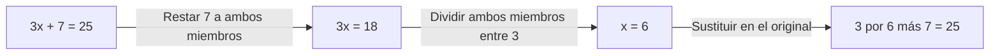

# Igualdad, operaciones inversas y comprobación

> **Fuente interna:** RUTA_ING_realista.xlsx, Plan progresivo!D72:D78 y Progresión!E12, para tema y tiempo. El desarrollo matemático no está localizado explícitamente en el Excel: es elaboración didáctica respaldada en [Referencias](../../REFERENCIAS.md).

**Subtema 11.1.1 · semana 11 · días 1 y 2 · 25 minutos cada día.**

**Objetivo:** Resolver ecuaciones lineales y comprobar la solución en el enunciado. En esta clase, practica específicamente igualdad, operaciones inversas y comprobación.

## Intuición y conexión

Una ecuación expresa que dos cantidades son iguales para ciertos valores de una incógnita. Puedes imaginar una balanza: modificar un lado exige la misma modificación en el otro para conservar el equilibrio. Resolver significa encontrar los valores que hacen verdadera la igualdad, no únicamente mover símbolos. Después de hallar un candidato, sustituirlo en la ecuación original permite comprobarlo.

## Definición y procedimiento

En ax+b=c, con a≠0, resta b a ambos miembros y divide ambos entre a: x=(c−b)/a. Puedes sumar o restar la misma cantidad en ambos miembros, y multiplicar o dividir ambos por un número distinto de cero. Si al simplificar obtienes 0=0, todos los valores admitidos sirven; si obtienes 0=5, no existe solución.

## Ejemplo resuelto paso a paso

Resuelve 3x+7=25. Resta 7 a ambos lados: 3x=18. Divide por 3: x=6. Comprueba en el original: 3·6+7=18+7=25. En una segunda forma, 5x−4=2x+11, resta 2x: 3x−4=11; suma 4: 3x=15; divide por 3: x=5. La comprobación da 21 en ambos miembros. Explicar la operación aplicada resulta más seguro que memorizar que un término cambia de signo al pasar.

## Aplicación en producción o diseño

Un proceso requiere 7 minutos de preparación y 3 minutos por pieza. Si termina en 25 minutos, 3x+7=25 permite inferir seis piezas. Aquí x debe ser un entero no negativo. Si la solución fuera 6,5, habría que revisar qué significa el tiempo o cómo se cuentan las piezas, antes de aceptar una producción fraccionaria.

## Error frecuente y reparación

Restar 7 solo al lado izquierdo rompe la igualdad. Dividir 3x+7 entre 3 exige dividir también el 7 si aún no lo has restado. Escribe los dos miembros después de cada operación y conserva la ecuación original para la verificación; comprobar una ecuación ya mal transformada puede ocultar el error.

## Dos microclases

- **Día A (25 min):** 2 min para responder una minipregunta de preconceptos; 6 min de lectura y reconstrucción del ejemplo sin copiarlo; 13 min para un ejercicio de la ruta elegida; 4 min para comparar con la solución y explicar un paso en voz alta.
- **Día B (25 min):** 2 min de recuerdo sin consultar; 4 min para recuperar el paso que falló; 15 min de práctica independiente en la misma ruta o una superior si ya dominas la anterior; 4 min de comprobación y registro de un error corregido. La comprobación usa el archivo de evaluación del subtema.

Trabaja una ruta por sesión. Si un ejercicio queda pendiente, continúa en el siguiente bloque de práctica; no añadas minutos fuera del plan. Conserva tus pasos para distinguir un error de cálculo de un modelo mal planteado.

## Conservar el equilibrio

Reconstruye esta cadena dentro de la lectura del día A; cada flecha nombra la operación que conserva la igualdad.

**Fuente del temario y tiempo:** RUTA_ING_realista.xlsx, Plan progresivo!D72:D78; Progresión!E12. El Excel define la secuencia y los minutos; las explicaciones matemáticas se apoyan en [Referencias](../../REFERENCIAS.md).

<!-- NAVEGACION -->
[Anterior](../modulo_10/tema_10.1_subtema_10.1.3_contenido.md) · [Índice](../../INDICE.md) · [Siguiente](tema_11.1_subtema_11.1.2_contenido.md)
<!-- FIN NAVEGACION -->
