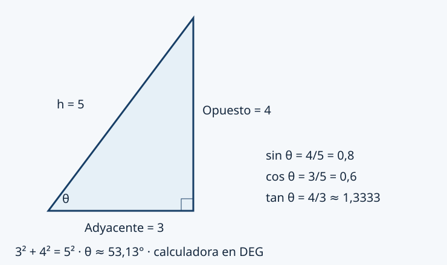

# 16.1.1 — Triángulo rectángulo y teorema de Pitágoras

> **Fuente interna:** RUTA_ING_realista.xlsx, Plan progresivo!D107:D113 y Progresión!E17, para tema y tiempo. El desarrollo matemático no está localizado explícitamente en el Excel: es elaboración didáctica respaldada en [Referencias](../../REFERENCIAS.md).

**Dos bloques de 30 min, días 1 y 2.** El tiempo incluye preconceptos, lectura, práctica y comprobación.

Fuente del temario y tiempo: RUTA_ING_realista.xlsx, Plan progresivo!D107: D113; Progresión!E17. La fuente no desarrolla estas explicaciones: son elaboración didáctica respaldada en [Referencias](../../REFERENCIAS.md).

## Objetivo observable

Resolver un triángulo rectángulo con razones trigonométricas. En este subtema, resuelve el ejemplo con datos nuevos, explica la elección del procedimiento y comprueba unidades o equivalencia.

## Comprensión intuitiva

Una diagonal permite unir dos posiciones con un segmento. Si las otras dos medidas son perpendiculares, forman un triángulo rectángulo. La hipotenusa está frente al ángulo recto y es el lado más largo; los otros dos lados son catetos. Un dibujo del objeto ayuda a distinguir qué longitud se conoce y cuál se busca.

## Regla y procedimiento

En un triángulo rectángulo a²+b²=c², donde c es la hipotenusa. Para hallar un cateto: a=√(c²−b²). La raíz elegida es positiva porque se calcula una longitud. Las tres medidas deben tener la misma unidad; el teorema no se aplica directamente a triángulos sin ángulo recto.

## Ejemplo resuelto

Un soporte tiene catetos de 30 cm y 40 cm. Eleva al cuadrado: 30²=900 y 40²=1600 cm². Suma: c²=2500 cm². Extrae la raíz: c=50 cm. Comprueba que 50 supera a ambos catetos y que 50²=30²+40². Un soporte de 50 cm con un cateto de 30 cm tiene el otro de √(2500−900)=40 cm.

## Error y reparación

Sumar longitudes y escribir c=30+40=70 confunde el perímetro con la diagonal. Tampoco es correcto calcular √(30+40). La suma se hace con los cuadrados antes de extraer la raíz.

## Explorar antes de calcular

Abre [la simulación](../../simulaciones/triangulo.html) dentro del tiempo de práctica. Predice: si los dos catetos se duplican, ¿cambia el ángulo? Comprueba con 3 y 4, luego 6 y 8. Respuesta: la hipotenusa pasa de 5 a 10, las razones y el ángulo permanecen.

## Clases y elección de práctica

Día 1: recupera el prerrequisito, lee la explicación y reproduce el ejemplo explicando cada operación. Resuelve el ejercicio 1 sin copiarlo. Día 2: recupera el procedimiento sin mirar, elige el ejercicio 2 para práctica independiente o el 3 como desafío si el 2 ya está dominado, y realiza la comprobación. Consulta el solucionario al terminar el intento. Estos ejercicios son opciones dentro del bloque, no tareas adicionales.

Si falla la comprobación, ubica el primer paso diferente de la solución y repite con un dato nuevo en el siguiente espacio de práctica. Para límites y derivadas verifica previamente álgebra y funciones; si no están consolidados, elige la ruta alternativa de la semana.

<!-- NAVEGACION -->
[Anterior](../modulo_15/tema_15.1_subtema_15.1.3_contenido.md) · [Índice](../../INDICE.md) · [Siguiente](tema_16.1_subtema_16.1.2_contenido.md)
<!-- FIN NAVEGACION -->
