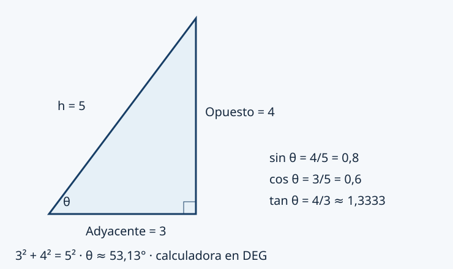

# 16.1.2 — Seno, coseno y tangente

> **Fuente interna:** RUTA_ING_realista.xlsx, Plan progresivo!D107:D113 y Progresión!E17, para tema y tiempo. El desarrollo matemático no está localizado explícitamente en el Excel: es elaboración didáctica respaldada en [Referencias](../../REFERENCIAS.md).

**Dos bloques de 30 min, días 3 y 4.** El tiempo incluye preconceptos, lectura, práctica y comprobación.

Fuente del temario y tiempo: RUTA_ING_realista.xlsx, Plan progresivo!D107: D113; Progresión!E17. La fuente no desarrolla estas explicaciones: son elaboración didáctica respaldada en [Referencias](../../REFERENCIAS.md).

## Objetivo observable

Resolver un triángulo rectángulo con razones trigonométricas. En este subtema, resuelve el ejemplo con datos nuevos, explica la elección del procedimiento y comprueba unidades o equivalencia.

## Comprensión intuitiva

Mira un ángulo agudo del triángulo y nombra los lados desde él. El opuesto queda enfrente; el adyacente toca el ángulo y no es la hipotenusa. Si cambias de ángulo, opuesto y adyacente intercambian papeles. Las razones permiten relacionar inclinación y medidas sin memorizar tamaños de triángulos particulares.

## Regla y procedimiento

sen θ=opuesto/hipotenusa; cos θ=adyacente/hipotenusa; tan θ=opuesto/adyacente. En triángulos semejantes estas razones se conservan. Para 0°<θ<90°, seno y coseno están entre 0 y 1; la tangente puede superar 1. Usa DEG para grados. θ=arctan(opuesto/adyacente) permite recuperar un ángulo agudo.

## Ejemplo resuelto

En un triángulo 3–4–5, toma θ frente al cateto 3. Entonces senθ=3/5=0,6; cosθ=4/5=0,8; tanθ=3/4=0,75. Para el otro ángulo agudo, sen=4/5 y cos=3/5. Si duplicas lados a 6–8–10, senθ=6/10=0,6. El tamaño cambia y la inclinación permanece. La figura y el simulador toman el ángulo frente al cateto de longitud 4: es el otro ángulo agudo. Identifica primero el ángulo elegido antes de comparar las razones.

## Error y reparación

Usar hipotenusa en el denominador de tangente cambia la razón. Escribe primero los nombres de los lados en el dibujo. Un seno de 1,5 para un ángulo agudo revela un cociente o identificación incorrectos.

## Explorar antes de calcular

Abre [la simulación](../../simulaciones/triangulo.html) dentro del tiempo de práctica. Predice: si los dos catetos se duplican, ¿cambia el ángulo? Comprueba con 3 y 4, luego 6 y 8. Respuesta: la hipotenusa pasa de 5 a 10, las razones y el ángulo permanecen.

## Clases y elección de práctica

Día 3: recupera el prerrequisito, lee la explicación y reproduce el ejemplo explicando cada operación. Resuelve el ejercicio 1 sin copiarlo. Día 4: recupera el procedimiento sin mirar, elige el ejercicio 2 para práctica independiente o el 3 como desafío si el 2 ya está dominado, y realiza la comprobación. Consulta el solucionario al terminar el intento. Estos ejercicios son opciones dentro del bloque, no tareas adicionales.

Si falla la comprobación, ubica el primer paso diferente de la solución y repite con un dato nuevo en el siguiente espacio de práctica. Para límites y derivadas verifica previamente álgebra y funciones; si no están consolidados, elige la ruta alternativa de la semana.

<!-- NAVEGACION -->
[Anterior](tema_16.1_subtema_16.1.1_contenido.md) · [Índice](../../INDICE.md) · [Siguiente](tema_16.1_subtema_16.1.3_contenido.md)
<!-- FIN NAVEGACION -->
