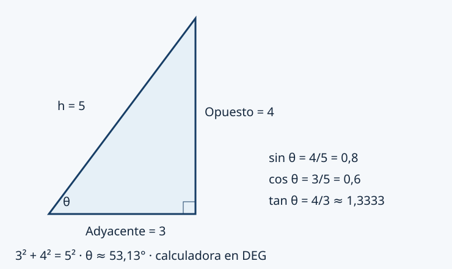

# 16.1.3 — Calcular lados y ángulos en una rampa

> **Fuente interna:** RUTA_ING_realista.xlsx, Plan progresivo!D107:D113 y Progresión!E17, para tema y tiempo. El desarrollo matemático no está localizado explícitamente en el Excel: es elaboración didáctica respaldada en [Referencias](../../REFERENCIAS.md).

**Dos bloques de 30 min, días 5 y 6.** El tiempo incluye preconceptos, lectura, práctica y comprobación.

Fuente del temario y tiempo: RUTA_ING_realista.xlsx, Plan progresivo!D107: D113; Progresión!E17. La fuente no desarrolla estas explicaciones: son elaboración didáctica respaldada en [Referencias](../../REFERENCIAS.md).

## Objetivo observable

Resolver un triángulo rectángulo con razones trigonométricas. En este subtema, resuelve el ejemplo con datos nuevos, explica la elección del procedimiento y comprueba unidades o equivalencia.

## Comprensión intuitiva

Una rampa se describe con su altura vertical, avance horizontal y longitud inclinada. Decide primero cuál de esas medidas da el problema. Si el avance es fijo, mayor altura implica mayor inclinación; si la altura es fija, aumentar el avance suaviza la inclinación. Aquí estudias relaciones geométricas, sin determinar requisitos constructivos.

## Regla y procedimiento

Si h es altura, d avance horizontal y L longitud inclinada: L=√(h²+d²), tanθ=h/d, senθ=h/L. Con θ y d: h=d·tanθ. Con θ y L: h=L·senθ. No intercambies d y L. Para obtener θ usa la función inversa correspondiente y la misma unidad angular.

## Ejemplo resuelto

Una maqueta de rampa sube 0,6 m con avance horizontal 2 m. Su longitud es √(0,36+4)=√4,36≈2,088 m. La inclinación θ=arctan(0,6/2)=arctan 0,3≈16,70°. Si se mantiene h y d se duplica a 4 m, tanθ=0,15 y θ≈8,53°; L≈4,045 m. Comprueba que L>d y que el ángulo disminuye.

## Error y reparación

Confundir 30% de pendiente con 30°: una razón 0,30 significa 30% y corresponde a arctan 0,30≈16,70°. El porcentaje compara altura y avance horizontal; no representa grados.

## Explorar antes de calcular

Abre [la simulación](../../simulaciones/triangulo.html) dentro del tiempo de práctica. Predice: si los dos catetos se duplican, ¿cambia el ángulo? Comprueba con 3 y 4, luego 6 y 8. Respuesta: la hipotenusa pasa de 5 a 10, las razones y el ángulo permanecen.

## Clases y elección de práctica

Día 5: recupera el prerrequisito, lee la explicación y reproduce el ejemplo explicando cada operación. Resuelve el ejercicio 1 sin copiarlo. Día 6: recupera el procedimiento sin mirar, elige el ejercicio 2 para práctica independiente o el 3 como desafío si el 2 ya está dominado, y realiza la comprobación. Consulta el solucionario al terminar el intento. Estos ejercicios son opciones dentro del bloque, no tareas adicionales.

Si falla la comprobación, ubica el primer paso diferente de la solución y repite con un dato nuevo en el siguiente espacio de práctica. Para límites y derivadas verifica previamente álgebra y funciones; si no están consolidados, elige la ruta alternativa de la semana.

<!-- NAVEGACION -->
[Anterior](tema_16.1_subtema_16.1.2_contenido.md) · [Índice](../../INDICE.md) · [Siguiente](../modulo_17/tema_17.1_subtema_17.1.1_contenido.md)
<!-- FIN NAVEGACION -->
