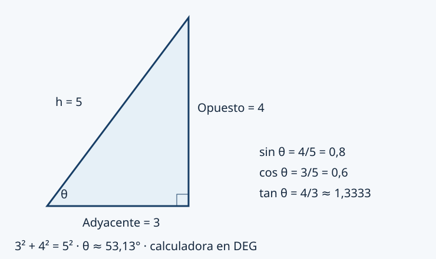

# 19.1.2 — Recuperar Pitágoras y razones trigonométricas

> **Fuente interna:** RUTA_ING_realista.xlsx, Plan progresivo!D128:D134 y Progresión!E20, para tema y tiempo. El desarrollo matemático no está localizado explícitamente en el Excel: es elaboración didáctica respaldada en [Referencias](../../REFERENCIAS.md).

**Dos bloques de 35 min, días 3 y 4.** El tiempo incluye preconceptos, lectura, práctica y comprobación.

Fuente del temario y tiempo: RUTA_ING_realista.xlsx, Plan progresivo!D128: D134; Progresión!E20. La fuente no desarrolla estas explicaciones: son elaboración didáctica respaldada en [Referencias](../../REFERENCIAS.md).

## Objetivo observable

Relacionar representaciones y validar dimensiones con trigonometría. En este subtema, resuelve el ejemplo con datos nuevos, explica la elección del procedimiento y comprueba unidades o equivalencia.

## Comprensión intuitiva

Recupera trigonometría dibujando antes de calcular. El dibujo no necesita ser exacto, pero sí identificar medidas, ángulo y unidad. Una buena elección de razón evita pasos adicionales; usa la razón que relaciona lo conocido y lo desconocido.

## Regla y procedimiento

Con dos catetos, usa Pitágoras para la diagonal o tangente para el ángulo. Con hipotenusa y ángulo, usa seno para el opuesto y coseno para el adyacente. Comprueba el resultado usando otra relación cuando sea posible. Redondea al final y señala que la medida es aproximada.

## Ejemplo resuelto

Una pieza triangular tiene catetos 9 y 12 cm. Hipotenusa 15 cm. Para θfrente a 9: senθ=9/15=0,6, cosθ=12/15=0,8 y tanθ=9/12=0,75. θ≈36,87°. Verificación: 15 sen 36,87°≈9. El otro ángulo es 90°−36,87°≈53,13°. Los ángulos de un triángulo suman 180°.

## Error y reparación

Una calculadora en RAD puede devolver un ángulo incompatible con los grados del dibujo. Para este bloque, selecciona DEG y comprueba que arctan 1=45°.

## Explorar antes de calcular

Abre [la simulación](../../simulaciones/triangulo.html) dentro del tiempo de práctica. Predice: si los dos catetos se duplican, ¿cambia el ángulo? Comprueba con 3 y 4, luego 6 y 8. Respuesta: la hipotenusa pasa de 5 a 10, las razones y el ángulo permanecen.

## Clases y elección de práctica

Día 3: recupera el prerrequisito, lee la explicación y reproduce el ejemplo explicando cada operación. Resuelve el ejercicio 1 sin copiarlo. Día 4: recupera el procedimiento sin mirar, elige el ejercicio 2 para práctica independiente o el 3 como desafío si el 2 ya está dominado, y realiza la comprobación. Consulta el solucionario al terminar el intento. Estos ejercicios son opciones dentro del bloque, no tareas adicionales.

Si falla la comprobación, ubica el primer paso diferente de la solución y repite con un dato nuevo en el siguiente espacio de práctica. Para límites y derivadas verifica previamente álgebra y funciones; si no están consolidados, elige la ruta alternativa de la semana.

<!-- NAVEGACION -->
[Anterior](tema_19.1_subtema_19.1.1_contenido.md) · [Índice](../../INDICE.md) · [Siguiente](tema_19.1_subtema_19.1.3_contenido.md)
<!-- FIN NAVEGACION -->
