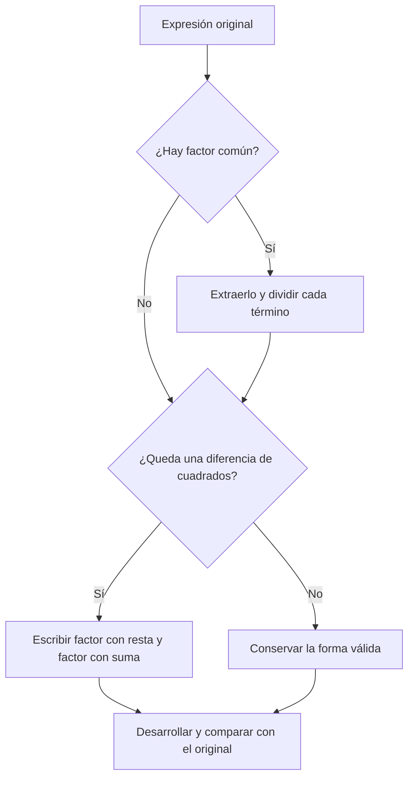

# Elegir factor y comprobar desarrollando

> **Fuente interna:** RUTA_ING_realista.xlsx, Plan progresivo!D58:D64 y Progresión!E10, para tema y tiempo. El desarrollo matemático no está localizado explícitamente en el Excel: es elaboración didáctica respaldada en [Referencias](../../REFERENCIAS.md).

**Subtema 9.1.3 · semana 9 · días 5 y 6 · 20 minutos cada día.**

**Objetivo:** Factorizar por factor común y diferencia de cuadrados. En esta clase, practica específicamente elegir factor y comprobar desarrollando.

## Intuición y conexión

Reconocer una forma es más útil que memorizar muchas respuestas aisladas. Al revisar una expresión, primero cuenta sus términos y busca algo que se repita. Después pregunta si aparece una diferencia de cuadrados. Esta rutina permite elegir una transformación justificable. La comprobación final consiste en desarrollar los factores y comparar término a término con el punto de partida.

## Definición y procedimiento

Una factorización completa, dentro de las identidades estudiadas, combina métodos cuando es necesario. En 2x²−18 primero extraes 2; luego x²−9 es diferencia de cuadrados. El resultado 2(x−3)(x+3) tiene factores distintos de los términos originales: un término se separa por + o −; un factor se multiplica por otros. No se cancelan términos dentro de sumas como si fueran factores.

## Ejemplo resuelto paso a paso

Factoriza 6x³−24x. Ambos términos tienen 6x: 6x(x²−4). El paréntesis contiene x²−2², así que obtienes 6x(x−2)(x+2). Comprueba en dos pasos: (x−2)(x+2)=x²−4; luego 6x(x²−4)=6x³−24x. Para x=3, 18·1·5=90, y el original vale 162−72=90. Si x=0, ambas formas valen cero; no se pierde ese caso al reescribir.

## Aplicación en producción o diseño

El área algebraica de una superficie se expresa como 6x³−24x en una escala definida por el diseño. Sus factores permiten identificar valores que hacen cero la expresión. Para interpretar un área positiva debes usar además el rango del diseño: con x>2 todos los factores son positivos. Un resultado algebraico negativo no representa automáticamente un área física aceptable.

## Error frecuente y reparación

Detenerse en 6x(x²−4) deja una identidad disponible sin usar. El error contrario consiste en inventar factores de x²+4 con la diferencia de cuadrados: el signo no permite ese paso. Si una expresión no coincide con un método conocido, conserva la forma válida y explica qué condición falta.

## Dos microclases

- **Día A (20 min):** 2 min para responder una minipregunta de preconceptos; 6 min de lectura y reconstrucción del ejemplo sin copiarlo; 8 min para un ejercicio de la ruta elegida; 4 min para comparar con la solución y explicar un paso en voz alta.
- **Día B (20 min):** 2 min de recuerdo sin consultar; 4 min para recuperar el paso que falló; 10 min de práctica independiente en la misma ruta o una superior si ya dominas la anterior; 4 min de comprobación y registro de un error corregido. La comprobación usa el archivo de evaluación del subtema.

Trabaja una ruta por sesión. Si un ejercicio queda pendiente, continúa en el siguiente bloque de práctica; no añadas minutos fuera del plan. Conserva tus pasos para distinguir un error de cálculo de un modelo mal planteado.

## Elegir el método

Lee el diagrama durante la reconstrucción del ejemplo, sin añadir tiempo. En 6x³−24x, sigue primero la extracción de 6x y después la diferencia de cuadrados.

**Fuente del temario y tiempo:** RUTA_ING_realista.xlsx, Plan progresivo!D58:D64; Progresión!E10. El Excel define la secuencia y los minutos; las explicaciones matemáticas se apoyan en [Referencias](../../REFERENCIAS.md).

<!-- NAVEGACION -->
[Anterior](tema_9.1_subtema_9.1.2_contenido.md) · [Índice](../../INDICE.md) · [Siguiente](../modulo_10/tema_10.1_subtema_10.1.1_contenido.md)
<!-- FIN NAVEGACION -->
