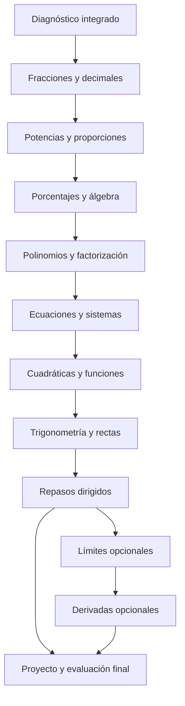

# Arquitectura curricular: Matemáticas para ingeniería industrial y diseño de producto

Código: MIPD-001. Diseño: 2026-10-04. Complejidad media; nivelación esencial para ingreso universitario. Audiencia: persona adulta con carrera técnica y más de diez años sin estudio formal. Modalidad asumida: autoestudio con acompañamiento semanal; pendiente de confirmar.

Duración: 22 semanas, 154 sesiones, 3920 minutos (65 horas y 20 minutos). No se agregan horas al Excel. Requisitos: lectura de enunciados breves, disponibilidad diaria y cuaderno; no se presume dominio algebraico. Fuente: C:/Users/archi/Downloads/RUTA_ING_realista.xlsx, Plan progresivo columnas C, D e I; Progresión columna E. Se conserva el archivo original y sus 22 temas en el mismo orden. Las fechas originales del libro son referencia; este cronograma utiliza semanas relativas hasta acordar el inicio.

## Objetivos generales

1. Resolver operaciones numéricas, proporciones y porcentajes con unidades y comprobación.
2. Traducir problemas de costos y producción a expresiones, ecuaciones y sistemas verificables.
3. Interpretar funciones y gráficos, y resolver problemas básicos de trigonometría y geometría analítica.
4. Detectar, explicar y corregir errores utilizando un registro de evidencias.
5. Elaborar un proyecto de lote y empaque con datos, operaciones, decisiones y justificación.

## Mapa conceptual



## Método y distribución del tiempo

El libro propone aprender, practicar/recuperar y explicar/corregir con una referencia 20/50/30. El curso conserva ese principio con proporciones flexibles: cada microclase indica su distribución concreta de minutos según la dificultad y la actividad. La lectura, el ejemplo, los ejercicios, la comprobación y las soluciones caben en el bloque diario; no se acumulan tareas de rutas diferentes. Día impar: concepto y ejemplo; día par: recuperación y aplicación. La microevaluación de subtema ocurre al final de los días 2, 4 y 6 dentro del cierre y sustituye práctica; no añade minutos. Domingo: resolver sin apuntes y corregir/explicar dentro de la distribución indicada por el cuestionario. Las evaluaciones acumulativas de semanas 6, 13, 19 y 22 sustituyen la evaluación semanal.

La estimación aplica factor cognitivo 1,5 al tiempo de tareas nuevas: se seleccionan actividades cuyo tiempo nominal conjunto sea como máximo dos tercios del presupuesto; el tercio restante absorbe relectura, error y consolidación. No se multiplica el horario autorizado por 1,5. Cada pareja de días desarrolla un único subtema. Las semanas 17–20 suman 4 h 5 min y las 21–22 4 h 40 min; son contenedores semanales fragmentados en siete clases de 35 o 40 minutos, nunca sesiones monolíticas.

El diagnóstico ocupa 10 minutos del día 1 y 10 del día 2 de la semana 1, dentro de 1.1.1; módulo 0 tiene cero minutos adicionales. Comprueba signos, orden de operaciones, equivalencias y suma de fracciones, y lectura de una tabla numérica. Su corrección orienta la ruta y se integra en la explicación.

## Rutas de aprendizaje y adaptación

- Básica (predeterminada): ejemplo completamente resuelto, pistas graduadas, ejercicios esenciales y comprobación; reemplazar desafíos por reparación de prerrequisitos.
- Intermedia: tras demostrar el prerrequisito, reducir lectura y usar el tiempo liberado para un problema de dos pasos y explicar otro método.
- Avanzada: prueba de recuperación al inicio, omitir explicaciones ya dominadas y dedicar el tiempo a comparación de modelos o justificación de restricciones. Puede consumir menos tiempo de lectura; el calendario no gana semanas ni cambia la carga diaria.

Las tres rutas utilizan el mismo presupuesto y objetivo esencial; varían apoyos y complejidad, no la exigencia de comprobar resultados. Regla inicial de dominio: 80% de puntos, unidades correctas y explicación del procedimiento; es un criterio del diseño y puede calibrarse tras las primeras semanas. Si hay error en un prerrequisito, el siguiente espacio de práctica sustituye el desafío por refuerzo. El ritmo nominal de 22 semanas es una planificación, no una garantía de dominio. No duplicar trabajo perdido. La sesión mínima por fatiga mantiene hábito, pero no equivale a completar la evidencia; registrar lo pendiente.

## Opcionales y ruta alternativa

Se conservan límites y derivadas en semanas 20 y 21. Activarlos si semana 19 evidencia dominio de álgebra, funciones y gráficos. Si no, ruta alternativa dentro de los mismos 245 y 280 minutos: semana 20, días 1–2 media, mediana y rango de mediciones; días 3–4 efecto de datos extremos; días 5–6 porcentajes y refuerzo; día 7 comprobación y corrección. Semana 21, días 1–2 medidas repetidas, media, mediana y rango; días 3–4 varianza poblacional y desviación estándar; días 5–6 costo lineal y conversiones; día 7 comprobación y corrección. La varianza se calcula dividiendo por el número de datos de la población estudiada y no se interpreta como estimación de una muestra. La estadística es una alternativa documentada, no una sustitución automática del temario ni un requisito adicional. Se realiza una sola ruta. La ruta elegida se registra antes de empezar semana 20.

El archivo fuente menciona una conversación dominical adicional de 10–15 minutos para todas las materias. Aquí el acompañamiento de matemáticas se integra en la corrección del bloque dominical; una conversación adicional conjunta es opcional y queda fuera de las 65 h 20 min, sin ser necesaria para completar el curso.

## Estructura modular

### Módulo 0: Diagnóstico transversal y orientación

0 minutos adicionales; 20 minutos integrados en semana 1, días 1–2. Objetivo: identificar operaciones que puede resolver sola, con pista o que necesita reaprender. Subtema 0.1.1: diagnóstico breve de operaciones y lectura matemática. Evidencia: respuestas y ruta asignada; no calificación sumativa.

### Módulo 1: Fracciones: suma y resta

Duración: 105 minutos en siete clases de 15. Objetivo: Calcular sumas y restas de fracciones y justificar el denominador común. Evidencia: Ficha de medidas y operaciones verificadas. Fuente: Plan progresivo!D2:D8; Progresión!E2.

#### Tema 1.1: Fracciones: suma y resta

- **1.1.1: Equivalencias, simplificación y diagnóstico**. Días 1 y 2, 30 minutos. Objetivo observable: resolver y explicar al menos un ejercicio de equivalencias, simplificación y diagnóstico, verificando el resultado. Tipo: mixto. Requiere código: no.
- **1.1.2: Suma y resta con denominador común**. Días 3 y 4, 30 minutos. Objetivo observable: resolver y explicar al menos un ejercicio de suma y resta con denominador común, verificando el resultado. Tipo: mixto. Requiere código: no.
- **1.1.3: Denominadores distintos y medidas fraccionarias**. Días 5 y 6, 30 minutos. Objetivo observable: resolver y explicar al menos un ejercicio de denominadores distintos y medidas fraccionarias, verificando el resultado. Tipo: mixto. Requiere código: no.

Día 7: evaluación del módulo, corrección y decisión de refuerzo dentro de la misma carga.

### Módulo 2: Fracciones: multiplicación y división

Duración: 105 minutos en siete clases de 15. Objetivo: Resolver productos y cocientes de fracciones e interpretar el reparto. Evidencia: Cálculo de porciones y lotes. Fuente: Plan progresivo!D9:D15; Progresión!E3.

#### Tema 2.1: Fracciones: multiplicación y división

- **2.1.1: Multiplicar fracciones y simplificar productos**. Días 1 y 2, 30 minutos. Objetivo observable: resolver y explicar al menos un ejercicio de multiplicar fracciones y simplificar productos, verificando el resultado. Tipo: mixto. Requiere código: no.
- **2.1.2: Dividir fracciones y comprobar con el producto**. Días 3 y 4, 30 minutos. Objetivo observable: resolver y explicar al menos un ejercicio de dividir fracciones y comprobar con el producto, verificando el resultado. Tipo: mixto. Requiere código: no.
- **2.1.3: Cantidades de material y reparto en lotes**. Días 5 y 6, 30 minutos. Objetivo observable: resolver y explicar al menos un ejercicio de cantidades de material y reparto en lotes, verificando el resultado. Tipo: mixto. Requiere código: no.

Día 7: evaluación del módulo, corrección y decisión de refuerzo dentro de la misma carga.

### Módulo 3: Decimales y conversión entre fracciones y decimales

Duración: 105 minutos en siete clases de 15. Objetivo: Convertir fracciones y decimales y calcular medidas con unidades. Evidencia: Hoja de mediciones y error de redondeo. Fuente: Plan progresivo!D16:D22; Progresión!E4.

#### Tema 3.1: Decimales y conversión entre fracciones y decimales

- **3.1.1: Valor posicional y conversión de representaciones**. Días 1 y 2, 30 minutos. Objetivo observable: resolver y explicar al menos un ejercicio de valor posicional y conversión de representaciones, verificando el resultado. Tipo: mixto. Requiere código: no.
- **3.1.2: Operaciones con decimales y redondeo**. Días 3 y 4, 30 minutos. Objetivo observable: resolver y explicar al menos un ejercicio de operaciones con decimales y redondeo, verificando el resultado. Tipo: mixto. Requiere código: no.
- **3.1.3: Mediciones, unidades y tolerancias**. Días 5 y 6, 30 minutos. Objetivo observable: resolver y explicar al menos un ejercicio de mediciones, unidades y tolerancias, verificando el resultado. Tipo: mixto. Requiere código: no.

Día 7: evaluación del módulo, corrección y decisión de refuerzo dentro de la misma carga.

### Módulo 4: Potenciación y radicación

Duración: 105 minutos en siete clases de 15. Objetivo: Aplicar reglas básicas de potencias y raíces a longitudes y áreas. Evidencia: Comparación de áreas y lados. Fuente: Plan progresivo!D23:D29; Progresión!E5.

#### Tema 4.1: Potenciación y radicación

- **4.1.1: Potencias, signos y orden de operaciones**. Días 1 y 2, 30 minutos. Objetivo observable: resolver y explicar al menos un ejercicio de potencias, signos y orden de operaciones, verificando el resultado. Tipo: mixto. Requiere código: no.
- **4.1.2: Raíces cuadradas y relación con potencias**. Días 3 y 4, 30 minutos. Objetivo observable: resolver y explicar al menos un ejercicio de raíces cuadradas y relación con potencias, verificando el resultado. Tipo: mixto. Requiere código: no.
- **4.1.3: Áreas, cuadrados y estimación de raíces**. Días 5 y 6, 30 minutos. Objetivo observable: resolver y explicar al menos un ejercicio de áreas, cuadrados y estimación de raíces, verificando el resultado. Tipo: mixto. Requiere código: no.

Día 7: evaluación del módulo, corrección y decisión de refuerzo dentro de la misma carga.

### Módulo 5: Notación científica y proporciones

Duración: 105 minutos en siete clases de 15. Objetivo: Expresar magnitudes y resolver proporciones conservando unidades. Evidencia: Plano a escala y conversiones. Fuente: Plan progresivo!D30:D36; Progresión!E6.

#### Tema 5.1: Notación científica y proporciones

- **5.1.1: Escritura y lectura en notación científica**. Días 1 y 2, 30 minutos. Objetivo observable: resolver y explicar al menos un ejercicio de escritura y lectura en notación científica, verificando el resultado. Tipo: mixto. Requiere código: no.
- **5.1.2: Razones y proporciones equivalentes**. Días 3 y 4, 30 minutos. Objetivo observable: resolver y explicar al menos un ejercicio de razones y proporciones equivalentes, verificando el resultado. Tipo: mixto. Requiere código: no.
- **5.1.3: Conversión de unidades y escalas de diseño**. Días 5 y 6, 30 minutos. Objetivo observable: resolver y explicar al menos un ejercicio de conversión de unidades y escalas de diseño, verificando el resultado. Tipo: mixto. Requiere código: no.

Día 7: evaluación del módulo, corrección y decisión de refuerzo dentro de la misma carga.

### Módulo 6: Regla de tres y porcentajes

Duración: 105 minutos en siete clases de 15. Objetivo: Seleccionar proporcionalidad y calcular porcentajes en producción. Evidencia: Balance de material útil y desperdicio. Fuente: Plan progresivo!D37:D43; Progresión!E7.

#### Tema 6.1: Regla de tres y porcentajes

- **6.1.1: Proporcionalidad directa e inversa**. Días 1 y 2, 30 minutos. Objetivo observable: resolver y explicar al menos un ejercicio de proporcionalidad directa e inversa, verificando el resultado. Tipo: mixto. Requiere código: no.
- **6.1.2: Porcentaje de una cantidad y variación**. Días 3 y 4, 30 minutos. Objetivo observable: resolver y explicar al menos un ejercicio de porcentaje de una cantidad y variación, verificando el resultado. Tipo: mixto. Requiere código: no.
- **6.1.3: Rendimiento, descuento y desperdicio**. Días 5 y 6, 30 minutos. Objetivo observable: resolver y explicar al menos un ejercicio de rendimiento, descuento y desperdicio, verificando el resultado. Tipo: mixto. Requiere código: no.

Día 7: evaluación del módulo, corrección y decisión de refuerzo dentro de la misma carga.

### Módulo 7: Lenguaje algebraico y expresiones algebraicas

Duración: 140 minutos en siete clases de 20. Objetivo: Traducir situaciones a expresiones y evaluar valores dados. Evidencia: Modelo de costo con variables definidas. Fuente: Plan progresivo!D44:D50; Progresión!E8.

#### Tema 7.1: Lenguaje algebraico y expresiones algebraicas

- **7.1.1: Variables, signos y traducción verbal**. Días 1 y 2, 40 minutos. Objetivo observable: resolver y explicar al menos un ejercicio de variables, signos y traducción verbal, verificando el resultado. Tipo: mixto. Requiere código: no.
- **7.1.2: Evaluación y términos semejantes**. Días 3 y 4, 40 minutos. Objetivo observable: resolver y explicar al menos un ejercicio de evaluación y términos semejantes, verificando el resultado. Tipo: mixto. Requiere código: no.
- **7.1.3: Expresiones de costo y consumo**. Días 5 y 6, 40 minutos. Objetivo observable: resolver y explicar al menos un ejercicio de expresiones de costo y consumo, verificando el resultado. Tipo: mixto. Requiere código: no.

Día 7: evaluación del módulo, corrección y decisión de refuerzo dentro de la misma carga.

### Módulo 8: Operaciones con polinomios

Duración: 140 minutos en siete clases de 20. Objetivo: Operar polinomios y verificar equivalencias mediante sustitución. Evidencia: Desarrollo de expresión de área. Fuente: Plan progresivo!D51:D57; Progresión!E9.

#### Tema 8.1: Operaciones con polinomios

- **8.1.1: Suma y resta de polinomios**. Días 1 y 2, 40 minutos. Objetivo observable: resolver y explicar al menos un ejercicio de suma y resta de polinomios, verificando el resultado. Tipo: mixto. Requiere código: no.
- **8.1.2: Producto, distributiva y productos notables**. Días 3 y 4, 40 minutos. Objetivo observable: resolver y explicar al menos un ejercicio de producto, distributiva y productos notables, verificando el resultado. Tipo: mixto. Requiere código: no.
- **8.1.3: Área algebraica y comprobación numérica**. Días 5 y 6, 40 minutos. Objetivo observable: resolver y explicar al menos un ejercicio de área algebraica y comprobación numérica, verificando el resultado. Tipo: mixto. Requiere código: no.

Día 7: evaluación del módulo, corrección y decisión de refuerzo dentro de la misma carga.

### Módulo 9: Factorización I (factor común, diferencia de cuadrados)

Duración: 140 minutos en siete clases de 20. Objetivo: Factorizar por factor común y diferencia de cuadrados. Evidencia: Expresiones factorizadas y verificadas. Fuente: Plan progresivo!D58:D64; Progresión!E10.

#### Tema 9.1: Factorización I (factor común, diferencia de cuadrados)

- **9.1.1: Extraer factor común numérico y literal**. Días 1 y 2, 40 minutos. Objetivo observable: resolver y explicar al menos un ejercicio de extraer factor común numérico y literal, verificando el resultado. Tipo: mixto. Requiere código: no.
- **9.1.2: Diferencia de cuadrados**. Días 3 y 4, 40 minutos. Objetivo observable: resolver y explicar al menos un ejercicio de diferencia de cuadrados, verificando el resultado. Tipo: mixto. Requiere código: no.
- **9.1.3: Elegir factor y comprobar desarrollando**. Días 5 y 6, 40 minutos. Objetivo observable: resolver y explicar al menos un ejercicio de elegir factor y comprobar desarrollando, verificando el resultado. Tipo: mixto. Requiere código: no.

Día 7: evaluación del módulo, corrección y decisión de refuerzo dentro de la misma carga.

### Módulo 10: Factorización II (trinomios)

Duración: 140 minutos en siete clases de 20. Objetivo: Factorizar trinomios sencillos y verificar el producto. Evidencia: Selección razonada de factorización. Fuente: Plan progresivo!D65:D71; Progresión!E11.

#### Tema 10.1: Factorización II (trinomios)

- **10.1.1: Trinomio cuadrado perfecto**. Días 1 y 2, 40 minutos. Objetivo observable: resolver y explicar al menos un ejercicio de trinomio cuadrado perfecto, verificando el resultado. Tipo: mixto. Requiere código: no.
- **10.1.2: Trinomios mónicos con factores enteros**. Días 3 y 4, 40 minutos. Objetivo observable: resolver y explicar al menos un ejercicio de trinomios mónicos con factores enteros, verificando el resultado. Tipo: mixto. Requiere código: no.
- **10.1.3: Trinomios no mónicos sencillos y comprobación**. Días 5 y 6, 40 minutos. Objetivo observable: resolver y explicar al menos un ejercicio de trinomios no mónicos sencillos y comprobación, verificando el resultado. Tipo: mixto. Requiere código: no.

Día 7: evaluación del módulo, corrección y decisión de refuerzo dentro de la misma carga.

### Módulo 11: Ecuaciones lineales de primer grado

Duración: 175 minutos en siete clases de 25. Objetivo: Resolver ecuaciones lineales y comprobar la solución en el enunciado. Evidencia: Presupuesto resuelto con ecuación. Fuente: Plan progresivo!D72:D78; Progresión!E12.

#### Tema 11.1: Ecuaciones lineales de primer grado

- **11.1.1: Igualdad, operaciones inversas y comprobación**. Días 1 y 2, 50 minutos. Objetivo observable: resolver y explicar al menos un ejercicio de igualdad, operaciones inversas y comprobación, verificando el resultado. Tipo: mixto. Requiere código: no.
- **11.1.2: Paréntesis, fracciones y despejes**. Días 3 y 4, 50 minutos. Objetivo observable: resolver y explicar al menos un ejercicio de paréntesis, fracciones y despejes, verificando el resultado. Tipo: mixto. Requiere código: no.
- **11.1.3: Problemas de costo y producción**. Días 5 y 6, 50 minutos. Objetivo observable: resolver y explicar al menos un ejercicio de problemas de costo y producción, verificando el resultado. Tipo: mixto. Requiere código: no.

Día 7: evaluación del módulo, corrección y decisión de refuerzo dentro de la misma carga.

### Módulo 12: Sistemas de ecuaciones lineales (2x2)

Duración: 175 minutos en siete clases de 25. Objetivo: Resolver un sistema 2x2 y validar ambos resultados. Evidencia: Composición de lote con dos productos. Fuente: Plan progresivo!D79:D85; Progresión!E13.

#### Tema 12.1: Sistemas de ecuaciones lineales (2x2)

- **12.1.1: Modelar dos incógnitas y sustitución**. Días 1 y 2, 50 minutos. Objetivo observable: resolver y explicar al menos un ejercicio de modelar dos incógnitas y sustitución, verificando el resultado. Tipo: mixto. Requiere código: no.
- **12.1.2: Eliminación y comprobación doble**. Días 3 y 4, 50 minutos. Objetivo observable: resolver y explicar al menos un ejercicio de eliminación y comprobación doble, verificando el resultado. Tipo: mixto. Requiere código: no.
- **12.1.3: Mezclas y combinación de productos**. Días 5 y 6, 50 minutos. Objetivo observable: resolver y explicar al menos un ejercicio de mezclas y combinación de productos, verificando el resultado. Tipo: mixto. Requiere código: no.

Día 7: evaluación del módulo, corrección y decisión de refuerzo dentro de la misma carga.

### Módulo 13: Ecuaciones cuadráticas

Duración: 210 minutos en siete clases de 30. Objetivo: Resolver cuadráticas e interpretar qué raíces son admisibles. Evidencia: Dimensiones compatibles con un área. Fuente: Plan progresivo!D86:D92; Progresión!E14.

#### Tema 13.1: Ecuaciones cuadráticas

- **13.1.1: Factorización y principio del producto cero**. Días 1 y 2, 60 minutos. Objetivo observable: resolver y explicar al menos un ejercicio de factorización y principio del producto cero, verificando el resultado. Tipo: mixto. Requiere código: no.
- **13.1.2: Fórmula general y discriminante**. Días 3 y 4, 60 minutos. Objetivo observable: resolver y explicar al menos un ejercicio de fórmula general y discriminante, verificando el resultado. Tipo: mixto. Requiere código: no.
- **13.1.3: Dimensiones de piezas y elección de raíces**. Días 5 y 6, 60 minutos. Objetivo observable: resolver y explicar al menos un ejercicio de dimensiones de piezas y elección de raíces, verificando el resultado. Tipo: mixto. Requiere código: no.

Día 7: evaluación del módulo, corrección y decisión de refuerzo dentro de la misma carga.

### Módulo 14: Funciones: concepto y función lineal

Duración: 210 minutos en siete clases de 30. Objetivo: Representar una función lineal e interpretar pendiente e intercepto. Evidencia: Tabla y gráfica de costos e ingresos. Fuente: Plan progresivo!D93:D99; Progresión!E15.

#### Tema 14.1: Funciones: concepto y función lineal

- **14.1.1: Entrada, salida, dominio y tablas**. Días 1 y 2, 60 minutos. Objetivo observable: resolver y explicar al menos un ejercicio de entrada, salida, dominio y tablas, verificando el resultado. Tipo: mixto. Requiere código: no.
- **14.1.2: Pendiente, intercepto y representación gráfica**. Días 3 y 4, 60 minutos. Objetivo observable: resolver y explicar al menos un ejercicio de pendiente, intercepto y representación gráfica, verificando el resultado. Tipo: mixto. Requiere código: no.
- **14.1.3: Costo lineal y punto de equilibrio**. Días 5 y 6, 60 minutos. Objetivo observable: resolver y explicar al menos un ejercicio de costo lineal y punto de equilibrio, verificando el resultado. Tipo: mixto. Requiere código: no.

Día 7: evaluación del módulo, corrección y decisión de refuerzo dentro de la misma carga.

### Módulo 15: Función cuadrática y otras funciones

Duración: 210 minutos en siete clases de 30. Objetivo: Interpretar funciones sencillas y seleccionar un modelo según datos. Evidencia: Comparación de modelos gráficos. Fuente: Plan progresivo!D100:D106; Progresión!E16.

#### Tema 15.1: Función cuadrática y otras funciones

- **15.1.1: Parábola, ceros y vértice**. Días 1 y 2, 60 minutos. Objetivo observable: resolver y explicar al menos un ejercicio de parábola, ceros y vértice, verificando el resultado. Tipo: mixto. Requiere código: no.
- **15.1.2: Funciones constante, valor absoluto e inversa**. Días 3 y 4, 60 minutos. Objetivo observable: resolver y explicar al menos un ejercicio de funciones constante, valor absoluto e inversa, verificando el resultado. Tipo: mixto. Requiere código: no.
- **15.1.3: Comparar modelos y restricciones de dominio**. Días 5 y 6, 60 minutos. Objetivo observable: resolver y explicar al menos un ejercicio de comparar modelos y restricciones de dominio, verificando el resultado. Tipo: mixto. Requiere código: no.

Día 7: evaluación del módulo, corrección y decisión de refuerzo dentro de la misma carga.

### Módulo 16: Trigonometría: razones trigonométricas

Duración: 210 minutos en siete clases de 30. Objetivo: Resolver un triángulo rectángulo con razones trigonométricas. Evidencia: Croquis y dimensiones de rampa. Fuente: Plan progresivo!D107:D113; Progresión!E17.

#### Tema 16.1: Trigonometría: razones trigonométricas

- **16.1.1: Triángulo rectángulo y teorema de Pitágoras**. Días 1 y 2, 60 minutos. Objetivo observable: resolver y explicar al menos un ejercicio de triángulo rectángulo y teorema de pitágoras, verificando el resultado. Tipo: mixto. Requiere código: no.
- **16.1.2: Seno, coseno y tangente**. Días 3 y 4, 60 minutos. Objetivo observable: resolver y explicar al menos un ejercicio de seno, coseno y tangente, verificando el resultado. Tipo: mixto. Requiere código: no.
- **16.1.3: Calcular lados y ángulos en una rampa**. Días 5 y 6, 60 minutos. Objetivo observable: resolver y explicar al menos un ejercicio de calcular lados y ángulos en una rampa, verificando el resultado. Tipo: mixto. Requiere código: no.

Día 7: evaluación del módulo, corrección y decisión de refuerzo dentro de la misma carga.

### Módulo 17: Geometría analítica: plano cartesiano y rectas

Duración: 245 minutos en siete clases de 35. Objetivo: Representar puntos y rectas y calcular relaciones geométricas. Evidencia: Plano de pieza con coordenadas. Fuente: Plan progresivo!D114:D120; Progresión!E18.

#### Tema 17.1: Geometría analítica: plano cartesiano y rectas

- **17.1.1: Coordenadas, distancia y punto medio**. Días 1 y 2, 70 minutos. Objetivo observable: resolver y explicar al menos un ejercicio de coordenadas, distancia y punto medio, verificando el resultado. Tipo: mixto. Requiere código: no.
- **17.1.2: Pendiente y ecuación de recta**. Días 3 y 4, 70 minutos. Objetivo observable: resolver y explicar al menos un ejercicio de pendiente y ecuación de recta, verificando el resultado. Tipo: mixto. Requiere código: no.
- **17.1.3: Rectas paralelas, perpendiculares y trazado**. Días 5 y 6, 70 minutos. Objetivo observable: resolver y explicar al menos un ejercicio de rectas paralelas, perpendiculares y trazado, verificando el resultado. Tipo: mixto. Requiere código: no.

Día 7: evaluación del módulo, corrección y decisión de refuerzo dentro de la misma carga.

### Módulo 18: Repaso dirigido: álgebra y ecuaciones (corrige puntos débiles)

Duración: 245 minutos en siete clases de 35. Objetivo: Corregir errores algebraicos y resolver un modelo integrado. Evidencia: Bitácora de errores corregidos. Fuente: Plan progresivo!D121:D127; Progresión!E19.

#### Tema 18.1: Repaso dirigido: álgebra y ecuaciones (corrige puntos débiles)

- **18.1.1: Diagnosticar errores en expresiones y factorización**. Días 1 y 2, 70 minutos. Objetivo observable: resolver y explicar al menos un ejercicio de diagnosticar errores en expresiones y factorización, verificando el resultado. Tipo: mixto. Requiere código: no.
- **18.1.2: Reparar ecuaciones y sistemas**. Días 3 y 4, 70 minutos. Objetivo observable: resolver y explicar al menos un ejercicio de reparar ecuaciones y sistemas, verificando el resultado. Tipo: mixto. Requiere código: no.
- **18.1.3: Problema integrado de presupuesto y dimensiones**. Días 5 y 6, 70 minutos. Objetivo observable: resolver y explicar al menos un ejercicio de problema integrado de presupuesto y dimensiones, verificando el resultado. Tipo: mixto. Requiere código: no.

Día 7: evaluación del módulo, corrección y decisión de refuerzo dentro de la misma carga.

### Módulo 19: Repaso dirigido: funciones y trigonometría

Duración: 245 minutos en siete clases de 35. Objetivo: Relacionar representaciones y validar dimensiones con trigonometría. Evidencia: Informe breve de rampa y costo. Fuente: Plan progresivo!D128:D134; Progresión!E20.

#### Tema 19.1: Repaso dirigido: funciones y trigonometría

- **19.1.1: Comparar tablas, gráficas y fórmulas**. Días 1 y 2, 70 minutos. Objetivo observable: resolver y explicar al menos un ejercicio de comparar tablas, gráficas y fórmulas, verificando el resultado. Tipo: mixto. Requiere código: no.
- **19.1.2: Recuperar Pitágoras y razones trigonométricas**. Días 3 y 4, 70 minutos. Objetivo observable: resolver y explicar al menos un ejercicio de recuperar pitágoras y razones trigonométricas, verificando el resultado. Tipo: mixto. Requiere código: no.
- **19.1.3: Problema integrado de rampa y costo**. Días 5 y 6, 70 minutos. Objetivo observable: resolver y explicar al menos un ejercicio de problema integrado de rampa y costo, verificando el resultado. Tipo: mixto. Requiere código: no.

Día 7: evaluación del módulo, corrección y decisión de refuerzo dentro de la misma carga.

### Módulo 20: (Opcional) Introducción a límites

Duración: 245 minutos en siete clases de 35. Objetivo: Estimar y calcular límites sencillos distinguiendo valor y aproximación. Evidencia: Tabla de aproximaciones y explicación. Fuente: Plan progresivo!D135:D141; Progresión!E21.

#### Tema 20.1: (Opcional) Introducción a límites

- **20.1.1: Aproximación numérica y gráfica**. Días 1 y 2, 70 minutos. Objetivo observable: resolver y explicar al menos un ejercicio de aproximación numérica y gráfica, verificando el resultado. Tipo: mixto. Requiere código: no.
- **20.1.2: Límites sencillos por sustitución y factorización**. Días 3 y 4, 70 minutos. Objetivo observable: resolver y explicar al menos un ejercicio de límites sencillos por sustitución y factorización, verificando el resultado. Tipo: mixto. Requiere código: no.
- **20.1.3: Continuidad e interpretación de límites**. Días 5 y 6, 70 minutos. Objetivo observable: resolver y explicar al menos un ejercicio de continuidad e interpretación de límites, verificando el resultado. Tipo: mixto. Requiere código: no.

Día 7: evaluación del módulo, corrección y decisión de refuerzo dentro de la misma carga.

### Módulo 21: (Opcional) Introducción a derivadas

Duración: 280 minutos en siete clases de 40. Objetivo: Calcular derivadas de polinomios sencillos e interpretar sus unidades. Evidencia: Comparación de cambio medio e instantáneo. Fuente: Plan progresivo!D142:D148; Progresión!E22.

#### Tema 21.1: (Opcional) Introducción a derivadas

- **21.1.1: Cambio medio y pendiente de secante**. Días 1 y 2, 80 minutos. Objetivo observable: resolver y explicar al menos un ejercicio de cambio medio y pendiente de secante, verificando el resultado. Tipo: mixto. Requiere código: no.
- **21.1.2: Derivada como cambio instantáneo y regla de potencia**. Días 3 y 4, 80 minutos. Objetivo observable: resolver y explicar al menos un ejercicio de derivada como cambio instantáneo y regla de potencia, verificando el resultado. Tipo: mixto. Requiere código: no.
- **21.1.3: Interpretar derivada en costo y geometría**. Días 5 y 6, 80 minutos. Objetivo observable: resolver y explicar al menos un ejercicio de interpretar derivada en costo y geometría, verificando el resultado. Tipo: mixto. Requiere código: no.

Día 7: evaluación del módulo, corrección y decisión de refuerzo dentro de la misma carga.

### Módulo 22: Repaso general y puntos débiles

Duración: 280 minutos en siete clases de 40. Objetivo: Integrar cálculos, ecuaciones, gráficos y geometría en una decisión. Evidencia: Proyecto de lote y empaque con explicación. Fuente: Plan progresivo!D149:D155; Progresión!E23.

#### Tema 22.1: Repaso general y puntos débiles

- **22.1.1: Recuperación acumulativa y reparación final**. Días 1 y 2, 80 minutos. Objetivo observable: resolver y explicar al menos un ejercicio de recuperación acumulativa y reparación final, verificando el resultado. Tipo: mixto. Requiere código: no.
- **22.1.2: Proyecto integrado de lote y empaque**. Días 3 y 4, 80 minutos. Objetivo observable: resolver y explicar al menos un ejercicio de proyecto integrado de lote y empaque, verificando el resultado. Tipo: mixto. Requiere código: no.
- **22.1.3: Verificación del proyecto y preparación de evaluación**. Días 5 y 6, 80 minutos. Objetivo observable: resolver y explicar al menos un ejercicio de verificación del proyecto y preparación de evaluación, verificando el resultado. Tipo: mixto. Requiere código: no.

Día 7: evaluación del módulo, corrección y decisión de refuerzo dentro de la misma carga.

## Proyecto integrador y rúbrica

Semana 22, días 3–6, dentro de 160 minutos: definir un lote y un empaque rectangular con datos suministrados; calcular material útil y desperdicio, representar costo e ingreso, resolver cantidad compatible con presupuesto y verificar una dimensión o diagonal. Entregables: hoja de operaciones, tabla/gráfico, croquis con unidades y decisión de 100–150 palabras. Ruta básica: tablas y pasos sugeridos; intermedia: datos y objetivos con selección autónoma de método; avanzada: comparar dos diseños y justificar restricciones. Rúbrica sobre 100 puntos: planteamiento y variables 20; cálculo y comprobación 35; unidades y representaciones 25; interpretación y explicación 20. La evaluación final del día 7 dura 40 minutos y no añade otra sesión.

## Recursos, mantenimiento y riesgos

Cuaderno, lápiz, regla y calculadora científica en trigonometría y contrastes; sin software obligatorio ni compra requerida. Docente: soluciones comentadas, registro de errores y rúbrica. Las gráficas pueden hacerse a mano. Revisar después de semanas 2 y 6 y al final: minutos reales, errores recurrentes y pertinencia frente al programa de primer semestre. Vigencia conceptual estable; revisión anual de ejemplos y requisitos de ingreso. Cuellos de botella: equivalencia de fracciones, signos y distributiva, factorización y traducción verbal. Mitigación: representaciones simples, un cambio conceptual por clase, soluciones justificadas y reducción de ejercicios antes que extender el tiempo. Un déficit grave requiere redefinir la planificación con la estudiante.

## Matriz de trazabilidad

| Módulo | Objetivo Bloom | Evidencia | Evaluación | Minutos |
|---|---|---|---|---:|
| 0 | Recordar y analizar | Diagnóstico integrado | Diagnóstica | 0 adicionales |
| 1 | Aplicar, analizar y explicar | Ficha de medidas y operaciones verificadas | Microevaluaciones y módulo | 105 |
| 2 | Aplicar, analizar y explicar | Cálculo de porciones y lotes | Microevaluaciones y módulo | 105 |
| 3 | Aplicar, analizar y explicar | Hoja de mediciones y error de redondeo | Microevaluaciones y módulo | 105 |
| 4 | Aplicar, analizar y explicar | Comparación de áreas y lados | Microevaluaciones y módulo | 105 |
| 5 | Aplicar, analizar y explicar | Plano a escala y conversiones | Microevaluaciones y módulo | 105 |
| 6 | Aplicar, analizar y explicar | Balance de material útil y desperdicio | Microevaluaciones y módulo | 105 |
| 7 | Aplicar, analizar y explicar | Modelo de costo con variables definidas | Microevaluaciones y módulo | 140 |
| 8 | Aplicar, analizar y explicar | Desarrollo de expresión de área | Microevaluaciones y módulo | 140 |
| 9 | Aplicar, analizar y explicar | Expresiones factorizadas y verificadas | Microevaluaciones y módulo | 140 |
| 10 | Aplicar, analizar y explicar | Selección razonada de factorización | Microevaluaciones y módulo | 140 |
| 11 | Aplicar, analizar y explicar | Presupuesto resuelto con ecuación | Microevaluaciones y módulo | 175 |
| 12 | Aplicar, analizar y explicar | Composición de lote con dos productos | Microevaluaciones y módulo | 175 |
| 13 | Aplicar, analizar y explicar | Dimensiones compatibles con un área | Microevaluaciones y módulo | 210 |
| 14 | Aplicar, analizar y explicar | Tabla y gráfica de costos e ingresos | Microevaluaciones y módulo | 210 |
| 15 | Aplicar, analizar y explicar | Comparación de modelos gráficos | Microevaluaciones y módulo | 210 |
| 16 | Aplicar, analizar y explicar | Croquis y dimensiones de rampa | Microevaluaciones y módulo | 210 |
| 17 | Aplicar, analizar y explicar | Plano de pieza con coordenadas | Microevaluaciones y módulo | 245 |
| 18 | Aplicar, analizar y explicar | Bitácora de errores corregidos | Microevaluaciones y módulo | 245 |
| 19 | Aplicar, analizar y explicar | Informe breve de rampa y costo | Microevaluaciones y módulo | 245 |
| 20 | Aplicar, analizar y explicar | Tabla de aproximaciones y explicación | Microevaluaciones y módulo | 245 |
| 21 | Aplicar, analizar y explicar | Comparación de cambio medio e instantáneo | Microevaluaciones y módulo | 280 |
| 22 | Aplicar, analizar y explicar | Proyecto de lote y empaque con explicación | Microevaluaciones y módulo | 280 |
| TOTAL | Integrar | Proyecto y registro | 22 evaluaciones semanales incluidas | 3920 |

## ARBOL CURRICULAR (JSON)

```json
[
  {
    "modulo_id": "0",
    "titulo": "Diagnóstico transversal y orientación",
    "semana": 1,
    "minutos": 0,
    "minutos_integrados": 20,
    "temas": [
      {
        "tema_id": "0.1",
        "titulo": "Punto de partida y ruta personal",
        "subtemas": [
          {
            "subtema_id": "0.1.1",
            "titulo": "Diagnóstico breve de operaciones y lectura matemática",
            "dias": [
              1,
              2
            ],
            "minutos": 20,
            "contabilizado_en": "1.1.1"
          }
        ]
      }
    ]
  },
  {
    "modulo_id": 1,
    "titulo": "Fracciones: suma y resta",
    "semana": 1,
    "minutos_dia": 15,
    "minutos": 105,
    "objetivo": "Calcular sumas y restas de fracciones y justificar el denominador común",
    "evidencia": "Ficha de medidas y operaciones verificadas",
    "fuente": {
      "archivo": "RUTA_ING_realista.xlsx",
      "hoja": "Plan progresivo",
      "rango": "D2:D8",
      "tiempos": "Progresión!E2"
    },
    "prerrequisitos": [
      "Diagnóstico 0.1.1 integrado"
    ],
    "temas": [
      {
        "tema_id": "1.1",
        "titulo": "Fracciones: suma y resta",
        "subtemas": [
          {
            "subtema_id": "1.1.1",
            "titulo": "Equivalencias, simplificación y diagnóstico",
            "dias": [
              1,
              2
            ],
            "minutos": 30,
            "tipo": "Mixto",
            "requiere_codigo": false
          },
          {
            "subtema_id": "1.1.2",
            "titulo": "Suma y resta con denominador común",
            "dias": [
              3,
              4
            ],
            "minutos": 30,
            "tipo": "Mixto",
            "requiere_codigo": false
          },
          {
            "subtema_id": "1.1.3",
            "titulo": "Denominadores distintos y medidas fraccionarias",
            "dias": [
              5,
              6
            ],
            "minutos": 30,
            "tipo": "Mixto",
            "requiere_codigo": false
          }
        ]
      }
    ],
    "distribucion_diaria": [
      {
        "dia": 1,
        "minutos": 15,
        "actividad": "Concepto, ejemplo y práctica guiada",
        "subtema_id": "1.1.1"
      },
      {
        "dia": 2,
        "minutos": 15,
        "actividad": "Recuperación, práctica independiente y explicación",
        "subtema_id": "1.1.1"
      },
      {
        "dia": 3,
        "minutos": 15,
        "actividad": "Concepto, ejemplo y práctica guiada",
        "subtema_id": "1.1.2"
      },
      {
        "dia": 4,
        "minutos": 15,
        "actividad": "Recuperación, práctica independiente y explicación",
        "subtema_id": "1.1.2"
      },
      {
        "dia": 5,
        "minutos": 15,
        "actividad": "Concepto, ejemplo y práctica guiada",
        "subtema_id": "1.1.3"
      },
      {
        "dia": 6,
        "minutos": 15,
        "actividad": "Recuperación, práctica independiente y explicación",
        "subtema_id": "1.1.3"
      },
      {
        "dia": 7,
        "minutos": 15,
        "actividad": "Evaluación de módulo, corrección y explicación",
        "subtema_id": null
      }
    ]
  },
  {
    "modulo_id": 2,
    "titulo": "Fracciones: multiplicación y división",
    "semana": 2,
    "minutos_dia": 15,
    "minutos": 105,
    "objetivo": "Resolver productos y cocientes de fracciones e interpretar el reparto",
    "evidencia": "Cálculo de porciones y lotes",
    "fuente": {
      "archivo": "RUTA_ING_realista.xlsx",
      "hoja": "Plan progresivo",
      "rango": "D9:D15",
      "tiempos": "Progresión!E3"
    },
    "prerrequisitos": [
      "Módulos previos pertinentes"
    ],
    "temas": [
      {
        "tema_id": "2.1",
        "titulo": "Fracciones: multiplicación y división",
        "subtemas": [
          {
            "subtema_id": "2.1.1",
            "titulo": "Multiplicar fracciones y simplificar productos",
            "dias": [
              1,
              2
            ],
            "minutos": 30,
            "tipo": "Mixto",
            "requiere_codigo": false
          },
          {
            "subtema_id": "2.1.2",
            "titulo": "Dividir fracciones y comprobar con el producto",
            "dias": [
              3,
              4
            ],
            "minutos": 30,
            "tipo": "Mixto",
            "requiere_codigo": false
          },
          {
            "subtema_id": "2.1.3",
            "titulo": "Cantidades de material y reparto en lotes",
            "dias": [
              5,
              6
            ],
            "minutos": 30,
            "tipo": "Mixto",
            "requiere_codigo": false
          }
        ]
      }
    ],
    "distribucion_diaria": [
      {
        "dia": 1,
        "minutos": 15,
        "actividad": "Concepto, ejemplo y práctica guiada",
        "subtema_id": "2.1.1"
      },
      {
        "dia": 2,
        "minutos": 15,
        "actividad": "Recuperación, práctica independiente y explicación",
        "subtema_id": "2.1.1"
      },
      {
        "dia": 3,
        "minutos": 15,
        "actividad": "Concepto, ejemplo y práctica guiada",
        "subtema_id": "2.1.2"
      },
      {
        "dia": 4,
        "minutos": 15,
        "actividad": "Recuperación, práctica independiente y explicación",
        "subtema_id": "2.1.2"
      },
      {
        "dia": 5,
        "minutos": 15,
        "actividad": "Concepto, ejemplo y práctica guiada",
        "subtema_id": "2.1.3"
      },
      {
        "dia": 6,
        "minutos": 15,
        "actividad": "Recuperación, práctica independiente y explicación",
        "subtema_id": "2.1.3"
      },
      {
        "dia": 7,
        "minutos": 15,
        "actividad": "Evaluación de módulo, corrección y explicación",
        "subtema_id": null
      }
    ]
  },
  {
    "modulo_id": 3,
    "titulo": "Decimales y conversión entre fracciones y decimales",
    "semana": 3,
    "minutos_dia": 15,
    "minutos": 105,
    "objetivo": "Convertir fracciones y decimales y calcular medidas con unidades",
    "evidencia": "Hoja de mediciones y error de redondeo",
    "fuente": {
      "archivo": "RUTA_ING_realista.xlsx",
      "hoja": "Plan progresivo",
      "rango": "D16:D22",
      "tiempos": "Progresión!E4"
    },
    "prerrequisitos": [
      "Módulos previos pertinentes"
    ],
    "temas": [
      {
        "tema_id": "3.1",
        "titulo": "Decimales y conversión entre fracciones y decimales",
        "subtemas": [
          {
            "subtema_id": "3.1.1",
            "titulo": "Valor posicional y conversión de representaciones",
            "dias": [
              1,
              2
            ],
            "minutos": 30,
            "tipo": "Mixto",
            "requiere_codigo": false
          },
          {
            "subtema_id": "3.1.2",
            "titulo": "Operaciones con decimales y redondeo",
            "dias": [
              3,
              4
            ],
            "minutos": 30,
            "tipo": "Mixto",
            "requiere_codigo": false
          },
          {
            "subtema_id": "3.1.3",
            "titulo": "Mediciones, unidades y tolerancias",
            "dias": [
              5,
              6
            ],
            "minutos": 30,
            "tipo": "Mixto",
            "requiere_codigo": false
          }
        ]
      }
    ],
    "distribucion_diaria": [
      {
        "dia": 1,
        "minutos": 15,
        "actividad": "Concepto, ejemplo y práctica guiada",
        "subtema_id": "3.1.1"
      },
      {
        "dia": 2,
        "minutos": 15,
        "actividad": "Recuperación, práctica independiente y explicación",
        "subtema_id": "3.1.1"
      },
      {
        "dia": 3,
        "minutos": 15,
        "actividad": "Concepto, ejemplo y práctica guiada",
        "subtema_id": "3.1.2"
      },
      {
        "dia": 4,
        "minutos": 15,
        "actividad": "Recuperación, práctica independiente y explicación",
        "subtema_id": "3.1.2"
      },
      {
        "dia": 5,
        "minutos": 15,
        "actividad": "Concepto, ejemplo y práctica guiada",
        "subtema_id": "3.1.3"
      },
      {
        "dia": 6,
        "minutos": 15,
        "actividad": "Recuperación, práctica independiente y explicación",
        "subtema_id": "3.1.3"
      },
      {
        "dia": 7,
        "minutos": 15,
        "actividad": "Evaluación de módulo, corrección y explicación",
        "subtema_id": null
      }
    ]
  },
  {
    "modulo_id": 4,
    "titulo": "Potenciación y radicación",
    "semana": 4,
    "minutos_dia": 15,
    "minutos": 105,
    "objetivo": "Aplicar reglas básicas de potencias y raíces a longitudes y áreas",
    "evidencia": "Comparación de áreas y lados",
    "fuente": {
      "archivo": "RUTA_ING_realista.xlsx",
      "hoja": "Plan progresivo",
      "rango": "D23:D29",
      "tiempos": "Progresión!E5"
    },
    "prerrequisitos": [
      "Módulos previos pertinentes"
    ],
    "temas": [
      {
        "tema_id": "4.1",
        "titulo": "Potenciación y radicación",
        "subtemas": [
          {
            "subtema_id": "4.1.1",
            "titulo": "Potencias, signos y orden de operaciones",
            "dias": [
              1,
              2
            ],
            "minutos": 30,
            "tipo": "Mixto",
            "requiere_codigo": false
          },
          {
            "subtema_id": "4.1.2",
            "titulo": "Raíces cuadradas y relación con potencias",
            "dias": [
              3,
              4
            ],
            "minutos": 30,
            "tipo": "Mixto",
            "requiere_codigo": false
          },
          {
            "subtema_id": "4.1.3",
            "titulo": "Áreas, cuadrados y estimación de raíces",
            "dias": [
              5,
              6
            ],
            "minutos": 30,
            "tipo": "Mixto",
            "requiere_codigo": false
          }
        ]
      }
    ],
    "distribucion_diaria": [
      {
        "dia": 1,
        "minutos": 15,
        "actividad": "Concepto, ejemplo y práctica guiada",
        "subtema_id": "4.1.1"
      },
      {
        "dia": 2,
        "minutos": 15,
        "actividad": "Recuperación, práctica independiente y explicación",
        "subtema_id": "4.1.1"
      },
      {
        "dia": 3,
        "minutos": 15,
        "actividad": "Concepto, ejemplo y práctica guiada",
        "subtema_id": "4.1.2"
      },
      {
        "dia": 4,
        "minutos": 15,
        "actividad": "Recuperación, práctica independiente y explicación",
        "subtema_id": "4.1.2"
      },
      {
        "dia": 5,
        "minutos": 15,
        "actividad": "Concepto, ejemplo y práctica guiada",
        "subtema_id": "4.1.3"
      },
      {
        "dia": 6,
        "minutos": 15,
        "actividad": "Recuperación, práctica independiente y explicación",
        "subtema_id": "4.1.3"
      },
      {
        "dia": 7,
        "minutos": 15,
        "actividad": "Evaluación de módulo, corrección y explicación",
        "subtema_id": null
      }
    ]
  },
  {
    "modulo_id": 5,
    "titulo": "Notación científica y proporciones",
    "semana": 5,
    "minutos_dia": 15,
    "minutos": 105,
    "objetivo": "Expresar magnitudes y resolver proporciones conservando unidades",
    "evidencia": "Plano a escala y conversiones",
    "fuente": {
      "archivo": "RUTA_ING_realista.xlsx",
      "hoja": "Plan progresivo",
      "rango": "D30:D36",
      "tiempos": "Progresión!E6"
    },
    "prerrequisitos": [
      "Módulos previos pertinentes"
    ],
    "temas": [
      {
        "tema_id": "5.1",
        "titulo": "Notación científica y proporciones",
        "subtemas": [
          {
            "subtema_id": "5.1.1",
            "titulo": "Escritura y lectura en notación científica",
            "dias": [
              1,
              2
            ],
            "minutos": 30,
            "tipo": "Mixto",
            "requiere_codigo": false
          },
          {
            "subtema_id": "5.1.2",
            "titulo": "Razones y proporciones equivalentes",
            "dias": [
              3,
              4
            ],
            "minutos": 30,
            "tipo": "Mixto",
            "requiere_codigo": false
          },
          {
            "subtema_id": "5.1.3",
            "titulo": "Conversión de unidades y escalas de diseño",
            "dias": [
              5,
              6
            ],
            "minutos": 30,
            "tipo": "Mixto",
            "requiere_codigo": false
          }
        ]
      }
    ],
    "distribucion_diaria": [
      {
        "dia": 1,
        "minutos": 15,
        "actividad": "Concepto, ejemplo y práctica guiada",
        "subtema_id": "5.1.1"
      },
      {
        "dia": 2,
        "minutos": 15,
        "actividad": "Recuperación, práctica independiente y explicación",
        "subtema_id": "5.1.1"
      },
      {
        "dia": 3,
        "minutos": 15,
        "actividad": "Concepto, ejemplo y práctica guiada",
        "subtema_id": "5.1.2"
      },
      {
        "dia": 4,
        "minutos": 15,
        "actividad": "Recuperación, práctica independiente y explicación",
        "subtema_id": "5.1.2"
      },
      {
        "dia": 5,
        "minutos": 15,
        "actividad": "Concepto, ejemplo y práctica guiada",
        "subtema_id": "5.1.3"
      },
      {
        "dia": 6,
        "minutos": 15,
        "actividad": "Recuperación, práctica independiente y explicación",
        "subtema_id": "5.1.3"
      },
      {
        "dia": 7,
        "minutos": 15,
        "actividad": "Evaluación de módulo, corrección y explicación",
        "subtema_id": null
      }
    ]
  },
  {
    "modulo_id": 6,
    "titulo": "Regla de tres y porcentajes",
    "semana": 6,
    "minutos_dia": 15,
    "minutos": 105,
    "objetivo": "Seleccionar proporcionalidad y calcular porcentajes en producción",
    "evidencia": "Balance de material útil y desperdicio",
    "fuente": {
      "archivo": "RUTA_ING_realista.xlsx",
      "hoja": "Plan progresivo",
      "rango": "D37:D43",
      "tiempos": "Progresión!E7"
    },
    "prerrequisitos": [
      "Módulos previos pertinentes"
    ],
    "temas": [
      {
        "tema_id": "6.1",
        "titulo": "Regla de tres y porcentajes",
        "subtemas": [
          {
            "subtema_id": "6.1.1",
            "titulo": "Proporcionalidad directa e inversa",
            "dias": [
              1,
              2
            ],
            "minutos": 30,
            "tipo": "Mixto",
            "requiere_codigo": false
          },
          {
            "subtema_id": "6.1.2",
            "titulo": "Porcentaje de una cantidad y variación",
            "dias": [
              3,
              4
            ],
            "minutos": 30,
            "tipo": "Mixto",
            "requiere_codigo": false
          },
          {
            "subtema_id": "6.1.3",
            "titulo": "Rendimiento, descuento y desperdicio",
            "dias": [
              5,
              6
            ],
            "minutos": 30,
            "tipo": "Mixto",
            "requiere_codigo": false
          }
        ]
      }
    ],
    "distribucion_diaria": [
      {
        "dia": 1,
        "minutos": 15,
        "actividad": "Concepto, ejemplo y práctica guiada",
        "subtema_id": "6.1.1"
      },
      {
        "dia": 2,
        "minutos": 15,
        "actividad": "Recuperación, práctica independiente y explicación",
        "subtema_id": "6.1.1"
      },
      {
        "dia": 3,
        "minutos": 15,
        "actividad": "Concepto, ejemplo y práctica guiada",
        "subtema_id": "6.1.2"
      },
      {
        "dia": 4,
        "minutos": 15,
        "actividad": "Recuperación, práctica independiente y explicación",
        "subtema_id": "6.1.2"
      },
      {
        "dia": 5,
        "minutos": 15,
        "actividad": "Concepto, ejemplo y práctica guiada",
        "subtema_id": "6.1.3"
      },
      {
        "dia": 6,
        "minutos": 15,
        "actividad": "Recuperación, práctica independiente y explicación",
        "subtema_id": "6.1.3"
      },
      {
        "dia": 7,
        "minutos": 15,
        "actividad": "Evaluación de módulo, corrección y explicación",
        "subtema_id": null
      }
    ]
  },
  {
    "modulo_id": 7,
    "titulo": "Lenguaje algebraico y expresiones algebraicas",
    "semana": 7,
    "minutos_dia": 20,
    "minutos": 140,
    "objetivo": "Traducir situaciones a expresiones y evaluar valores dados",
    "evidencia": "Modelo de costo con variables definidas",
    "fuente": {
      "archivo": "RUTA_ING_realista.xlsx",
      "hoja": "Plan progresivo",
      "rango": "D44:D50",
      "tiempos": "Progresión!E8"
    },
    "prerrequisitos": [
      "Módulos previos pertinentes"
    ],
    "temas": [
      {
        "tema_id": "7.1",
        "titulo": "Lenguaje algebraico y expresiones algebraicas",
        "subtemas": [
          {
            "subtema_id": "7.1.1",
            "titulo": "Variables, signos y traducción verbal",
            "dias": [
              1,
              2
            ],
            "minutos": 40,
            "tipo": "Mixto",
            "requiere_codigo": false
          },
          {
            "subtema_id": "7.1.2",
            "titulo": "Evaluación y términos semejantes",
            "dias": [
              3,
              4
            ],
            "minutos": 40,
            "tipo": "Mixto",
            "requiere_codigo": false
          },
          {
            "subtema_id": "7.1.3",
            "titulo": "Expresiones de costo y consumo",
            "dias": [
              5,
              6
            ],
            "minutos": 40,
            "tipo": "Mixto",
            "requiere_codigo": false
          }
        ]
      }
    ],
    "distribucion_diaria": [
      {
        "dia": 1,
        "minutos": 20,
        "actividad": "Concepto, ejemplo y práctica guiada",
        "subtema_id": "7.1.1"
      },
      {
        "dia": 2,
        "minutos": 20,
        "actividad": "Recuperación, práctica independiente y explicación",
        "subtema_id": "7.1.1"
      },
      {
        "dia": 3,
        "minutos": 20,
        "actividad": "Concepto, ejemplo y práctica guiada",
        "subtema_id": "7.1.2"
      },
      {
        "dia": 4,
        "minutos": 20,
        "actividad": "Recuperación, práctica independiente y explicación",
        "subtema_id": "7.1.2"
      },
      {
        "dia": 5,
        "minutos": 20,
        "actividad": "Concepto, ejemplo y práctica guiada",
        "subtema_id": "7.1.3"
      },
      {
        "dia": 6,
        "minutos": 20,
        "actividad": "Recuperación, práctica independiente y explicación",
        "subtema_id": "7.1.3"
      },
      {
        "dia": 7,
        "minutos": 20,
        "actividad": "Evaluación de módulo, corrección y explicación",
        "subtema_id": null
      }
    ]
  },
  {
    "modulo_id": 8,
    "titulo": "Operaciones con polinomios",
    "semana": 8,
    "minutos_dia": 20,
    "minutos": 140,
    "objetivo": "Operar polinomios y verificar equivalencias mediante sustitución",
    "evidencia": "Desarrollo de expresión de área",
    "fuente": {
      "archivo": "RUTA_ING_realista.xlsx",
      "hoja": "Plan progresivo",
      "rango": "D51:D57",
      "tiempos": "Progresión!E9"
    },
    "prerrequisitos": [
      "Módulos previos pertinentes"
    ],
    "temas": [
      {
        "tema_id": "8.1",
        "titulo": "Operaciones con polinomios",
        "subtemas": [
          {
            "subtema_id": "8.1.1",
            "titulo": "Suma y resta de polinomios",
            "dias": [
              1,
              2
            ],
            "minutos": 40,
            "tipo": "Mixto",
            "requiere_codigo": false
          },
          {
            "subtema_id": "8.1.2",
            "titulo": "Producto, distributiva y productos notables",
            "dias": [
              3,
              4
            ],
            "minutos": 40,
            "tipo": "Mixto",
            "requiere_codigo": false
          },
          {
            "subtema_id": "8.1.3",
            "titulo": "Área algebraica y comprobación numérica",
            "dias": [
              5,
              6
            ],
            "minutos": 40,
            "tipo": "Mixto",
            "requiere_codigo": false
          }
        ]
      }
    ],
    "distribucion_diaria": [
      {
        "dia": 1,
        "minutos": 20,
        "actividad": "Concepto, ejemplo y práctica guiada",
        "subtema_id": "8.1.1"
      },
      {
        "dia": 2,
        "minutos": 20,
        "actividad": "Recuperación, práctica independiente y explicación",
        "subtema_id": "8.1.1"
      },
      {
        "dia": 3,
        "minutos": 20,
        "actividad": "Concepto, ejemplo y práctica guiada",
        "subtema_id": "8.1.2"
      },
      {
        "dia": 4,
        "minutos": 20,
        "actividad": "Recuperación, práctica independiente y explicación",
        "subtema_id": "8.1.2"
      },
      {
        "dia": 5,
        "minutos": 20,
        "actividad": "Concepto, ejemplo y práctica guiada",
        "subtema_id": "8.1.3"
      },
      {
        "dia": 6,
        "minutos": 20,
        "actividad": "Recuperación, práctica independiente y explicación",
        "subtema_id": "8.1.3"
      },
      {
        "dia": 7,
        "minutos": 20,
        "actividad": "Evaluación de módulo, corrección y explicación",
        "subtema_id": null
      }
    ]
  },
  {
    "modulo_id": 9,
    "titulo": "Factorización I (factor común, diferencia de cuadrados)",
    "semana": 9,
    "minutos_dia": 20,
    "minutos": 140,
    "objetivo": "Factorizar por factor común y diferencia de cuadrados",
    "evidencia": "Expresiones factorizadas y verificadas",
    "fuente": {
      "archivo": "RUTA_ING_realista.xlsx",
      "hoja": "Plan progresivo",
      "rango": "D58:D64",
      "tiempos": "Progresión!E10"
    },
    "prerrequisitos": [
      "Módulos previos pertinentes"
    ],
    "temas": [
      {
        "tema_id": "9.1",
        "titulo": "Factorización I (factor común, diferencia de cuadrados)",
        "subtemas": [
          {
            "subtema_id": "9.1.1",
            "titulo": "Extraer factor común numérico y literal",
            "dias": [
              1,
              2
            ],
            "minutos": 40,
            "tipo": "Mixto",
            "requiere_codigo": false
          },
          {
            "subtema_id": "9.1.2",
            "titulo": "Diferencia de cuadrados",
            "dias": [
              3,
              4
            ],
            "minutos": 40,
            "tipo": "Mixto",
            "requiere_codigo": false
          },
          {
            "subtema_id": "9.1.3",
            "titulo": "Elegir factor y comprobar desarrollando",
            "dias": [
              5,
              6
            ],
            "minutos": 40,
            "tipo": "Mixto",
            "requiere_codigo": false
          }
        ]
      }
    ],
    "distribucion_diaria": [
      {
        "dia": 1,
        "minutos": 20,
        "actividad": "Concepto, ejemplo y práctica guiada",
        "subtema_id": "9.1.1"
      },
      {
        "dia": 2,
        "minutos": 20,
        "actividad": "Recuperación, práctica independiente y explicación",
        "subtema_id": "9.1.1"
      },
      {
        "dia": 3,
        "minutos": 20,
        "actividad": "Concepto, ejemplo y práctica guiada",
        "subtema_id": "9.1.2"
      },
      {
        "dia": 4,
        "minutos": 20,
        "actividad": "Recuperación, práctica independiente y explicación",
        "subtema_id": "9.1.2"
      },
      {
        "dia": 5,
        "minutos": 20,
        "actividad": "Concepto, ejemplo y práctica guiada",
        "subtema_id": "9.1.3"
      },
      {
        "dia": 6,
        "minutos": 20,
        "actividad": "Recuperación, práctica independiente y explicación",
        "subtema_id": "9.1.3"
      },
      {
        "dia": 7,
        "minutos": 20,
        "actividad": "Evaluación de módulo, corrección y explicación",
        "subtema_id": null
      }
    ]
  },
  {
    "modulo_id": 10,
    "titulo": "Factorización II (trinomios)",
    "semana": 10,
    "minutos_dia": 20,
    "minutos": 140,
    "objetivo": "Factorizar trinomios sencillos y verificar el producto",
    "evidencia": "Selección razonada de factorización",
    "fuente": {
      "archivo": "RUTA_ING_realista.xlsx",
      "hoja": "Plan progresivo",
      "rango": "D65:D71",
      "tiempos": "Progresión!E11"
    },
    "prerrequisitos": [
      "Módulos previos pertinentes"
    ],
    "temas": [
      {
        "tema_id": "10.1",
        "titulo": "Factorización II (trinomios)",
        "subtemas": [
          {
            "subtema_id": "10.1.1",
            "titulo": "Trinomio cuadrado perfecto",
            "dias": [
              1,
              2
            ],
            "minutos": 40,
            "tipo": "Mixto",
            "requiere_codigo": false
          },
          {
            "subtema_id": "10.1.2",
            "titulo": "Trinomios mónicos con factores enteros",
            "dias": [
              3,
              4
            ],
            "minutos": 40,
            "tipo": "Mixto",
            "requiere_codigo": false
          },
          {
            "subtema_id": "10.1.3",
            "titulo": "Trinomios no mónicos sencillos y comprobación",
            "dias": [
              5,
              6
            ],
            "minutos": 40,
            "tipo": "Mixto",
            "requiere_codigo": false
          }
        ]
      }
    ],
    "distribucion_diaria": [
      {
        "dia": 1,
        "minutos": 20,
        "actividad": "Concepto, ejemplo y práctica guiada",
        "subtema_id": "10.1.1"
      },
      {
        "dia": 2,
        "minutos": 20,
        "actividad": "Recuperación, práctica independiente y explicación",
        "subtema_id": "10.1.1"
      },
      {
        "dia": 3,
        "minutos": 20,
        "actividad": "Concepto, ejemplo y práctica guiada",
        "subtema_id": "10.1.2"
      },
      {
        "dia": 4,
        "minutos": 20,
        "actividad": "Recuperación, práctica independiente y explicación",
        "subtema_id": "10.1.2"
      },
      {
        "dia": 5,
        "minutos": 20,
        "actividad": "Concepto, ejemplo y práctica guiada",
        "subtema_id": "10.1.3"
      },
      {
        "dia": 6,
        "minutos": 20,
        "actividad": "Recuperación, práctica independiente y explicación",
        "subtema_id": "10.1.3"
      },
      {
        "dia": 7,
        "minutos": 20,
        "actividad": "Evaluación de módulo, corrección y explicación",
        "subtema_id": null
      }
    ]
  },
  {
    "modulo_id": 11,
    "titulo": "Ecuaciones lineales de primer grado",
    "semana": 11,
    "minutos_dia": 25,
    "minutos": 175,
    "objetivo": "Resolver ecuaciones lineales y comprobar la solución en el enunciado",
    "evidencia": "Presupuesto resuelto con ecuación",
    "fuente": {
      "archivo": "RUTA_ING_realista.xlsx",
      "hoja": "Plan progresivo",
      "rango": "D72:D78",
      "tiempos": "Progresión!E12"
    },
    "prerrequisitos": [
      "Módulos previos pertinentes"
    ],
    "temas": [
      {
        "tema_id": "11.1",
        "titulo": "Ecuaciones lineales de primer grado",
        "subtemas": [
          {
            "subtema_id": "11.1.1",
            "titulo": "Igualdad, operaciones inversas y comprobación",
            "dias": [
              1,
              2
            ],
            "minutos": 50,
            "tipo": "Mixto",
            "requiere_codigo": false
          },
          {
            "subtema_id": "11.1.2",
            "titulo": "Paréntesis, fracciones y despejes",
            "dias": [
              3,
              4
            ],
            "minutos": 50,
            "tipo": "Mixto",
            "requiere_codigo": false
          },
          {
            "subtema_id": "11.1.3",
            "titulo": "Problemas de costo y producción",
            "dias": [
              5,
              6
            ],
            "minutos": 50,
            "tipo": "Mixto",
            "requiere_codigo": false
          }
        ]
      }
    ],
    "distribucion_diaria": [
      {
        "dia": 1,
        "minutos": 25,
        "actividad": "Concepto, ejemplo y práctica guiada",
        "subtema_id": "11.1.1"
      },
      {
        "dia": 2,
        "minutos": 25,
        "actividad": "Recuperación, práctica independiente y explicación",
        "subtema_id": "11.1.1"
      },
      {
        "dia": 3,
        "minutos": 25,
        "actividad": "Concepto, ejemplo y práctica guiada",
        "subtema_id": "11.1.2"
      },
      {
        "dia": 4,
        "minutos": 25,
        "actividad": "Recuperación, práctica independiente y explicación",
        "subtema_id": "11.1.2"
      },
      {
        "dia": 5,
        "minutos": 25,
        "actividad": "Concepto, ejemplo y práctica guiada",
        "subtema_id": "11.1.3"
      },
      {
        "dia": 6,
        "minutos": 25,
        "actividad": "Recuperación, práctica independiente y explicación",
        "subtema_id": "11.1.3"
      },
      {
        "dia": 7,
        "minutos": 25,
        "actividad": "Evaluación de módulo, corrección y explicación",
        "subtema_id": null
      }
    ]
  },
  {
    "modulo_id": 12,
    "titulo": "Sistemas de ecuaciones lineales (2x2)",
    "semana": 12,
    "minutos_dia": 25,
    "minutos": 175,
    "objetivo": "Resolver un sistema 2x2 y validar ambos resultados",
    "evidencia": "Composición de lote con dos productos",
    "fuente": {
      "archivo": "RUTA_ING_realista.xlsx",
      "hoja": "Plan progresivo",
      "rango": "D79:D85",
      "tiempos": "Progresión!E13"
    },
    "prerrequisitos": [
      "Módulos previos pertinentes"
    ],
    "temas": [
      {
        "tema_id": "12.1",
        "titulo": "Sistemas de ecuaciones lineales (2x2)",
        "subtemas": [
          {
            "subtema_id": "12.1.1",
            "titulo": "Modelar dos incógnitas y sustitución",
            "dias": [
              1,
              2
            ],
            "minutos": 50,
            "tipo": "Mixto",
            "requiere_codigo": false
          },
          {
            "subtema_id": "12.1.2",
            "titulo": "Eliminación y comprobación doble",
            "dias": [
              3,
              4
            ],
            "minutos": 50,
            "tipo": "Mixto",
            "requiere_codigo": false
          },
          {
            "subtema_id": "12.1.3",
            "titulo": "Mezclas y combinación de productos",
            "dias": [
              5,
              6
            ],
            "minutos": 50,
            "tipo": "Mixto",
            "requiere_codigo": false
          }
        ]
      }
    ],
    "distribucion_diaria": [
      {
        "dia": 1,
        "minutos": 25,
        "actividad": "Concepto, ejemplo y práctica guiada",
        "subtema_id": "12.1.1"
      },
      {
        "dia": 2,
        "minutos": 25,
        "actividad": "Recuperación, práctica independiente y explicación",
        "subtema_id": "12.1.1"
      },
      {
        "dia": 3,
        "minutos": 25,
        "actividad": "Concepto, ejemplo y práctica guiada",
        "subtema_id": "12.1.2"
      },
      {
        "dia": 4,
        "minutos": 25,
        "actividad": "Recuperación, práctica independiente y explicación",
        "subtema_id": "12.1.2"
      },
      {
        "dia": 5,
        "minutos": 25,
        "actividad": "Concepto, ejemplo y práctica guiada",
        "subtema_id": "12.1.3"
      },
      {
        "dia": 6,
        "minutos": 25,
        "actividad": "Recuperación, práctica independiente y explicación",
        "subtema_id": "12.1.3"
      },
      {
        "dia": 7,
        "minutos": 25,
        "actividad": "Evaluación de módulo, corrección y explicación",
        "subtema_id": null
      }
    ]
  },
  {
    "modulo_id": 13,
    "titulo": "Ecuaciones cuadráticas",
    "semana": 13,
    "minutos_dia": 30,
    "minutos": 210,
    "objetivo": "Resolver cuadráticas e interpretar qué raíces son admisibles",
    "evidencia": "Dimensiones compatibles con un área",
    "fuente": {
      "archivo": "RUTA_ING_realista.xlsx",
      "hoja": "Plan progresivo",
      "rango": "D86:D92",
      "tiempos": "Progresión!E14"
    },
    "prerrequisitos": [
      "Módulos previos pertinentes"
    ],
    "temas": [
      {
        "tema_id": "13.1",
        "titulo": "Ecuaciones cuadráticas",
        "subtemas": [
          {
            "subtema_id": "13.1.1",
            "titulo": "Factorización y principio del producto cero",
            "dias": [
              1,
              2
            ],
            "minutos": 60,
            "tipo": "Mixto",
            "requiere_codigo": false
          },
          {
            "subtema_id": "13.1.2",
            "titulo": "Fórmula general y discriminante",
            "dias": [
              3,
              4
            ],
            "minutos": 60,
            "tipo": "Mixto",
            "requiere_codigo": false
          },
          {
            "subtema_id": "13.1.3",
            "titulo": "Dimensiones de piezas y elección de raíces",
            "dias": [
              5,
              6
            ],
            "minutos": 60,
            "tipo": "Mixto",
            "requiere_codigo": false
          }
        ]
      }
    ],
    "distribucion_diaria": [
      {
        "dia": 1,
        "minutos": 30,
        "actividad": "Concepto, ejemplo y práctica guiada",
        "subtema_id": "13.1.1"
      },
      {
        "dia": 2,
        "minutos": 30,
        "actividad": "Recuperación, práctica independiente y explicación",
        "subtema_id": "13.1.1"
      },
      {
        "dia": 3,
        "minutos": 30,
        "actividad": "Concepto, ejemplo y práctica guiada",
        "subtema_id": "13.1.2"
      },
      {
        "dia": 4,
        "minutos": 30,
        "actividad": "Recuperación, práctica independiente y explicación",
        "subtema_id": "13.1.2"
      },
      {
        "dia": 5,
        "minutos": 30,
        "actividad": "Concepto, ejemplo y práctica guiada",
        "subtema_id": "13.1.3"
      },
      {
        "dia": 6,
        "minutos": 30,
        "actividad": "Recuperación, práctica independiente y explicación",
        "subtema_id": "13.1.3"
      },
      {
        "dia": 7,
        "minutos": 30,
        "actividad": "Evaluación de módulo, corrección y explicación",
        "subtema_id": null
      }
    ]
  },
  {
    "modulo_id": 14,
    "titulo": "Funciones: concepto y función lineal",
    "semana": 14,
    "minutos_dia": 30,
    "minutos": 210,
    "objetivo": "Representar una función lineal e interpretar pendiente e intercepto",
    "evidencia": "Tabla y gráfica de costos e ingresos",
    "fuente": {
      "archivo": "RUTA_ING_realista.xlsx",
      "hoja": "Plan progresivo",
      "rango": "D93:D99",
      "tiempos": "Progresión!E15"
    },
    "prerrequisitos": [
      "Módulos previos pertinentes"
    ],
    "temas": [
      {
        "tema_id": "14.1",
        "titulo": "Funciones: concepto y función lineal",
        "subtemas": [
          {
            "subtema_id": "14.1.1",
            "titulo": "Entrada, salida, dominio y tablas",
            "dias": [
              1,
              2
            ],
            "minutos": 60,
            "tipo": "Mixto",
            "requiere_codigo": false
          },
          {
            "subtema_id": "14.1.2",
            "titulo": "Pendiente, intercepto y representación gráfica",
            "dias": [
              3,
              4
            ],
            "minutos": 60,
            "tipo": "Mixto",
            "requiere_codigo": false
          },
          {
            "subtema_id": "14.1.3",
            "titulo": "Costo lineal y punto de equilibrio",
            "dias": [
              5,
              6
            ],
            "minutos": 60,
            "tipo": "Mixto",
            "requiere_codigo": false
          }
        ]
      }
    ],
    "distribucion_diaria": [
      {
        "dia": 1,
        "minutos": 30,
        "actividad": "Concepto, ejemplo y práctica guiada",
        "subtema_id": "14.1.1"
      },
      {
        "dia": 2,
        "minutos": 30,
        "actividad": "Recuperación, práctica independiente y explicación",
        "subtema_id": "14.1.1"
      },
      {
        "dia": 3,
        "minutos": 30,
        "actividad": "Concepto, ejemplo y práctica guiada",
        "subtema_id": "14.1.2"
      },
      {
        "dia": 4,
        "minutos": 30,
        "actividad": "Recuperación, práctica independiente y explicación",
        "subtema_id": "14.1.2"
      },
      {
        "dia": 5,
        "minutos": 30,
        "actividad": "Concepto, ejemplo y práctica guiada",
        "subtema_id": "14.1.3"
      },
      {
        "dia": 6,
        "minutos": 30,
        "actividad": "Recuperación, práctica independiente y explicación",
        "subtema_id": "14.1.3"
      },
      {
        "dia": 7,
        "minutos": 30,
        "actividad": "Evaluación de módulo, corrección y explicación",
        "subtema_id": null
      }
    ]
  },
  {
    "modulo_id": 15,
    "titulo": "Función cuadrática y otras funciones",
    "semana": 15,
    "minutos_dia": 30,
    "minutos": 210,
    "objetivo": "Interpretar funciones sencillas y seleccionar un modelo según datos",
    "evidencia": "Comparación de modelos gráficos",
    "fuente": {
      "archivo": "RUTA_ING_realista.xlsx",
      "hoja": "Plan progresivo",
      "rango": "D100:D106",
      "tiempos": "Progresión!E16"
    },
    "prerrequisitos": [
      "Módulos previos pertinentes"
    ],
    "temas": [
      {
        "tema_id": "15.1",
        "titulo": "Función cuadrática y otras funciones",
        "subtemas": [
          {
            "subtema_id": "15.1.1",
            "titulo": "Parábola, ceros y vértice",
            "dias": [
              1,
              2
            ],
            "minutos": 60,
            "tipo": "Mixto",
            "requiere_codigo": false
          },
          {
            "subtema_id": "15.1.2",
            "titulo": "Funciones constante, valor absoluto e inversa",
            "dias": [
              3,
              4
            ],
            "minutos": 60,
            "tipo": "Mixto",
            "requiere_codigo": false
          },
          {
            "subtema_id": "15.1.3",
            "titulo": "Comparar modelos y restricciones de dominio",
            "dias": [
              5,
              6
            ],
            "minutos": 60,
            "tipo": "Mixto",
            "requiere_codigo": false
          }
        ]
      }
    ],
    "distribucion_diaria": [
      {
        "dia": 1,
        "minutos": 30,
        "actividad": "Concepto, ejemplo y práctica guiada",
        "subtema_id": "15.1.1"
      },
      {
        "dia": 2,
        "minutos": 30,
        "actividad": "Recuperación, práctica independiente y explicación",
        "subtema_id": "15.1.1"
      },
      {
        "dia": 3,
        "minutos": 30,
        "actividad": "Concepto, ejemplo y práctica guiada",
        "subtema_id": "15.1.2"
      },
      {
        "dia": 4,
        "minutos": 30,
        "actividad": "Recuperación, práctica independiente y explicación",
        "subtema_id": "15.1.2"
      },
      {
        "dia": 5,
        "minutos": 30,
        "actividad": "Concepto, ejemplo y práctica guiada",
        "subtema_id": "15.1.3"
      },
      {
        "dia": 6,
        "minutos": 30,
        "actividad": "Recuperación, práctica independiente y explicación",
        "subtema_id": "15.1.3"
      },
      {
        "dia": 7,
        "minutos": 30,
        "actividad": "Evaluación de módulo, corrección y explicación",
        "subtema_id": null
      }
    ]
  },
  {
    "modulo_id": 16,
    "titulo": "Trigonometría: razones trigonométricas",
    "semana": 16,
    "minutos_dia": 30,
    "minutos": 210,
    "objetivo": "Resolver un triángulo rectángulo con razones trigonométricas",
    "evidencia": "Croquis y dimensiones de rampa",
    "fuente": {
      "archivo": "RUTA_ING_realista.xlsx",
      "hoja": "Plan progresivo",
      "rango": "D107:D113",
      "tiempos": "Progresión!E17"
    },
    "prerrequisitos": [
      "Módulos previos pertinentes"
    ],
    "temas": [
      {
        "tema_id": "16.1",
        "titulo": "Trigonometría: razones trigonométricas",
        "subtemas": [
          {
            "subtema_id": "16.1.1",
            "titulo": "Triángulo rectángulo y teorema de Pitágoras",
            "dias": [
              1,
              2
            ],
            "minutos": 60,
            "tipo": "Mixto",
            "requiere_codigo": false
          },
          {
            "subtema_id": "16.1.2",
            "titulo": "Seno, coseno y tangente",
            "dias": [
              3,
              4
            ],
            "minutos": 60,
            "tipo": "Mixto",
            "requiere_codigo": false
          },
          {
            "subtema_id": "16.1.3",
            "titulo": "Calcular lados y ángulos en una rampa",
            "dias": [
              5,
              6
            ],
            "minutos": 60,
            "tipo": "Mixto",
            "requiere_codigo": false
          }
        ]
      }
    ],
    "distribucion_diaria": [
      {
        "dia": 1,
        "minutos": 30,
        "actividad": "Concepto, ejemplo y práctica guiada",
        "subtema_id": "16.1.1"
      },
      {
        "dia": 2,
        "minutos": 30,
        "actividad": "Recuperación, práctica independiente y explicación",
        "subtema_id": "16.1.1"
      },
      {
        "dia": 3,
        "minutos": 30,
        "actividad": "Concepto, ejemplo y práctica guiada",
        "subtema_id": "16.1.2"
      },
      {
        "dia": 4,
        "minutos": 30,
        "actividad": "Recuperación, práctica independiente y explicación",
        "subtema_id": "16.1.2"
      },
      {
        "dia": 5,
        "minutos": 30,
        "actividad": "Concepto, ejemplo y práctica guiada",
        "subtema_id": "16.1.3"
      },
      {
        "dia": 6,
        "minutos": 30,
        "actividad": "Recuperación, práctica independiente y explicación",
        "subtema_id": "16.1.3"
      },
      {
        "dia": 7,
        "minutos": 30,
        "actividad": "Evaluación de módulo, corrección y explicación",
        "subtema_id": null
      }
    ]
  },
  {
    "modulo_id": 17,
    "titulo": "Geometría analítica: plano cartesiano y rectas",
    "semana": 17,
    "minutos_dia": 35,
    "minutos": 245,
    "objetivo": "Representar puntos y rectas y calcular relaciones geométricas",
    "evidencia": "Plano de pieza con coordenadas",
    "fuente": {
      "archivo": "RUTA_ING_realista.xlsx",
      "hoja": "Plan progresivo",
      "rango": "D114:D120",
      "tiempos": "Progresión!E18"
    },
    "prerrequisitos": [
      "Módulos previos pertinentes"
    ],
    "temas": [
      {
        "tema_id": "17.1",
        "titulo": "Geometría analítica: plano cartesiano y rectas",
        "subtemas": [
          {
            "subtema_id": "17.1.1",
            "titulo": "Coordenadas, distancia y punto medio",
            "dias": [
              1,
              2
            ],
            "minutos": 70,
            "tipo": "Mixto",
            "requiere_codigo": false
          },
          {
            "subtema_id": "17.1.2",
            "titulo": "Pendiente y ecuación de recta",
            "dias": [
              3,
              4
            ],
            "minutos": 70,
            "tipo": "Mixto",
            "requiere_codigo": false
          },
          {
            "subtema_id": "17.1.3",
            "titulo": "Rectas paralelas, perpendiculares y trazado",
            "dias": [
              5,
              6
            ],
            "minutos": 70,
            "tipo": "Mixto",
            "requiere_codigo": false
          }
        ]
      }
    ],
    "distribucion_diaria": [
      {
        "dia": 1,
        "minutos": 35,
        "actividad": "Concepto, ejemplo y práctica guiada",
        "subtema_id": "17.1.1"
      },
      {
        "dia": 2,
        "minutos": 35,
        "actividad": "Recuperación, práctica independiente y explicación",
        "subtema_id": "17.1.1"
      },
      {
        "dia": 3,
        "minutos": 35,
        "actividad": "Concepto, ejemplo y práctica guiada",
        "subtema_id": "17.1.2"
      },
      {
        "dia": 4,
        "minutos": 35,
        "actividad": "Recuperación, práctica independiente y explicación",
        "subtema_id": "17.1.2"
      },
      {
        "dia": 5,
        "minutos": 35,
        "actividad": "Concepto, ejemplo y práctica guiada",
        "subtema_id": "17.1.3"
      },
      {
        "dia": 6,
        "minutos": 35,
        "actividad": "Recuperación, práctica independiente y explicación",
        "subtema_id": "17.1.3"
      },
      {
        "dia": 7,
        "minutos": 35,
        "actividad": "Evaluación de módulo, corrección y explicación",
        "subtema_id": null
      }
    ]
  },
  {
    "modulo_id": 18,
    "titulo": "Repaso dirigido: álgebra y ecuaciones (corrige puntos débiles)",
    "semana": 18,
    "minutos_dia": 35,
    "minutos": 245,
    "objetivo": "Corregir errores algebraicos y resolver un modelo integrado",
    "evidencia": "Bitácora de errores corregidos",
    "fuente": {
      "archivo": "RUTA_ING_realista.xlsx",
      "hoja": "Plan progresivo",
      "rango": "D121:D127",
      "tiempos": "Progresión!E19"
    },
    "prerrequisitos": [
      "Módulos previos pertinentes"
    ],
    "temas": [
      {
        "tema_id": "18.1",
        "titulo": "Repaso dirigido: álgebra y ecuaciones (corrige puntos débiles)",
        "subtemas": [
          {
            "subtema_id": "18.1.1",
            "titulo": "Diagnosticar errores en expresiones y factorización",
            "dias": [
              1,
              2
            ],
            "minutos": 70,
            "tipo": "Mixto",
            "requiere_codigo": false
          },
          {
            "subtema_id": "18.1.2",
            "titulo": "Reparar ecuaciones y sistemas",
            "dias": [
              3,
              4
            ],
            "minutos": 70,
            "tipo": "Mixto",
            "requiere_codigo": false
          },
          {
            "subtema_id": "18.1.3",
            "titulo": "Problema integrado de presupuesto y dimensiones",
            "dias": [
              5,
              6
            ],
            "minutos": 70,
            "tipo": "Mixto",
            "requiere_codigo": false
          }
        ]
      }
    ],
    "distribucion_diaria": [
      {
        "dia": 1,
        "minutos": 35,
        "actividad": "Concepto, ejemplo y práctica guiada",
        "subtema_id": "18.1.1"
      },
      {
        "dia": 2,
        "minutos": 35,
        "actividad": "Recuperación, práctica independiente y explicación",
        "subtema_id": "18.1.1"
      },
      {
        "dia": 3,
        "minutos": 35,
        "actividad": "Concepto, ejemplo y práctica guiada",
        "subtema_id": "18.1.2"
      },
      {
        "dia": 4,
        "minutos": 35,
        "actividad": "Recuperación, práctica independiente y explicación",
        "subtema_id": "18.1.2"
      },
      {
        "dia": 5,
        "minutos": 35,
        "actividad": "Concepto, ejemplo y práctica guiada",
        "subtema_id": "18.1.3"
      },
      {
        "dia": 6,
        "minutos": 35,
        "actividad": "Recuperación, práctica independiente y explicación",
        "subtema_id": "18.1.3"
      },
      {
        "dia": 7,
        "minutos": 35,
        "actividad": "Evaluación de módulo, corrección y explicación",
        "subtema_id": null
      }
    ]
  },
  {
    "modulo_id": 19,
    "titulo": "Repaso dirigido: funciones y trigonometría",
    "semana": 19,
    "minutos_dia": 35,
    "minutos": 245,
    "objetivo": "Relacionar representaciones y validar dimensiones con trigonometría",
    "evidencia": "Informe breve de rampa y costo",
    "fuente": {
      "archivo": "RUTA_ING_realista.xlsx",
      "hoja": "Plan progresivo",
      "rango": "D128:D134",
      "tiempos": "Progresión!E20"
    },
    "prerrequisitos": [
      "Módulos previos pertinentes"
    ],
    "temas": [
      {
        "tema_id": "19.1",
        "titulo": "Repaso dirigido: funciones y trigonometría",
        "subtemas": [
          {
            "subtema_id": "19.1.1",
            "titulo": "Comparar tablas, gráficas y fórmulas",
            "dias": [
              1,
              2
            ],
            "minutos": 70,
            "tipo": "Mixto",
            "requiere_codigo": false
          },
          {
            "subtema_id": "19.1.2",
            "titulo": "Recuperar Pitágoras y razones trigonométricas",
            "dias": [
              3,
              4
            ],
            "minutos": 70,
            "tipo": "Mixto",
            "requiere_codigo": false
          },
          {
            "subtema_id": "19.1.3",
            "titulo": "Problema integrado de rampa y costo",
            "dias": [
              5,
              6
            ],
            "minutos": 70,
            "tipo": "Mixto",
            "requiere_codigo": false
          }
        ]
      }
    ],
    "distribucion_diaria": [
      {
        "dia": 1,
        "minutos": 35,
        "actividad": "Concepto, ejemplo y práctica guiada",
        "subtema_id": "19.1.1"
      },
      {
        "dia": 2,
        "minutos": 35,
        "actividad": "Recuperación, práctica independiente y explicación",
        "subtema_id": "19.1.1"
      },
      {
        "dia": 3,
        "minutos": 35,
        "actividad": "Concepto, ejemplo y práctica guiada",
        "subtema_id": "19.1.2"
      },
      {
        "dia": 4,
        "minutos": 35,
        "actividad": "Recuperación, práctica independiente y explicación",
        "subtema_id": "19.1.2"
      },
      {
        "dia": 5,
        "minutos": 35,
        "actividad": "Concepto, ejemplo y práctica guiada",
        "subtema_id": "19.1.3"
      },
      {
        "dia": 6,
        "minutos": 35,
        "actividad": "Recuperación, práctica independiente y explicación",
        "subtema_id": "19.1.3"
      },
      {
        "dia": 7,
        "minutos": 35,
        "actividad": "Evaluación de módulo, corrección y explicación",
        "subtema_id": null
      }
    ]
  },
  {
    "modulo_id": 20,
    "titulo": "(Opcional) Introducción a límites",
    "semana": 20,
    "minutos_dia": 35,
    "minutos": 245,
    "objetivo": "Estimar y calcular límites sencillos distinguiendo valor y aproximación",
    "evidencia": "Tabla de aproximaciones y explicación",
    "fuente": {
      "archivo": "RUTA_ING_realista.xlsx",
      "hoja": "Plan progresivo",
      "rango": "D135:D141",
      "tiempos": "Progresión!E21"
    },
    "prerrequisitos": [
      "Módulos previos pertinentes"
    ],
    "temas": [
      {
        "tema_id": "20.1",
        "titulo": "(Opcional) Introducción a límites",
        "subtemas": [
          {
            "subtema_id": "20.1.1",
            "titulo": "Aproximación numérica y gráfica",
            "dias": [
              1,
              2
            ],
            "minutos": 70,
            "tipo": "Mixto",
            "requiere_codigo": false
          },
          {
            "subtema_id": "20.1.2",
            "titulo": "Límites sencillos por sustitución y factorización",
            "dias": [
              3,
              4
            ],
            "minutos": 70,
            "tipo": "Mixto",
            "requiere_codigo": false
          },
          {
            "subtema_id": "20.1.3",
            "titulo": "Continuidad e interpretación de límites",
            "dias": [
              5,
              6
            ],
            "minutos": 70,
            "tipo": "Mixto",
            "requiere_codigo": false
          }
        ]
      }
    ],
    "distribucion_diaria": [
      {
        "dia": 1,
        "minutos": 35,
        "actividad": "Concepto, ejemplo y práctica guiada",
        "subtema_id": "20.1.1"
      },
      {
        "dia": 2,
        "minutos": 35,
        "actividad": "Recuperación, práctica independiente y explicación",
        "subtema_id": "20.1.1"
      },
      {
        "dia": 3,
        "minutos": 35,
        "actividad": "Concepto, ejemplo y práctica guiada",
        "subtema_id": "20.1.2"
      },
      {
        "dia": 4,
        "minutos": 35,
        "actividad": "Recuperación, práctica independiente y explicación",
        "subtema_id": "20.1.2"
      },
      {
        "dia": 5,
        "minutos": 35,
        "actividad": "Concepto, ejemplo y práctica guiada",
        "subtema_id": "20.1.3"
      },
      {
        "dia": 6,
        "minutos": 35,
        "actividad": "Recuperación, práctica independiente y explicación",
        "subtema_id": "20.1.3"
      },
      {
        "dia": 7,
        "minutos": 35,
        "actividad": "Evaluación de módulo, corrección y explicación",
        "subtema_id": null
      }
    ]
  },
  {
    "modulo_id": 21,
    "titulo": "(Opcional) Introducción a derivadas",
    "semana": 21,
    "minutos_dia": 40,
    "minutos": 280,
    "objetivo": "Calcular derivadas de polinomios sencillos e interpretar sus unidades",
    "evidencia": "Comparación de cambio medio e instantáneo",
    "fuente": {
      "archivo": "RUTA_ING_realista.xlsx",
      "hoja": "Plan progresivo",
      "rango": "D142:D148",
      "tiempos": "Progresión!E22"
    },
    "prerrequisitos": [
      "Módulos previos pertinentes"
    ],
    "temas": [
      {
        "tema_id": "21.1",
        "titulo": "(Opcional) Introducción a derivadas",
        "subtemas": [
          {
            "subtema_id": "21.1.1",
            "titulo": "Cambio medio y pendiente de secante",
            "dias": [
              1,
              2
            ],
            "minutos": 80,
            "tipo": "Mixto",
            "requiere_codigo": false
          },
          {
            "subtema_id": "21.1.2",
            "titulo": "Derivada como cambio instantáneo y regla de potencia",
            "dias": [
              3,
              4
            ],
            "minutos": 80,
            "tipo": "Mixto",
            "requiere_codigo": false
          },
          {
            "subtema_id": "21.1.3",
            "titulo": "Interpretar derivada en costo y geometría",
            "dias": [
              5,
              6
            ],
            "minutos": 80,
            "tipo": "Mixto",
            "requiere_codigo": false
          }
        ]
      }
    ],
    "distribucion_diaria": [
      {
        "dia": 1,
        "minutos": 40,
        "actividad": "Concepto, ejemplo y práctica guiada",
        "subtema_id": "21.1.1"
      },
      {
        "dia": 2,
        "minutos": 40,
        "actividad": "Recuperación, práctica independiente y explicación",
        "subtema_id": "21.1.1"
      },
      {
        "dia": 3,
        "minutos": 40,
        "actividad": "Concepto, ejemplo y práctica guiada",
        "subtema_id": "21.1.2"
      },
      {
        "dia": 4,
        "minutos": 40,
        "actividad": "Recuperación, práctica independiente y explicación",
        "subtema_id": "21.1.2"
      },
      {
        "dia": 5,
        "minutos": 40,
        "actividad": "Concepto, ejemplo y práctica guiada",
        "subtema_id": "21.1.3"
      },
      {
        "dia": 6,
        "minutos": 40,
        "actividad": "Recuperación, práctica independiente y explicación",
        "subtema_id": "21.1.3"
      },
      {
        "dia": 7,
        "minutos": 40,
        "actividad": "Evaluación de módulo, corrección y explicación",
        "subtema_id": null
      }
    ]
  },
  {
    "modulo_id": 22,
    "titulo": "Repaso general y puntos débiles",
    "semana": 22,
    "minutos_dia": 40,
    "minutos": 280,
    "objetivo": "Integrar cálculos, ecuaciones, gráficos y geometría en una decisión",
    "evidencia": "Proyecto de lote y empaque con explicación",
    "fuente": {
      "archivo": "RUTA_ING_realista.xlsx",
      "hoja": "Plan progresivo",
      "rango": "D149:D155",
      "tiempos": "Progresión!E23"
    },
    "prerrequisitos": [
      "Módulos previos pertinentes"
    ],
    "temas": [
      {
        "tema_id": "22.1",
        "titulo": "Repaso general y puntos débiles",
        "subtemas": [
          {
            "subtema_id": "22.1.1",
            "titulo": "Recuperación acumulativa y reparación final",
            "dias": [
              1,
              2
            ],
            "minutos": 80,
            "tipo": "Mixto",
            "requiere_codigo": false
          },
          {
            "subtema_id": "22.1.2",
            "titulo": "Proyecto integrado de lote y empaque",
            "dias": [
              3,
              4
            ],
            "minutos": 80,
            "tipo": "Mixto",
            "requiere_codigo": false
          },
          {
            "subtema_id": "22.1.3",
            "titulo": "Verificación del proyecto y preparación de evaluación",
            "dias": [
              5,
              6
            ],
            "minutos": 80,
            "tipo": "Mixto",
            "requiere_codigo": false
          }
        ]
      }
    ],
    "distribucion_diaria": [
      {
        "dia": 1,
        "minutos": 40,
        "actividad": "Concepto, ejemplo y práctica guiada",
        "subtema_id": "22.1.1"
      },
      {
        "dia": 2,
        "minutos": 40,
        "actividad": "Recuperación, práctica independiente y explicación",
        "subtema_id": "22.1.1"
      },
      {
        "dia": 3,
        "minutos": 40,
        "actividad": "Concepto, ejemplo y práctica guiada",
        "subtema_id": "22.1.2"
      },
      {
        "dia": 4,
        "minutos": 40,
        "actividad": "Recuperación, práctica independiente y explicación",
        "subtema_id": "22.1.2"
      },
      {
        "dia": 5,
        "minutos": 40,
        "actividad": "Concepto, ejemplo y práctica guiada",
        "subtema_id": "22.1.3"
      },
      {
        "dia": 6,
        "minutos": 40,
        "actividad": "Recuperación, práctica independiente y explicación",
        "subtema_id": "22.1.3"
      },
      {
        "dia": 7,
        "minutos": 40,
        "actividad": "Evaluación de módulo, corrección y explicación",
        "subtema_id": null
      }
    ]
  }
]
```
